### 数据链路层

#### PDU

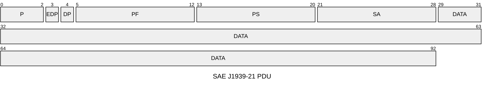
- Ρ为优先权，从最高0设置到最低7。
- EDP为扩展数据页，预留后期扩展使用，本文件中为0。
- DP为数据页，用来选择参数组描述的辅助页，本文件中为0。
- PF为PDU格式消息类型，用来确定PDU的格式，以及数据域对应的消息类型。
- PS为 PDU特定格式，PS值取决于PDU格式，本文件中采用PDU1格式，PS值为目标地址。SA为源地址，数据帧的源地址。
- DATA 为数据域。
#### 地址分配

| 设备                  | 地址          |
| ------------------- | ----------- |
| [[B类系统#SECC\|SECC]] | $86(56_H)$  |
| [[B类系统#EVCC\|EVCC]] | $244(F4_H)$ |


### A类系统报文代号一览表
##### 充电握手阶段

| 报文代号                          | 报文名称    | 数据长度 | 报文周期 | 源-目的地址     | 真实CANid      |
| ----------------------------- | ------- | ---- | ---- | ---------- | ------------ |
| [[A类系统#CHM(0x1826F456)\|CHM]] | 充电机握手报文 | 3    | 250  | SECC->EVCC | `0x1826F456` |
| [[A类系统#BHM(0x182756F4)\|BHM]] | 车辆握手报文  | 2    | 250  | EVCC->SECC | `0x182756F4` |
| [[A类系统#CRM(0x1801F456)\|CRM]] | 充电机辨识报文 | 8    | 250  | SECC->EVCC | `0x1801F456` |
| [[A类系统#BRM(0x1C0256F4)\|BRM]] | 车辆辨识报文  | 49   | 250  | EVCC->SECC | `0x1C0256F4` |

---
##### 充电参数配置阶段

| 报文代号                          | 报文名称          | 数据长度 | 报文周期 | 源-目的地址     | 真实CANid      |
| ----------------------------- | ------------- | ---- | ---- | ---------- | ------------ |
| [[A类系统#BCP(0x1C0656F4)\|BCP]] | 车辆充电参数报文      | 13   | 500  | EVCC->SECC | `0x1C0656F4` |
| [[A类系统#CTS(0x1807F456)\|CTS]] | 充电机发送时间同步信息报文 | 7    | 500  | SECC->EVCC | `0x1807F456` |
| [[A类系统#CML(0x1808F456)\|CML]] | 充电机最大输出能力报文   | 8    | 250  | SECC->EVCC | `0x1808F456` |
| [[A类系统#BRO(0x100956F4)\|BRO]] | 车辆充电准备就绪状态报文  | 1    | 250  | EVCC->SECC | `0x100956F4` |
| [[A类系统#CRO(0x100AF456)\|CRO]] | 充电机输出准备就绪状态报文 | 1    | 250  | SECC->EVCC | `0x100AF456` |

---
##### 充电阶段

| 报文代号                          | 报文名称      | 数据长度 | 报文周期   | 源-目的地址     | 真实CANid      |
| ----------------------------- | --------- | ---- | ------ | ---------- | ------------ |
| [[A类系统#BCL(0x181056F4)\|BCL]] | 电池充电需求报文  | 5    | 50     | EVCC->SECC | `0x181056F4` |
| [[A类系统#BCS(0x1C1156F4)\|BCS]] | 电池充电总状态报文 | 9    | 250    | EVCC->SECC | `0x1C1156F4` |
| [[A类系统#CCS(0x1812F456)\|CCS]] | 充电机充电状态报文 | 7    | 50     | SECC->EVCC | `0x1812F456` |
| [[A类系统#BSM(0x181356F4)\|BSM]] | 车辆状态信息报文  | 7    | 250    | EVCC->SECC | `0x181356F4` |
| [[A类系统#BMV(0x1C1556F4)\|BMV]] | 单体蓄电池电压报文 | -    | 10,000 | EVCC->SECC | `0x1C1556F4` |
| [[A类系统#BMT(0x1C1656F4)\|BMT]] | 动力蓄电池温度报文 | -    | 10,000 | EVCC->SECC | `0x1C1656F4` |
| [[A类系统#BSP(0x1C1756F4)\|BSP]] | 动力蓄电池预留报文 | -    | 10,000 | EVCC->SECC | `0x1C1756F4` |
| [[A类系统#BST(0x101956F4)\|BST]] | 车辆中止充电报文  | 4    | 10     | EVCC->SECC | `0x101956F4` |
| [[A类系统#CST(0x101AF456)\|CST]] | 充电机中止充电报文 | 4    | 10     | SECC->EVCC | `0x101AF456` |

---
##### 充电结束阶段

| 报文代号                          | 报文名称      | 数据长度 | 报文周期 | 源-目的地址     | 真实CANid      |
| ----------------------------- | --------- | ---- | ---- | ---------- | ------------ |
| [[A类系统#BSD(0x181C56F4)\|BSD]] | 车辆统计数据报文  | 7    | 250  | EVCC->SECC | `0x181C56F4` |
| [[A类系统#CSD(0x181DF456)\|CSD]] | 充电机统计数据报文 | 8    | 250  | SECC->EVCC | `0x181DF456` |
##### 错误报文

| 报文代号                          | 报文名称    | 数据长度 | 报文周期 | 源-目的地址     | 真实CANid      |
| ----------------------------- | ------- | ---- | ---- | ---------- | ------------ |
| [[A类系统#BEM(0x081E56F4)\|BEM]] | 车辆错误报文  | 4    | 250  | EVCC->SECC | `0x081E56F4` |
| [[A类系统#CEM(0x081FF456)\|CEM]] | 充电机错误报文 | 4    | 250  | SECC->EVCC | `0x081FF456` |

---
### 报文格式
##### CHM(0x1826F456)
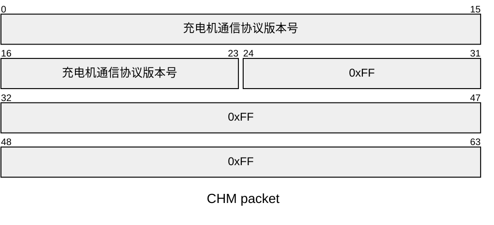

| 起始位偏移 | 长度    | 定义                                                          | 必须  |
| ----- | ----- | ----------------------------------------------------------- | --- |
| 0     | 3Byte | 充电机通信协议版本号，本文件规定当前版本为V1.1，表示为:byte3—00H;byte2—01H;byte1—01H | 是   |
##### BHM(0x182756F4)
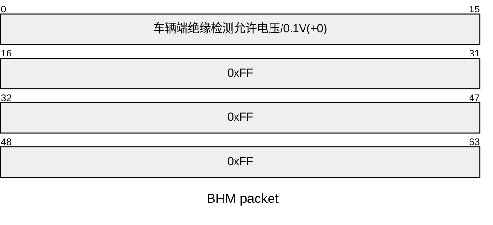

| 起始位偏移 | 长度    | 定义                                   | 必须  |
| ----- | ----- | ------------------------------------ | --- |
| 0     | 2Byte | 车辆端绝缘监测允许总电压(V)：数据分辨率：0.1 V/位，0 V偏移量 | 是   |

##### CRM(0x1801F456)
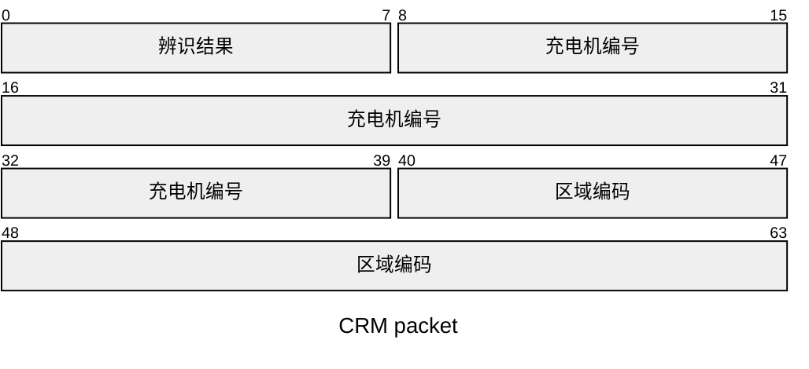

| 起始位偏移 | 长度    | 定义                                              | 必须  |
| ----- | ----- | ----------------------------------------------- | --- |
| 0     | 1Byte | 辨识结果(<0x00>:未辨识 BMS 及车辆信息；<0xAA>：已辨识 BMS 及车辆信息） | 是   |
| 8     | 4Byte | 充电机编号，1/位，0偏移量，数据范围：0～0xFFFFFFFF                | 是   |
| 40    | 3Byte | 充电机/充电站所在区域编码(由数字和大小写字母组成)，标准 ASCII码            | -   |

##### BRM(0x1C0256F4)
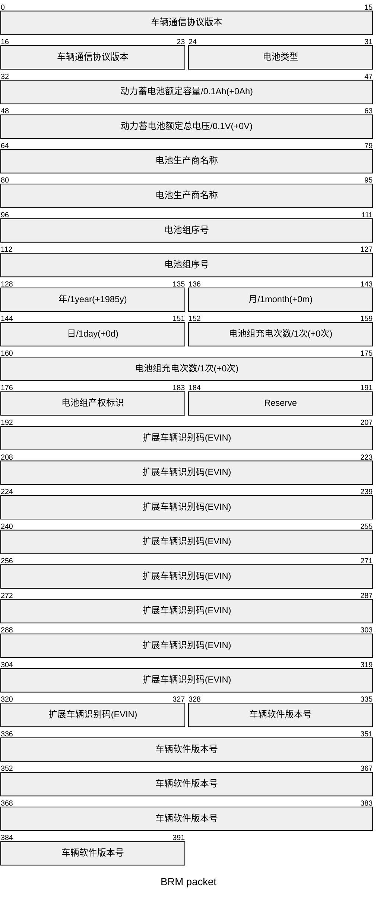

| 起始位偏移 | 长度     | 定义                                                                                                                                                                                                                                                                                                                                                                                        | 必须  |
| ----- | ------ | ----------------------------------------------------------------------------------------------------------------------------------------------------------------------------------------------------------------------------------------------------------------------------------------------------------------------------------------------------------------------------------------- | --- |
| 0     | 3Byte  | 车辆通信协议版本号，本文件规定当前版本为V1.10,表示为：byte1—0x01,byte2—0x01,byte3—0x00                                                                                                                                                                                                                                                                                                                            | 是   |
| 24    | 1Byte  | 电池类型，<br>01H：铅酸电池；<br>02H：镍氢电池；<br>03H：磷酸铁锂电池;<br>04H：锰酸锂电池；<br>05H：钴酸锂电池；<br>06H：三元材料电池；<br>07H：聚合物锂离子电池；<br>08H：钛酸锂电池；<br>FFH:其他电池                                                                                                                                                                                                                                                      | 是   |
| 32    | 2Byte  | 动力蓄电池系统额定容量/Ah,0.1 Ah/位，0 Ah 偏移量                                                                                                                                                                                                                                                                                                                                                          | 是   |
| 48    | 2Byte  | 动力蓄电池系统额定总电压/V,0.1 V/位，0 V偏移量                                                                                                                                                                                                                                                                                                                                                             | 是   |
| 64    | 4Byte  | 电池生产厂商名称，标准ASCII码                                                                                                                                                                                                                                                                                                                                                                         | -   |
| 96    | 4Byte  | 电池组序号，预留，由厂商自行定义                                                                                                                                                                                                                                                                                                                                                                          | -   |
| 128   | 1Byte  | 电池组生产日期：年，1年/位，1985年偏移量，数据范出：1985年—2235年                                                                                                                                                                                                                                                                                                                                                  | -   |
| 136   | 1Byte  | 电池组生产日期：月，1月/位，0月偏移量，数据范围：1～12 月                                                                                                                                                                                                                                                                                                                                                          | -   |
| 144   | 1Byte  | 电池组生产日期：日，1日/位，0日偏移量，数据范围：1～31 日                                                                                                                                                                                                                                                                                                                                                          | -   |
| 152   | 3Byte  | 电池组充电次数，1次/位，0次偏移量，以BMS统计为准                                                                                                                                                                                                                                                                                                                                                               | -   |
| 176   | 1Byte  | 电池组产权标识(<0>：=租赁；<1>：=车自有)                                                                                                                                                                                                                                                                                                                                                                 | -   |
| 184   | 1Byte  | 预留                                                                                                                                                                                                                                                                                                                                                                                        | -   |
| 192   | 17Byte | 扩展车辆识别码(EVIN)                                                                                                                                                                                                                                                                                                                                                                             | -   |
| 328   | 8Byte  | 车辆通信协议软件版本号，8字节，表示当前车辆版本信息，按照16进制编码确定。其中：<br>byte8、byte7、byte6—000001H～FFFFFEH，预留，填FFFFFFH;<br>byte5～byte2作为车辆软件版本编译时间信息标记，<br>byte5，byte4—0001H～FFFEH 表示“年”(例如 2015年：填写 byte5—DFH，byte4—07H) 大端存储;<br>byte3—01H～0CH表示“月”(例如 11月：填写 byte3 0BH) ;<br>byte2—01H～1FH 表示“日”(例如 10日：填写 byte2 0AH) ;<br>bytel—01H～FEH表示版本流水号（例如 16:填写byte1—10H).<br>（如上数值表示：车辆当前使用2015年11月10日第16次编译版本，未填写认证授权码) | -   |

##### BCP(0x1C0656F4)
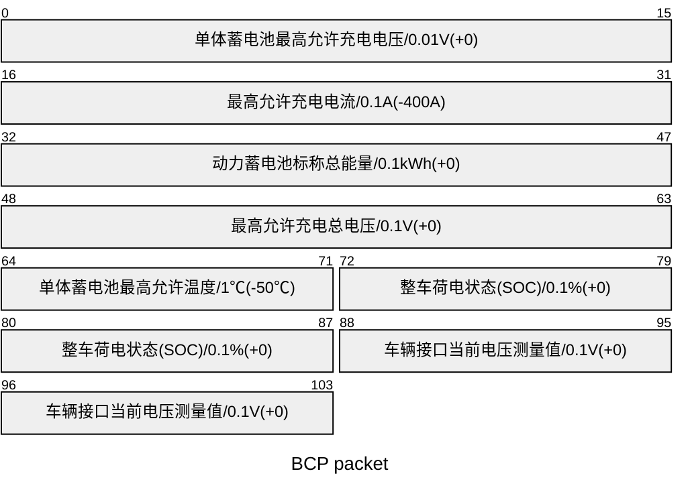

| 起始位偏移 | 长度    | 定义                                                                 | 必须  |
| ----- | ----- | ------------------------------------------------------------------ | --- |
| 0     | 2Byte | 单体蓄电池最高允许充电电压(V)<br>数据分辨率：0.01 V/位,0 V 偏移量；数据范围：0 V~24 V;          | 是   |
| 16    | 2Byte | 最高允许充电电流(A)<br>数据分辨率：0.1 A/位，-400 A 偏移量；                           | 是   |
| 32    | 2Byte | 动力蓄电池标称总能量(kWh)<br>数据分辨率：0.1 kWh/位,0 kWh 偏移量;数据范围：0 kWh~1 000 kWh; | 是   |
| 48    | 2Byte | 最高允许充电总电压(V)<br>数据分辨率：0.1 V/位,0 V 偏移量；                             | 是   |
| 64    | 1Byte | 单体蓄电池最高允许温度(℃)<br>数据分辨率：1℃/位，-50℃偏移量；数据范围-50℃~+200℃；               | 是   |
| 72    | 2Byte | 整车荷电状态(SOC)<br>数据分辨率：0.1%/位，0%偏移量；数据范围：0~100%；                     | 是   |
| 88    | 2Byte | 车辆接口当前电压测量值(V)<br>数据分辨率：0.1 V/位,0 V偏移量。                            | 是   |

##### CTS(0x1807F456)
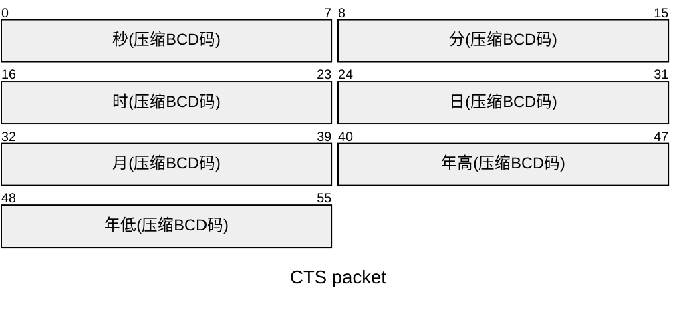
> 年/月/日/时/分/秒,如 2019 年 10 月 11 日 15 时 20 分13秒表示为：byte7-19H, byte6-20H，byte5-10H, byte4-11H, byte3-15H, byte2-20H, byte1-13H (可选)

##### CML(0x1808F456)
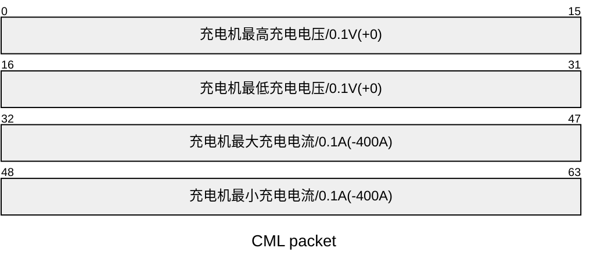

| 起始位偏移 | 长度    | 定义          | 必须  |
| ----- | ----- | ----------- | --- |
| 0     | 2Byte | 充电机最高充电电压/V | 是   |
| 16    | 2Byte | 充电机最低充电电压/V | 是   |
| 32    | 2Byte | 充电机最大充电电流/A | 是   |
| 48    | 2Byte | 充电机最小充电电流/A | 是   |
##### BRO(0x100956F4)

> 车辆是否充电准备好(<0x00 >：=车辆未做好充电准备）;<0xAA>：=车辆完成充电准备；<0xFF>：=无效)(车辆在不能获知当前准备就绪状态时，为了保证通信信道正常，可发送无效值)
##### CRO(0x100AF456)

> 充电机是否充电准备好(<0x00>：=充电机未完成充电准备；<0xAA>：=充电机完成充电准备；<0xFF>：=无效）（充电机在不能获知当前准备就绪状态时，为了保证通信信道正常，可发送无效值)
##### BCL(0x181056F4)
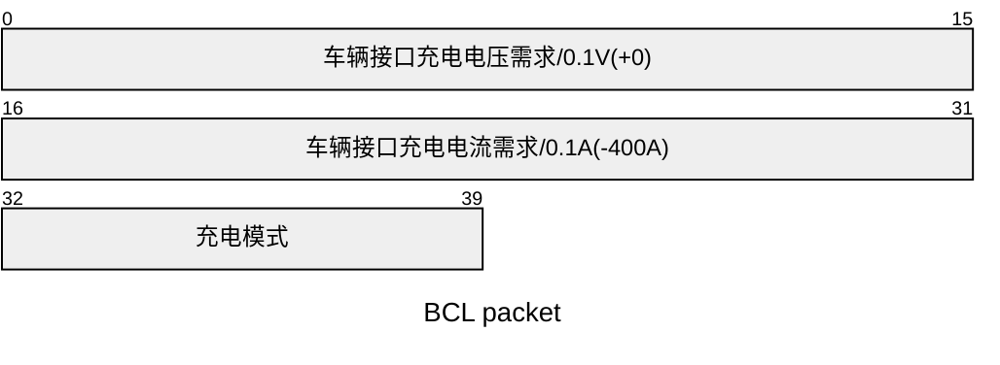

| 起始位偏移 | 长度    | 定义                                | 必须  |
| ----- | ----- | --------------------------------- | --- |
| 0     | 2Byte | 车辆接口充电电压需求/V                      | 是   |
| 16    | 2Byte | 车辆接口充电电流需求/A,即输入至车辆充电插座的车辆充电电流总需求 | 是   |
| 32    | 1Byte | 充电模式(0x01：恒压充电；0x02：恒流充电）         | 是   |
##### BCS(0x1C1156F4)
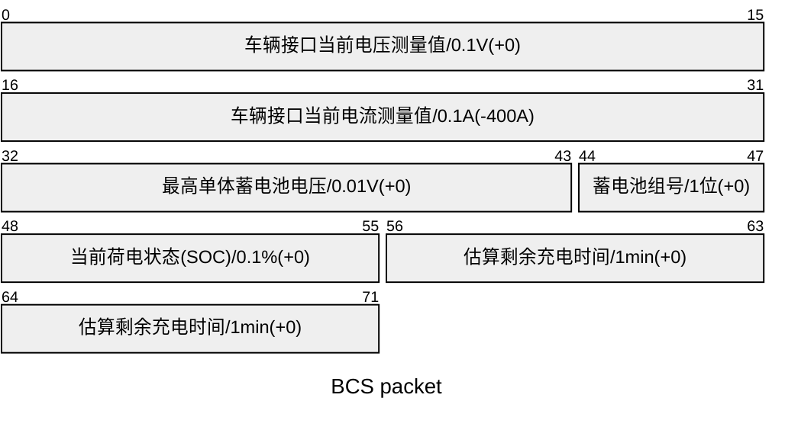

| 起始位偏移 | 长度    | 定义                                                                                                                          | 必须  |
| ----- | ----- | --------------------------------------------------------------------------------------------------------------------------- | --- |
| 0     | 2Byte | 车辆接口当前电压测量值(V)<br>数据分辨率：0.1 V/位，0 V 偏移量；                                                                                    | 是   |
| 16    | 2Byte | 车辆接口当前电流测量值(A)<br>数据分辨率：0.1 A/位，—400 A 偏移量                                                                                  | 是   |
| 32    | 2Byte | 最高单体蓄电池电压及其组号<br>1 位～12 位：最高单体蓄电池电压，数据分辨率：0.01 V/位，0 V偏移量;数据范围：0 V～24 V;<br>13位～16位：最高单体蓄电池电压所在组号，数据分辨率：1/位，0偏移量；数据范围：0～15； | 是   |
| 48    | 1Byte | 当前荷电状态 SOC<br>数据分辨率：1%/位，0%偏移量；数据范围：0~100%；                                                                                 | 是   |
| 56    | 2Byte | 估算剩余充电时间(min)<br>数据分辨率：1 min/位,0 min 偏移量                                                                                    | 是   |
##### CCS(0x1812F456)
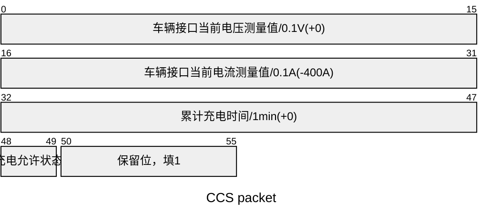

| 起始位偏移 | 长度    | 定义                                         | 必须  |
| ----- | ----- | ------------------------------------------ | --- |
| 0     | 2Byte | 车辆接口当前电压测量值(V)<br>数据分辨率：0.1 V/位，0 V 偏移量；   | 是   |
| 16    | 2Byte | 车辆接口当前电流测量值(A)<br>数据分辨率：0.1 A/位，—400 A 偏移量 | 是   |
| 32    | 2Byte | 累计充电时间(min)<br>数据分辨率：1 min/位,0 min 偏移量     | 是   |
| 48    | 2bit  | 充电允许(<00>：=暂停；<01>：=允许)；                   | 是   |
| 50    | 6bit  | 保留位，填 1                                            | -   |
##### BSM(0x181356F4)
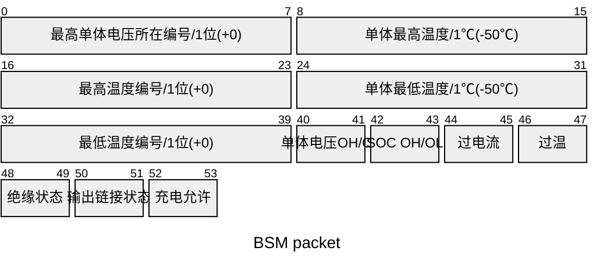

| 起始位偏移 | 长度    | 定义                                                  | 必须  |
| ----- | ----- | --------------------------------------------------- | --- |
| 0     | 1Byte | 最高单体蓄电池电压所在编号<br>数据分辨率：1/位，1偏移量；数据范围：1～256；         | 是   |
| 8     | 1Byte | 最高动力蓄电池温度(℃)<br>数据分辨率：1℃/位，-50℃偏移量；数据范围：-50℃～+200℃； | 是   |
| 16    | 1Byte | 最高温度检测点编号<br>数据分辨率：1/位，1偏移量；数据范围：1～128              | 是   |
| 24    | 1Byte | 最低动力蓄电池温度(℃)<br>数据分辨率：1℃/位，-50℃偏移量；数据范围：-50℃～+200℃  | 是   |
| 32    | 1Byte | 最低温度检测点编号<br>数据分辨率：1/位，1偏移量；数据范围：1～128              | 是   |
| 40    | 2bit  | 单体蓄电池电压过高/过低(<00>：=正常；<01>：=过高；<10>：=过低)            | 是   |
| 42    | 2bit  | 动力蓄电池荷电状态 SOC 过高/过低(<00>：=正常;<01>:=过高;<10>:=过低)     | 是   |
| 44    | 2bit  | 动力蓄电池充电过电流(<00>：=正常；<01>：=过流；<10>：=不可信状态）           | 是   |
| 46    | 2bit  | 动力蓄电池温度过高(<00>：=正常；<01>：=过高；<10>：=不可信状态）            | 是   |
| 48    | 2bit  | 动力蓄电池绝缘状态(<00>：=正常；<01>：=不正常；<10>：=不可信状态）           | 是   |
| 50    | 2bit  | 动力蓄电池组输出连接器连接状态(<00>：=正常；<01>:=不正常；<10>:=不可信状态)     | 是   |
| 52    | 2bit  | 充电允许(<00>:=禁止;<01>:=允许)                             | 是   |

##### BMV(0x1C1556F4)
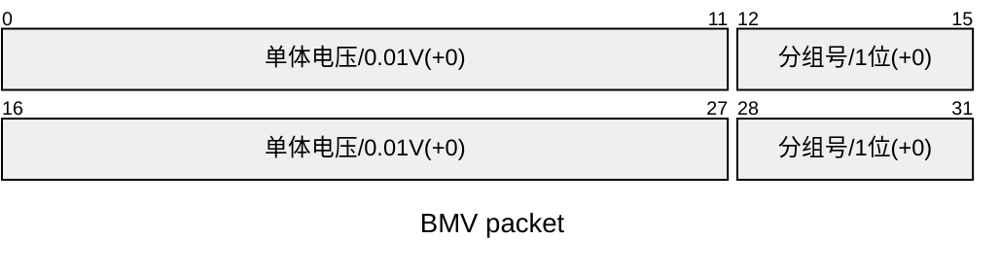
> 单体蓄电池电压(V)：1 位～12 位：单体蓄电池电压，数据分辨率：0.01 V/位，0 V 偏移量；数据范围：0 V~24 V；13位～16位：电池分组号，数据分辨率：1/位，0偏移量；数据范围：0～15。
##### BMT(0x1C1656F4)
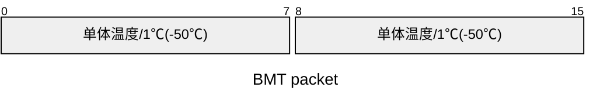
> 动力蓄电池温度(℃)：数据分辨率：1℃/位，—50℃偏移量；数据范围：—50℃～+200℃。
##### BSP(0x1C1756F4)

##### BST(0x101956F4)
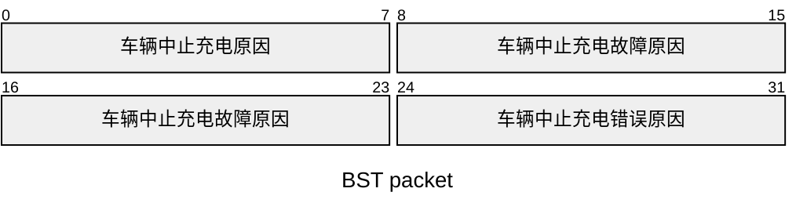
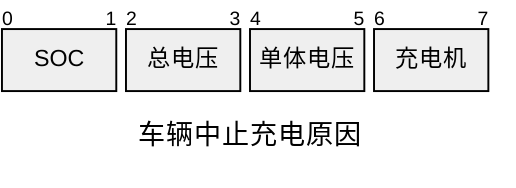
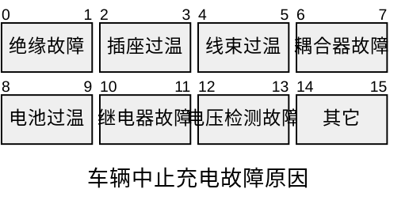
```mermaid
---
config:
    packet:
        bitsPerRow: 8
---
packet
title 车辆中止充电错误原因
+2: "电流过大"
+2: "电压异常"
+2: "充电参数不匹配"

```

| 起始位偏移 | 长度    | 定义                                                                                                                                                                                                                                                                                                                                                                                                                                                                                                                                                                      | 必须  |
| ----- | ----- | ----------------------------------------------------------------------------------------------------------------------------------------------------------------------------------------------------------------------------------------------------------------------------------------------------------------------------------------------------------------------------------------------------------------------------------------------------------------------------------------------------------------------------------------------------------------------- | --- |
| 0     | 1Byte | 车辆中止充电原因：<br>第1～2位：**达到所需求的 SOC目标值**<br><00>：=未达到所需SOC目标值；<br><01>：=达到所需SOC目标值；<br><10>：=不可信状态；<br>第3～4位：**达到总电压的设定值**<br><00>：=未达到总电压设定值；<br><01>：=达到总电压设定值；<br><10>：=不可信状态；<br>第5～6位：**达到单体电压的设定值**<br><00>：=未达到单体电压设定值；<br><01>：=达到单体电压设定值；<br><10>：=不可信状态；<br>第7～8位：**充电机主动中止**<br><00>：=正常;<br><01>：=充电机中止(接收CST 帧);<br><10>：=不可信状态。                                                                                                                                                                                                                               | 是   |
| 8     | 2Byte | 车辆中止充电故障原因：<br>第1～2位：**绝缘故障**<br><00>：=正常;<br><01>：=故障;<br><10>：=不可信状态；<br>第3～4位：**车辆插座过温故障**<br><00>：=正常;<br><01>：=故障；<br><10>：=不可信状态；<br>第5～6位：**车辆内部线束或相关连接器过温**<br><00>：=正常;<br><01>：=故障;<br><10>：=不可信状态；<br>第7～8位：**充电耦合器连接故障**<br><00>：=充电连接器正常；<br><01>：=充电连接器故障；<br><10>：=不可信状态；<br>第9～10位：**电池组温度过高故障**<br><00>：=电池组温度正常；<br><01>：=电池组温度过高；<br><10>：=不可信状态；<br>第11~12位：**高压继电器故障**<br><00>:=正常;<br><01>:=故障;<br><10>:=不可信状态；<br>第13~14位：**检测点2电压检测故障**<br><00>:=正常;<br><01>:=故障;<br><10>:=不可信状态；<br>第15~16位：**其他原因**<br><00>:=正常;<br><01>:=故障;<br><10>：=不可信状态。 | 是   |
| 24    | 1Byte | 车辆中止充电错误原因：<br>第1～2位：**电流过大**<br><00>：=电流正常；<br><01>：=电流超过需求值；<br><10>：=不可信状态；<br>第3～4位：**电压异常**<br><00>：=正常;<br><01>：=电压异常;<br><10>：=不可信状态；<br>第5～6位：**充电参数不匹配**<br><00>：=参数匹配；<br><01>：=参数不匹配；<br><10>：=不可信状态。                                                                                                                                                                                                                                                                                                                                                        | 是   |

##### CST(0x101AF456)
```mermaid
---
config:
    packet:
        bitsPerRow: 16
---
packet
title CST packet
+8: "充电机中止充电原因"
+16: "充电机中止充电故障原因"
+8: "充电机中止充电错误原因"
```

| 起始位偏移 | 长度    | 定义                                                                                                                                                                                                                                                                                                                                                                                                                                                                                                                                                                                                                           | 必须  |
| ----- | ----- | ---------------------------------------------------------------------------------------------------------------------------------------------------------------------------------------------------------------------------------------------------------------------------------------------------------------------------------------------------------------------------------------------------------------------------------------------------------------------------------------------------------------------------------------------------------------------------------------------------------------------------- | --- |
| 0     | 1Byte | 充电机中止充电原因：<br>第1～2位：**达到充电机设定的条件中止**(包括充电机在充电前预先设置的结束充电条件，如按金额充电、按时间充电，按SOC充电等）<br><00>：=正常；<br><01>：=达到充电机设定条件中止；<br><10>：=不可信状态；<br>第3～4位：**人工中止**(包括通信开始后由用户触发的主动中止充电)<br><00>:=正常;<br><01>：=人工中止;<br><10>：=不可信状态；<br>第5～6位：**故障中止**(包括通信开始后各类非正常中止)<br><00>:=正常;<br><01>:=故障中止;<br><10>：=不可信状态；<br>第7～8位：**车辆主动中止**(包括接收车辆的BST报文)<br><00>:=正常;<br><01>：=车辆中止;<br><10>：=不可信状态。<br>***CST报文中的充电机中止充电原因不允许出现两个及以上。***                                                                                                                                                                                                       | 是   |
| 8     | 2Byte | 充电机中止充电故障原因：<br>第1～2位：**充电机过温故障**<br><00>：=充电机温度正常；<br><01>：=充电机过温；<br><10>：=不可信状态；<br>第3～4位：**充电连接器故障**<br><00>：=充电连接器正常；<br><01>：=充电连接器故障；<br><10>：=不可信状态；<br>第5～6位：**充电机内部过温故障**<br><00>：=充电机内部温度正常；<br><01>：=充电机内部过温；<br><10>：=不可信状态；<br>第7～8位：**所需电量不能传送**<br><00：=电量传送正常；<br><01>：电量不能传送；<br><10>：=不可信状态；<br>第9～10位：**充电机急停故障**<br><00>:=正常;<br><01>:=充电机急停;<br><10>:=不可信状态；<br>第11~12位：**其他故障**<br><00>：=正常;<br><01>：=故障；<br><10>：=不可信状态。<br>第13~14位：**自检故障**(包括绝缘检测、短路测试、粘连检测等自检过程中出现的故障)<br><00>:=正常;<br><01>:=故障;<br><10>:=不可信状态。<br>第15~16位：**预充故障**(包括预充电压不匹配，预充失败等故障)<br><00>:=正常;<br><01>:=故障;<br><10>：=不可信状态。 | 是   |
| 24    | 1Byte | 充电机中止充电错误原因：<br>第1～2位：**电流不匹配**<br><00>：=电流匹配;<br><01>：=电流不匹配;<br><10>：=不可信状态；<br>第3～4位：**电压异常**<br><00>：=正常;<br><01>：=电压异常;<br><10>：=不可信状态；<br>第5～6位：**充电参数不匹配**<br><00>：=参数匹配；<br><01>：=参数不匹配；<br><10>：=不可信状态。                                                                                                                                                                                                                                                                                                                                                                                                             | 是   |
##### BSD(0x181C56F4)
```mermaid
---
config:
    packet:
        bitsPerRow: 16
---
packet
title BSD packet
+8: "中止电荷状态(SOC)/1%(+0)"
+16: "单体最低电压/0.01V(+0)"
+16: "单体最高电压/0.01V(+0)"
+8: "单体最低温度/1℃(-50℃)"
+8: "单体最高温度/1℃(-50℃)"
```

| 起始位偏移 | 长度    | 定义                                                      | 必须  |
| ----- | ----- | ------------------------------------------------------- | --- |
| 0     | 1Byte | 中止荷电状态 SOC<br>数据分辨率：1%/位,0%偏移量；数据范围：0%~100%；            | 是   |
| 8     | 2Byte | 单体蓄电池单体最低电压(V)<br>数据分辨率：0.01 V/位,0 V 偏移量;数据范围：0 V~24 V; | 是   |
| 24    | 2Byte | 单体蓄电池单体最高电压(V)<br>数据分辨率：0.01 V/位,0 V 偏移量;数据范围：0 V~24 V; | 是   |
| 40    | 1Byte | 动力蓄电池最低温度(℃)<br>数据分辨率：1℃/位，-50℃偏移量；数据范围：-50℃~+200℃；     | 是   |
| 48    | 1Byte | 动力蓄电池最高温度(℃)<br>数据分辨率：1℃/位，-50℃偏移量；数据范围：-50℃~+200℃；     | 是   |
##### CSD(0x181DF456)
```mermaid
---
config:
    packet:
        bitsPerRow: 16
---
packet
title CSD packet
+16: "本次充电时间/1min(+0)"
+16: "输出能量/0.1kWh(+0)"
+32: "充电机编号/1位"
```

| 起始位偏移 | 长度    | 定义                                                          | 必须  |
| ----- | ----- | ----------------------------------------------------------- | --- |
| 0     | 2Byte | 累计充电时间(min)<br>数据分辨率:1 min/位，0 min 偏移量;数据范围:0 min~600 min;  | 是   |
| 16    | 2Byte | 输出能量(kWh)<br>数据分辨率：0.1 kWh/位,0 kWh 偏移量;数据范围:0 kWh~1 000 kWh | 是   |
| 32    | 4Byte | 充电机编号，1/位，1偏移量，数据范围：0～0xFFFFFFFF                            | 是   |
##### BEM(0x081E56F4)
```mermaid
---
config:
    packet:
        bitsPerRow: 8
---
packet
title BEM packet
+2: "CRM(0x00) 超时"
+2: "CRM(0xAA) 超时"
+4: "预留位"
+2: "CML/CTS 超时"
+2: "CRO 超时"
+4: "预留位"
+2: "CCS 超时"
+2: "CST 超时"
+4: "预留位"
+2: "CSD 超时"
+6: "预留位"
```
> <00>:=正常;
> <01>:=超时;
> <10>:=不可信状态。
##### CEM(0x081FF456)
```mermaid
---
config:
    packet:
        bitsPerRow: 8
---
packet
title CEM packet
+2: "BRM 超时"
+6: "预留位"
+2: "BCP 超时"
+2: "BRO 超时"
+4: "预留位"
+2: "BCS 超时"
+2: "BCL 超时"
+2: "BST 超时"
+2: "预留位"
+2: "BSD 超时"
+2: "BSM 超时"
+4: "预留位"
```

> <00>:=正常;
> <01>:=超时;
> <10>:=不可信状态。

### 报文开始-终止发送条件
#### 报文开始条件和中止条件表

| 报文代号                                                                                                                                      | 报文开始发送条件                                                                                               | 报文中止发送条件                                                                                           |
| ----------------------------------------------------------------------------------------------------------------------------------------- | ------------------------------------------------------------------------------------------------------ | -------------------------------------------------------------------------------------------------- |
| [[A类系统#CHM(0x1826F456)\|CHM]]                                                                                                             | 低压辅助供电回路闭合                                                                                             | 充电机自检完成准备发送[[A类系统#CRM(0x1801F456)\|CRM]]                                                           |
| [[A类系统#BHM(0x182756F4)\|BHM]]                                                                                                             | 接收[[A类系统#CHM(0x1826F456)\|CHM]]报文                                                                      | 接收[[A类系统#CRM(0x1801F456)\|CRM(SPN2560(辨识结果)=0x00)]]报文                                              |
| [[A类系统#CRM(0x1801F456)\|CRM]]                                                                                                             | 自检完成                                                                                                   | 接收[[A类系统#BCP(0x1C0656F4)\|BCP]]报文                                                                  |
| [[A类系统#BRM(0x1C0256F4)\|BRM]]                                                                                                             | 接收[[A类系统#CRM(0x1801F456)\|CRM]]报文                                                                      | 接收[[A类系统#CRM(0x1801F456)\|CRM(SPN2560(辨识结果)=0xAA)]]报文                                              |
| [[A类系统#BCP(0x1C0656F4)\|BCP]]                                                                                                             | 接收[[A类系统#CRM(0x1801F456)\|CRM(SPN2560(辨识结果)=0xAA)]]报文                                                  | 接收[[A类系统#CML(0x1808F456)\|CML]]报文[^1]                                                              |
| [[A类系统#BRO(0x100956F4)\|BRO]]                                                                                                             | 接收[[A类系统#CML(0x1808F456)\|CML]]报文                                                                      | 发送[[A类系统#BRO(0x100956F4)\|BRO(SPN2829=0xAA)]]报文且接收[[A类系统#CRO(0x100AF456)\|CRO(SPN2830=0xAA)]]报文    |
| [[A类系统#CTS(0x1807F456)\|CTS(可选)]] \ [[A类系统#CML(0x1808F456)\|CML]]                                                                         | 接收[[A类系统#BCP(0x1C0656F4)\|BCP]]报文                                                                      | 接收[[A类系统#BRO(0x100956F4)\|BRO(SPN2829=0xAA)]]报文                                                    |
| [[A类系统#CRO(0x100AF456)\|CRO]]                                                                                                             | 接收[[A类系统#BRO(0x100956F4)\|BRO(SPN2829=0xAA)]]报文                                                        | 接收[[A类系统#BCL(0x181056F4)\|BCL]]和[[A类系统#BCS(0x1C1156F4)\|BCS]]报文                                    |
| [[A类系统#BCL(0x181056F4)\|BCL]] \ [[A类系统#BCS(0x1C1156F4)\|BCS]]                                                                             | 接收[[A类系统#CRO(0x100AF456)\|CRO(SPN2830=0xAA)]]报文                                                        | 接收[[A类系统#CST(0x101AF456)\|CST]]报文(充电机主动中止充电)或<br>发送[[A类系统#BST(0x101956F4)\|BST]]报文(车辆主动中止充电)       |
| [[A类系统#CCS(0x1812F456)\|CCS]]                                                                                                             | 接收[[A类系统#BCL(0x181056F4)\|BCL]]报文                                                                      | 接收[[A类系统#BST(0x101956F4)\|BST]]报文(车辆主动中止充电)或<br>发送[[A类系统#CST(0x101AF456)\|CST]]报文(充电机主动中止充电)       |
| [[A类系统#BSM(0x181356F4)\|BSM]] \ [[A类系统#BMV(0x1C1556F4)\|BMV(可选)]] \ [[A类系统#BMT(0x1C1656F4)\|BMT(可选)]] \ [[A类系统#BSP(0x1C1756F4)\|BSP(可选)]] | 接收[[A类系统#CCS(0x1812F456)\|CCS]]报文                                                                      | 接收[[A类系统#CST(0x101AF456)\|CST]]报文(充电机主动中止充电)或<br>发送[[A类系统#BST(0x101956F4)\|BST]]报文(车辆主动中止充电)       |
| [[A类系统#BST(0x101956F4)\|BST]]                                                                                                             | 1) 车辆满足结束充电条件(车辆主动中止充电)<br>2) 接收[[A类系统#CST(0x101AF456)\|CST]]报文(充电机主动中止充电)                             | 接收[[A类系统#CST(0x101AF456)\|CST]]报文(充电机主动中止充电)或<br>发送5～10包[[A类系统#BST(0x101956F4)\|BST]]报文后(充电机主动中止充电) |
| [[A类系统#CST(0x101AF456)\|CST]]                                                                                                             | 1) 充电机满足结束充电条件(充电机主动中止充电)<br>2) 接收[[A类系统#BST(0x101956F4)\|BST]]报文(车辆主动中止充电)                            | 接收[[A类系统#BSD(0x181C56F4)\|BSD]]报文                                                                  |
| [[A类系统#BSD(0x181C56F4)\|BSD]]                                                                                                             | 1) 车辆主动中止后接收[[A类系统#CST(0x101AF456)\|CST]]并停止发送[[A类系统#BST(0x101956F4)\|BST]]<br>2) 充电机主动中止后，车辆发送5～10帧[[A类系统#BST(0x101956F4)\|BST]]后 | 接收[[A类系统#CSD(0x181DF456)\|CSD]]报文                                                                  |
| [[A类系统#CSD(0x181DF456)\|CSD]]                                                                                                             | 接收[[A类系统#BSD(0x181C56F4)\|BSD]]报文                                                                      | 关闭辅助电源                                                                                             |
| [[A类系统#BEM(0x081E56F4)\|BEM]]                                                                                                             | 当车辆接收充电机报文超时                                                                                           | 完成通信超时处理                                                                                           |
| [[A类系统#CEM(0x081FF456)\|CEM]]                                                                                                             | 当充电机接收车辆报文超时                                                                                           | 完成通信超时处理                                                                                           |

[^1]:车辆接收到[[A类系统#CML(0x1808F456)|CML]]报文 , 如需要更新[[A类系统#BCP(0x1C0656F4)|BCP]]报文参数 , 宜至少再发送2帧更新参数后的BCP报文后发送[[A类系统#BRO(0x100956F4)|BRO(SPN2829=0x00)]]报文

#### 报文生命周期

```mermaid
sequenceDiagram
    participant HardWareCondition
    
    rect rgb(191, 223, 255)
	    create participant CHM@{"type" : "control"}
	    HardWareCondition ->> CHM :低压辅助供电回路闭合
	    
	    note left of CHM :充电握手阶段
	    rect rgb(151,240,255)
		    note right of CHM :充电握手启动阶段
		    
		    create participant BHM@{"type":"control"}
		    CHM ->> BHM :接收CHM
		
			par CHM suspended by 充电机自检完成
			    destroy CHM
			    HardWareCondition -x CHM :充电机自检完成
		    and CRM started by 充电机自检完成
				create participant CRM@{"type":"control"}
			    HardWareCondition ->> CRM :充电机自检完成
		    end
		    
			destroy BHM
			CRM -x BHM :CRM(SPN2560=0x00)
	    end
	    
	    rect rgb(164,183,255)
		    note right of CRM :充电握手辨识阶段
		    
		    create participant BRM@{"type":"control"}
		    CRM ->> BRM :接收CRM
		    
		    HardWareCondition ->> CRM :辨识成功
		    
		    par BRM suspended by CRM
			    destroy BRM
			    CRM -x BRM :CRM(SPN2560=0xAA)
		    and BCP started by CRM
			    create participant BCP@{"type":"control"}
			    CRM ->> BCP :CRM(SPN2560=0xAA)
		    end
	    end
    end
    
    rect rgb(196,141,255)
	    note right of BCP :充电参数配置阶段
		par CML started by BCP 
		    create participant CML@{"type":"control"}
			BCP ->> CML :接收BCP
		and CTS started by BCP
		    create participant CTS@{"type":"control","alias":"CTS(可选)"}
		    BCP ->> CTS :接收BCP
		and CRM suspended by BCP
			destroy CRM
			BCP -x CRM :接收BCP
	    end
	    
	    alt BCP无需更新参数
		    destroy BCP
			CML -x BCP :接收CML
		else BCP需更新参数
			destroy BCP
			HardWareCondition <<-->> BCP :发送更新后参数
		end
		
		create participant BRO@{"type":"control"}
		CML ->> BRO :接收CML
		
		HardWareCondition ->> BRO :车辆完成充电准备
		
		par CML & CTS suspended by BRO(SPN2829=0xAA)
			destroy CML
			BRO -x CML :接收BRO(SPN2829=0xAA)
			destroy CTS
			BRO -x CTS :接收BRO(SPN2829=0xAA)
		and CRO started by BRO(SPN2829=0xAA)
			create participant CRO@{"type":"control"}
			BRO ->> CRO :接收BRO(SPN2829=0xAA)
		end
		
		HardWareCondition ->> CRO :充电机完成充电准备
	end
	rect rgb(95,195,255)
		note right of CRO :充电阶段
		par BRO suspended by BRO(SPN2829=0xAA)&CRO(SPN1830=0xAA)
			destroy BRO
			CRO -x BRO :发送BRO(SPN2829=0xAA)且接收CRO(SPN1830=0xAA)
		and BCL & BCS started by CRO(SPN1830=0xAA)
			create participant BCL@{"type":"control"}
			CRO ->> BCL :接收CRO(SPN1830=0xAA)
			create participant BCS@{"type":"control"}
			CRO ->> BCS :接收CRO(SPN1830=0xAA)
		end
		
		par CRO suspended by BCL & BCS
			BCL -x CRO :接收BCL
			destroy CRO
			BCS -x CRO :接收BCS
		and CCS started by BCL
			create participant CCS@{"type":"control"}
			BCL ->> CCS :接收BCL
		end
		
		create participant BSM@{"type":"control","alias":"BSM&BMV(可选)&BMT(可选)&BSP(可选)"}
		CCS ->> BSM :接收CCS
		
		loop 50ms
			BCL ->> HardWareCondition :充电需求报文
			CCS ->> HardWareCondition :充电机状态报文
		end
		loop 250ms(10000ms)
			BCS ->> HardWareCondition :电池充电总状态报文
			BSM ->> HardWareCondition :车辆充电状态报文
		end
	end
```
```mermaid
sequenceDiagram
    participant BST@{"type":"control","alias":"BST (车辆主动中止充电)"}

    participant BCL@{"type":"control"}
    participant BCS@{"type":"control"}
    participant CCS@{"type":"control"}
    participant BSM@{"type":"control","alias":"BSM&BMV(可选)&BMT(可选)&BSP(可选)"}
    

    par 结束充电阶段所有报文
	    destroy BCL
        BST-x BCL: 车辆主动中止
    and
	    destroy BCS
        BST-x BCS: 车辆主动中止
    and
	    destroy CCS
        BST-x CCS: 车辆主动中止
    and
	    destroy BSM
        BST-x BSM: 车辆主动中止
    and
	    create participant CST@{"type":"control"}
	    BST ->> CST: 车辆主动中止,接收BST
    end
    
    par EVCC 接收CST报文
	    create participant BSD@{"type":"control"}
		CST ->> BSD: 接收CST
	and
	    destroy BST
		CST -x BST: 接收CST
	end
	
	par SECC 接收BSD报文
		create participant CSD@{"type":"control"}
		BSD ->> CSD:接收BSD
	and
		destroy CST
		BSD -x CST:接收BSD
	end
	
	destroy BSD
	CSD -x BSD:接收CSD
	
	note left of CSD :关闭辅助电源,充电结束
```
```mermaid
sequenceDiagram
	participant SECC@{"alias":"SECC(充电桩)"}
    participant CST@{"type":"control","alias":"CST (充电机主动中止充电)"}
    participant BCL@{"type":"control"}
    participant BCS@{"type":"control"}
    participant CCS@{"type":"control"}
    participant BSM@{"type":"control","alias":"BSM&BMV(可选)&BMT(可选)&BSP(可选)"}
    

    par 结束充电阶段所有报文
	    destroy BCL
        CST-x BCL: 充电机主动中止
    and
	    destroy BCS
        CST-x BCS: 充电机主动中止
    and
	    destroy CCS
        CST-x CCS: 充电机主动中止
    and
	    destroy BSM
        CST-x BSM: 充电机主动中止
    and
	    create participant BST@{"type":"control"}
	    CST ->> BST: 充电机主动中止,接收CST
    end
    
    loop BST发送5~10包报文 
	    BST ->> SECC:发送BST,车辆中止充电报文
    end
    
    par BST发送5~10包报文后
	    create participant BSD@{"type":"control"}
		BST ->> BSD: 触发
	and
		destroy BST
	    CST -x BST:发送5~10包报文后
	end
	
	par SECC 接收BSD报文
		create participant CSD@{"type":"control"}
		BSD ->> CSD:接收BSD
	and
		destroy CST
		BSD -x CST:接收BSD
	end
	
	destroy BSD
	CSD -x BSD:接收CSD
	
	note left of CSD :关闭辅助电源,充电结束
```
