---
tags:
  - B类系统
effective_date: 2026-10-21
version: 0.1.0
---
## 术语&缩略语
###### CAN
控制器局域网`(Controller Area Network)`
###### CP
控制导引`(Control Pilot)`
###### EVCC
车辆充电通信控制器`(Electric Vehicle Communication Controller)`
###### LM
长消息`(Long Message)`
###### LM_ACK
长消息应答确认`(Long Message Acknowledgment)`
###### LM_EndofACK
长消息接收结束确认`(Long Message End of Acknowledgement)`
###### LM_NACK
长消息放弃连接确认`(Long Message Negative Acknowledgement)`
###### SECC
充电机充电通信控制器`(Supply Equipment Communication Controller)`
###### SM
短消息`(Short Message)`
###### SM_ACK
短消息应答确认消息`(Short Message Acknowledgement)`
###### SM_RM
需要确认的短消息`(Reliable Short Message)`
###### SM_URM
不需要确认的短消息`(Unreliable Short Message)`
###### TL
传输层`(Transport Layer)`
###### VACC
车辆适配器通信控制器`(Vehice Adaptor Communication Controller)`
###### PGI
参数组标识`(Parameter Group Identification)`
###### FC
功能代码`(Function Code)`
###### FDC
功能描述码`(Function Description Code)`
###### IF
信息帧`(Information Frame)`
###### CF
控制帧`(Control Frame)`


## 数据链路层

#### PDU

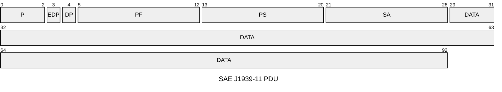
- Ρ为优先权，从最高0设置到最低7。
- EDP为扩展数据页，预留后期扩展使用，本文件中为0。
- DP为数据页，用来选择参数组描述的辅助页，本文件中为0。
- PF为PDU格式消息类型，用来确定PDU的格式，以及数据域对应的消息类型。
- PS为 PDU特定格式，PS值取决于PDU格式，本文件中采用PDU1格式，PS值为目标地址。SA为源地址，数据帧的源地址。
- DATA 为数据域。
#### 地址分配

| 设备              | 地址         |
| --------------- | ---------- |
| [[#SECC\|SECC]] | $95(5F_H)$ |
| [[#EVCC\|EVCC]] | $37(25_H)$ |
| [[#VACC\|VACC]] | $96(60_H)$ |
#### 版本协商
##### 充电机协议版本帧
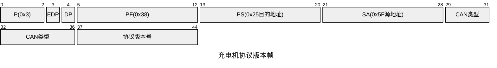

| 参数内容  | 长度    | 参数类型                     | 描述                                              |
| ----- | ----- | ------------------------ | ----------------------------------------------- |
| CAN类型 | 1Byte | [[#CANType]]             | 充电机通信的CAN类型，当前版本的CAN 类型为 CAN2.0                 |
| 协议版本号 | 3Byte | [[#ProtocolVersionType]] | 车辆通信的CAN类型，本文件规定当前主版本号为2,次版本号和临时版本号为0, 即 V2.0.0 |
##### 车辆协商结果帧

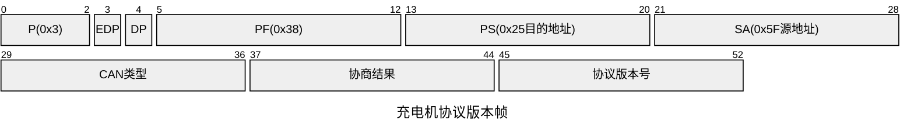

| 参数内容  | 长度    | 数据类型                     | 描述                                                                                                                             |
| ----- | ----- | ------------------------ | ------------------------------------------------------------------------------------------------------------------------------ |
| CAN类型 | 1Byte | [[#CANType]]             | 车辆通信的CAN类型，本文件规定当前主版本号为2,次版本号和临时版本号为0, 即 V2.0.0                                                                                |
| 协商结果  | 1Byte | [[#VersionResultType]]   | 车辆版本协商结果，包括“继续协商”“协商成功”“协商失败”                                                                                                  |
| 协议版本号 | 3Byte | [[#ProtocolVersionType]] | 车辆期望或协商一致的版本号：<br>--如果车辆协商结果为“协商成功”时，值为双方协商一致的版本号；<br>--如果车辆协商结果为“继续协商”，值为车辆期望的版本号；<br>--如果车辆协商结果为“协商失败”，值为0xFFFFFF，此时充电机不判断该值 |
##### 充电机版本协商状态转换图
```mermaid
%%elk%%
---
title: 充电机版本协商状态转换
config:
    theme: default
---
stateDiagram-v2
    S0:初始状态
    S1:协商中
    S2:协商成功
    S3:协商失败
    state if_state <<choice>>
    state join_state_T1 <<join>>
    [*]-->S0
    
    S1 --> join_state_T1:T1定时器到(发送"充电机协议版本帧")
    S0 --> join_state_T1:T1定时器到(发送"充电机协议版本帧")
    join_state_T1 --> S1
    S1 --> S3:Tc定时器到
    S1 --> if_state:接收"车辆协商结果帧"
    if_state --> S3:充电机CAN类型不等于CAN2.0
    if_state --> S2:协商成功
    if_state --> S3:协商失败
    if_state --> S1:继续协商(根据“车辆协商结果报文_协议版本号”调整 CList 队列的Ns指针，并发送“充电机协议版本帧)
    S3 --> [*]
    S2 -->[*]
```
##### 车辆版本协商状态转换图
```mermaid
%%elk%%
---
title: 车辆版本协商状态转换
config:
    theme: default
---
stateDiagram-v2
	S1:协商中
	S2:协商成功
	S3:协商失败
	[*] --> S1
	state if_state <<choice>>

	S1 --> if_state:接收"充电机协议版本帧"
	
	if_state --> S1:不支持接收到版本,但支持低于接收到版本(发送"继续协商",低于接收到版本最高版本)
	if_state --> S2:支持接收到版本(发送"协商成功")
	S1 --> S3:Tv定时器到(发送"协商失败")
	if_state --> S3:不支持接收到版本及更低版本(发送"协商失败")
	if_state --> S3:充电机CAN类型不等于CAN2.0
	
	S2 --> [*]
	S3 --> [*]
```
## 传输层
#### [[#SM_URM|SM_URM 不需要确认的短消息]]
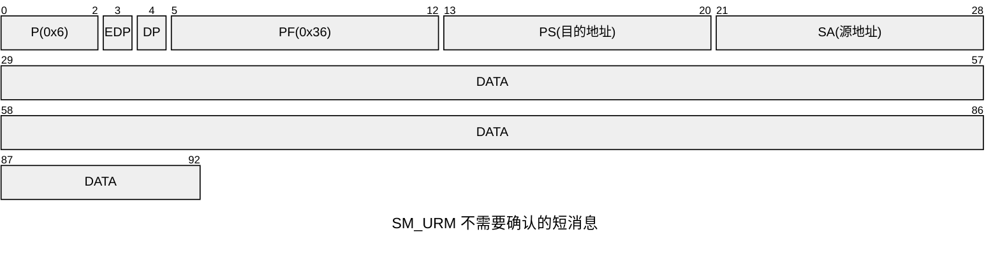
#### [[#SM_RM|SM_RM 需要确认的短消息]]
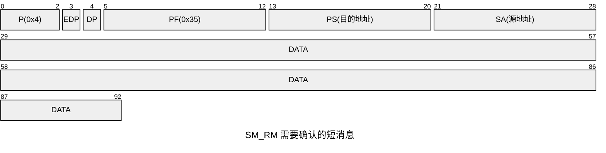
#### [[#SM_ACK|SM_ACK 需要确认的短消息的应答确认帧]]
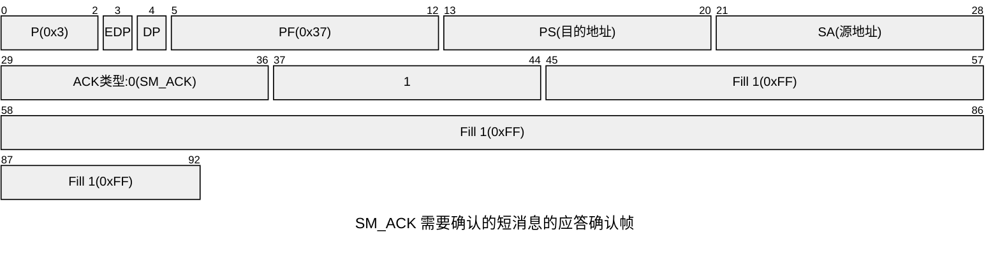
#### [[#LM|LM 长消息]]
##### $LM(0)$ 长消息(帧序号0)
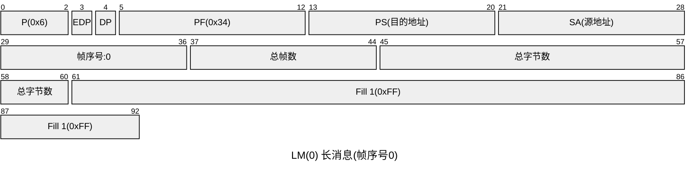
##### $LM(n)$ 长消息(帧序号非0)
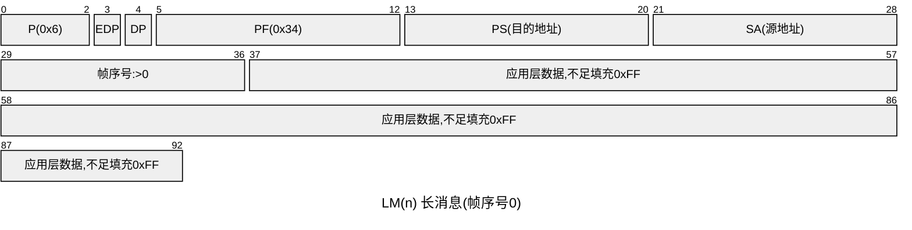
#### 长消息控制帧
##### [[#LM_ACK|LM_ACK 长消息应答确认帧]]
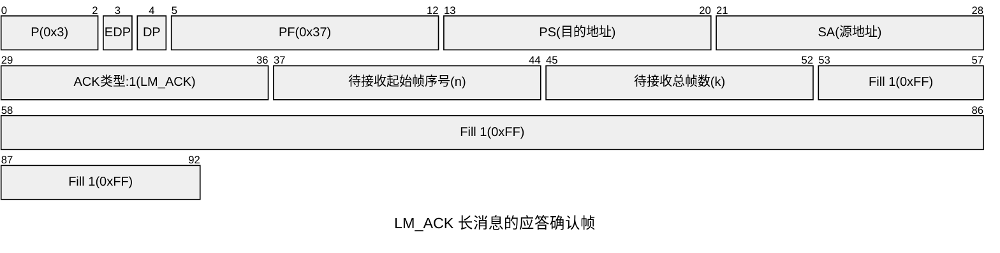
##### [[#LM_NACK|LM_NACK 长消息放弃连接确认帧]]
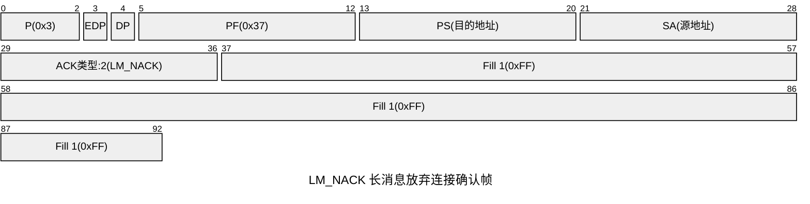
##### [[#LM_EndofACK|LM_EndofACK 长消息接收结束确认帧]]
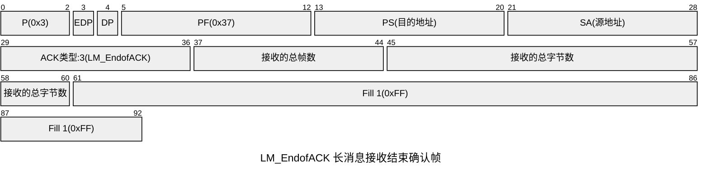
#### 多帧传输
- `send_cnt`为一次传输中发送帧计数器,初始值为0,每发送完成一帧,计数器加1
- `LMS_T1`为一次传输中信息帧按序发送时间间隔,每个信息帧发送后重置
- `LMS_T2`为接收信息帧或控制帧超时计时器
- `LMS_T3`为长消息传输超时计时器,发送第一帧报文开启
- `lm_tfra`为长消息总帧数
- `err_cnt`为接收信息帧超时次数计数器
- `recv_no`为待接收信息帧帧序号
- `recv_num`为当前请求已接收有效数据帧的帧数
- `recv_tfra`为已接收有效数据帧的总帧数
- `k`为接收方单次能接收的数据帧的帧数(取接收能力和剩余发送帧的较小值)
##### 发送方状态转换图
```mermaid
%%elk%%
---
title: 发送方状态转换
config:
    theme: default
---
stateDiagram-v2
	Idel:空闲
	S0:连接建立
	S1:数据传输
	S2:等待应答确认
	S3:等待结束确认
	S4:连接关闭
	
	%%state join_state <<join>> %%
	state if_state_S0_S0 <<choice>>
	state fork_state_S0_S4 <<fork>>
	state join_state_S0_S4 <<join>>
	state if_state_S1_timer <<choice>>
	state if_state_S2_timer_T2 <<choice>>
	state join_state_T2_overtime <<join>>
	state if_state_S3_timer_T2 <<choice>>
	
	%%[*] --> Idel%%
	Idel --> S0:发送LM(0),开启LMS_T2
	S0 --> S1:接收到LM_ACK(n,k),send_cnt set 1,开启LMS_T1,关闭LMS_T2
	S0 --> S4:接收到LM_NACK
	S0 --> if_state_S0_S0:LMS_T2定时器到
	if_state_S0_S0 --> join_state_T2_overtime:连续3次响应超时
	join_state_T2_overtime --> S4:发送LM_NACK
	if_state_S0_S0 --> S0:发送LM(0),重置LMS_T2,超时计数器+1
	
	S0 --> fork_state_S0_S4
	fork_state_S0_S4 --> join_state_S0_S4:LMS_T3定时器到
	fork_state_S0_S4 --> join_state_S0_S4:主动终止传输
	join_state_S0_S4 --> S4:发送LM_NACK
	
	S1 --> S1:接收到LM_ACK(n,k),保存k,send_cnt set 1,开启LMS_T1,关闭LMS_T2
	S1 --> S4:接收到LM_NACK
	S1 --> fork_state_S0_S4
	S1 --> if_state_S1_timer:发送时间LMS_T1定时器到
	if_state_S1_timer --> S1:发送LM(n+send_cnt),send_cnt+1,重置LMS_T1(send_cnt<k-1 && n+send_cnt<lm_tfra)
	if_state_S1_timer --> S2:发送LM(n+send_cnt),send_cnt+1,关闭LMS_T1,开启LMS_T2(send_cnt==k-1 && n+send_cnt<lm_tfra)
	if_state_S1_timer --> S3:发送LM(lm_tfra),send_cnt+1,关闭LMS_T1,开启LMS_T2(n+send_cnt==lm_tfra)
	
	S2 --> S1:接收到LM_ACK(n,k),调整帧序号为n,send_cnt set 1,开启LMS_T1,关闭LMS_T2
	S2 --> S4:接收到LM_NACK
	S2 --> if_state_S2_timer_T2:LMS_T2定时器到
	if_state_S2_timer_T2 --> join_state_T2_overtime:连续3次响应超时
	if_state_S2_timer_T2 --> S2:发送LM(n+k-1),重置LMS_T2,超时计数器+1
	S2 --> fork_state_S0_S4
	
	S3 --> S1:接收到LM_ACK(n,k),调整帧序号为n,send_cnt set 1,开启LMS_T1,关闭LMS_T2
	S3 --> S4:接收到LM_NACK
	S3 --> S4:接收到LM_EndofACK
	S3 --> if_state_S3_timer_T2:LMS_T2定时器到
	if_state_S3_timer_T2 --> join_state_T2_overtime:连续3次响应超时
	if_state_S3_timer_T2 --> S3:发送LM(lm_tfra),重置LMS_T2,超时计数器+1
	S3 --> fork_state_S0_S4
	
	S4 --> Idel:关闭LMS_T1/LMS_T2/LMS_T3,send_cnt set 0
```
##### 接收方状态转换图
```mermaid
%%elk%%
---
title: 接收方状态转换
config:
    theme: default
---
stateDiagram-v2
	S0:空闲
	S1:接收数据
	S2:关闭连接
	
	[*]-->S0
	state Init {
		[*]-->[*]:开启LMS_T2
		--
		[*]-->[*]:recv_no set 0
		--
		[*]-->[*]:recv_num set 0
		--
		[*]-->[*]:recv_tfra set 0
	}
	
	S0 --> Init:接收到LM(0),保存lm_tfra,发送LM_ACK(1,k)
	Init --> S1
	
	S1 --> Init:接收到LM(0),发送LM_ACK(1,k)
	
	state if_state_recv_LM_n <<choice>>
	
	S1 --> if_state_recv_LM_n:接收到LM(n)
	
	state RLFLM{
		[*] --> [*]:recv_tfra set lm_tfra
		--
		[*] --> [*]:发送LM_EndofACK
	}
	if_state_recv_LM_n --> RLFLM:接收长消息最后一帧(n==recv_no+1 && recv_tfra+1==lm_tfra)
	RLFLM --> S2
	
	state RLFS{
		[*]-->[*]:recv_no set n
		--
		[*]-->[*]:发送LM_ACK(n+1,k)
		--
		[*]-->[*]:recv_num set 0
		--
		[*]-->[*]:recv_tfra+1
		--
		[*]-->[*]:开启LMS_T2
	}
	if_state_recv_LM_n --> RLFS:接收当前请求最后一帧(n==recv_no+1 && recv_num>=k-1 && recv_tfra+1<lm_tfra)
	RLFS --> S1
	
	state NRLFS{
		[*]-->[*]:recv_no set n
		--
		[*]-->[*]:recv_num+1
		--
		[*]-->[*]:recv_tfra+1
		--
		[*]-->[*]:开启LMS_T2
	}
	if_state_recv_LM_n --> NRLFS:非当前请求最后一帧(n==recv_no+1 && recv_num<k-1 && recv_tfra+1<lm_tfra)
	NRLFS --> S1
	
	state NCoNR{
		[*]-->[*]:发送LM_ACK(recv_no+1,k)
		--
		[*]-->[*]:开启LMS_T2
		--
		[*]-->[*]:recv_num set 0
	}
	if_state_recv_LM_n --> NCoNR:接收帧序号不连续或漏收报文(n>recv_no+1 && recv_tfra<lmtfra)
	NCoNR --> S1
	
%%	state RCLM{
%%		[*] --> [*]:recv_tfra set lm_tfra
%%		--
%%		[*] --> [*]:发送LM_EndofACK
%%	}
	if_state_recv_LM_n --> RLFLM:已接收完(recv_tfra==lmtfra)
	RLFLM --> S2
	state Deinit{
		[*]-->[*]:关闭LMS_T2
		--
		[*]-->[*]:关闭LMS_T3
		--
		[*]-->[*]:recv_no set 0
		--
		[*]-->[*]:err_cnt set 0
	}
	S2 --> Deinit
	Deinit --> [*]
```
##### 长消息交互过程图
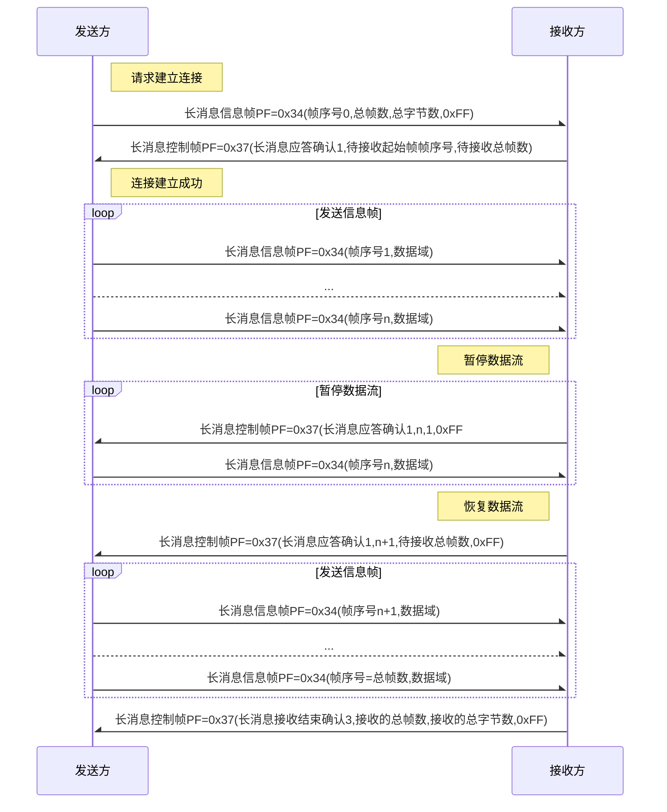

## 应用层
### 参数类型
###### PIDType
参数组标识码
###### CANType
CAN类型:`[CAN2.0:0x00,CANFD:0x01,CANXL:0x02]`
###### ProtocolVersionType
协议版本号:`[1:主版本号,2:次版本号,3:临时版本号]`
###### ReservedType
预留:默认为0xFF
###### VersionResultType
协商结果:`[继续协商:0x00,协商成功:0x01,协商失败:0x02]`
###### FCType
功能代码:

| 功能代码(FC) | 描述信息                                                                           | 可选项 | 是否可重载 |
| -------- | ------------------------------------------------------------------------------ | --- | ----- |
| `0x10`   | 本次充电所实现的业务功能的交互和确认                                                             | 必须项 | 否     |
| `0x20`   | 基本充电参数的交互                                                                      | 必须项 | 否     |
| `0x30`   | 车辆和/或充电机身份交互和确认                                                                | 可配置 | 是     |
| `0x40`   | 启动供电模式或预充及能量传输功能模块的时间点的交互和确认                                                   | 可配置 | 是     |
| `0x50`   | 完成充电机的绝缘检测(包括泄放)，短路检测，粘连检测等功能所需的信息交互                                           | 可配置 | 是     |
| `0x60`   | 充电机在电池组不接入的情况下以恒压模式实现对电池组加热等供电功能所需的信息交互                                        | 可配置 | 是     |
| `0x70`   | 包括预充和能量传输两个过程的信息交互，前者是充电机为了避免对电池组等车内组件造成冲击而在能量传输前所执行的相关操作，后者包括启动至结束充电和/或放电的全过程 | 必须项 | 是     |
| `0x80`   | 完成能量传输后所执行的相关信息交互，如充电过程统计等相关信息                                                 | 可配置 | 是     |
| `0x90`   | 能量传输结束后，为了完成运营需求或某些增值服务而传输的数据信息                                                | 可配置 | 是     |
###### FDCType
功能描述码:FDC编码,数据范围`0~8`
###### FDCSupportType
FDC支持情况:`[1:第一个FDC支持情况/支持非0/不支持0,2:第二个FDC支持情况/支持非0/不支持0,...,8:第八个FDC支持情况/支持非0/不支持0]`
###### CheckType
自检检测状态: `[未检测:0x00,检测中:0x01,检测结束:0x02]`
###### CheckResult
自检结果: `[失败:0x00,成功:0xAA]`
###### LatchingStatusType
电子锁状态: `[未锁止:0x00,锁止:0xAA]`
###### ReadyType
就绪状态: `[未就绪:0x00,就绪:0xAA]`
###### VoltageType1
电压: `数据分辨率:0.1V/位;0V偏移量;数据范围0~6553.5V`
###### VoltageType2
电压: `数据分辨率0.001V/位;0V偏移量;数据范围0~15.000V;0xFE表示异常值;0xFF表示无效值`
###### CurrentType
电流: `数据分辨率0.1A/位;0A偏移量;数据范围0~6553.5A`
###### SOCType
荷电状态: `数据分辨率0.1%/位;0%偏移量;数据范围0%~100%`
###### CapacityType
能量: `数据分辨率0.1kWh/位;0kWh偏移量;数据范围0~1000kWh`
###### ChargeModeType
充电模式: `[恒流:0x01,恒压:0x02]`
###### PowerSupplyEndType
车辆结束供电请求: `结束供电:0xAA;其他值无效`
###### MTimeType
时间(分): `数据分辨率1min/位;0min偏移量;数据范围0~1440min`
###### ReasonType
输出能力变化的原因: `[电网原因:0x01,充电机原因:0x02,其它:0x03]`
###### ChargingRateType
电流调整速率: `数据分辨率(1A/s)/位;0A/s偏移量`
###### EndCodeType
中止类型: 
- 充电机: `[停机:0x01,功能模块通信超时:0x02,执行失败:0x03,其它:0x04]`
- 车辆: `[中止充电:0x01,功能模块通信超时:0x02,执行失败:0x03,其它:0x04]`
###### EndReasonType
中止原因:
- 充电机-停机
	- 充电机正常停机:0x01
	- 充电机(除通信超时)故障停机:0x02
	- 充电机紧急停机:0x03
	- 充电机侧主动防护:0x04
- 充电机-车辆-功能模块通信超时
	- 功能协商超时:0x01
	- 参数配置超时:0x02
	- 鉴权超时:0x03
	- 预约超时:0x04
	- 系统自检超时:0x05
	- 供电模式超时:0x06
	- 预充超时:0x07
	- 服务统计超时:0x08
	- 服务空闲超时:0x09
- 充电机-车辆-执行失败
	- 功能协商失败:0x01
	- 参数不匹配:0x02
	- 鉴权执行失败:0x03
	- 预约执行失败:0x04
	- 系统自检失败:0x05
	- 供电模式执行失败:0x06
	- 预充失败:0x07
	- 服务统计执行失败:0x08
	- 服务空闲执行失败:0x09
	- 阶段确认失败:0x0A
- 车辆-中止充电
	- 车辆正常停机:0x01
	- 车辆故障停机(除通信超时):0x02
	- 车辆紧急停机:0x03
###### FaultType
故障代码: 
- 当中止原因为“正常停机”时，故障代码值为0，
- 当中止原因为“故障停机”或“紧急停机”时，故障代码应符合 NB/T 10905—2021的要求；
- 当中止原因为“充电机侧主动防护”时，发送内部故障代码
###### PhaseACKType
阶段确认信息:`[阶段确认失败:0x00,阶段确认成功:0xAA]`
###### ContactStatusType
接触器状态: `[断开:0x00,闭合:0xAA]`
###### CAuthenStatusType
充电机鉴权状态: `[开始/持续:0x00,完成:0xAA]`
###### VAuthenResultType
车辆等待鉴权状态:  `[不同意等待:0x00,继续等待:0xAA]`
###### AuthenResultType
鉴权结果: `[鉴权失败:0x00,鉴权成功:0xAA]`
###### EVINType
扩展车辆识别码: ASCII编码
###### PowerType
输出功率: `数据分辨率0.1kW/位;0kW偏移量;功率范围0~1000kW`
###### PowerProIntType
时刻编码: `数据分辨率1/位;0偏移量;数据范围0~95`
###### PowerProType
输出功率百分比: `数据分辨率0.1%/位;0%偏移量;数据范围0~100%`
###### ScheACKType
预约确认: `[确认失败:0x00,确认成功:0xAA]`
###### ScheNegoType
预约协商结果: `[协商失败:0x00,协商成功:0xAA]`
###### SupportChargerType
立即充电标识: `[不支持立即充电:0x00,支持立即充电:0xAA,确认成功:0xFF]`
###### CycleIndexType
循环次数: `数据分辨率0.1ci/位;0偏移量`
###### KilometreType
里程: `数据分辨率0.1km/位;0km偏移量`
###### TemperatureType1
温度: `数据分辨率1℃/位;-40℃偏移量;温度范围-40~210℃;0xFE标识异常值;0xFF表示无效值`
###### TemperatureType2
温度: `数据分辨率1℃/位;-50℃偏移量;温度范围-50~200℃`
###### PauseStatusType
暂停状态: `[暂停充电:0xAA,充电:非0xAA]`
###### AdaptorType
适配器类型: `[A型:0x01,B型0x02]`
### 公共报文
##### 阶段确认
###### 阶段确认报文
| 参数组标识  | 报文描述                    | 信息类型     | 周期时间 | 最大发送时间/ms | 源-目的地址  |
| ------ | ----------------------- | -------- | ---- | --------- | ------- |
| `0x01` | [[#充电机阶段请求报文\|充电机阶段请求]] | 需要确认的短消息 | -    | 1000      | 充电机->车辆 |
| `0x02` | [[#车辆阶段确认报文\|车辆阶段确认]]   | 需要确认的短消息 | -    | 1000      | 车辆->充电机 |
###### 充电机阶段请求报文
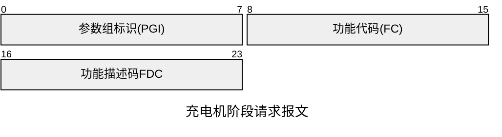

| 参数内容            | 长度    | 参数类型         | 描述              |
| --------------- | ----- | ------------ | --------------- |
| [[#PGI\|参数组标识]] | 1BYTE | [[#PIDType]] | 固定为`0x01`       |
| [[#FC\|功能代码]]   | 1BYTE | [[#FCType]]  | 即将进入的功能模块代码     |
| [[#FDC\|功能描述码]] | 1BYTE | [[#FDCType]] | 即将进入的功能模块的FDC编码 |
###### 车辆阶段确认报文
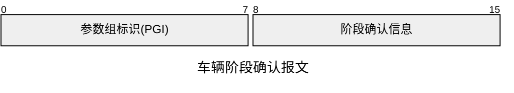

| 参数内容            | 长度    | 参数类型              | 描述                                                         |
| --------------- | ----- | ----------------- | ---------------------------------------------------------- |
| [[#PGI\|参数组标识]] | 1BYTE | [[#PIDType]]      | 固定为`0x02`                                                  |
| 阶段确认信息          | 1BYTE | [[#PhaseACKType]] | 车辆确认信息:<br>`0x00`:确认失败(FC或FDC不一致)<br>`0xAA`:确认成功(FC或FDC一致) |
##### 接触器状态
###### 接触器状态报文
| 参数组标识  | 报文描述                                    | 信息类型     | 周期时间 | 最大发送时间/ms | 源-目的地址  |
| ------ | --------------------------------------- | -------- | ---- | --------- | ------- |
| `0x05` | [[#充电机直流供电回路接触器状态报文\|充电机直流供电回路接触器状态报文]] | 需要确认的短消息 | -    | 1000      | 充电机->车辆 |
| `0x06` | [[#车辆断开装置状态报文\|车辆断开装置状态报文]]             | 需要确认的短消息 | -    | 1000      | 车辆->充电机 |
###### 充电机直流供电回路接触器状态报文
| 参数内容            | 长度    | 参数类型                   | 描述                                 |
| --------------- | ----- | ---------------------- | ---------------------------------- |
| [[#PGI\|参数组标识]] | 1BYTE | [[#PIDType]]           | 固定为`0x05`                          |
| 接触器状态           | 1BYTE | [[#ContactStatusType]] | 充电机直流供电回路接触器C1状态信息;断开：0x00;闭合：0xAA |
| 接触器状态           | 1BYTE | [[#ContactStatusType]] | 充电机直流供电回路接触器C2状态信息;断开：0x00;闭合：0xAA |
###### 车辆断开装置状态报文
| 参数内容            | 长度    | 参数类型                   | 描述                           |
| --------------- | ----- | ---------------------- | ---------------------------- |
| [[#PGI\|参数组标识]] | 1BYTE | [[#PIDType]]           | 固定为`0x06`                    |
| 接触器状态           | 1BYTE | [[#ContactStatusType]] | 车辆断开装置C5状态信息;断开：0x00;闭合：0xAA |
| 接触器状态           | 1BYTE | [[#ContactStatusType]] | 车辆断开装置C6状态信息;断开：0x00;闭合：0xAA |
##### 电子锁状态
###### 电子锁状态报文
| 参数组标识  | 报文描述                    | 信息类型     | 周期时间 | 最大发送时间/ms | 源-目的地址  |
| ------ | ----------------------- | -------- | ---- | --------- | ------- |
| `0x07` | [[#车辆电子锁状态报文\|车辆电子锁状态]] | 不需要确认的消息 | 250  | -         | 车辆->充电机 |

###### 车辆电子锁状态报文

| 参数内容            | 长度    | 参数类型                    | 描述                           |
| --------------- | ----- | ----------------------- | ---------------------------- |
| [[#PGI\|参数组标识]] | 1BYTE | [[#PIDType]]            | 固定为`0x07`                    |
| 电子锁状态           | 1BYTE | [[#LatchingStatusType]] | 车辆电子锁锁止状态信息;未锁止：0x00;锁止：0xaa |
##### 中止状态
###### 中止报文
| 参数组标识  | 报文描述                  | 信息类型    | 周期时间 | 最大发送时间/ms | 源-目的地址  |
| ------ | --------------------- | ------- | ---- | --------- | ------- |
| `0x03` | [[#充电机中止报文\|充电机中止报文]] | 需要确认的消息 | -    | 1000      | 充电机->车辆 |
| `0x04` | [[#车辆中止报文\|车辆中止报文]]   | 需要确认的消息 | -    | 1000      | 车辆->充电机 |
###### 充电机中止报文
| 参数内容            | 长度    | 参数类型               | 描述        |
| --------------- | ----- | ------------------ | --------- |
| [[#PGI\|参数组标识]] | 1BYTE | [[#PIDType]]       | 固定为`0x03` |
| 充电机中止类型         | 1BYTE | [[#EndCodeType]]   |           |
| 充电机中止原因         | 1BYTE | [[#EndReasonType]] |           |
| 故障代码            | 4BYTE | [[#FaultType]]     |           |
###### 车辆中止报文
| 参数内容            | 长度    | 参数类型               | 描述        |
| --------------- | ----- | ------------------ | --------- |
| [[#PGI\|参数组标识]] | 1BYTE | [[#PIDType]]       | 固定为`0x04` |
| 车辆中止类型          | 1BYTE | [[#EndCodeType]]   |           |
| 车辆中止原因          | 1BYTE | [[#EndReasonType]] |           |
| 故障代码            | 4BYTE | [[#FaultType]]     |           |

### 功能模块
```mermaid
%%elk%%
---
title: 基本充电场景
---
flowchart 
	classDef req fill:#f9f,stroke:#333,stroke-width:4px;
	A([插枪]) --> B[版本协商]:::req --> C[功能协商 FDC=1]:::req --> D[参数配置 FDC=1]:::req
	B -.->|兼容协商|附录M
	D -->DE@{ shape: f-circ, label: "Junction" } --> EA[NULL]:::req & EB[鉴权 FDC=1] & EC[鉴权 FDC=2] & ED[鉴权 FDC=...] --> EF@{ shape: f-circ, label: "Junction" }
	EF --> FA[NULL]:::req & FB[预约 FDC=1] & FC[预约 FDC=...] --> FG@{ shape: f-circ, label: "Junction" } 
	FG --> GA[系统自检 FDC=1]:::req & GB[系统自检 FDC=...] --> GH@{ shape: f-circ, label: "Junction" }
	GH --> HA[NULL]:::req & HB[供电模式 FDC=1] & HC[供电模式 FDC=...] --> HI@{ shape: f-circ, label: "Junction" }
	HI --> IA[预充及能量传输 FDC=1]:::req & IB[预充及能量传输 FDC=2] & IC[预充及能量传输 FDC=...] --> IJ@{ shape: f-circ, label: "Junction" }
	IJ --> JA[NULL]:::req & JB[服务统计 FDC=1] & JC[服务统计 FDC=...] --> JK@{ shape: f-circ, label: "Junction" }
	JK --> KA[NULL]:::req & KB[服务空闲 FDC=...] --> L([拔枪])
	
```


#### 功能协商
| 功能代码(FC) | 描述信息               | 可选项 | 是否可重载 |
| -------- | ------------------ | --- | ----- |
| `0x10`   | 本次充电所实现的业务功能的交互和确认 | 必须项 | 否     |

| 功能描述码(FDC) | 描述信息 |
| ---------- | ---- |
| `0x01`     | 功能协商 |
##### 通用功能协商(FDC=1)
| 参数组标识  | 报文描述                      | 信息类型    | 周期时间 | 最大发送时间/ms | 源-目的地址  |
| ------ | ------------------------- | ------- | ---- | --------- | ------- |
| `0x11` | [[#充电机支持功能报文\|充电机支持功能]]   | 需要确认的消息 | -    | 5000      | 充电机->车辆 |
| `0x12` | [[#车辆功能协商结果报文\|车辆功能协商结果]] | 需要确认的消息 | -    | 5000      | 车辆->充电机 |
###### 充电机支持功能报文
| 参数内容                  | 长度    | 参数类型         | 描述        |
| --------------------- | ----- | ------------ | --------- |
| [[#PGI\|参数组标识]]       | 1BYTE | [[#PIDType]] | 固定为`0x11` |
| **鉴权**模块FDC的支持情况      | 8BYTE | [[#FDCType]] |           |
| **预约**模块FDC的支持情况      | 8BYTE | [[#FDCType]] |           |
| **系统自检**模块FDC的支持情况    | 8BYTE | [[#FDCType]] |           |
| **供电模式**模块FDC的支持情况    | 8BYTE | [[#FDCType]] |           |
| **预充及能量传输**模块FDC的支持情况 | 8BYTE | [[#FDCType]] |           |
| **服务统计**模块FDC的支持情况    | 8BYTE | [[#FDCType]] |           |
| **服务空闲**模块FDC的支持情况    | 8BYTE | [[#FDCType]] |           |

###### 车辆功能协商结果报文
| 参数内容                  | 长度    | 参数类型         | 描述                   |
| --------------------- | ----- | ------------ | -------------------- |
| [[#PGI\|参数组标识]]       | 1BYTE | [[#PIDType]] | 固定为`0x12`            |
| **鉴权**模块FDC的支持情况      | 8BYTE | [[#FDCType]] | 支持则为共同支持FDC编号;不支持填充0 |
| **预约**模块FDC的支持情况      | 8BYTE | [[#FDCType]] | 支持则为共同支持FDC编号;不支持填充0 |
| **系统自检**模块FDC的支持情况    | 8BYTE | [[#FDCType]] | 支持则为共同支持FDC编号;不支持填充0 |
| **供电模式**模块FDC的支持情况    | 8BYTE | [[#FDCType]] | 支持则为共同支持FDC编号;不支持填充0 |
| **预充及能量传输**模块FDC的支持情况 | 8BYTE | [[#FDCType]] | 支持则为共同支持FDC编号;不支持填充0 |
| **服务统计**模块FDC的支持情况    | 8BYTE | [[#FDCType]] | 支持则为共同支持FDC编号;不支持填充0 |
| **服务空闲**模块FDC的支持情况    | 8BYTE | [[#FDCType]] | 支持则为共同支持FDC编号;不支持填充0 |
###### 充电机功能协商状态转换图
```mermaid
%%elk%%
---
title: 充电机功能协商状态转换
config:
    theme: default
---
stateDiagram-v2
	S0:初始化
	S1:功能协商
	S2:阶段确认过程
	S3:成功
	S4:失败
	state 初始化{
		[*]-->[*]:打开Tc
		--
		[*]-->[*]:发送"充电机支持功能(PGI=0x11)"报文
	}
	S0-->初始化:接收"车辆版本协商结果(成功)"
	初始化-->S1
	state if_state_S1 <<choice>>
	S1-->if_state_S1: 接收"车辆功能协商结果(PGI=0x12)"报文
	state 成功{
		[*]-->[*]:发送"充电机阶段信息(PGI=0x01)"报文
	}
	state 中止_协商失败{
		[*]-->[*]:发送"中止_功能协商失败(PGI=0x03,中止类型:执行失败0x03,中止原因:功能协商失败0x01)"报文
	}
	if_state_S1-->成功:全部必须功能协商成功
	if_state_S1-->中止_协商失败:至少一个必须功能协商失败
	成功-->S2
	中止_协商失败-->S4
	state if_state_S2 <<choice>>
	state 中止_确认失败{
		[*]-->[*]:发送"中止_阶段确认失败(PGI=0x03,中止类型:执行失败0x03,中止原因:阶段确认失败0x0A)"报文
	}
	S2-->if_state_S2:接收"车辆阶段确认(PGI=0x02)"报文
	if_state_S2-->S3:确认成功
	if_state_S2-->中止_确认失败:确认失败
	中止_确认失败-->S4
	state 中止_超时{
		[*]-->[*]:发送"中止_功能协商超时(PGI=0x03,中止类型:通信超时0x02,中止原因:功能协商超时0x01)"报文
	}
	%%state join_state_stop <<join>>
	S2-->中止_超时:Tc定时器到
	S1-->中止_超时:Tc定时器到
	S3-->参数配置功能模块FDC:关闭Tc定时器
	S4-->退出充电:关闭Tc定时器
```
###### 车辆功能协商状态转换图
```mermaid
%%elk%%
---
title: 车辆功能协商状态转换
config:
    theme: default
---
stateDiagram-v2
	S1:功能协商
	S2:阶段确认过程
	S3:成功
	S4:失败
	[*]-->S1
	state 版本协商{
		[*]-->[*]:发送"车辆版本协商结果"
	}
	S1-->版本协商:接收"充电机版本协商"
	版本协商-->S1
	state if_state_S1 <<choice>>
	S1-->协商:接收"充电机支持功能(PGI=0x11)"报文
	state 协商{
		[*]-->[*]:发送"车辆功能协商结果(PGI=0x12)"
	}
	协商-->if_state_S1
	if_state_S1-->S2:支持
	if_state_S1-->S4:不持支
	
	state 阶段确认_成功{
		[*]-->[*]:发送"车辆阶段确认_成功(PGI=0x02,0xAA)"报文
	}
	state 阶段确认_失败{
		[*]-->[*]:发送"车辆阶段确认_失败(PGI=0x02,0x00)"报文
	}
	state if_state_S2 <<choice>>
	S2-->if_state_S2:接收"充电机阶段信息报文(PGI=0x01)"
	if_state_S2-->阶段确认_成功:支持
	if_state_S2-->阶段确认_失败:不支持
	阶段确认_成功-->S3
	阶段确认_失败-->S4
	
	state 中止_协商超时{
		[*]-->[*]:发送"中止_功能协商超时(PGI=0x04,中止类型:通信超时0x02,中止原因:功能协商超时0x01)"
	}
	S1-->中止_协商超时:Tv定时器到
	中止_协商超时-->S4
	S2-->S4:接收"中止_功能协商失败(PGI=0x03,中止类型:执行失败0x03,中止原因:功能协商失败0x01)"
	S3-->参数配置功能模块FDC:关闭Tv定时器
	S4-->退出充电:关闭Tv定时器
```
#### 参数配置
| 功能代码(FC) | 描述信息      | 可选项 | 是否可重载 |
| -------- | --------- | --- | ----- |
| `0x20`   | 基本充电参数的交互 | 必须项 | 否     |

| 功能描述码(FDC) | 描述信息      |
| ---------- | --------- |
| `0x01`     | 充电模式参数配置  |
| `0x02`     | 充放电模式参数配置 |
##### 基本参数配置(FDC=1)
| 参数组标识  | 报文描述                    | 信息类型    | 周期时间 | 最大发送时间/ms | 源-目的地址  |
| ------ | ----------------------- | ------- | ---- | --------- | ------- |
| `0x21` | [[#充电机充电参数报文\|充电机充电参数]] | 需要确认的消息 | -    | 5000      | 充电机->车辆 |
| `0x22` | [[#车辆充电参数报文\|车辆充电参数]]   | 需要确认的消息 | -    | 5000      | 车辆->充电机 |
###### 充电机充电参数报文
| 参数内容            | 长度    | 参数类型                  | 描述                         |
| --------------- | ----- | --------------------- | -------------------------- |
| [[#PGI\|参数组标识]] | 1BYTE | [[#PIDType]]          | 固定为`0x21`                  |
| 电压              | 2BYTE | [[#VoltageType1]]     | 充电机最高充电电压                  |
| 电压              | 2BYTE | [[#VoltageType1]]     | 充电机最低充电电压                  |
| 电流              | 2BYTE | [[#CurrentType]]      | 充电机最大充电电流                  |
| 电流              | 2BYTE | [[#CurrentType]]      | 充电机最小充电电流                  |
| 电压              | 2BYTE | [[#VoltageType1]]     | 充电机最高放电电压,无放电功能值位`0xFFFF`  |
| 电压              | 2BYTE | [[#VoltageType1]]     | 充电机最低放电电压,无放电功能值位`0xFFFF`  |
| 电流              | 2BYTE | [[#CurrentType]]      | 充电机最高放电电流,无放电功能值位`0xFFFF`  |
| 电流              | 2BYTE | [[#CurrentType]]      | 充电机最低放电电流,无放电功能值位`0xFFFF`  |
| 电流调整速率          | 2BYTE | [[#ChargingRateType]] | 充电机电流上调最小充电速率,不声明时为$0$     |
| 电流调整速率          | 2BYTE | [[#ChargingRateType]] | 充电机电流下调最小充电速率,不声明时为$20A/s$ |
###### 车辆充电参数报文
| 参数内容            | 长度    | 参数类型                  | 描述                                                     |
| --------------- | ----- | --------------------- | ------------------------------------------------------ |
| [[#PGI\|参数组标识]] | 1BYTE | [[#PIDType]]          | 固定为`0x22`                                              |
| 电流              | 2BYTE | [[#CurrentType]]      | 车辆最高允许充电电流                                             |
| 电压              | 2BYTE | [[#VoltageType1]]     | 车辆最高允许充电总电压                                            |
| 能量              | 2BYTE | [[#CapacityType]]     | 车辆最高允许输入总能量,否则发送`0xFFFF`                               |
| 荷电状态            | 2BYTE | [[#SOCType]]          | 动力蓄电池当前荷电状态                                            |
| 电压              | 2BYTE | [[#VoltageType2]]     | 蓄电池电芯组最高允许电压                                           |
| 温度              | 1BYTE | [[#TemperatureType1]] | 蓄电池电芯组最高允许温度                                           |
| 能量              | 2BYTE | [[#CapacityType]]     | 车辆最高允许放电总能量,无放电功能值为$0$,有放电功能且作为保护阈值发送实际数据,否则发送`0xFFFF` |
| 电压              | 2BYTE | [[#VoltageType1]]     | 车辆最低放电电压,无放电功能值位`0xFFFF`                               |
| 电流              | 2BYTE | [[#CurrentType]]      | 车辆最大放电电流,无放电功能值位`0xFFFF`                               |
| 电流              | 2BYTE | [[#CurrentType]]      | 车辆最小放电电流,无放电功能值位`0xFFFF`                               |
###### 充电机充电参数状态转换图
```mermaid
%%elk%%
---
title: 充电机充电参数状态转换
config:
    theme: default
---
stateDiagram-v2
	S0:初始化
	S1:配置中
	S2:阶段确认过程
	S3:成功
	S4:失败
	
	state 初始化{
		[*]-->[*]:打开Tc计时器
		--
		[*]-->[*]:发送"充电机充电参数(PGI=0x21)"报文
	}
	S0-->初始化:接收当前FDC的"车辆阶段确认_成功(PGI=0x02,0xAA)"报文
	初始化-->S1
	state if_state_S1 <<choice>>
	S1-->if_state_S1:接收"车辆充电参数报文(PGI=0x22)"报文
	state 充电参数匹配{
		[*]-->[*]:发送"充电机阶段信息(PGI=0x01)"报文
	}
	if_state_S1-->充电参数匹配
	充电参数匹配-->S2
	state 充电参数不匹配{
		[*]-->[*]:发送"中止_参数不匹配(PGI=0x03,中止类型:执行失败0x03,中止原因:参数不匹配0x02)"报文
	}
	if_state_S1-->充电参数不匹配
	充电参数不匹配-->S4
	S1-->S4:接收"中止_参数不匹配(PGI=0x04,中止类型:执行失败0x03,中止原因:参数不匹配0x02)"报文
	state 超时{
		[*]-->[*]:发送"中止_参数配置超时(PGI=0x03,中止类型:超时0x02,中止原因:参数配置超时0x02)"报文
	}
	S1-->超时:Tc定时器到
	超时-->S4
	state if_state_S2 <<choice>>
	S2-->if_state_S2:接收"车辆阶段确认(PGI=0x02)"报文
	if_state_S2-->S3:确认成功
	if_state_S2-->S4:确认失败
	S3-->下一功能模块FDC:关闭Tc定时器
	state 失败{
		[*]-->[*]:发送"中止_阶段确认失败(PGI=0x03,中止类型:执行失败0x03,中止原因:阶段确认失败0x0A)"报文
	}
	S4-->失败:关闭Tc定时器
	失败-->退出充电
```
###### 车辆充电参数状态转换图
```mermaid
%%elk%%
---
title: 车辆充电参数状态转换
config:
    theme: default
---
stateDiagram-v2
	S0:初始化
	S1:参数配置
	S2:阶段确认过程
	S3:成功
	S4:失败
	S0-->S1:当前FDC阶段确认,打开Tv计时器
	state if_state_S1 <<choice>>
	state 充电参数匹配{
		[*]-->[*]:发送"车辆充电参数(PGI=0x22)"报文
	}
	state 充电参数不匹配{
		[*]-->[*]:发送"中止_参数不匹配(PGI=0x4,中止类型:执行失败0x03,中止原因:参数不匹配0x02)"报文
	}
	S1-->if_state_S1:接收"充电机充电参数(PGI=0x21)"报文
	if_state_S1-->充电参数不匹配
	if_state_S1-->充电参数匹配
	充电参数匹配-->S2
	充电参数不匹配-->S4
	state if_state_S2 <<choice>>
	S2-->if_state_S2:接收"充电机阶段信息(PGI=0x01)"报文
	state 支持{
		[*]-->[*]:发送"车辆阶段确认_成功(PGI=0x02,0xAA)"报文
	}
	state 不支持{
		[*]-->[*]:发送"车辆阶段确认_失败(PGI=0x02,0x00)"报文
	}
	if_state_S2-->支持
	if_state_S2-->不支持
	支持-->S3
	不支持-->S4
	S2-->S4:接收"中止_参数不匹配(PGI=0x03,中止类型:执行失败0x03,中止原因:参数不匹配0x02)"报文
	state 超时{
		[*]-->[*]:发送"中止_参数配置超时(PGI=0x04,中止类型:超时0x02,中止原因:参数配置超时0x02)"报文
	}
	S1-->超时:Tv定时器到
	S2-->超时:Tv定时器到
	超时-->S4
	S3-->下一功能模块FDC:关闭Tc定时器
	%%state 失败{
	%%	[*]-->[*]:发送"中止_阶段确认失败(PGI=0x03,中止类型:执行失败0x03,中止原因:阶段确认失败0x0A)"报文
	%%}
	%%S4-->失败:关闭Tc定时器
	%%失败-->退出充电
	S4-->退出充电:关闭Tc定时器
```
#### 鉴权
| 功能代码(FC) | 描述信息            | 可选项 | 是否可重载 |
| -------- | --------------- | --- | ----- |
| `0x30`   | 车辆和/或充电机身份交互和确认 | 可配置 | 是     |

| 功能描述码(FDC) | 描述信息      |
| ---------- | --------- |
| `0x01`     | 扫码/刷卡     |
| `0x02`     | EVIN鉴权    |
| `0x03`     | 云端鉴权-桩识别码 |
#### 预约
| 功能代码(FC) | 描述信息                         | 可选项 | 是否可重载 |
| -------- | ---------------------------- | --- | ----- |
| `0x40`   | 启动供电模式或预充及能量传输功能模块的时间点的交互和确认 | 可配置 | 是     |

| 功能描述码(FDC) | 描述信息       |
| ---------- | ---------- |
| `0x01`     | 车辆定义预约开始时间 |
#### 系统自检
| 功能代码(FC) | 描述信息                                 | 可选项 | 是否可重载 |
| -------- | ------------------------------------ | --- | ----- |
| `0x50`   | 完成充电机的绝缘检测(包括泄放)，短路检测，粘连检测等功能所需的信息交互 | 可配置 | 是     |

| 功能描述码(FDC) | 描述信息       |
| ---------- | ---------- |
| `0x01`     | 输出回路检测(通用) |
##### 通用系统自检(FDC=1)
| 参数组标识  | 报文描述                    | 信息类型     | 周期时间 | 最大发送时间/ms | 源-目的地址  |
| ------ | ----------------------- | -------- | ---- | --------- | ------- |
| `0x51` | [[#充电机自检状态报文\|充电机自检状态]] | 不需要确认的消息 | 250  | -         | 充电机->车辆 |
| `0x52` | [[#充电机自检结果报文\|充电机自检结果]] | 需要确认的消息  | -    | 20,000    | 充电机->车辆 |
###### 充电机自检状态报文
| 参数内容            | 长度    | 参数类型           | 描述           |
| --------------- | ----- | -------------- | ------------ |
| [[#PGI\|参数组标识]] | 1BYTE | [[#PIDType]]   | 固定为`0x51`    |
| 自检检测状态          | 1BYTE | [[#CheckType]] | **粘连**检测状态信息 |
| 自检检测状态          | 1BYTE | [[#CheckType]] | **短路**检测状态信息 |
| 自检检测状态          | 1BYTE | [[#CheckType]] | **绝缘**检测状态信息 |
###### 充电机自检结果报文
| 参数内容            | 长度    | 参数类型                  | 描述                                                     |
| --------------- | ----- | --------------------- | ------------------------------------------------------ |
| [[#PGI\|参数组标识]] | 1BYTE | [[#PIDType]]          | 固定为`0x52`                                              |
| 自检检测结果          | 1BYTE | [[#CheckResult]]      | **粘连**检测结果                                             |
| 自检检测结果          | 1BYTE | [[#CheckResult]]      | **短路**检测结果                                             |
| 自检检测结果          | 1BYTE | [[#CheckResult]]      | **绝缘**检测结果                                             |
###### 充电机通用系统自检状态转换图
```mermaid
%%elk%%
---
title: 充电机通用系统自检状态转换
config:
    theme: default
---
stateDiagram-v2
	S0:初始化
	S1:等待车辆电子锁锁止
	S2:系统自检
	S3:阶段确认过程
	S4:成功
	S5:失败
	
	state 初始化{
		[*]-->[*]:打开Tc定时器(超时定时器)
		--
		[*]-->[*]:发送"充电机自检状态_未检测(PGI=0x51,0x00,0x00,0x00)"
		--
		[*]-->[*]:打开T1定时器(发送周期定时器)
	}
	S0-->初始化:接收当前FDC的"车辆阶段确认_成功(PGI=0x02,0xAA)"报文
	初始化-->S1
	S1-->S2:接收"车辆电子锁状态_锁止(PGI=0x07,0xAA)"报文
	state S1保持{
		[*]-->[*]:发送"充电机自检状态_未检测(PGI=0x51,0x00,0x00,0x00)"
	}
	S1-->S1保持:T1定时器到
	S1保持-->S1
	state Tc超时_电子锁锁止失败{
		[*]-->[*]:发送"中止_电子锁锁止异常(PGI=0x03,中止类型:执行失败0x03,中止原因:系统自检失败0x05)"报文
	}
	state Tc超时{
		[*]-->[*]:发送"中止_电子锁锁止异常(PGI=0x03,中止类型:超时0x02,中止原因:系统自检超时0x05)"报文
	}
	S1-->Tc超时_电子锁锁止失败
	Tc超时_电子锁锁止失败-->S5
	state 电子锁锁止失败{
		[*]-->[*]:发送"中止_电子锁锁止异常(PGI=0x03,中止类型:执行失败0x03,中止原因:系统自检失败0x05)"报文
	}
	S2-->电子锁锁止失败:接收"车辆电子锁状态_未锁止(PGI=0x07,0x00)"报文
	电子锁锁止失败-->S5
	state S2保持{
		[*]-->[*]:发送"充电机自检状态_未检测/检测中(PGI=0x51,[0x00/0x01])"报文
	}
	S2-->S2保持:T1定时器到
	S2保持-->S2
	state 自检成功{
		[*]-->阶段确认开始:发送"充电机自检结果_成功(PGI=0x52,0xAA)"报文
		阶段确认开始-->[*]:发送"充电机阶段确认信息(PGI=0x01,FC=0x50,FDC=0x01)"报文
	}
	S2-->自检成功
	自检成功-->S3
	state 自检失败{
		[*]-->[*]:发送"充电机自检结果_失败(PGI=0x52,0x00)"报文
		--
		[*]-->[*]:发送"中止_自检失败(PGI=0x03,中止类型:执行失败0x03,中止原因:系统自检失败0x05)"报文
	}
	S2-->自检失败
	自检失败-->S5
	S2-->Tc超时:Tc定时器到
	Tc超时-->S5
	
	S3-->电子锁锁止失败:接收"车辆电子锁状态_未锁止(PGI=0x07,0x00)"报文
	state S3保持{
		[*]-->[*]:发送"充电机自检状态_检测结束(PGI=0x51,0x02)"报文
	}
	S3-->S3保持:T1定时器到
	S3保持-->S3
	state if_state_S3 <<choice>>
	S3-->if_state_S3:接收"车辆阶段确认(PGI=0x02)"报文
	if_state_S3-->S4:确认成功(0xAA)
	state 确认失败{
		[*]-->[*]:发送"中止_阶段确认失败(PGI=0x03,中止类型:执行失败0x03,中止原因:阶段确认失败0x0A)
	}
	if_state_S3-->确认失败
	确认失败-->S5
	S3-->Tc超时:Tc定时器到
	
	S4-->下一功能模块FDC:关闭Tc,T1定时器
	state if_state_S5 <<choice>>
	S5-->if_state_S5:关闭Tc,T1定时器
	if_state_S5-->阶段确认_服务统计:功能协商中"服务统计"协商成功
	阶段确认_服务统计-->服务统计FDC
	if_state_S5-->退出充电:功能协商中"服务统计"未协商
```
###### 车辆充电参数状态转换图
```mermaid
%%elk%%
---
title: 车辆充电参数状态转换
config:
    theme: default
---
stateDiagram-v2
	S0:初始化
	S1:锁止确认
	S2:系统自检
	S3:阶段确认过程
	S4:成功
	S5:失败
	[*]-->S0
	S0-->S1:开启Tv计时器(自检超时定时器)
	state Tv超时{
		[*]-->[*]:发送"中止_系统自检超时(PGI=0x04,中止类型:超时0x02,中止原因:系统自检超时0x05)
	}
	S0-->Tv超时:Tv定时器到
	S1-->Tv超时:Tv定时器到
	S2-->Tv超时:Tv定时器到
	S3-->Tv超时:Tv定时器到
	Tv超时-->S5
	state if_state_S1 <<choice>>
	state 电子锁锁止{
		[*]-->[*]:发送"车辆电子锁状态_锁止(PGI=0x07,0xAA)"报文
	}
	S1-->if_state_S1:接收"充电机自检状态_未检测(PGI=0x51,0x00)"报文
	if_state_S1-->电子锁锁止
	电子锁锁止-->S2
	state 电子锁未锁止{
		[*]-->[*]:发送"车辆电子锁状态_未锁止(PGI=0x07,0x00)"报文
	}
	if_state_S1-->S1:电子锁未锁止
	电子锁未锁止-->S5
	
	state if_state_S2 <<choice>>
	S2-->if_state_S2:接收"充电机自检状态_未检测/检测中(PGI=0x51,0x00/0x01)"报文
	if_state_S2-->S2:电子锁锁止
	if_state_S2-->电子锁未锁止
	
	state if_state_S2_checkResult <<choice>>
	S2-->if_state_S2_checkResult:接收"充电机自检结果(PGI=0x52)"报文
	if_state_S2_checkResult-->S3:成功(0xAA)
	if_state_S2_checkResult-->S5:失败(0x00)
	
	state if_state_S3 <<choice>>
	S3-->if_state_S3:接收"充电机阶段信息(PGI=0x01)"报文
	if_state_S3-->S4:发送"车辆阶段确认_成功(PGI=0x02,0xAA)"报文
	if_state_S3-->S5:发送"车辆阶段确认_失败(PGI=0x02,0x00)"报文
	
	state if_state_S3_latching <<choice>>
	S3-->if_state_S3_latching:接收"充电机自检状态_未检测/检测中(PGI=0x51,0x00/0x01)"报文
	if_state_S3_latching-->S3:电子锁锁止
	if_state_S3_latching-->电子锁未锁止
	
	S4-->下一个功能模块FDC:关闭Tv定时器
	state if_state_S5 <<choice>>
	S5-->if_state_S5:关闭Tv定时器
	if_state_S5-->阶段确认_服务统计:功能协商中"服务统计"协商成功
	阶段确认_服务统计-->服务统计FDC
	if_state_S5-->退出充电:功能协商中"服务统计"未协商
```

#### 供电模式
| 功能代码(FC) | 描述信息                                    | 可选项 | 是否可重载 |
| -------- | --------------------------------------- | --- | ----- |
| `0x60`   | 充电机在电池组不接入的情况下以恒压模式实现对电池组加热等供电功能所需的信息交互 | 可配置 | 是     |

| 功能描述码(FDC) | 描述信息       |
| ---------- | ---------- |
| `0x01`     | 恒压供电模式(通用) |
#### 预充及能量传输
| 功能代码(FC) | 描述信息                                                                           | 可选项 | 是否可重载 |
| -------- | ------------------------------------------------------------------------------ | --- | ----- |
| `0x70`   | 包括预充和能量传输两个过程的信息交互，前者是充电机为了避免对电池组等车内组件造成冲击而在能量传输前所执行的相关操作，后者包括启动至结束充电和/或放电的全过程 | 必须项 | 是     |

| 功能描述码(FDC) | 描述信息                               |
| ---------- | ---------------------------------- |
| `0x01`     | [[#充电模式能量传输(FDC=1)\|充电模式预充及能量传输]]  |
| `0x02`     | [[#放电模式能量传输(FDC=2)\|充放电模式预充及能量传输]] |
##### 充电模式能量传输(FDC=1)
| 参数组标识  | 报文描述                                 | 信息类型     | 周期时间                               | 最大发送时间/ms | 源-目的地址  |
| ------ | ------------------------------------ | -------- | ---------------------------------- | --------- | ------- |
| `0x71` | [[#充电机就绪状态报文(FDC=1)\|充电机就绪状态]]       | 不需要确认的消息 | 250                                | -         | 充电机->车辆 |
| `0x72` | [[#车辆就绪状态报文(FDC=1)\|车辆就绪状态]]         | 不需要确认的消息 | 跟随[[#充电机就绪状态报文(FDC=1)\|充电机就绪状态]]发送 | -         | 车辆->充电机 |
| `0x73` | [[#车辆充电需求报文(FDC=1)\|车辆充电需求]]         | 不需要确认的消息 | 5000                               | -         | 车辆->充电机 |
| `0x74` | [[#车辆充电基本信息报文(FDC=1)\|车辆充电基本信息]]     | 不需要确认的消息 | 车辆自定义(默认1000)                      | -         | 车辆->充电机 |
| `0x75` | [[#车辆充电电池基本信息报文(FDC=1)\|车辆充电电池基本信息]] | 不需要确认的消息 | 车辆自定义且<=1000                       | -         | 车辆->充电机 |
| `0x76` | [[#充电机动态输出能力报文(FDC=1)\|充电机动态输出能力]]   | 需要确认的消息  | -                                  | 5000      | 充电机->车辆 |
| `0x77` | [[#充电机暂停充电报文(FDC=1)\|充电机暂停充电]]       | 需要确认的消息  | -                                  | 5000      | 充电机->车辆 |
| `0x78` | [[#车辆暂停充电报文(FDC=1)\|车辆暂停充电]]         | 需要确认的消息  | -                                  | 5000      | 车辆->充电机 |
###### 充电机就绪状态报文(FDC=1)

| 参数内容            | 长度    | 参数类型           | 描述          |
| --------------- | ----- | -------------- | ----------- |
| [[#PGI\|参数组标识]] | 1BYTE | [[#PIDType]]   | 固定为`0x71`   |
| 就绪状态            | 1BYTE | [[#ReadyType]] | 充电机充电准备就绪状态 |
###### 车辆就绪状态报文(FDC=1)

| 参数内容            | 长度    | 参数类型              | 描述          |
| --------------- | ----- | ----------------- | ----------- |
| [[#PGI\|参数组标识]] | 1BYTE | [[#PIDType]]      | 固定为`0x72`   |
| 电压              | 2BYTE | [[#VoltageType1]] | 车辆接口当前电压测量值 |
| 就绪状态            | 1BYTE | [[#ReadyType]]    | 车辆充电准备就绪状态  |
###### 车辆充电需求报文(FDC=1)

| 参数内容            | 长度    | 参数类型                | 描述        |
| --------------- | ----- | ------------------- | --------- |
| [[#PGI\|参数组标识]] | 1BYTE | [[#PIDType]]        | 固定为`0x73` |
| 电压              | 2BYTE | [[#VoltageType1]]   | 整车充电电压需求  |
| 电流              | 2BYTE | [[#CurrentType]]    | 整车充电电流需求  |
| 充电模式            | 1BYTE | [[#ChargeModeType]] | 车辆期待充电模式  |
###### 车辆充电基本信息报文(FDC=1)

| 参数内容            | 长度    | 参数类型           | 描述        |
| --------------- | ----- | -------------- | --------- |
| [[#PGI\|参数组标识]] | 1BYTE | [[#PIDType]]   | 固定为`0x74` |
| 荷电状态            | 2BYTE | [[#SOCType]]   | 当前荷电状态    |
| 时间(分)           | 2BYTE | [[#MTimeType]] | 剩余估算时间    |
###### 车辆充电电池基本信息报文(FDC=1)

| 参数内容            | 长度    | 参数类型                  | 描述         |
| --------------- | ----- | --------------------- | ---------- |
| [[#PGI\|参数组标识]] | 1BYTE | [[#PIDType]]          | 固定为`0x75`  |
| 电压              | 2BYTE | [[#VoltageType2]]     | 蓄电池电芯组最高电压 |
| 电压              | 2BYTE | [[#VoltageType2]]     | 蓄电池电芯组最低电压 |
| 温度              | 1BYTE | [[#TemperatureType1]] | 蓄电池电芯组最高温度 |
| 温度              | 1BYTE | [[#TemperatureType1]] | 蓄电池电芯组最低温度 |
###### 充电机动态输出能力报文(FDC=1)

| 参数内容            | 长度    | 参数类型             | 描述            |
| --------------- | ----- | ---------------- | ------------- |
| [[#PGI\|参数组标识]] | 1BYTE | [[#PIDType]]     | 固定为`0x76`     |
| 电流              | 2BYTE | [[#CurrentType]] | 充电机可用的最大电流    |
| 输出能力变化的原因       | 1BYTE | [[#ReasonType]]  | 充电机当前输出能力变化原因 |
###### 充电机暂停充电报文(FDC=1)

| 参数内容            | 长度    | 参数类型                 | 描述        |
| --------------- | ----- | -------------------- | --------- |
| [[#PGI\|参数组标识]] | 1BYTE | [[#PIDType]]         | 固定为`0x77` |
| 暂停状态            | 1BYTE | [[#PauseStatusType]] | 充电机暂停充电通知 |
###### 车辆暂停充电报文(FDC=1)

| 参数内容            | 长度    | 参数类型                 | 描述        |
| --------------- | ----- | -------------------- | --------- |
| [[#PGI\|参数组标识]] | 1BYTE | [[#PIDType]]         | 固定为`0x78` |
| 暂停状态            | 1BYTE | [[#PauseStatusType]] | 车辆暂停充电通知  |
###### 充电机充电模式能量传输状态转换图
```mermaid
%%elk%%
---
title: 充电机充电模式能量传输状态转换
config:
    theme: default
---
stateDiagram-v2
	[*]-->S0
	S0:初始化S0
	state 初始化{
		[*]-->[*]:打开Tc定时器
		--
		[*]-->[*]:发送"充电机就绪状态_未就绪(PGI=0x71,0x00)"报文
		--
		[*]-->[*]:打开T1定时器
	}
	S0-->初始化:接收当前FDC的"车辆阶段确认_成功(PGI=0x02,0xAA)"报文
	初始化-->S1
	
	state join_state_H1 <<join>>
	state join_state_H2 <<join>>
	state join_state_H3 <<join>>
	state join_state_H4 <<join>>
	join_state_H1-->中止_正常中止_H1:充电机主动中止
	join_state_H2-->H2:接收"车辆中止(PGI=0x04)"报文
	join_state_H3-->中止_预充超时_H3:Tc定时器到
	join_state_H4-->中止_车辆逻辑错误_H4:未就绪(0x00)
	%%S1状态
	S1:等待车辆就绪S1
	state if_state_S1_wait <<choice>>
	S1-->if_state_S1_wait:接收"车辆就绪状态(PGI=0x72)"
	if_state_S1_wait-->S2:就绪(0xAA)
	if_state_S1_wait-->S1:未就绪(0x00)
	S1-->join_state_H3
	S1-->join_state_H1
	S1-->join_state_H2
		
	state join_state_negotation_suc <<join>>
	join_state_negotation_suc-->协商过_服务统计:协商过"服务统计"
	state join_state_negotation_fal <<join>>
	join_state_negotation_fal-->S7:未协商过"服务统计"

	协商过_服务统计-->S5
	state 中止_正常中止_H1{
		[*]-->[*]:发送"中止_充电机正常中止(PGI=0x03,中止类型:停机0x01,中止原因:正常停机0x01)"报文
		--
		state if_state_stop_EVCC_normally_stop <<choice>>
		[*]-->if_state_stop_EVCC_normally_stop
		
		if_state_stop_EVCC_normally_stop-->join_state_negotation_suc
		if_state_stop_EVCC_normally_stop-->join_state_negotation_fal
	}
	state H2{
		state if_state_H2 <<choice>>
		[*]-->if_state_H2
		
		if_state_H2-->join_state_negotation_suc
		if_state_H2-->join_state_negotation_fal
	}
	state 中止_预充超时_H3{
		[*]-->[*]:发送"中止_预充超时(PGI=0x03,中止类型:超时0x02,中止原因:预充超时0x07)"报文
		--
		state if_state_stop_prechg_timeout <<choice>>
		[*]-->if_state_stop_prechg_timeout
		
		if_state_stop_prechg_timeout-->join_state_negotation_suc
		if_state_stop_prechg_timeout-->join_state_negotation_fal
	}
	state 中止_车辆逻辑错误_H4{
		[*]-->[*]:发送"中止_车辆逻辑错误(PGI=0x03,中止类型:执行失败0x03,中止原因:预充失败0x07)"报文
		--
		state if_state_H4 <<choice>>
		[*]-->if_state_H4
		
		if_state_H4-->join_state_negotation_suc
		if_state_H4-->join_state_negotation_fal
	}
	state 协商过_服务统计{
		[*]-->[*]:发送"充电机阶段确认(PGI=0x01,FC=0x80,FDC=0x01)"报文
		--
		[*]-->[*]:打开T2计时器
	}
	

	state T1_timeout_S1{
		[*]-->[*]:发送"充电机就绪_未就绪(PGI=0x71,0x00)"报文
	}
	S1-->T1_timeout_S1:T1定时器到
	T1_timeout_S1-->S1
	state T1_timeout_S2{
		[*]-->[*]:发送"充电机就绪_未就绪(PGI=0x71,0x00)"报文
	}
	S2-->T1_timeout_S2:T1定时器到
	T1_timeout_S2-->S2
	state T1_timeout_S3{
		[*]-->[*]:发送"充电机就绪_就绪(PGI=0x71,0xAA)"报文
	}
	S3-->T1_timeout_S3:T1定时器到
	T1_timeout_S3-->S3
	
	S2:充电机预充S2
	state if_state_S2_wait <<choice>>
	S2-->if_state_S2_wait:接收"车辆就绪状态(PGI=0x72)"
	if_state_S2_wait-->S2:就绪(0xAA)
	if_state_S2_wait-->join_state_H4
	S2-->join_state_H1
	S2-->S3:预充完成
	S2-->join_state_H1
	S2-->join_state_H2
	
	S3:充电机就绪S3
	state if_state_S3_wait <<choice>>
	S3-->if_state_S3_wait:接收"车辆就绪状态(PGI=0x72)"
	if_state_S3_wait-->S3:就绪(0xAA)
	if_state_S3_wait-->join_state_H4
	S3-->join_state_H3
	state 进入能量传输{
		[*]-->[*]:关闭T1,Tc定时器
	}
	S3-->进入能量传输:接收"车辆充电需求(PGI=0x73)"报文
	进入能量传输-->S4
	S3-->join_state_H1
	S3-->join_state_H2
	
	S4:能量传输S4
	state join_state_standby_S4 <<join>>
	join_state_standby_S4-->S4
	S4-->join_state_standby_S4:接收"车辆充电需求(PGI=0x73)"报文,根据需求调节输出
	S4-->join_state_standby_S4:输出能力变化,发送"充电机动态输出能力(PGI=0x76)"报文
	S4-->join_state_H1
	S4-->join_state_H2
	state if_state_S4_ev_stop <<choice>>
	state if_state_S4_se_stop <<choice>>
	S4-->if_state_S4_ev_stop:接收"车辆暂停充电(PGI=0x78)"报文
	if_state_S4_ev_stop-->join_state_standby_S4:暂停能力输出
	if_state_S4_ev_stop-->join_state_standby_S4:恢复能力输出
	S4-->if_state_S4_se_stop:充电机主动暂停
	if_state_S4_se_stop-->join_state_standby_S4:发送"充电机暂停充电_暂停(PGI=0x77,0xAA)",暂停能力输出
	if_state_S4_se_stop-->join_state_standby_S4:发送"充电机暂停充电_恢复(PGI=0x77,非0xAA)",恢复能力输出
	
	S5:阶段确认过程S5
	state if_state_S5 <<choice>>
	S5-->if_state_S5:接收"车辆阶段确认(PGI=0x02)"
	if_state_S5-->S6:确认成功
	if_state_S5-->S7:失败,发送"中止_阶段确认失败(PGI=0x03,中止类型:执行失败0x03,中止原因:阶段确认失败0x0A)"
	S5-->S7:T2定时器到,发送"中止_阶段确认超时(PGI=0x03,中止类型:超时0x02,中止原因:阶段确认超时0x0A)"
	
	S6:预充及能量传输结束S6
	S6-->服务统计功能模块FDC:关闭Tc,T1,T2定时器
	
	S7:退出充电S7
	S7-->[*]:关闭Tc,T1定时器,退出充电
```

###### 车辆充电模式能量传输状态转换图
```mermaid
%%elk%%
---
title: 车辆充电模式能量传输状态转换
config:
    theme: default
---
stateDiagram-v2
	S0:初始化S0
	S5:阶段确认过程S5
	S7:退出充电S7
	[*]-->S0:发送当前FDC的"车辆阶段确认_成功(PGI=0x02,0xAA)"报文
	S0-->S1:打开Tv定时器
	
	state H1{
		[*]-->[*]:发送"中止_预充超时(PGI=0x04,中止类型:超时0x02,中止原因:预充超时0x07)"报文
		--
		state if_state_H1 <<choice>>
		[*]-->if_state_H1:"服务统计"功能模块协商确认
		if_state_H1-->S5:协商过,打开T2定时器
		if_state_H1-->S7:未协商过
	}
	state H2{
		[*]-->[*]:发送"中止_车辆正常中止(PGI=0x04,中止类型:中止充电0x01,中止原因:正常停机0x01)"报文
		--
		[*]-->[*]:关闭T1定时器
		--
		state if_state_H2 <<choice>>
		[*]-->if_state_H2:"服务统计"功能模块协商确认
		if_state_H2-->S5:协商过,打开T2定时器
		if_state_H2-->S7:未协商过
	}
	state H3{
		[*]-->[*]:关闭T1定时器
		--
		state if_state_H3 <<choice>>
		[*]-->if_state_H3:"服务统计"功能模块协商确认
		if_state_H3-->S5:协商过,打开T2定时器
		if_state_H3-->S7:未协商过
	}
	S1:充电机状态确认S1
	state if_state_S1_ready <<choice>>
	S1-->if_state_S1_ready:接收"充电机就绪状态(PGI=0x71)"报文
	state S1_S2{
		[*]-->[*]:发送"车辆就绪状态_未就绪(PGI=0x72,0x00)"报文
		--
		[*]-->[*]:闭合车辆断开装置
	}
	if_state_S1_ready-->S1_S2:充电机未就绪(0x00)
	if_state_S1_ready-->S1:充电机就绪(0xAA)
	S1_S2-->S2
	S1-->H1:Tv定时器到
	S1-->H2:车辆主动中止
	S1-->H3:接收"充电机中止(PGI=0x03)"报文
	
	S2:车辆未就绪S2
	state if_state_S2_ready <<choice>>
	S2-->if_state_S2_ready:接收"充电机就绪状态(PGI=0x71)"报文
	if_state_S2_ready-->S2:充电机未就绪(0x00),发送"车辆就绪状态_未就绪(PGI=0x72,0x00)"报文
	if_state_S2_ready-->S2:充电机就绪(0xAA),发送"车辆就绪状态_未就绪(PGI=0x72,0x00)"报文
	S2-->H1:Tv定时器到
	S2-->S3:电池成功投入
	S2-->H2:车辆主动中止
	S2-->H3:接收"充电机中止(PGI=0x03)"报文
	
	S3:车辆就绪S3
	state if_state_S3_ready <<choice>>
	S3-->if_state_S3_ready:接收"充电机就绪状态(PGI=0x71)"报文
	if_state_S3_ready-->S3:充电机未就绪(0x00),发送"车辆就绪状态_就绪(PGI=0x72,0xAA)"报文
	state S3_ready{
		[*]-->[*]:发送"车辆充电需求(PGI=0x73)"报文
		--
		[*]-->[*]:发送"车辆充电基本信息(PGI=0x74)"报文
		--
		[*]-->[*]:关闭Tv定时器
		--
		[*]-->[*]:开启T1定时器
	}
	if_state_S3_ready-->S3_ready:充电机就绪(0xAA)
	S3_ready-->S4
	S3-->H1:Tv定时器到
	S3-->H2:车辆主动中止
	S3-->H3:接收"充电机中止(PGI=0x03)"报文
	
	S4:能量传输S4
	S4-->S4:接收"充电机动态输出能力(PGI=0x76)"报文,根据实际情况调节
	state fork_state_S4 <<fork>>
	state join_state_S4 <<join>>
	S4-->fork_state_S4
	fork_state_S4-->join_state_S4:T3定时器到
	fork_state_S4-->join_state_S4:充电需求变化
	join_state_S4-->S4:发送"车辆充电需求(PGI=0x73)"
	S4-->S4:T1定时器到,发送"车辆充电基本信息(PGI=0x74)"
	S4-->S4:T4定时器到,发送"车辆充电电池基本信息(PGI=0x75)"
	state if_state_S4_pause <<choice>>
	S4-->if_state_S4_pause:车辆主动暂停充电
	if_state_S4_pause-->S4:发送"车辆暂停充电_暂停(PGI=0x78,0xAA)",等待充电机暂停能量传输
	if_state_S4_pause-->S4:发送"车辆暂停充电_恢复(PGI=0x78,非0xAA)",等待充电机恢复能量传输
	S4-->H2:车辆主动中止
	S4-->H3:接收"充电机中止(PGI=0x03)"报文
	
	
	state if_state_S5 <<choice>>
	S5-->if_state_S5:接收"充电机阶段信息(PGI=0x01)"报文
	if_state_S5-->S6:发送"车辆阶段确认_成功(PGI=0x02,0xAA)"报文
	if_state_S5-->S7:发送"车辆阶段确认_失败(PGI=0x02,0x00)"报文
	S5-->S7:T2定时器到,发送"中止_阶段确认超时(PIG=0x04,中止类型:超时0x2,中止原因:阶段确认超时0x0A)"报文
	
	S6:预充及能量传输结束S6
	S6-->下一功能模块FDC:关闭Tv,T1定时器
	
	
	S7-->[*]:关闭Tv,T1定时器
```

##### 放电模式能量传输(FDC=2)
| 参数组标识  | 报文描述                                 | 信息类型     | 周期时间                                 | 最大发送时间/ms | 源-目的地址  |
| ------ | ------------------------------------ | -------- | ------------------------------------ | --------- | ------- |
| `0x91` | [[#充放电机就绪状态报文(FDC=2)\|充放电机就绪状态]]     | 不需要确认的消息 | 250                                  | -         | 充电机->车辆 |
| `0x92` | [[#车辆就绪状态报文(FDC=2)\|车辆就绪状态]]         | 不需要确认的消息 | 跟随[[#充放电机就绪状态报文(FDC=2)\|充放电机就绪状态]]发送 | -         | 车辆->充电机 |
| `0x93` | [[#车辆放电需求报文(FDC=2)\|车辆放电需求]]         | 不需要确认的消息 | 5000                                 | -         | 车辆->充电机 |
| `0x94` | [[#车辆放电状态报文(FDC=2)\|车辆放电状态]]         | 不需要确认的消息 | 车辆自定义(默认1000)                        | -         | 车辆->充电机 |
| `0x95` | [[#车辆放电基本信息报文(FDC=2)\|车辆放电基本信息]]     | 不需要确认的消息 | 车辆自定义且<=1000                         | -         | 车辆->充电机 |
| `0x96` | [[#充放电机动态放电能力报文(FDC=2)\|充放电机动态放电能力]] | 需要确认的消息  | -                                    | 5000      | 充电机->车辆 |
| `0x97` | [[#充放电机放电状态报文(FDC=2)\|充放电机放电状态]]     | 不需要确认的消息 | 1000                                 | -         | 充电机->车辆 |
###### 充放电机就绪状态报文(FDC=2)
| 参数内容            | 长度    | 参数类型           | 描述           |
| --------------- | ----- | -------------- | ------------ |
| [[#PGI\|参数组标识]] | 1BYTE | [[#PIDType]]   | 固定为`0x91`    |
| 就绪状态            | 1BYTE | [[#ReadyType]] | 充放电机放电准备就绪状态 |
###### 车辆就绪状态报文(FDC=2)
| 参数内容            | 长度    | 参数类型                | 描述             |
| --------------- | ----- | ------------------- | -------------- |
| [[#PGI\|参数组标识]] | 1BYTE | [[#PIDType]]        | 固定为`0x92`      |
| 电压              | 2BYTE | [[#VoltageType1]]   | 车辆接口当前电压测量值    |
| 就绪状态            | 1BYTE | [[#ReadyType]]      | 车辆放电准备就绪状态     |
| 能量              | 2BYTE | [[#CapacityType]]   | 整车当前动力蓄电池系统总能量 |
| 循环次数            | 2BYTE | [[#CycleIndexType]] | 参与V2G的循环次数     |
| 循环次数            | 2BYTE | [[#CycleIndexType]] | 剩余V2G的循环次数     |
| 里程              | 2BYTE | [[#KilometreType]]  | 预估剩余续航里程       |
| 电压              | 2BYTE | [[#VoltageType1]]   | 整车动力蓄电池系统额定总电压 |
###### 车辆放电需求报文(FDC=2)
| 参数内容            | 长度    | 参数类型              | 描述        |
| --------------- | ----- | ----------------- | --------- |
| [[#PGI\|参数组标识]] | 1BYTE | [[#PIDType]]      | 固定为`0x93` |
| 电压              | 2BYTE | [[#VoltageType1]] | 整车放电允许需求  |
| 电流              | 2BYTE | [[#CurrentType]]  | 整车放电允许电流  |
###### 车辆放电状态报文(FDC=2)
| 参数内容            | 长度    | 参数类型              | 描述        |
| --------------- | ----- | ----------------- | --------- |
| [[#PGI\|参数组标识]] | 1BYTE | [[#PIDType]]      | 固定为`0x94` |
| 电压              | 2BYTE | [[#VoltageType1]] | 车辆放电电压测量值 |
| 电流              | 2BYTE | [[#CurrentType]]  | 车辆放电电流测量值 |
| 时间(分)           | 2BYTE | [[#MTimeType]]    | 剩余估算时间    |
###### 车辆放电基本信息报文(FDC=2)
| 参数内容            | 长度    | 参数类型               | 描述        |
| --------------- | ----- | ------------------ | --------- |
| [[#PGI\|参数组标识]] | 1BYTE | [[#PIDType]]       | 固定为`0x95` |
| 荷电状态            | 2BYTE | [[#SOCType]]       | 当前荷电状态    |
| 里程              | 2BYTE | [[#KilometreType]] | 预估剩余里程    |
###### 充放电机动态放电能力报文(FDC=2)
| 参数内容            | 长度    | 参数类型             | 描述             |
| --------------- | ----- | ---------------- | -------------- |
| [[#PGI\|参数组标识]] | 1BYTE | [[#PIDType]]     | 固定为`0x96`      |
| 电流              | 2BYTE | [[#CurrentType]] | 充放电机当前放电的最大电流  |
| 放电能量变化原因        | 1BYTE | [[#ReasonType]]  | 充放电机当前放电能力变化原因 |
###### 充放电机放电状态报文(FDC=2)
| 参数内容            | 长度    | 参数类型              | 描述          |
| --------------- | ----- | ----------------- | ----------- |
| [[#PGI\|参数组标识]] | 1BYTE | [[#PIDType]]      | 固定为`0x97`   |
| 电压              | 2BYTE | [[#VoltageType1]] | 充放电机放电电压测量值 |
| 电流              | 2BYTE | [[#CurrentType]]  | 充放电机放电电流测量值 |
###### 充放电机放电状态转换图
```mermaid
%%elk%%
---
title: 充放电机放电状态转换
config:
    theme: default
---
stateDiagram-v2
	S0:初始化S0
	[*]-->S0:接收当前FDC"车辆阶段确认_成功(PGI=0x02,0xAA)"报文
	state 初始化{
		[*]-->[*]:打开Tc定时器
		--
		[*]-->[*]:发送"充放电机就绪状态_未就绪(PGI=0x91,0x00)"
		--
		[*]-->[*]:打开T1定时器
	}
	S0-->初始化
	初始化-->S1
	
	S1:等待车辆就绪S1
	
```

###### 车辆放电状态转换图

#### 服务统计
| 功能代码(FC) | 描述信息                           | 可选项 | 是否可重载 |
| -------- | ------------------------------ | --- | ----- |
| `0x80`   | 完成能量传输后所执行的相关信息交互，如充电过程统计等相关信息 | 可配置 | 是     |

| 功能描述码(FDC) | 描述信息   |
| ---------- | ------ |
| `0x01`     | 结束(通用) |
#### 服务空闲
| 功能代码(FC) | 描述信息                            | 可选项 | 是否可重载 |
| -------- | ------------------------------- | --- | ----- |
| `0x90`   | 能量传输结束后，为了完成运营需求或某些增值服务而传输的数据信息 | 可配置 | 是     |
