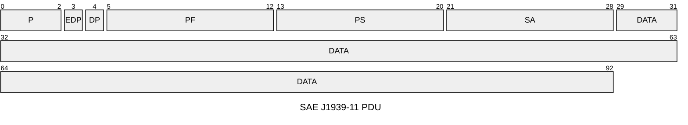
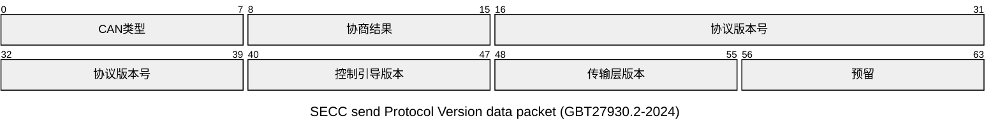
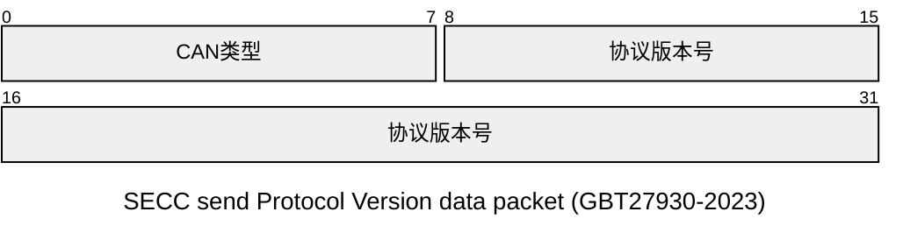
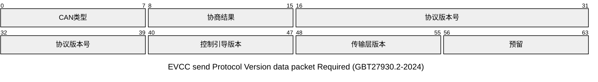
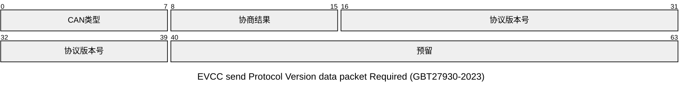
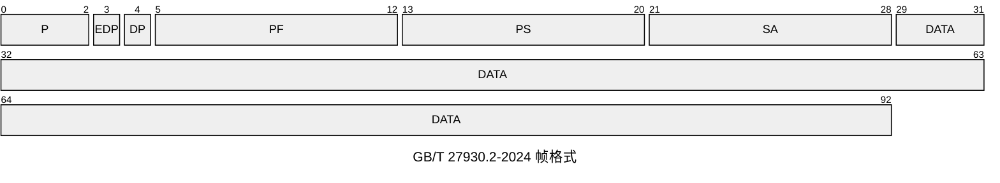

#A类系统 #B类系统 #GB-T-27930-2023 

`GB/T 27930-2015`与`GB/T 27930-2023`中**A类系统**基本相同 ,后续如未明确标注 ,则仅对比`GB/T 27930-2023`中**A/B系统**的差异
## 物理层
- 2015 :
	标准符合`ISO 11898-1`,`SAE J1939-11`皆可
- 2023 :
	标准符合`SAE J1939-11`,`SAE J1939-15`; 
- 对比 :
	`SAE J1939-11`与`ISO 11898-1`的**物理层**与**数据链路层**具有几乎相近的规范 ,`ISO11898-1`相对于`SAE J1939` 上层**传输层**等未有明确规范 
## 数据链路层

### PDU

- Ρ为优先权，从最高0设置到最低7。
- EDP为扩展数据页，预留后期扩展使用，本文件中为0。
- DP为数据页，用来选择参数组描述的辅助页，本文件中为0。
- PF为PDU格式消息类型，用来确定PDU的格式，以及数据域对应的消息类型。
- PS为 PDU特定格式，PS值取决于PDU格式，本文件中采用PDU1格式，PS值为目标地址。SA为源地址，数据帧的源地址。
- DATA 为数据域，不同消息类型的数据域定义见15章的规定。

新旧标准都基于`SAE J1939-11`,无明显变化.

### 地址分配

1. A类系统

| 设备              | 地址         |
| --------------- | ---------- |
| SECC(充电桩)       | 86(56*H*)  |
| EVCC(电动汽车通信控制器) | 244(F4*H*) |

2. B类系统

| 设备               | 地址        |
| ---------------- | --------- |
| SECC(充电桩)        | 95(5F*H*) |
| EVCC(电动汽车通信控制器)  | 37(25*H*) |
| VACC(车辆适配器通信控制器) | 96(60*H*) |
3. 具有向下兼容能力的B类系统

| 设备              | 地址         |
| --------------- | ---------- |
| SECC(充电桩)       | 86(56*H*)  |
| EVCC(电动汽车通信控制器) | 244(F4*H*) |
### B类系统数据链路层的额外机制

#### 版本协商机制
版本协商机制是**B类系统**向下**兼容A类系统**及**向后扩展**的一个机制
1. 向下兼容A类系统
	参考[GBT27930.2-2024](https://std.samr.gov.cn/gb/search/gbDetailed?id=2AD02706399B091BE06397BE0A0A2D62)附录M (版本协商阶段\[协商失败,超时,协商版本为"V1.1.0"\]进入兼容通信协议)
	兼容通信协议即为**A类系统**所规定的充电流程
2. 向后扩展
	[GBT27930-2023](https://std.samr.gov.cn/gb/search/gbDetailed?id=053404E3EF398F91E06397BE0A0A9209)B类系统所规定的版本号为`"V2.0.0"`
	目前仅有A/B两类系统 ,A类系统适用兼容通信协议(`V1.1.0`) ,后续通信协议可通过版本协商区分
##### 版本协商流程
> 本段内容使用[GBT27930.2-2024](https://std.samr.gov.cn/gb/search/gbDetailed?id=2AD02706399B091BE06397BE0A0A2D62)部分对于版本协商的扩展定义 
> ~~[GBT27930-2023](https://std.samr.gov.cn/gb/search/gbDetailed?id=053404E3EF398F91E06397BE0A0A9209)对于此段内容协商数据域未能完全包含所有字段~~
>> [GBT27930-2023](https://std.samr.gov.cn/gb/search/gbDetailed?id=053404E3EF398F91E06397BE0A0A9209)发送帧id的*目的地址*与*源地址*区别于[GBT27930.2-2024](https://std.samr.gov.cn/gb/search/gbDetailed?id=2AD02706399B091BE06397BE0A0A2D62) , **兼容B系统**为了使充电机及车辆端能正常受到握手报文 , 采用与**A类系统**相同的固定地址
>> **B类系统**如不支持兼容 , 发送版本协商帧异于**兼容B系统**
1. SECC->EVCC:
**兼容系统**
SECC发送帧`canid:0xC38F456 data:0x00 0x00 0x02 0x00 0x00 0x02 0x01 0xff` ;

**B系统**
SECC发送帧`canid:0xC38255F data:0x00 0x02 0x00 0x00 0xff 0xff 0xff 0xff` ;

2. EVCC->SECC
**兼容系统**
若车载协议符合SECC发出的协商版本 ,则如下回复:
`canid:0xC3856F4 data:0x00 0x01 0x02 0x00 0x00 0x02 0x01 0xff`  ;

**B系统**
若车载协议符合SECC发出的协商版本 ,则如下回复:
`canid:0xC385F25 data:0x00 0x01 0x02 0x00 0x00 0xff 0xff 0xff`  ;

3. A类系统的充电握手阶段
	> 此部分内容属于A类系统的**应用层**    
	使用`SAE J1939-11` 所使用的PGN规则发送握手报文 ,见下表:

| 报文代号                          | 报文名称    | PGN(Dec) | PGN(Hex) | 优先权 | 数据长度BYTE | 保温周期ms | 源地址->目的地址    |
| ----------------------------- | ------- | -------- | -------- | --- | -------- | ------ | ------------ |
| [[A类系统#CHM(0x1826F456)\|CHM]] | 充电机握手报文 | 9728     | 0x002600 | 6   | 3        | 250    | 充电机->车辆      |
| [[A类系统#BHM(0x182756F4)\|BHM]] | 车辆握手报文  | 9984     | 0x002700 | 6   | 2        | 250    | 车辆->充电机      |
| [[A类系统#CRM(0x1801F456)\|CRM]] | 充电机辨识报文 | 256      | 0x000100 | 6   | 8        | 250    | 充电机->BMS(车辆) |
| [[A类系统#BRM(0x1C0256F4)\|BRM]] | 车辆辨识报文  | 512      | 0x000200 | 7   | 49       | 250    | 车辆->充电机      |

`PGN = PF × 256 = PF << 8`
`eg: CHM : canid: 0x1826F456 `

### B类系统的传输层额外定义
> B类系统额外定义了一层来取代`SAE J1939-11`所定义的PGN
> 帧格式上 ,B类系统与`SAE J1939-11`无区别

| 消息                                  | 优先权  | PF   |
| ----------------------------------- | ---- | ---- |
| 不需确认的短消息(SM_URM)                    | 0x06 | 0x36 |
| 需确认的短消息(SM_RM)                      | 0x04 | 0x35 |
| 需确认的短消息的控制帧(SM_ACK)                 | 0x03 | 0x37 |
| 长消息(LM)                             | 0x06 | 0x34 |
| 长消息的控制帧(LM_ACK/LM_NACK/LM_EndofACK) | 0x03 | 0x37 |

| 控制帧类型       | 数据域:idx:0 | 数据域:idx:1 | 数据域:idx:2   | 数据域:idx:3 | 备注          |
| ----------- | --------- | --------- | ----------- | --------- | ----------- |
| SM_ACK      | 0x00      | 0x01      | 被确认短消息参数组标识 | -         | -           |
| LM_ACK      | 0x01      | 待接收起始帧序号  | 待接收总帧数      | -         | 可靠传输-回退N帧协议 |
| LM_NACK     | 0x02      | -         | -           | -         | 放弃链接        |
| LM_EndofACK | 0x03      | 接收的总帧数    | 接收的总字节数     | 接收的总字节数   | -           |
> 长消息传输模型类似于[[可靠传输#回退N帧]] ,但标准中使用完全固定的帧序号 ,而不是通过窗口来确定帧序号
> ~~***标准中未规范发生漏帧时如何处理***~~
> 标准中在**发送方状态转换表**中**S2数据传输**部分描述了如何处理`LM_ACK(n,k)` :
> 保存`k` , 并调整发送包序号为`n` 

## 应用层

### [[A类系统]]
仅依靠`SAE J1939-11`中各个PGN组和组内规定的参数格式来发送报文
#### [[TP_CM报文]]
- TP_CM 是 J1939 里**两点之间一对一**的多包传输方式，只在发送方和接收方之间通信，不广播。
- 传输以 **CM 报文（PGN=0x00EC00）** 开始，控制字为 **RTS（请求发送）**，并携带总字节数、总包数、要传输的 PGN 信息。
- 接收方回复 **CTS（清除发送）** 的 CM 报文，告知可以接收的包数量和起始包号。
- 发送方按 CTS 要求，用 **DT 数据报文（PGN=0x00EB00）** 分段发数据。
- CTS 与 DT 反复交互，直到所有数据发完。
- 传输完成后，接收方发 **EOM（结束确认）** 的 CM 报文，连接正式关闭。
- 整个过程有握手、有确认、有流控，可靠但比 TP_BAM 复杂。

## 充电流程
### [GBT27930-2023-A类系统](https://std.samr.gov.cn/gb/search/gbDetailed?id=053404E3EF398F91E06397BE0A0A9209)与[GBT27930-2015](https://std.samr.gov.cn/gb/search/gbDetailed?id=71F772D80B0CD3A7E05397BE0A0AB82A)充电流程差异
> 两类系统之间定义基本相同 ,仅存在部分流程判断中条件的微小差异
#### 充电握手阶段
- BHM报文结束发送条件差异
	- [GBT27930-2015](https://std.samr.gov.cn/gb/search/gbDetailed?id=71F772D80B0CD3A7E05397BE0A0AB82A): 收到CRM即中止
	- [GBT27930-2023-A类系统](https://std.samr.gov.cn/gb/search/gbDetailed?id=053404E3EF398F91E06397BE0A0A9209): 收到CRM未完成辨识报文中止
#### 充电阶段
##### CST报文差异
[GBT27930-2023-A类系统](https://std.samr.gov.cn/gb/search/gbDetailed?id=053404E3EF398F91E06397BE0A0A9209)对[[A类系统#CST(0x101AF456)|CST]]报文
- **充电机中止充电故障原因**增加了两个字段故障(自检故障、预充故障)
- **充电机中止充电错误原因**增加了一个字段错误原因(充电参数不匹配)

#### 充电结束阶段

##### BST 与 BSD报文差异
- BST报文结束发送条件差异
	- [GBT27930-2015](https://std.samr.gov.cn/gb/search/gbDetailed?id=71F772D80B0CD3A7E05397BE0A0AB82A): 发送BSD报文的同时
	- [GBT27930-2023-A类系统](https://std.samr.gov.cn/gb/search/gbDetailed?id=053404E3EF398F91E06397BE0A0A9209): 发送5~10包BST报文后
- BSD报文开始发送条件差异
	- [GBT27930-2015](https://std.samr.gov.cn/gb/search/gbDetailed?id=71F772D80B0CD3A7E05397BE0A0AB82A): 收到CST报文
	- [GBT27930-2023-A类系统](https://std.samr.gov.cn/gb/search/gbDetailed?id=053404E3EF398F91E06397BE0A0A9209): 发送5~10包BST报文后

>  [GBT27930-2015](https://std.samr.gov.cn/gb/search/gbDetailed?id=71F772D80B0CD3A7E05397BE0A0AB82A)在结束充电(充电机主动中止充电)时 , BST功能作用不显(未能发挥作用) ;
>  具体表现为 : 在充电机主动发送CST时 , BST与BSD过渡不明显 , BST与BSD开始发送条件均为接收到CST , 但BST中止条件为自身发送BSD;
>  这将导致车载系统行为差异化 , 即有的系统可能仍会发送BST , 但有的系统直接跳过发送BST直接发送BSD;
>  [GBT27930-2023-A类系统](https://std.samr.gov.cn/gb/search/gbDetailed?id=053404E3EF398F91E06397BE0A0A9209)在结束充电(充电机主动中止充电)时 , 规定充电机主动中止充电时BST行为;
>  即直接接收到CST时 , 仍要发送5~10包BST , 而后发送BSD

##### BSD 与 CSD报文差异
- BSD报文结束条件差异
	- [GBT27930-2015](https://std.samr.gov.cn/gb/search/gbDetailed?id=71F772D80B0CD3A7E05397BE0A0AB82A): 收到CRM报文或检测不到辅助电源输出
	- [GBT27930-2023-A类系统](https://std.samr.gov.cn/gb/search/gbDetailed?id=053404E3EF398F91E06397BE0A0A9209): 收到CSD报文
- CSD报文结束条件差异
	- [GBT27930-2015](https://std.samr.gov.cn/gb/search/gbDetailed?id=71F772D80B0CD3A7E05397BE0A0AB82A): 重新发送CRM报文或关闭辅助电源输出
	- [GBT27930-2023-A类系统](https://std.samr.gov.cn/gb/search/gbDetailed?id=053404E3EF398F91E06397BE0A0A9209): 关闭辅助电源输出

>  [GBT27930-2015](https://std.samr.gov.cn/gb/search/gbDetailed?id=71F772D80B0CD3A7E05397BE0A0AB82A)在结束充电时 , BSD/CSD/CRM功能作用混乱 ;
>  具体表现为 : 判断结束充电的依据是依靠非对应功能的**CRM**报文 , 且车载端和充电桩均不互相依赖对应的**BSD/CSD**报文结束充电阶段;
>  这将导致**CSD/BSD**报文无法完成对应信息交换功能 , 充电结束阶段各充电桩与车载系统之间交互混乱 ; 有可能导致CRM重启充电交互;
>  [GBT27930-2023-A类系统](https://std.samr.gov.cn/gb/search/gbDetailed?id=053404E3EF398F91E06397BE0A0A9209)在结束充电时 , 规定**BSD/CSD**单一结束条件;
>  确保车端与充电机能准确收到对应充电结束信息 , 再由充电机断开辅助电源 , 确保安全

#### 充电错误报文
##### CEM报文差异
[GBT27930-2023-A类系统](https://std.samr.gov.cn/gb/search/gbDetailed?id=053404E3EF398F91E06397BE0A0A9209)对[[A类系统#CEM(0x101FF456)|CEM]]报文
- 增加一个**SPN3928接收BSM超时**错误字段

## B类系统与兼容系统的差异

### 功能模块

#### 
