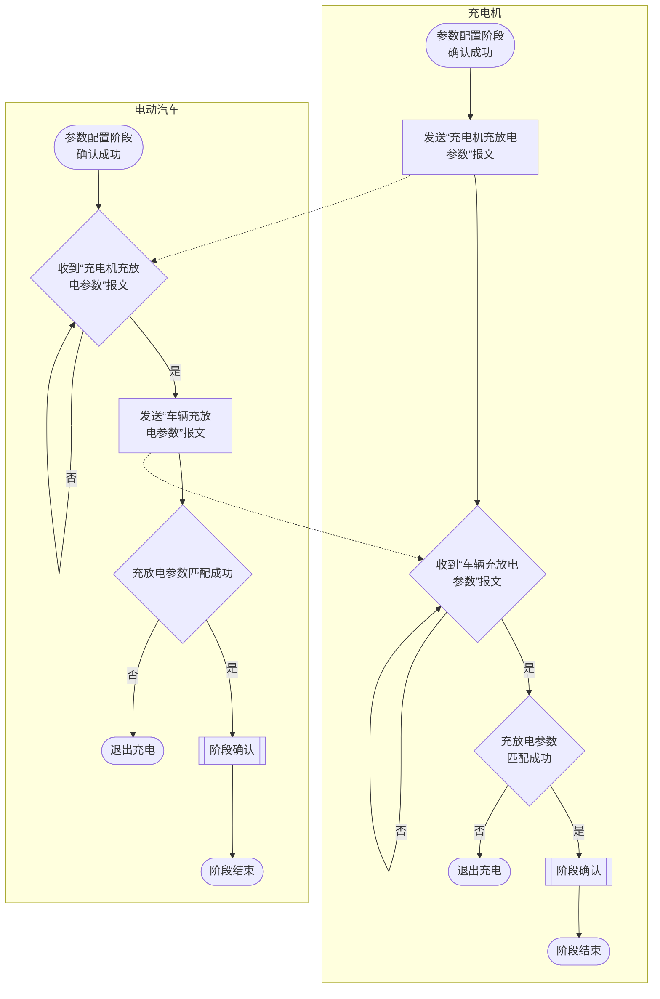

<!-- Page 1 -->

ICS 43.120  
CCS T 35

# 中华人民共和国国家标准

## GB/T 27930.2—2024

---

# 非车载传导式充电机与电动汽车之间  
# 的数字通信协议　第 2 部分：用于  
# GB/T 20234.3 的通信协议

**Digital communication protocols between off-board conductive charger and**  
**electric vehicle—Part 2: Communication protocols for GB/T 20234.3**

2024-12-31 发布　　　　　　　　　　　　　　　　　2024-12-31 实施

---

国家市场监督管理总局  
国家标准化管理委员会　发布


<!-- Page 2 -->


<!-- Page 3 -->

GB/T 27930.2—2024

# 目次

| 条目 | 页码 |
|---|---:|
| 前言 | Ⅲ |
| 引言 | Ⅳ |
| 1 范围 | 1 |
| 2 规范性引用文件 | 1 |
| 3 术语和定义 | 1 |
| 4 缩略语 | 1 |
| 5 总体要求 | 2 |
| 6 物理层 | 3 |
| 7 数据链路层 | 3 |
| &emsp;7.1 总体要求 | 3 |
| &emsp;7.2 版本协商 | 4 |
| 8 传输层 | 11 |
| &emsp;8.1 通则 | 11 |
| &emsp;8.2 不需要确认的短消息 | 12 |
| &emsp;8.3 需要确认的短消息 | 12 |
| &emsp;8.4 长消息 | 12 |
| &emsp;8.5 多信息帧传输方式 | 13 |
| 9 应用层 | 21 |
| &emsp;9.1 总体要求 | 21 |
| &emsp;9.2 通信过程 | 22 |
| &emsp;9.3 公共报文 | 24 |
| 10 超时 | 30 |
| &emsp;10.1 概述 | 30 |
| &emsp;10.2 数据链路层和传输层超时 | 30 |
| &emsp;10.3 应用层功能模块超时 | 30 |
| 附录 A（规范性） 应用场景的实现 | 32 |
| &emsp;A.1 充电应用场景 | 32 |
| &emsp;A.2 充放电应用场景 | 33 |
| 附录 B（规范性） 功能协商功能模块 | 35 |
| &emsp;B.1 概述 | 35 |
| &emsp;B.2 总体要求 | 35 |
| &emsp;B.3 报文定义 | 35 |
| &emsp;B.4 报文交互过程 | 38 |
| 附录 C（规范性） 参数配置功能模块 | 42 |
| &emsp;C.1 概述 | 42 |

Ⅰ


<!-- Page 4 -->

GB/T 27930.2—2024

| 条目 | 名称 | 页码 |
|---|---|---:|
| C.2 | 充电模式参数配置（FDC＝1） | 42 |
| C.3 | 充放电模式参数配置（FDC＝2） | 46 |
| 附录 D（规范性） | 鉴权功能模块 | 52 |
| D.1 | 通则 | 52 |
| D.2 | 扫码/刷卡（FDC＝1） | 52 |
| D.3 | EVIN 鉴权（FDC＝2） | 57 |
| D.4 | 云端鉴权-桩识别码（FDC＝3） | 62 |
| 附录 E（规范性） | 预约充电功能模块 | 68 |
| E.1 | 通则 | 68 |
| E.2 | 车辆定义预约开始时间（FDC＝1） | 68 |
| 附录 F（规范性） | 输出回路检测功能模块 | 77 |
| F.1 | 通则 | 77 |
| F.2 | 输出回路检测（FDC＝1） | 77 |
| 附录 G（规范性） | 供电模式功能模块 | 84 |
| G.1 | 通则 | 84 |
| G.2 | 恒压供电模式（FDC＝1） | 84 |
| 附录 H（规范性） | 预充及能量传输模块 | 93 |
| H.1 | 通则 | 93 |
| H.2 | 充电模式预充及能量传输（FDC＝1） | 93 |
| H.3 | 充放电模式预充及能量传输（FDC＝2） | 105 |
| 附录 I（规范性） | 结束功能模块 | 126 |
| I.1 | 概述 | 126 |
| I.2 | 结束（FDC＝1） | 126 |
| 附录 J（规范性） | 报文周期及功能模块超时 | 133 |
| 附录 K（规范性） | 退出方式 | 141 |
| 附录 L（规范性） | 参数类型表 | 144 |
| 附录 M（规范性） | 向下兼容的通信协议 | 155 |
| M.1 | 通则 | 155 |
| M.2 | 物理层 | 155 |
| M.3 | 数据链路层 | 155 |
| M.4 | 应用层 | 156 |
| M.5 | 充电总体流程 | 157 |
| M.6 | 报文分类 | 157 |
| M.7 | 报文格式和内容 | 159 |
| M.8 | 充电流程 | 172 |
| M.9 | 报文开始发送条件和结束发送条件 | 178 |
| 参考文献 |  | 180 |

Ⅱ


<!-- Page 5 -->

GB/T 27930.2—2024

# 前言

本文件按照 GB/T 1.1—2020《标准化工作导则　第 1 部分：标准化文件的结构和起草规则》的规定起草。

本文件是 GB/T 27930 的第 2 部分。GB/T 27930 已经发布了以下部分：

———非车载传导式充电机与电动汽车之间的数字通信协议；

———非车载传导式充电机与电动汽车之间的数字通信协议　第 2 部分：用于 GB/T 20234.3 的通信协议。

请注意本文件的某些内容可能涉及专利。本文件的发布机构不承担识别专利的责任。

本文件由中华人民共和国工业和信息化部提出。

本文件由全国汽车标准化技术委员会（SAC/TC 114）归口。

本文件起草单位：中国汽车技术研究中心有限公司、比亚迪汽车工业有限公司、华为数字能源技术有限公司、北汽福田汽车股份有限公司、广汽埃安新能源汽车股份有限公司、广州小鹏汽车科技有限公司、蔚来汽车科技（安徽）有限公司、深圳市车电网络有限公司、广州巨湾技研有限公司、深蓝汽车科技有限公司、领充新能源科技有限公司、中汽研新能源汽车检验中心（天津）有限公司、特来电新能源股份有限公司、天津平高易电科技有限公司、合肥国轩高科动力能源有限公司、深圳巴斯巴科技发展有限公司、杭州中恒电气股份有限公司、宁德时代新能源科技股份有限公司、中汽研汽车检验中心（广州）有限公司、湖南京能新能源科技有限公司、北京车和家汽车科技有限公司、吉利汽车研究院（宁波）有限公司、绿能慧充数字技术有限公司、梅赛德斯—奔驰（中国）投资有限公司、深圳市欧澄电气有限公司、中国第一汽车集团有限公司、重庆长安汽车股份有限公司、威凯检测技术有限公司、中石油昆仑网联电能科技有限公司、长城汽车股份有限公司、开迈斯新能源科技有限公司、长园深瑞能源技术有限公司、沃尔沃汽车（亚太）投资控股有限公司。

本文件主要起草人：廉玉波、徐枭、赵颖、李津、邵长宏、韩忠华、郑天雷、廖梦雄、王芳、赵绿化、兰海波、柳邵辉、刘庆荣、邱鹏、李骁、孙茂建、程浩、王兵、王春生、彭文科、邱石军、樊彬、李川、谭易、魏俊生、方灵珊、何源、郑祥杰、冯斌、孙小文、季学彬、朱健强、李恩虎、荣超、廖超、田宇威、谷兆宁、巩慧蛟、吕国伟、吕玉华、李亮、姜毅、谢娜、梁士福、武亨、姜瑞、陈基永、周安健、闫磊、房凯龙、高峰、王超、王婧雅、杨俊、许青松、柳志民。

Ⅲ


<!-- Page 6 -->

GB/T 27930.2—2024

# 引言

随着电动汽车相关产业与消费市场规模的快速扩大，行业迫切需求大功率充电、即插即充、预约充电、放电等新充电功能，直流充电通信协议标准亟待升级。本文件规定了用于 GB/T 20234.3 直流充电接口的非车载传导式充电机与电动汽车之间的直流充电通信协议，具体给出了通信协议的物理层、数据链路层、传输层和应用层的详细内容。本文件规定的直流通信协议进一步提升了充电的安全性、兼容性与便捷性，从而引导电动汽车相关产业的高质量发展。

GB/T 27930 拟由 2 个部分构成。

———第 1 部分：用于 GB/T 20234.3 和 GB/T 20234.4 的通信协议。目的在于确立 GB/T 20234.3 和 GB/T 20234.4 直流充电接口所应用的数字通信数据链路层、传输层和应用层等内容。

———第 2 部分：用于 GB/T 20234.3 的通信协议。目的在于确立 GB/T 20234.3 直流充电接口所应用的数字通信数据链路层、传输层和应用层等内容，用于实现大功率充电、即插即充、预约充电、放电等数字通信。

Ⅳ


<!-- Page 7 -->

GB/T 27930.2—2024

# 非车载传导式充电机与电动汽车之间的数字通信协议 第 2 部分：用于 GB/T 20234.3 的通信协议

## 1 范围

本文件规定了用于 GB/T 20234.3 直流充电接口的电动汽车直流充电通信控制器与非车载传导式充电机充电通信控制器之间基于控制器局域网的物理层、数据链路层、传输层及应用层的通信协议。

本文件适用于直流控制导引电路与控制原理符合 GB/T 18487.5 的电动汽车（简称“车辆”）与非车载传导式充电机（简称“充电机”）之间的数字通信。

## 2 规范性引用文件

下列文件中的内容通过文中的规范性引用而构成本文件必不可少的条款。其中，注日期的引用文件，仅该日期对应的版本适用于本文件；不注日期的引用文件，其最新版本（包括所有的修改单）适用于本文件。

GB/T 1988　信息技术　信息交换用七位编码字符集

GB 16735　道路车辆　车辆识别代号（VIN）

GB 18030　信息技术　中文编码字符集

GB/T 18487.5　电动汽车传导充电系统　第 5 部分：用于 GB/T 20234.3 的直流充电系统

GB/T 19596　电动汽车术语

GB/T 20234.3　电动汽车传导充电用连接装置　第 3 部分：直流充电接口

GB/T 27930—2023　非车载传导式充电机与电动汽车之间的数字通信协议

GB/T 29317　电动汽车充换电设施术语

## 3 术语和定义

GB/T 19596、GB/T 27930—2023 和 GB/T 29317 界定的以及下列术语和定义适用于本文件。

### 3.1

**功能模块**　*function module*

由充电通信交互过程划分的若干个可定义的、具有特定业务功能的最小单元。

### 3.2

**公共报文**　*public message*

满足发送条件时，在应用层各功能模块均可交互的报文。

## 4 缩略语

下列缩略语适用于本文件。

CAN：控制器局域网（Controller Area Network）


<!-- Page 8 -->

GB/T 27930.2—2024

CP：控制导引（Control Pilot）

EVCC：车辆充电通信控制器（Electric Vehicle Communication Controller）

LM：长消息（Long Message）

LM_ACK：长消息应答确认（Long Message Acknowledgment）

LM_EndofACK：长消息接收结束确认（Long Message End of Acknowledgment）

LM_NACK：长消息放弃连接确认（Long Message Negative Acknowledgment）

SECC：充电机充电通信控制器（Supply Equipment Communication Controller）

SM：短消息（Short Message）

SM_ACK：短消息应答确认消息（Short Message Acknowledgment）

SM_RM：需要确认的短消息（Reliable Short Message）

SM_URM：不需要确认的短消息（Unreliable Short Message）

TL：传输层（Transport Layer）

## 5 总体要求

### 5.1

本文件规定的数字通信协议适用的充电接口应符合 GB/T 20234.3。

### 5.2

本文件规定的数字通信协议适用的直流充电系统应符合 GB/T 18487.5。

### 5.3

车辆与充电机之间的通信网络基于 CAN2.0B 协议，通信模型分为物理层、数据链路层、传输层和应用层，分别按第 6 章、第 7 章、第 8 章和第 9 章的规定。协议架构分层模型见图 1。

| 层级 | 各层定义和要求 | 实现方式 | 层间接口关系 |
|---|---|---|---|
| 应用层 | **报文**<br><br>规定充电通信过程、各个功能模块功能及运行过程<br><br>规定报文类型、数据格式内容以及发送方式 | 软件 | 消息发送调用<br>消息接收通知<br>收发状态 |
| 传输层 | **消息**<br><br>定义传输消息类型、可靠和非可靠性消息传输机制和要求 | 软件 | 接收缓冲区<br>发送缓冲区<br>总线状态 |
| 数据链路层 | **数据帧**<br><br>规定帧格式、协议数据单元格式、通信地址、版本协商等要求 | CAN控制器 | 硬线连接 |
| 物理层 | **比特流**<br><br>规定CAN总线传输速率、节点数量、抗干扰等要求 | CAN收发器 |  |

注 1：实现方式、层间接口关系不在本文件规定范围内。

注 2：“上层”或“上层应用”用于描述当前层以上层级。

注 3：本文件规定的通信协议应用层要求同样适用于可变速率 CAN（CAN FD）、扩展长度 CAN（CAN XL）等协议。CAN FD、CAN XL 为未来功能预留，实现方式未在本文件中规定。

**图 1　协议架构分层模型**

### 5.4

车辆与充电机之间的通信过程由不同功能模块组成，充电和充放电应用场景的功能模块应符合附录 A 的规定。

### 5.5

功能模块的信息交互报文、交互过程应符合附录 B～附录 I 的规定。应用层各功能模块间的确认和连接应按 9.3.1 阶段确认的要求完成。

2


<!-- Page 9 -->

GB/T 27930.2—2024

5.6　报文周期及功能模块超时应符合附录 J 的规定。退出方式应符合附录 K 的规定。参数类型表应符合附录 L 的规定。

5.7　通信过程自物理连接完成后应立即进入版本协商阶段。版本协商完成后，应根据协商结果确认选择协商一致的版本进行充电。通信协议具备向下兼容（兼容旧版本）能力，通信流程通过版本协商跳转进入向下兼容的通信协议。向下兼容的通信协议应符合附录 M 的规定。

5.8　本文 件规定的通信协议版本号为 V2.0.0，主版本号和次版本号由本文 件定义，临时版本号仅用于企业的内部开发。

> 注：企业内部开发意味着采用自定义临时版本号的车辆或充电机不在市场流通。产品开发阶段的企业外部验证或示范活动采用自定义临时版本号时，通过在本文 件归口的标准化机构备案临时版本号以避免临时版本号无序使用。

5.9　通信交互应符合状态转换表的要求。

> 注 1：状态转换表定义了充电机和车辆的交互状态转换方式。状态转换表左侧列为充电机或车辆在当前通信流程的状态，上方表头为触发状态跳转的条件。  
>
> 注 2：流程图给出了车辆和充电机（简称“车桩”）交互状态和功能跳转的图形化示意，便于文件使用者的快速理解。

# 6　物理层

车辆与充电机之间的通信物理层应符合 GB/T 27930—2023 第 13 章的规定。其中，物理层应使用独立的 CAN 总线，支持 EVCC 和 SECC 共 2 个节点。

# 7　数据链路层

## 7.1　总体要求

### 7.1.1　帧格式

车辆与充电机之间的通信帧格式应符合 GB/T 27930—2023 中 14.1 的规定。

### 7.1.2　协议数据单元

协议数据单元由优先权、扩展数据页、数据页、PDU 格式、PDU 特定格式、源地址和数据域共 7 个部分组成，应符合表 1 的规定。

**表 1　协议数据单元**

| P | EDP | DP | PF | PS | SA | DATA |
|---:|---:|---:|---:|---:|---:|---:|
| 3 | 1 | 1 | 8 | 8 | 8 | 0～64 |

数据格式要求：

1. P 为优先权：从最高 0 到最低 7；
2. EDP 为扩展数据页：以备未来扩展使用，本文件中为 0；
3. DP 为数据页：用来选择参数组描述的辅助页，本文件中为 0；
4. PF 为 PDU 格式：用来确定 PDU 的格式，以及数据域对应的消息类型；
5. PS 为 PDU 特定格式：PS 值取决于 PDU 格式，本文件中采用 PDU1 格式，PS 值为目的地址；
6. SA 为源地址：数据帧的源地址；
7. DATA 为数据域：不同消息类型的数据域定义详见应用层的规定；
8. 本表第三行表示位数。


<!-- Page 10 -->

GB/T 27930.2—2024

### 7.1.3 协议数据单元格式

协议数据单元格式应符合 GB/T 27930—2023 中 14.3 的规定。

### 7.1.4 地址分配

EVCC 和 SECC 应定义为不可配置地址且为定值，包括服务工具在内的任何手段都不能改变其源地址。EVCC 和 SECC 的地址分配应符合表 2 的要求。

注：网络地址用于保证信息标识符的唯一性以及表明信息的来源。

**表 2　地址分配**

| 序号 | 节点 | 地址 |
|---|---|---|
| 1 | EVCC | 244(F4H) |
| 2 | SECC | 86(56H) |
| 注：本文统一分配通信节点地址。 |  |  |

## 7.2 版本协商

### 7.2.1 总体要求

充电机和车辆应通过协商决定本次交互的通信协议版本。版本协商的协商原则、报文定义和信息交互过程应固定不变。版本协商总体要求应符合表 3 的规定。

**表 3　版本协商总体要求**

| 序号 | 项目 | 要求 |
|---|---|---|
| 1 | 名称 | 版本协商 |
| 2 | 目标 | 充电机和车辆协商决定通信协议版本 |
| 3 | 描述 | 确认物理连接完成（按 GB/T 18487.5），通信链路建立之后，双方进行通信协议版本协商，向对方发送己方支持的最高协议版本号（版本的比较即数字的大小比较）并读取对方判断结果，版本协商应满足以下要求。<br><br>——如对方发送协商成功且协商版本一致，或对方发送协商失败，则结束协商。<br><br>——如对方发送继续协商，则判断接收版本是否支持，支持则发送协商成功并将协议版本修改为协商版本。<br><br>——如不支持该版本且低于对方发送的版本，则保持当前版本并“继续协商”。<br><br>——如不支持该版本且高于对方版本但有低于对方发送的版本，则根据“期望版本号”调整协议版本指向低于对方期望版本中最高的版本，发送协议版本并“继续协商”。<br><br>——如接收版本已低于最低版本，则发送“协商失败”。<br><br>版本协商成功后，车辆持续发送“协商成功”，直到充电机发送下一阶段报文。充电机在接收车辆发送“协商成功”且版本不低于 V2.0.0 后进入功能协商阶段。<br><br>满足以下任一情况，双方进入附录 M 通信流程（不需发送阶段确认报文）：<br><br>——协商失败；<br><br>——从己方首次发送版本协商报文超过 10 s；<br><br>——车辆收到 CHM/CRM 报文；<br><br>——版本协商成功且协商成功版本低于 V2.0.0。<br><br>进入附录 M 通信流程后，充电机应符合 GB/T 18487.5 的规定，车辆应等待充电机闭合辅源及发送 CHM/CRM 报文。 |

4


<!-- Page 11 -->

GB/T 27930.2—2024

**表 3　版本协商总体要求（续）**

| 序号 | 项目 | 要求 |
|---|---|---|
| 4 | 前置条件 | 确认物理连接完成，通信链路建立后同时开始。<br><br>在辅源或报文唤醒车辆后，充电机应重新发起版本协商（仅适用于自动重连或重启充电）。 |
| 5 | 协议版本 | 充电机和车辆宜支持多个版本的通信协议。协商成功时，双方支持相同的协议版本，否则协商失败。<br><br>通信协议版本号由 CAN 类型、主版本号、次版本号、临时版本号组成，应满足以下要求：<br><br>——当前 CAN 类型为 CAN2.0B，同时预留 CAN FD、CAN XL 的应用；<br><br>——主版本号在通信协议有结构性变化（如功能模块有变化）时更新；<br><br>——次版本号在通信协议有较大功能变化时更新；<br><br>——临时版本号仅用于企业内部的示范、测试等临时用途，正式发布的版本中临时版本号为 0。 |
| 6 | 结束条件 | 协商成功条件包括：<br><br>——版本协商成功，版本低于 V2.0.0（如 V1.1.0），充电机根据自身需求适时提供辅源，双方按照附录 M 进行信息交互；<br><br>——版本协商成功，版本不低于 V2.0.0，双方发送“协商成功”，双方按照协商一致的协议版本进行信息交互。<br><br>协商失败条件包括：<br><br>——版本协商失败，充电机或车辆发送“协商失败”，双方按附录 M 进行通信；<br><br>——版本协商超时，充电机或车辆发送“协商失败”，双方按附录 M 进行通信。<br><br>退出条件包括：<br><br>——在版本协商时，充电机可断开开关 S1，双方停止通信，退出充电流程；<br><br>——在版本协商时，车辆可断开开关 S2，双方停止通信，退出充电流程。 |

### 7.2.2　报文定义

版本协商交互报文的数据链路层应满足 7.1 的规定。版本协商包括“充电机版本协商”和“车辆版本协商”报文，其帧格式定义应分别符合表 4 和表 5 的规定，数据域内容应分别符合表 6 和表 7 的规定。

**表 4　充电机版本协商帧格式**

| 协议数据单元 | P | EDP | DP | PF | PS | SA | 数据域 1 | 数据域 2 | 数据域 3 | 数据域 4 | 数据域 5 | 数据域 6 | 数据域 7 | 数据域 8 |
|---|---:|---:|---:|---:|---:|---:|---:|---:|---:|---:|---:|---:|---:|---:|
| 占位 bit | 3 | 1 | 1 | 8 | 8 | 8 | 8 | 8 | 8 | 8 | 8 | 8 | 8 | 8 |
| 定义 | 0x03 | 0 | 0 | 0x38 | 0xF4<br>（目的地址） | 0x56<br>（源地址） | colspan=8：应符合表 6 |  |  |  |  |  |  |  |

**表 5　车辆版本协商帧格式**

| 协议数据单元 | P | EDP | DP | PF | PS | SA | 数据域 1 | 数据域 2 | 数据域 3 | 数据域 4 | 数据域 5 | 数据域 6 | 数据域 7 | 数据域 8 |
|---|---:|---:|---:|---:|---:|---:|---:|---:|---:|---:|---:|---:|---:|---:|
| 占位 bit | 3 | 1 | 1 | 8 | 8 | 8 | 8 | 8 | 8 | 8 | 8 | 8 | 8 | 8 |
| 定义 | 0x03 | 0 | 0 | 0x39 | 0x56<br>（目的地址） | 0xF4<br>（源地址） | colspan=8：应符合表 7 |  |  |  |  |  |  |  |


<!-- Page 12 -->

GB/T 27930.2—2024

**表 6　充电机版本协商数据域内容**

| 序号 | 参数内容 | 长度 | 数据类型 | 参数类型 | 描述与要求 |
|---|---|---|---|---|---|
| 1 | CAN 类型 | 1 字节 | BYTE | CANType | 充电机 CAN 类型：<br><br>0x00：CAN2.0B；<br><br>0x01：CAN FD；<br><br>0x02：CAN XL。<br><br>当前版本采用 CAN2.0B 通信。接收方不以该值判定协商结果，高版本兼容低版本 |
| 2 | 协商结果 | 1 字节 | BYTE | VersionResultType | 充电机版本协商结果：<br><br>0x00：继续协商；<br><br>0x01：协商成功；<br><br>0x02：协商失败 |
| 3 | 协议版本号 | 3 字节 | BYTE[3] | ProtocolVersionType | 充电机期望或协商一致的版本号。<br><br>BYTE1：主版本号；<br><br>BYTE2：次版本号；<br><br>BYTE3：临时版本号。<br><br>如：BYTE1：0x01，BYTE2：0x02，BYTE3：0x03，则版本号为 V1.2.3。<br><br>若充电机协商结果为“协商成功”，值为双方协商一致的版本号。<br><br>若充电机协商结果为“继续协商”，值为充电机期望的版本号。<br><br>若充电机协商结果为“协商失败”，值为 0xFFFFFF |
| 4 | 控制导引版本 | 1 字节 | BYTE | CPVersionType | 充电机控制导引版本：<br><br>0x01：GB/T 18487.5 中旧版本充电机控制导引电路；<br><br>0x02：GB/T 18487.5。<br><br>接收方不以该值判定协商结果 |
| 5 | 传输层版本 | 1 字节 | BYTE | TLVersionType | 充电机传输层版本：<br><br>0x01：第 8 章；<br><br>0xFF：其他。<br><br>接收方不以该值判定协商结果，高版本兼容低版本 |
| 6 | 预留 | 1 字节 | BYTE | ReservedType | 接收方不判断该值，默认填充 0xFF |

6


<!-- Page 13 -->

表7　车辆版本协商数据域内容

| 序号 | 参数内容 | 长度 | 数据类型 | 参数类型 | 描述与要求 |
|---:|---|---|---|---|---|
| 1 | CAN类型 | 1字节 | BYTE | CANType | 车辆CAN类型：<br>0x00：CAN2.0B；<br>0x01：CAN FD；<br>0x02：CAN XL。<br>当前版本采用CAN2.0B通信。接收方不以该值判定协商结果，高版本兼容低版本 |
| 2 | 协商结果 | 1字节 | BYTE | VersionResultType | 车辆版本协商结果：<br>0x00：继续协商；<br>0x01：协商成功；<br>0x02：协商失败 |
| 3 | 协议版本号 | 3字节 | BYTE[3] | ProtocolVersionType | 车辆期望或协商一致的版本号。<br>BYTE1：主版本号；<br>BYTE2：次版本号；<br>BYTE3：临时版本号。<br>如：BYTE1：0x01，BYTE2：0x02，BYTE3：0x03，则版本号为V1.2.3。<br>若车辆协商结果为“协商成功”，值为双方协商一致的版本号。<br>若车辆协商结果为“继续协商”，值为车辆期望的版本号。<br>若车辆协商结果为“协商失败”，值为0xFFFFFF |
| 4 | 控制导引版本 | 1字节 | BYTE | CPVersionType | 车辆控制导引版本：<br>0x01：GB/T 18487.5中旧版本车辆控制导引电路；<br>0x02：GB/T 18487.5。<br>接收方不以该值判定协商结果 |
| 5 | 传输层版本 | 1字节 | BYTE | TLVersionType | 车辆传输层版本：<br>0x01：第8章；<br>0xFF：其他。<br>接收方不以该值判定协商结果，高版本兼容低版本 |
| 6 | 预留 | 1字节 | BYTE | ReservedType | 接收方不判断该值，默认填充0xFF |

## 7.2.3　报文交互过程

### 7.2.3.1

物理连接完成或车桩被唤醒后1 s内（不包括预约到时唤醒），充电机和车辆分别向对方发送其支持的最高协议版本号和“继续协商”状态，接收并检查自身支持的协议版本号返回版本协商结果。若为“继续协商”，则继续以较低的协议版本号进行协商；若为“协商成功”且协议版本不低于V2.0.0，则按照协商一致的版本的通信协议进行信息交互；若为“协商失败”、超时或“协商成功”且协议版本为V1.1.0，则按附录M通信。

### 7.2.3.2

版本协商的完整状态转换过程应符合表8和表9的规定，报文交互流程示意见图2。


<!-- Page 14 -->

# 表 8　版本协商充电桩状态转接表

**GB/T 27930.2—2024**

| 充电机状态 | 触发条件 | 处理动作及下一状态 |
|---|---|---|
| S0 待复位 | 物理连接完成 | 发送“充电机版本协商”报文，协议版本号＝CVList（Ns）；打开 T1、Tout0 定时器；进入 S1。 |
| S0 待复位 | 其他条件 | — |
| S1 协商中 | 物理连接完成 | — |
| S1 协商中 | T1 到时 | 发送“充电机版本协商”报文，协议版本号＝CVList（Ns）中最小版本号；保持 S1。 |
| S1 协商中 | 接收“协商成功”报文；版本不一致 | 协商结果＝“协商成功”；保持 S1。 |
| S1 协商中 | 接收“协商成功”报文；版本一致且 ≥ V1.1.0 | 协商结果＝“协商成功”；进入 S2。 |
| S1 协商中 | 接收“协商成功”报文；版本一致且 ≥ V2.0.0 | 协商结果＝“协商成功”；进入 S3。 |
| S1 协商中 | 接收“协商失败”报文 | 进入 S4。 |
| S1 协商中 | 接收“版本协商”报文；有相同的版本号 | 根据车辆“期望版本号”信息，通知 Ns 找向低于车辆版本中最高的版本；保持 S1。 |
| S1 协商中 | 接收“版本协商”报文；版本低于车辆 | 协商结果＝“协商成功”；向低于车辆版本中最高版本；保持 S1。 |
| S1 协商中 | 接收“版本协商”报文；有更低的版本号 | 进入 S4。 |
| S1 协商中 | 接收“版本协商”报文；无更低的版本号 | 进入 S5。 |
| S1 协商中 | 充电机故障应中止充电或车辆进入 S2 | 进入 S4。 |
| S1 协商中 | Tout0 到时 | 进入 S4。 |
| S2 附录 M 协商成功 | — | 发送“协商成功”报文；关闭 T1、Tout0；进入附录 M 协商成功。 |
| S3 协商成功 | — | 发送“协商成功”报文；关闭 T1、Tout0；进入协商成功。 |
| S4 协商失败 | — | 发送“协商失败”报文；关闭 T1、Tout0；进入协商失败。 |
| S5 退出充电 | — | 结束通信，退出充电流程。 |

8


<!-- Page 15 -->

## 表 8 版本协商充电机状态转换表（续）

| 充电机 | 物理连接完成 | T1 到时 | 接收“协商成功” | 接收“缆线协商” | 充电机故障应中止充电或者车辆断开 S2 | Tout0 到时 |
|---|---|---|---|---|---|---|
|  |  |  | 版本不一致 | 有相同的版本号 |  |  |
|  |  |  | 版本一致且为 V1.1.0 | 版本低于车辆 |  |  |
|  |  |  | 版本一致且 ≥ V2.0.0 | 有更低的版本号 |  |  |
|  |  |  |  | 无更低的版本号 |  |  |

转换要求：

1) Tout0 为版本协商超时定时器，当充电机向充电管理控制器、车辆发送 CvlList(Ns) 列表报文后置 T1 定时器，同时为 50 ms；

2) T1 为充电机发送“充电机版本协商（CvlList）”定时器，充电机向车辆发送“充电机版本协商（CvlList）”报文后置 T1 定时器，同时为 50 ms；

3) CvlList 为充电机支持的协议版本列表，版本号从小到大排列，Ns 为版本号索引，初始值指向最高版本号；

4) “—”表示充电机不作任何处理。

## 表 9 版本协商车辆状态转换表

| 状态 | 触发事件 | 版本不一致 | 版本一致且为 V1.1.0 | 版本一致且 ≥ V2.0.0 | 接收“协商成功” | 有相同的版本号 | 版本低于车辆 | 有更低的版本号 | 无更低的版本号 | 接收“缆线协商” | 接收“充电机版本协商” | 接收 CHM/CRM | 车辆连接故障应中止充电或者充电机断开 S1 | Tout0 到时 |
|---|---|---|---|---|---|---|---|---|---|---|---|---|---|---|
| S0 初始化 | 物理连接完成 | — | — | — | — | — | — | — | — | — | — | 进入 S4 | — | — |
|  | 发送“车辆版本协商—协议版本号（Ns）”，打开 T1，进入 S1 |  |  |  |  |  |  |  |  |  |  |  |  |  |

GB/T 27930.2—2024

9


<!-- Page 16 -->

# 表 9　版本协商车型状态转换表（续）

### 充电机版本协商流程

| 状态类别 | 充电机状态 | 物理连接完成 | T1 到时 | 接收“协商成功”<br>版本不一致 | 接收“协商成功”<br>版本一致且为 V1.1.0 | 接收“协商成功”<br>版本一致且为 V2.0.0 | 接收“协商失败” | 接收“继续协商”<br>有相同的版本号 | 接收“继续协商”<br>版本低于车辆 | 接收“继续协商”<br>版本高于车辆且有更低的版本号 | 接收“继续协商”<br>版本高于车辆且无更低的版本号 | 接收 CHM/CRM | 车辆故障应中止充电或充电机断开 S1 | Tout0 到时 |
|---|---|---|---|---|---|---|---|---|---|---|---|---|---|---|
| 状态 | S1<br>协商中 | — | 发送“车辆版本协商”协议版本号为 `EvList(Ns)` 报文，保持 S1 | 协商结果 =“继续协商”，保持 S1 | 协商结果 =“协商成功”，进入 S2 | 协商结果 =“协商成功”，进入 S3 | 进入 S1 | 协商结果 =“协商成功”，`Ns` 指向该版本，保持 S1 | 保持 S1 | 根据充电机“期望版本号”信息，确定 `Ns` 指向低于充电机期望版本中最高的版本，保持 S1 | 进入 S4 | 进入 S4 | 进入 S5 | 进入 S4 |
| 状态 | S2<br>附录 M 协商成功 | 发送“协商成功”，关闭 T1、Tout0，进行附录 M 通信 | — | — | — | — | — | — | — | — | — | — | — | — |
| 状态 | S3<br>成功 | 持续发送“协商成功”，进入功能协商阶段，关闭 Tout0，收到“充电机支持功能”后关闭 T1 | — | — | — | — | — | — | — | — | — | — | — | — |
| 状态 | S4<br>协商失败 | 发送“协商失败”，关闭 T1、Tout0，进行附录 M 通信 | — | — | — | — | — | — | — | — | — | — | — | — |
| 状态 | S5<br>退出充电 | 结束通信，退出充电流程 | — | — | — | — | — | — | — | — | — | — | — | — |

### 转换要求

1. `Tout0` 为版本协商超时定时器，当车辆首次发送版本协商报文时开启 `Tout0` 定时器，超时时间为 10 s；
2. `T1` 为车辆发送“车辆版本协商”定时器，物理连接后启动 `T1` 定时器，车辆发送 `EvList` 队列报文重置，周期为 50 ms；
3. `EvList` 为车辆支持的协议版本队列，版本号从小到大排列，`Ns` 为版本号索引，初始值指向最高版本号；
4. “—”表示车辆不作任何处理。


<!-- Page 17 -->

GB/T 27930.2—2024

## 图 2　版本协商交互流程示意图

| 充电机 | 电动汽车 |
|---|---|
| **物理连接完成** | **物理连接完成** |
| 版本设为支持的最高版本 | 版本设为支持的最高版本 |
| 周期发送“充电机版本协商”报文（本图简称 A1） | 周期发送“车辆版本协商”报文（本图简称 A2） |
| 是否收到 A2 报文？ | 是否收到 A1 报文？ |
| 是：A2 协商结果 | 是：A1 协商结果 |
| 否：超时；自发送首帧 A1 开始 10 s | 否：超时；自发送首帧 A2 开始 10 s |
| 超时后：至少发送 1 帧协商失败后停止发送 A1；附录 M | 超时后：至少发送 1 帧协商失败后停止发送 A2；附录 M |
| A2 协商结果为失败：充电机协商结果＝“协商失败”，协商版本＝0xFFFFFF | A1 协商结果为失败：车辆协商结果＝“协商失败”，协商版本＝0xFFFFFF |
| A2 协商结果为成功：是否支持接收车辆版本号？ | A1 协商结果为成功：是否支持接收充电机版本号？ |
| 否：继续周期发送 A1 | 否：继续周期发送 A2 |
| 是：版本比较 | 是：版本比较 |
| 版本相同：充电机协商结果＝“协商成功”，协商版本＝接收版本 | 版本相同：车辆协商结果＝“协商成功”，协商版本＝接收版本 |
| 高于 A2 无更低版本：充电机协商结果＝“继续协商”，协商版本＝低于 A2 的最高版本 | 高于 A1 无更低版本：车辆协商结果＝“继续协商”，协商版本＝低于 A1 的最高版本 |
| 低于 A2：充电机协商结果＝“继续协商”，协商版本＝当前版本 | 低于 A1：车辆协商结果＝“继续协商”，协商版本＝当前版本 |

### 协商结果处理

- 充电机协商结果为“继续协商”：继续发送 A1。
- 车辆协商结果为“继续协商”：继续发送 A2。
- 协商结果为“协商成功”且版本＜2.0.0：
  - 至少发送 1 帧 A1 后停发 A1；
  - 至少发送 1 帧 A2 后停发 A2；
  - 附录 M。
- 协商结果为“协商成功”且版本≥2.0.0：
  - 充电机：是否收到“协商成功”的 A2？
    - 是：至少发送 1 帧 A1 后停发 A1，版本协商结束。
    - 否：超时，自发送首帧 A1 开始 10 s。
  - 电动汽车：是否收到“充电机支持功能”报文？
    - 是：停发 A2，版本协商结束。
    - 否：按功能协商超时判断。

> 注：虚线框内容见功能协商阶段判断。

## 8　传输层

### 8.1　通则

#### 8.1.1

传输层负责数据传输、流量控制、分组传输与接收帧顺序检查等。

#### 8.1.2

传输层消息类型包括不需要确认的短消息、需要确认的短消息和长消息，具体为：

—— 不需要确认的短消息：消息长度不大于 8 字节，面向简单不可靠信息的传输服务；


<!-- Page 18 -->

——需要确认的短消息：消息长度不大于 8 字节，由传输层为上层应用提供可靠性传输服务，包括流量控制和传输结果上报；

——长消息：消息长度大于 8 字节，由传输层为上层应用提供可靠性传输服务，包括流量控制、分组传输、接收帧顺序检查、传输结果上报。

### 8.1.3

接收方应忽略非本文件定义的消息，除非另有规定。

## 8.2 不需要确认的短消息

不需要确认的短消息（SM_URM）无需接收方应答确认，其信息帧格式应符合表 10 的规定。

注 1：上层应用中周期发送的报文通常为不需要确认的短消息。

注 2：若采用轮询方式接收报文，可能出现同种消息类型报文不能全部接收的异常情况。

**表 10　不需要确认的短消息的信息帧定义**

| 协议数据单元 | P | EDP | DP | PF | PS | SA | 数据域 |
|---|---:|---:|---:|---:|---:|---:|---|
| 占位 bit | 3 | 1 | 1 | 8 | 8 | 8 | 8×8 |
| 定义 | 0x06 | 0 | 0 | 0x36 | 目的地址 | 源地址 | 符合应用层规定，不足 8 字节的填充 0xFF |

## 8.3 需要确认的短消息

需要确认的短消息（SM_RM）要求接收方应答确认。若发送方没有接收到确认信息，发送方应进一步尝试，重发的时间间隔为 50 ms，直至达到应用层总发送时间。需要确认的短消息的信息帧格式应符合表 11 的规定，控制帧（应答确认）格式定义应符合表 12 的规定。

注：多条需要确认的短消息同时发送时，通过控制帧中的被确认短消息参数组标识来识别控制帧与需要确认的短消息的对应关系。

**表 11　需要确认的短消息的信息帧格式**

| 协议数据单元 | P | EDP | DP | PF | PS | SA | 数据域 |
|---|---:|---:|---:|---:|---:|---:|---|
| 占位 bit | 3 | 1 | 1 | 8 | 8 | 8 | 8×8 |
| 定义 | 0x04 | 0 | 0 | 0x35 | 目的地址 | 源地址 | 符合应用层规定，不足 8 字节的填充 0xFF |

**表 12　需要确认的短消息的控制帧（应答确认）格式**

| 协议数据单元 | P | EDP | DP | PF | PS | SA | 数据域 1 | 数据域 2 | 数据域 3 | 数据域 4 | 数据域 5 | 数据域 6 | 数据域 7 | 数据域 8 |
|---|---:|---:|---:|---:|---:|---:|---:|---:|---|---:|---:|---:|---:|
| 占位 bit | 3 | 1 | 1 | 8 | 8 | 8 | 8 | 8 | 8 | 8 | 8 | 8 | 8 |
| 定义 | 0x03 | 0 | 0 | 0x37 | 目的地址 | 源地址 | 0x00 | 0x01 | 被确认短消息参数组标识（应用层首字节） | 0xFF | 0xFF | 0xFF | 0xFF | 0xFF |

## 8.4 长消息

### 8.4.1

长消息（LM）的传输应符合 8.5 规定的多信息帧传输方式，其信息帧格式定义应符合表 13


<!-- Page 19 -->

GB/T 27930.2—2024

的规定。

**表13　长消息的信息帧格式**

| 协议数据单元 | P | EDP | DP | PF | PS | SA | 数据域 |
|---|---:|---:|---:|---:|---:|---:|---|
| 占位 bit | 3 | 1 | 1 | 8 | 8 | 8 | 8 × 8 |
| 定义 | 0x06 | 0 | 0 | 0x34 | 目的地址 | 源地址 | 帧序号：0；总帧数；总字节数；0xFF；0xFF；0xFF；0xFF；0xFF |
|  |  |  |  |  |  |  | 帧序号：>0；应用层参数组，最后一帧不足 8 字节的，填充 0xFF |

LM(0)表示帧序号为 0 的长消息信息帧；LM(i)表示帧序号为 *i*（*i*>0）的长消息信息帧。

总帧数为包括应用层参数组在内传输的所有帧数，不包括 LM(0)。

总字节数为长消息应用层参数组长度，不含帧序号，不含最后一帧不足 8 字节填充的 0xFF。应采用小端模式来传递总字节数。

### 8.4.2

长消息（LM）的控制帧用于差错控制和流量控制，包括长消息应答确认（LM_ACK）、长消息放弃连接确认（LM_NACK）和长消息接收结束确认（LM_EndofACK）。其中，LM_ACK、LM_EndofACK 是接收方对发送方的确认响应，LM_NACK 是接收方或发送方发送给对方的放弃连接确认。长消息的控制帧格式定义应符合表14的规定。

**表14　长消息的控制帧格式**

| 协议数据单元 | P | EDP | DP | PF | PS | SA | 数据域 |
|---|---:|---:|---:|---:|---:|---:|---|
| 占位 bit | 3 | 1 | 1 | 8 | 8 | 8 | 8 × 8 |
| 定义：LM_ACK | 0x03 | 0 | 0 | 0x37 | 目的地址 | 源地址 | LM_ACK：1；待接收起始帧序号；待接收总帧数；0xFF；0xFF；0xFF；0xFF；0xFF |
| 定义：LM_NACK | 0x03 | 0 | 0 | 0x37 | 目的地址 | 源地址 | LM_NACK：2；0xFF；0xFF；0xFF；0xFF；0xFF；0xFF；0xFF |
| 定义：LM_EndofACK | 0x03 | 0 | 0 | 0x37 | 目的地址 | 源地址 | LM_EndofACK：3；接收的总帧数；接收的总字节数；0xFF；0xFF；0xFF；0xFF；0xFF |

LM_ACK(*n*, *k*)表示待接收起始帧序号为 *n*，待接收总帧数为 *k* 的长消息应答确认控制帧。

*k* 为能接收的信息帧的帧数（取接收能力和剩余发送帧的二者较小值）。

## 8.5　多信息帧传输方式

### 8.5.1　功能分类

长消息传输控制的主要功能为分包重组和连接管理。

### 8.5.2　分包重组

#### 8.5.2.1　重组方式

发送方首先将长消息拆分为多个信息帧，在建立连接后按序进行传输。接收方接收到所有的信息


<!-- Page 20 -->

GB/T 27930.2—2024

帧数据后再重组成原始信息。

### 8.5.2.2 信息帧

每个信息帧应能被识别和重组，信息帧数据域的首字节定义为信息帧的帧序号，序号范围为 1～255（序号为 0 的信息帧仅用于建立连接），信息帧应从编号 1 开始按序进行发送，最长的数据长度是 1 785 字节。当发送方请求建立长消息传输的虚拟连接时，首先发送帧序号为 0 的信息帧，在收到接收方应答确认后，按要求发送信息帧。

每个信息帧（除了最后 1 个信息帧和用于建立连接帧序号为 0 的信息帧）都装载着应用层数据的 7 个字节，最后 1 个信息帧的数据域的 8 个字节包含：信息帧的序号和至少 1 个字节的应用层数据，未使用的字节全部设置为 0xFF。

### 8.5.2.3 帧序号

传输层在拆装时给信息帧分配帧序号，接收方接收后，利用帧序号把信息帧重组回原始信息。信息帧从编号为 1 的信息帧开始按编号递增顺序发送。序号为 0 的信息帧不含应用层数据，仅用于建立虚拟连接。

### 8.5.2.4 数据传输

信息帧之间的发送间隔时间（LMS_T1）应不小于 5 ms 且不大于 10 ms。同一时间只允许建立一个虚拟连接，即只有当发送方或接收方发送长消息放弃连接确认或接收方发送长消息接收结束确认，才能建立新的虚拟连接。

注 1：在通信过程中，为了传送长消息，在两个节点间建立的临时连接，即虚拟连接。

注 2：同一时间建立一个以上的虚拟连接时，无法区分帧序号相同的不同长消息的信息帧。

### 8.5.2.5 信息帧重组

接收方完成所有信息帧接收后，应按照帧序号从小到大将其重组回原始信息。

## 8.5.3 连接管理

### 8.5.3.1 概述

连接管理包括虚拟连接的建立、使用和关闭。

### 8.5.3.2 总体要求

#### 8.5.3.2.1

虚拟连接建立前，收发双方应确认记录帧序号的计数器为 0，其中发送方计数器用于记录下次要发送的帧序号，接收方计数器用于记录下次要接收的起始帧序号。

#### 8.5.3.2.2

发送方发送帧序号为 0 的信息帧作为连接建立的请求，接收方应答确认后，连接建立。

#### 8.5.3.2.3

连接建立后，发送方按照接收方的应答确认发送信息帧，发送结束后等待接收方的下一个应答确认。

#### 8.5.3.2.4

发送方、接收方不支持同时建立两个及以上的虚拟连接。

#### 8.5.3.2.5

发送方发生传输异常（如连续出现 3 次同类型的连接超时），应返回“发送失败”信息至应用层。

### 8.5.3.3 连接的建立

#### 8.5.3.3.1

发送方请求发送长消息时，信息帧帧序号为 0，且包含长消息的总帧数和总字节数。

#### 8.5.3.3.2

接收方接收到帧序号为 0 的长消息后，可选择接收或者拒绝建立连接。若选择接收，应发送

14


<!-- Page 21 -->

长消息应答确认帧 LM_ACK，且 LM_ACK 中应包含接收方待接收的起始帧序号、待接收总帧数。连接建立后，接收方应从序号为 1 的信息帧开始接收。

8.5.3.3.3　若发送方接收到 LM_ACK，连接建立完成。

8.5.3.3.4　若接收方缺少资源或存储空间，可拒绝建立连接，此时应发送放弃连接确认 LM_NACK，连接建立失败。

## 8.5.3.4　数据传输

发送方接收到 LM_ACK 后开始数据传输。接收方负责调整节点之间的数据流控制，若接收方需要暂停数据流，应重复发送 LM_ACK 将待接收总帧数置为 1，待接收起始帧序号置为已接收的最后一帧的帧序号，发送方重复发送此帧内容（即接收方重复接收上一组最后一帧报文），接收方收到该报文后不做处理。当接收方恢复数据流时，则将 LM_ACK 中“待接收起始序号”置为前一次接收到的下一帧帧序号，按照自身接收和处理能力重置“待接收总帧数”，直至完成所有信息帧的接收。

## 8.5.3.5　连接的关闭

8.5.3.5.1　在传输没有错误的情况下，当接收到所有信息帧后，接收方应发送消息结束确认 LM_End-ofACK，通知发送方连接关闭。

8.5.3.5.2　长消息传输过程中，发送方或接收方可在任何时候使用 LM_NACK 终止连接。若接收方没有可用资源处理消息，可通过发送 LM_NACK 放弃连接。当发送或接收到 LM_NACK 时，所有已传送信息帧应被丢弃。

8.5.3.5.3　长消息的连接关闭，应包括以下方面。

a) 发送方在以下情况下，可认为连接被关闭：

1) 完成整个长消息的数据传输且接收到 LM_EndofACK；

2) 发送 LM_NACK（如发送方希望提早停止通信、超时等）；

3) 接收 LM_NACK。

b) 接收方在以下情况下，可认为连接被关闭：

1) 完成整个长消息的数据传输后发送了 LM_EndofACK；

2) 发送 LM_NACK（如接收方缺少资源或存储空间）；

3) 接收 LM_NACK。

**注：**发送方或接收方发生传输故障（如连续出现 3 次同类型的连接超时）会导致连接关闭。

## 8.5.3.6　连接的超时

8.5.3.6.1　接收方接收到一个信息帧后，若接收信息帧或控制帧超时定时器（LMS_T2）时间内未接收到下一个信息帧即为超时，超时后发送 LM_ACK 通知发送方重发，连续出现 3 次超时后发送 LM_NACK 放弃连接。

8.5.3.6.2　接收方发送 LM_ACK 后，若 LMS_T2 时间内未接收到正确帧序号的信息帧即为超时，超时后发送 LM_ACK 通知发送方重发，连续出现 3 次超时后发送 LM_NACK 放弃连接。

8.5.3.6.3　接收方接收到帧序号为 0 的信息帧后，接收整个长消息的时间大于长消息传输定时器（LMS_T3）即为超时，超时后发送 LM_NACK 放弃连接。

8.5.3.6.4　发送方发送帧序号为 0 的信息帧后，若 LMS_T2 时间内未接收到接收方的确认消息即为超时，超时后重发帧序号为 0 的信息帧，连续出现 3 次超时后发送 LM_NACK 放弃连接。

8.5.3.6.5　发送方发送完成本次需要传输的全部信息帧后，若 LMS_T2 时间内未接收到接收方的确认消息（LM_ACK 或 LM_EndofACK）即为超时，超时后发送方重发本次传输的最后一帧，连续出现 3 次超时后发送 LM_NACK 放弃连接。


<!-- Page 22 -->

GB/T 27930.2—2024

8.5.3.6.6　发送方从发送帧序号为 0 的信息帧后，传输整个长消息的时间大于 LMS_T3 即为超时，超时后发送 LM_NACK 放弃连接。

8.5.3.6.7　LMS_T2 应为 100 ms，LMS_T3 应为 10 000 ms；若应用层未规定总发送时间，长消息应在 LMS_T3 时间内传输完成，否则以应用层规定为准。

8.5.3.6.8　长消息发送的完整状态转换过程应符合表 15 和表 16 的规定，报文交互流程示意见图 3。

16


<!-- Page 23 -->

GB/T 27930.2—2024

### 表 15 发送方状态转换表

| 状态 | 触发条件 | 收到报文：LM_ACK(n,k) | 收到报文：LM_NACK | 收到报文：LM_EndofACK | 发送周期 LMS_T1 计时到：当发送帧为接收方请求的最后一帧报文且长消息未传送完毕，send_cnt≤k−1 且 n+send_cnt＜lm_fra | 发送周期 LMS_T1 计时到：当发送帧为接收方请求的最后一帧报文且长消息已传送完毕，send_cnt≥lm_fra | 接收报文超时 LMS_T2 计时到，err_cnt＜2 | 数据传输超时 LMS_T3 计时到或主动中止传输 |
|---|---|---|---|---|---|---|---|---|
| S0 空闲 | 发送 LM(0)，err_cnt＝0，开启 LMS_T2、LMS_T3，进入 S1 | — | — | — | — | — | — | — |
| S1 连接建立 | — | 保存 k，err_cnt 清零，send_cnt 清零，LMS_T1 开启，LMS_T2 关闭，进入 S2 | 进入 S5 | — | — | err_cnt 加 1，发送 LM(0)，重置 LMS_T2，保持 S1 | 发送 LM_NACK，进入 S5 | 发送 LM_NACK，进入 S5 |
| S2 数据传输 | — | 保存 k，根据应答帧接受 LM 的包序号为 n（不发送报文），err_cnt 清零，send_cnt 清零，LMS_T1 开启，LMS_T2 关闭，保持 S2 | 进入 S5 | — | 发送 LM(n＋send_cnt)，send_cnt 加 1，LMS_T1 重置，保持 S2 | 发送 LM(n＋send_cnt)，send_cnt 加 1，LMS_T1 关闭，LMS_T2 开启，进入 S3 | 发送 LM(lm_fra)，send_cnt 加 1，LMS_T1 关闭，LMS_T2 开启，进入 S4 | 发送 LM_NACK，进入 S5 |

17


<!-- Page 24 -->

# 表 15　发送方状态转换表（续）

| 状态 | 触发条件 | 收到报文 | 处理动作 |
|---|---|---|---|
| S3 等待应答确认 | — | LM_NACK（n，k） | 保存 k。根据应答扩展 LM 的包序号为 n（不发送报文），err_cnt 清零，send_cnt 清零，LMS_T1 开启，LMS_T2 关闭；进入 S2。 |
| S3 等待应答确认 | — | LM_EndofACK | — |
| S3 等待应答确认 | 发送周期 LMS_T1 计时到 | 当发送帧为请求的最后一帧报文且长消息未传送完毕，send_cnt≥k−1 且 n＋send_cnt＜lm_fra | — |
| S3 等待应答确认 | 发送周期 LMS_T1 计时到 | 当发送帧为长消息最后一帧报文或已发送完毕，n＋send_cnt≥lm_fra | — |
| S3 等待应答确认 | 接收报文超时 LMS_T2 计时到 | err_cnt＜2 | err_cnt 加 1，发送 LM（n＋k−1），保持 S3，重置 LMS_T2。 |
| S3 等待应答确认 | 接收报文超时 LMS_T2 计时到 | err_cnt≥2 | 发送 LM_NACK，进入 S5。 |
| S3 等待应答确认 | 数据传输过程中 LMS_T3 计时到或主动中止传输 | — | 发送 LM_NACK，进入 S5。 |
| S4 等待结束确认 | — | LM_NACK | 根据应答帧发送 LM 的包序号为 n（不发送报文），err_cnt 清零，send_cnt 清零，LMS_T1 开启，LMS_T2 关闭；进入 S2。 |
| S4 等待结束确认 | — | LM_EndofACK | 进入 S5。 |
| S4 等待结束确认 | 接收报文超时 LMS_T2 计时到 | err_cnt＜2 | err_cnt 加 1，发送 LM（lm_fra），保持 S4，重置 LMS_T2。 |
| S4 等待结束确认 | 接收报文超时 LMS_T2 计时到 | err_cnt≥2 | 发送 LM_NACK，进入 S5。 |
| S4 等待结束确认 | 数据传输过程中 LMS_T3 计时到或主动中止传输 | — | 发送 LM_NACK，进入 S5。 |
| S5 连接关闭 | — | — | 关闭 LMS_T1、LMS_T2、LMS_T3 定时器，err_cnt、send_cnt 清零；进入空闲状态。 |

其中：

1. err_cnt 为接收超时计数；
2. send_cnt 为一次传输中发送帧计数器，初始值为 0，每发送一帧，计数器加 1；
3. LMS_T1 为一次传输中信息帧传输时间间隔，5 ms≤LMS_T1≤10 ms；
4. LMS_T2 为接收信息帧或控制帧超时时间，为 100 ms；
5. LMS_T3 为长消息传输计时器，发送首帧 LM（0）报文开启，默认 10 s，如应用层定义报文总发送时间，则以应用层定义为准；
6. lm_fra 为长消息发送总帧数。


<!-- Page 25 -->

GB/T 27930.2—2024

## 表 16　接收状态转接表

| 状态 | 接收方 | 触发条件 | 操作 |
|---|---|---|---|
| S0 空闲 | 收到报文 LM(0) | 长消息已接收完：`recv_fra = lm_fra` | 保存 `lm_fra`，发送 `LM_ACK(1, k)`，开启 `LMS_T2`、`LMS_T3`，`recv_no` 清零，`recv_num` 清零，`err_cnt` 清零，转入 S1 |
| S0 空闲 | 其他触发条件 | — | — |
| S1 接收数据 | 收到报文 LM(0) | 长消息已接收完：`recv_fra = lm_fra` | 保存 `lm_fra`，发送 `LM_ACK(1, k)`，重置 `LMS_T2`，`recv_no` 清零，`recv_num` 清零，保持 S1 |
| S1 接收数据 | 收到报文 LM(i) | `recv_fra = lm_fra` | 发送 `LM_End_ofACK`，进入 S2 |
| S1 接收数据 | 收到重复报文 | `i < recv_no + 1` | 重置 `LMS_T2`，`err_cnt` 清零，发送 `LM_ACK(recv_no + 1, k)`，`recv_num` 清零，保持 S1 |
| S1 接收数据 | 收到报文 | `i > recv_no + 1` 且 `recv_fra < lm_fra` | 重置 `LMS_T2`，`err_cnt` 加 1，发送 `LM_ACK(recv_no + 1, k)`，`recv_num` 清零，保持 S1 |
| S1 接收数据 | 接收到的最后一帧 | `i = recv_no + 1` 且 `recv_num ≥ k − 1` | 重置 `LMS_T2`，`err_cnt` 清零，`recv_no` 置为 `i`，发送 `LM_ACK(i + 1, k)`，`recv_num` 清零，`recv_fra` 加 1，保持 S1 |
| S1 接收数据 | 未接收完 | `i = recv_no + 1` 且 `recv_num < k − 1` | 重置 `LMS_T2`，`err_cnt` 清零，`recv_no` 置为 `i`，`recv_num` 加 1，`recv_fra` 加 1，保持 S1 |
| S1 接收数据 | 收到 `LM_NACK` | — | 发送 `LM_NACK`，进入 S2 |
| S1 接收数据 | 接收报文超时 | `LMS_T2` 计时到，`err_cnt < 2` | 重置 `LMS_T2`，`err_cnt` 加 1，发送 `LM_ACK(recv_no + 1, k)`，保持 S1 |
| S1 接收数据 | 接收报文超时 | `LMS_T2` 计时到，`err_cnt ≥ 2` | 发送 `LM_NACK`，进入 S2 |
| S1 接收数据 | 所有接收结束 | — | 重置 `LMS_T2`，`err_cnt` 清零，发送 `LM_ACK(recv_no + 1, k)`，保持 S1 |
| S1 接收数据 | 数据传输 | `LMS_T3` 计时到，或主机到中止/传输 | 发送 `LM_NACK`，进入 S2 |
| S2 转发关闭 | — | — | 关闭 `LMS_T2`、`LMS_T3` |

注：所有计数器（`recv_no`、`recv_num`、`err_cnt`）清零；所有定时器（`LMS_T2`、`LMS_T3`）关闭。


<!-- Page 26 -->

GB/T 27930.2—2024

**表 16　接收方状态转移表（续）**

| 接收方 | 触发条件 | LM(i) |
|---|---|---|
|  | 收到报文 LM(0) |  |
|  | 长消息接收完：`recv_ftra = lm_ftra` |  |
|  | 接收帧序号不连续：`i > recv_no + 1` |  |
|  | 收到重复报文：`i < recv_no + 1` |  |
|  | 接收报文：`i = recv_no + 1` 且 `recv_num ≥ k − 1` |  |
|  | 接收长消息帧：`i = recv_no + 1` 且 `recv_num < k − 1` |  |
|  |  | `LM_N ACK` |
|  | 接收报文时 `LMS_T2` 计时到 | `err_cnt < 2` |
|  | 接收报文时 `LMS_T2` 计时到 | `err_cnt ≥ 2` |
|  |  | 暂停接收 |
|  | 接收报文时有效帧待接收 `LMS_T3` 计时到，或主动中止传输 |  |

其中：

1) `err_cnt` 为接收超时计数；  
2) `recv_no` 为接收信息帧序号；  
3) `recv_num` 为当前请求接收有效信息帧数；  
4) `recv_ftra` 为当前接收总的有效信息帧数；  
5) `LMS_T2` 为接收信息帧或控制帧超时计时器，超时时间为 100 ms；  
6) `LMS_T3` 为长消息传输计时器，接收首帧 `LM(0)` 报文开始计时，默认 10 s，如应用层定义报文总发送时间，则以应用层定义为准；  
7) `lm_ftra` 为长消息组成应用层的总帧数。  

20


<!-- Page 27 -->

GB/T 27930.2—2024

**发送方**　　　　　　　　　　　　　　　　　　　　　　　　　**接收方**

`SntCnt=0`　　　　　　　　　　　　　　　　　　　　　　　`RcvCnt=0`

### 长消息交互流程

#### 正常传输

1. 发送方 → 接收方：长消息信息帧 `PF=0x34`（帧序号 `0`，总帧数 `lm_tfra`，总字节数，`0xFF`）  
   请求建立连接。
2. 接收方 → 发送方：长消息控制帧 `PF=0x37`（长消息应答确认 `1`，待接收总帧数 `k`，`0xFF`）  
   待接收的起始帧序号 `1`。  
   接收方：连接建立成功。
3. 发送方 → 接收方：长消息信息帧 `PF=0x34`（帧序号 `1`，应用层数据）。
4. 发送方 → 接收方：……。
5. 发送方 → 接收方：长消息信息帧 `PF=0x34`（帧序号 `k`，应用层数据）。  
   接收方：正常接收。
6. 接收方 → 发送方：长消息控制帧 `PF=0x37`（长消息应答确认 `1`，待接收的起始帧序号 `k+1`，待接收总帧数 `k′`，`0xFF`）。
7. 发送方 → 接收方：长消息信息帧 `PF=0x34`（帧序号 `k+1`，应用层数据）。
8. 发送方 → 接收方：……。
9. 发送方 → 接收方：长消息信息帧 `PF=0x34`（帧序号 `k+m`，应用层数据）。

#### 暂停传输

10. 接收方 → 发送方：长消息控制帧 `PF=0x37`（长消息应答确认 `1`，待接收的起始帧序号 `k+m`，待接收总帧数 `1`，`0xFF`）。  
    接收方：暂停数据流；接收到 `k+m` 帧时需暂停。
11. 发送方 → 接收方：长消息信息帧 `PF=0x34`（帧序号 `k+m`，应用层数据）。  
    暂停数据流。
12. 发送方 → 接收方：……。

#### 恢复传输

13. 接收方 → 发送方：长消息控制帧 `PF=0x37`（长消息应答确认 `1`，待接收的起始帧序号 `k+m+1`，待接收总帧数 `0`，`0xFF`）。  
    接收方：恢复数据流，自 `k+m+1` 帧开始请求。
14. 发送方 → 接收方：长消息信息帧 `PF=0x34`（帧序号 `k+m+1`，应用层数据）。
15. 发送方 → 接收方：……。

#### 完成传输

16. 发送方 → 接收方：长消息信息帧 `PF=0x34`（帧序号＝总帧数 `lm_tfra`，应用层数据）。
17. 接收方 → 发送方：长消息控制帧 `PF=0x37`（长消息应答确认 `3`，接收的总帧数 `lm_tfra`，接收的总字节数，`0xFF`）。  
    接收方：接收结束，连接关闭。

`SntCnt=0`　　　　　　　　　　　　　　　　　　　　　　　`RcvCnt=0`

注：`SntCnt`、`RcvCnt` 分别为发送方计数器和接收方计数器。

**图 3　长消息交互示例**

# 9 应用层

## 9.1 总体要求

### 9.1.1

应用层报文应采用参数组标识（PGI）对参数组进行编号，各节点根据 PGI 识别报文内容。


<!-- Page 28 -->

GB/T 27930.2—2024

9.1.2　通信双方应按实际数据发送报文，除非另有规定。

9.1.3　接收方接收到非本文件定义的报文、本文件未规定的参数值或参数值超出本文件规定数据范围时，应忽略该信息，除非另有规定。

9.1.4　接收方接收到的参数值为本文件定义的“预留”值或“无效”值时，应不处理该参数。

9.1.5　传输的数据类型应符合表17的规定，应采用小端模式传递数字信息。

9.1.6　各功能模块状态转换表中发送“报文名称_报文内容”报文为应用层发送至传输层，应用层状态跳转可不依赖于传输层是否收到接收方控制应答。成功发送“报文名称_报文内容”报文为应用层发送报文至传输层并接收到接收方控制应答报文。除非另有规定。

9.1.7　应用层接收到传输层传输失败，应按附录K故障停机退出。应用层接收到数据链路层或传输层超时，未触发应用层报文或功能模块超时时，可再次尝试发送，若应用层超时，应按附录K故障停机退出。

9.1.8　功能模块交互流程示意图仅用于对业务流程的理解，未体现阶段超时或交互双方在本功能模块主业务，没有表述需要中止充电或响应对方中止充电的情况。

9.1.9　各功能模块状态表表头中的接收“阶段请求”、接收“车辆确认结果”触发条件仅表示进入阶段确认子流程，阶段确认子流程应按9.3.1。

9.1.10　参数类型应符合表L.1的规定。

**表17　数据类型**

| 数据类型 | 描述及要求 |
|---|---|
| BYTE | 无符号单字节整型（字节，8位） |
| WORD | 无符号双字节整型（字，16位） |
| DWORD | 无符号四字节整型（双字，32位） |
| BYTE[n] | *n* 字节 |
| STRING | 若无数据则放一个0终止符，编码应符合GB/T 1988；含汉字时，编码应符合GB 18030 |

## 9.2　通信过程

9.2.1　充电通信过程由多个功能模块按序组成，各功能模块对应的功能代码（FC）应符合表18的规定。一个完整的充电通信过程应包括所有必需项功能模块以及零个或多个可选项功能模块。功能模块类型及其通信过程应符合图4的规定。

9.2.2　除功能协商外，其他功能模块都可进行重载以实现不同的应用，各功能模块的不同应用通过功能描述码（FDC）区分，每个可重载功能模块（可重新定义和替换的功能模块）支持的FDC上限为8个。不可重载的功能模块FDC固定为0x01。

> 注：功能协商功能模块FDC定义为不可重载。功能协商的内容未来发生变化时，通信协议的主版本号将进行变更。

9.2.3　通信过程中，应保证信息交互的同步性。在完成功能模块的信息交互后，如需进入下一阶段，应首先按9.3.1的要求进行阶段确认，保证进入下一功能的通信信息在FC及FDC上的一致性，除非另有规定。

22


<!-- Page 29 -->

GB/T 27930.2—2024

### 表 18　组成充电通信过程的功能模块

| 功能模块名称 | 功能代码（FC） | 描述 | 功能模块类型ᵃ | 是否可重载 |
|---|---:|---|---|---|
| 功能协商 | 0x10 | 本次充电所实现的相关功能的交互和确认 | 必需项 | 否 |
| 参数配置 | 0x20 | 基本充/放电参数的交互 | 必需项 | 是 |
| 鉴权 | 0x30 | 车辆和/或充电机身份交互和确认 | 可选项 | 是 |
| 预约 | 0x40 | 启动输出回路检测功能模块时间点的交互和确认 | 可选项 | 是 |
| 输出回路检测 | 0x50 | 实现充电机的绝缘检测（包括泄放）、短路检测、粘连检测等功能 | 必需项 | 是 |
| 供电模式 | 0x60 | 充电机在充电前应车辆要求，提供指定的供电方式，多用于动力蓄电池（即可充电储能系统）加热等功能 | 可选项 | 是 |
| 预充及能量传输 | 0x70 | 包括预充和能量传输两个过程。预充是充电机为避免对动力蓄电池等车内组件造成电能冲击在能量传输前所执行的相关操作；能量传输包括启动至结束充电和/或放电的全过程 | 必需项 | 是 |
| 结束 | 0x80 | 完成能量传输后所执行的相关操作，如车辆接触器粘连检测、充电过程统计等相关信息的交互 | 必需项 | 是 |

ᵃ 必需项和可选项功能模块信息在充电流程的功能协商阶段应交互。某一可选项功能模块在特定应用场景中可能成为必需项。如鉴权是非限制场所使用的充电机的必需项，车辆应在该充电流程中选择进行鉴权模块，否则将导致充电失败。

### 图 4　功能模块类型

> **通信起始点：** 物理连接完成  
> ↓  
> **版本协商**  
> ├─→ **进入附录 M：** 低压辅助上电 → 充电握手阶段 → 充电参数配置阶段 → 充电阶段 → 充电结束阶段  
> └─↓  
> **功能协商** → **参数配置** → *鉴权* → *预约*  
> 　　　　　　　　　　　　　　　　　　　　↓  
> **结束** ← **预充及能量传输** ← *供电模式* ← **输出回路检测**

图例：

- 圆角框：通信起始点
- 实线框：必需项功能模块
- 虚线框：可选项功能模块
- ○：阶段确认
- 双线框：不可重载功能模块

**9.2.4**　通信过程中，充电机判断需要发送中止报文，根据表 L.4 的中止原因成功发送中止报文后通过阶段确认请求报文进入结束阶段。充电机收到车辆中止报文（不包含充电机主动中止）或开关 S2 断开，成功发送“中止_车辆主动中止”报文后通过阶段确认请求报文进入结束阶段。

**9.2.5**　通信过程中，车辆判断需要发送中止报文，根据表 L.4 的中止原因发送中止报文并通过阶段确认请求报文进入结束阶段。车辆收到充电机中止报文（不包含车辆主动中止）或开关 S1 断开，发送“中止_充电机主动中止”报文，通过阶段确认请求报文进入结束阶段。


<!-- Page 30 -->

GB/T 27930.2—2024

### 9.2.6

中止过程中，充电机和车辆应根据表 L.4 确认中止退出方式，对应的退出方式按附录 K 和 GB/T 18487.5 进行。中止过程发生不低于现中止退出方式优先级的故障，应更新中止原因后重发中止报文，双方根据优先级最高的方式进行退出。

### 9.2.7

发起或等待阶段确认请求进入结束阶段前，充电机和车辆应关闭除阶段超时定时器以外已开启的本功能模块报文发送和/或超时定时器，在退出当前阶段前应关闭阶段超时定时器。

## 9.3 公共报文

### 9.3.1 阶段确认

在进入可重载功能模块前，充电机与车辆应在上一阶段结束时，根据功能协商结果确认即将进入的 FC 和 FDC 同预期保持一致。充电机首先发送下一个需要执行的功能模块的对应 FDC，若车辆返回阶段确认成功信息，双方进入下一个 FDC 的执行；若车辆返回阶段确认失败信息，双方退出充电过程。

阶段确认过程是充电机和车辆信息交互同步的基础，其报文定义和信息交互过程应固定不变。阶段确认报文信息类型应符合表 19 的规定，报文数据格式与内容应分别符合表 20 和表 21 的规定。阶段确认的完整状态转换应符合表 22 和表 23 的规定。

**表 19　阶段确认报文**

| 参数组标识 | 报文描述 | 信息类型 | 周期时间 | 总发送时间/ms | 源地址-目的地址 |
|---|---|---|---|---|---|
| 0x01 | 阶段请求 | 需要确认的短消息 | — | 1 000 | 充电机-车辆 |
| 0x02 | 车辆确认结果 | 需要确认的短消息 | — | 1 000 | 车辆-充电机 |

**表 20　阶段请求报文数据域内容**

| 序号 | 参数内容 | 长度 | 数据类型 | 参数类型 | 描述与要求 |
|---|---|---|---|---|---|
| 1 | 参数组标识 | 1 字节 | BYTE | PIDType | 定值：0x01 |
| 2 | 阶段信息 | 2 字节 | WORD | PhaseType | 即将进入功能模块的 FC 及 FDC：<br>BYTE1：功能代码（FC），定义按表 18；<br>BYTE2：功能描述码（FDC），定义按 L.3；<br>FDC：数据分辨率：1/位；0 偏移量；数据范围 1～8 |

**表 21　车辆确认结果报文数据域内容**

| 序号 | 参数内容 | 长度 | 数据类型 | 参数类型 | 描述与要求 |
|---|---|---|---|---|---|
| 1 | 参数组标识 | 1 字节 | BYTE | PIDType | 定值：0x02 |
| 2 | 阶段确认 | 1 字节 | BYTE | PhaseACKType | 车辆确认信息：<br>0x00：确认失败（FC 或 FDC 不一致）；<br>0xAA：确认成功（FC 或 FDC 一致） |

24


<!-- Page 31 -->

GB/T 27930.2—2024

**表 22　阶段确认充电机状态转移表**
### 充电机阶段确认流程

| 状态 | 充电机动作 | 接收“车辆确认结果”<br>确认成功 | 接收“车辆确认结果”<br>确认失败：正进入非结束阶段 | 接收“车辆确认结果”<br>确认失败：正进入结束阶段 | 接收“车辆中止”或开关 S2 打开<br>收到“中止_充电机主动中止”或正在进入结束 | 接收“车辆中止”或开关 S2 打开<br>其他 | 当前功能模块阶段超时/Tout0 到时<br>正进入非结束阶段 | 当前功能模块阶段超时/Tout0 到时<br>正进入结束阶段 | 阶段确认中充电机判断需要发送中止报文<br>正进入非结束阶段 | 阶段确认中充电机判断需要发送中止报文<br>正进入结束阶段，退出方式优先级不低于当前退出方式 | 阶段确认中充电机判断需要发送中止报文<br>其他 |
|---|---|---|---|---|---|---|---|---|---|---|---|
| 状态 | S0<br>初始化 | 发送即将进入功能模块的“阶段请求”，打开 Tout0，进入 S1 | — | — | — | — | — | — | — | — | — |
| 状态 | S1<br>等待确认 | 进入 S2 | 成功发送“中止_阶段确认失败”后，重置 Tout0，发送结束模块的“阶段请求”并保持 S1 | 发送“中止_阶段确认失败”，进入 S3 | 保持 S1 | 成功发送“中止_车辆主动中止”。重置 Tout0，发送结束模块的“阶段请求”并保持 S1 | 成功发送“中止_阶段超时”（当前阶段超时）/“中止_车辆确认结果报文超时（Tout0 超时）”后，重置 Tout0，发送结束模块的“阶段请求”并保持 S1 | 发送“中止_阶段超时（当前阶段超时）”/“中止_车辆确认结果报文超时（Tout0 超时）”，进入 S3 | 成功发送中止报文后，重置 Tout0，发送结束模块的“阶段请求”并保持 S1 | 发送中止报文，保持 S1 | 保持 S1 |
| 状态 | S2<br>成功 | 关闭 Tout0，进入对应功能模块 | 关闭 Tout0，进入对应功能模块 | 关闭 Tout0，进入对应功能模块 | 关闭 Tout0，进入对应功能模块 | 关闭 Tout0，进入对应功能模块 | 关闭 Tout0，进入对应功能模块 | 关闭 Tout0，进入对应功能模块 | 关闭 Tout0，进入对应功能模块 | 关闭 Tout0，进入对应功能模块 | 关闭 Tout0，进入对应功能模块 |
| 状态 | S3<br>失败 | 关闭 Tout0，接收到或发出的中止报文中退出方式优先级最高方式完成退出，停止报文交互（如尝试再次进入结束，不影响原有停机动作时间） | 同左 | 同左 | 同左 | 同左 | 同左 | 同左 | 同左 | 同左 | 同左 |

### 其中

1. `Tout0` 为充电机侧阶段确认超时定时器，在充电机发送本阶段的“阶段请求”后开启，超时时间为 1 s。若当前功能模块阶段超时定时器开启，则使用当前阶段超时定时器；或已关闭当前功能模块阶段超时定时器，则使用阶段确认的阶段超时定时器；
2. “—”表示充电机不作任何处理。

25


<!-- Page 32 -->

## 表 23　阶段确认车辆状态转换表

| 状态 | 触发条件 | 处理 |
|---|---|---|
| S0 初始化 | — | — |
| S1 等待确认 | 接收充电机“阶段请求”<br>不支持充电机发送的 FC 或 FDC | 发送“中止_车辆确认结果_确认失败”，保持 S1 |
| S1 等待确认 | 接收充电机“阶段请求”<br>FC 或 FDC 不一致 | 重新定位 FC 或 FDC；成功则发送“车辆确认结果_确认成功”，保持 S1 |
| S1 等待确认 | 接收充电机“阶段请求”<br>FC、FDC 均一致 | 发送“车辆确认结果_确认成功”，进入 S2 |
| S1 等待确认 | 接收充电机“阶段请求”<br>其他 | 发送“中止_车辆确认结果_确认失败”，保持 S1 |
| S1 等待确认 | 接收“充电机中止”或关 S1 打开 | 发送“中止_阶段请求”，保持 S1 |
| S1 等待确认 | 当前功能模块阶段超时（Tout0）到时 | 发送“中止_阶段请求”；重复等待接收结束的“阶段请求”，保持 S1 |
| S1 等待确认 | 车辆控制器需要发送中止报文<br>正常进入结束阶段 | 正常进入结束阶段 |
| S1 等待确认 | 车辆控制器需要发送中止报文<br>正常进入结束阶段且目标段方式优先级不低于当前退出方式 | 正常进入结束阶段 |
| S1 等待确认 | 车辆控制器需要发送中止报文<br>其他 | 其他 |
| S2 成功 | 关闭 Tout0，确认进入到自身（FC＋FDC） | — |
| S3 失败 | 关闭 Tout0，接收到或发出的中止报文中最低优先级退出方式优先级高于或等于停止报文交互 | — |

其中：

1. Tout0 为车辆侧阶段确认阶段的超时时间；在车辆侧阶段确认阶段使用阶段超时定时器，如果车辆功能模块阶段超时定时器开启，则使用当前阶段超时定时器；如果车辆功能模块阶段超时定时器未开启，则使用阶段超时定时器。“—”表示车辆不作任何处理。
2. 重新定位指车辆在收到阶段请求报文中 FC 和 FDC 与车辆当前阶段确认结果报文中的 FC 和 FDC 不符时，车辆重新定位。
3. 在收到阶段请求报文中，FC 和 FDC 与车辆当前功能模块阶段确认结果报文中的 FC 和 FDC 不符时，车辆重新定位。


<!-- Page 33 -->

GB/T 27930.2—2024

### 9.3.2 中止报文

在充电过程中若需要退出通信流程，应发送中止报文提供中止原因，其报文定义和信息交互过程固定不变。中止报文信息类型应符合表24的规定，报文数据格式与内容应符合表25和表26的规定。

**表24　中止报文**

| 参数组标识 | 报文描述 | 信息类型 | 周期时间 | 总发送时间/ms | 源地址-目的地址 |
|---|---|---|---|---|---|
| 0x03 | 充电机中止 | 需要确认的短消息 | — | 1 000 | 充电机-车辆 |
| 0x04 | 车辆中止 | 需要确认的短消息 | — | 1 000 | 车辆-充电机 |

**表25　充电机中止报文数据域内容**

| 序号 | 参数内容 | 长度 | 数据类型 | 参数类型 | 描述与要求 |
|---|---|---|---|---|---|
| 1 | 参数组标识 | 1字节 | BYTE | PIDType | 定值：0x03 |
| 2 | 充电机中止类型 | 1字节 | BYTE | EndCodeType | 充电机中止类型按表L.4 |
| 3 | 充电机中止原因 | 2字节 | BYTE[2] | EndReasonType | 充电机中止原因按表L.4 |
| 4 | 请求重连 | 1字节 | BYTE | RepeatType | 请求进行重连充电（不影响重新启动）：<br>0x00：不请求重连充电；<br>0xAA：请求重连充电；<br>0xFF：无效（车辆主动中止，充电机响应车辆中止时发送） |

**表26　车辆中止报文数据域内容**

| 序号 | 参数内容 | 长度 | 数据类型 | 参数类型 | 描述与要求 |
|---|---|---|---|---|---|
| 1 | 参数组标识 | 1字节 | BYTE | PIDType | 定值：0x04 |
| 2 | 车辆中止类型 | 1字节 | BYTE | EndCodeType | 车辆中止类型按表L.4 |
| 3 | 车辆中止原因 | 2字节 | BYTE[2] | EndReasonType | 车辆中止原因按表L.4 |
| 4 | 请求重连 | 1字节 | BYTE | RepeatType | 请求进行重连充电（不影响重新启动）：<br>0x00：不请求重连充电；<br>0xAA：请求重连充电；<br>0xFF：无效（充电机主动中止，车辆响应充电机中止时发送） |

### 9.3.3 接触器状态报文

版本协商成功后，车辆接口未断开连接且充电机和车辆未处于休眠状态，当充电机接触器K1、K2和车辆供电回路接触器K5、K6状态发生变化时，更新并周期发送相应报文。接触器状态报文信息类型应符合表27的规定，报文数据格式与内容应符合表28和表29的规定。

> 注：预充电阶段对接触器的状态要求与充电机或车辆发送的接触器状态报文内容发生矛盾时，车桩逻辑功能由制造厂自定义。

27


<!-- Page 34 -->

GB/T 27930.2—2024

**表 27　接触器状态报文**

| 参数组标识 | 报文描述 | 信息类型 | 周期时间 | 总发送时间/ms | 源地址-目的地址 |
|---|---|---|---|---|---|
| 0x05 | 直流供电回路<br>接触器状态 | 不需要确认<br>的短消息 | 直流供电回路接触器状态<br>未变化时以 1 000 ms 周期<br>发送；发生变化时以 50 ms<br>周期连续发送 3 帧 | — | 充电机-车辆 |
| 0x06 | 车辆供电回路<br>接触器状态 | 不需要确认<br>的短消息 | 车辆供电回路接触器状态<br>未变化时以 1 000 ms 周期<br>发送；发生变化时以 50 ms<br>周期连续发送 3 帧 | — | 车辆-充电机 |

1 000 ms 周期时间与 50 ms 周期时间的计时逻辑相互独立

**表 28　直流供电回路接触器状态报文数据域内容**

| 序号 | 参数内容 | 长度 | 数据类型 | 参数类型 | 描述与要求 |
|---|---|---|---|---|---|
| 1 | 参数组标识 | 1 字节 | BYTE | PIDType | 定值：0x05 |
| 2 | 接触器状态 | 1 字节 | BYTE | ContactStatusType | 直流供电回路接触器 K1 状态信息：<br>0x00：断开；<br>0xAA：闭合；<br>0xFF：不可信（初始化或接触器动作无法确认状态时发送） |
| 3 | 接触器状态 | 1 字节 | BYTE | ContactStatusType | 直流供电回路接触器 K2 状态信息：<br>0x00：断开；<br>0xAA：闭合；<br>0xFF：不可信（初始化或接触器动作无法确认状态时发送） |

**表 29　车辆供电回路接触器状态报文数据域内容**

| 序号 | 参数内容 | 长度 | 数据类型 | 参数类型 | 描述与要求 |
|---|---|---|---|---|---|
| 1 | 参数组标识 | 1 字节 | BYTE | PIDType | 定值：0x06 |
| 2 | 接触器状态 | 1 字节 | BYTE | ContactStatusType | 车辆供电回路接触器 K5 状态信息：<br>0x00：断开；<br>0xAA：闭合；<br>0xFF：不可信（初始化或接触器动作无法确认状态时发送） |
| 3 | 接触器状态 | 1 字节 | BYTE | ContactStatusType | 车辆供电回路接触器 K6 状态信息：<br>0x00：断开；<br>0xAA：闭合；<br>0xFF：不可信（初始化或接触器动作无法确认状态时发送） |

28


<!-- Page 35 -->

GB/T 27930.2—2024

### 9.3.4 电子锁状态报文

版本协商成功后，车辆接口未断开连接且充电机未处于休眠状态，当充电机电子锁状态发生变化时，更新并周期发送相应报文。电子锁状态报文信息类型应符合表30的规定，报文数据格式与内容应符合表31的规定。

注：充电阶段对电子锁状态的要求与充电机发送的电子锁状态报文内容发生矛盾时，车辆逻辑功能由制造厂自定义。

**表30　电子锁状态报文**

| 参数组标识 | 报文描述 | 信息类型 | 周期时间 | 总发送时间/ms | 源地址-目的地址 |
|---|---|---|---|---|---|
| 0x07 | 充电机电子锁状态 | 不需要确认的短消息 | 充电机电子锁状态未变化时以1 000 ms周期发送；发生变化时以50 ms周期连续发送3帧 | — | 充电机-车辆 |

**表31　充电机电子锁状态报文数据域内容**

| 序号 | 参数内容 | 长度 | 数据类型 | 参数类型 | 描述与要求 |
|---|---|---|---|---|---|
| 1 | 参数组标识 | 1字节 | BYTE | PIDType | 定值：0x07 |
| 2 | 电子锁状态 | 1字节 | BYTE | LatchingStatusType | 充电机电子锁状态信息：<br>0x00：未锁止；<br>0xAA：锁止；<br>0xFF：不可信（初始化或电子锁动作无法确认状态时发送） |

### 9.3.5 唤醒报文

充电机和车辆处于休眠或交互结束时，如车辆接口未断开连接，可通过唤醒报文唤醒对方。当充电机唤醒车辆时，应闭合辅源接触器K3、K4并同时发送“充电机唤醒”报文，直到收到车辆发送“车辆唤醒”报文且唤醒标识为唤醒。当车辆唤醒充电机时，应发送“车辆唤醒”报文，直到收到充电机发送“充电机唤醒”报文且唤醒标识为唤醒。唤醒报文信息类型应符合表32的规定，报文数据格式与内容应符合表33和表34的规定。

注：发送唤醒报文后未收到对方唤醒标识为唤醒的唤醒报文时，以50 ms周期重发唤醒报文直到到达总发送时间，以提高唤醒成功率。

**表32　唤醒报文**

| 参数组标识 | 报文描述 | 信息类型 | 周期时间 | 总发送时间/ms | 源地址-目的地址 |
|---|---|---|---|---|---|
| 0x08 | 充电机唤醒 | 需要确认的短消息 | — | 10 000 | 充电机-车辆 |
| 0x09 | 车辆唤醒 | 需要确认的短消息 | — | 10 000 | 车辆-充电机 |

29


<!-- Page 36 -->

GB/T 27930.2—2024

**表 33　充电机唤醒报文数据域内容**

| 序号 | 参数内容 | 长度 | 数据类型 | 参数类型 | 描述与要求 |
|---|---|---|---|---|---|
| 1 | 参数组标识 | 1 字节 | BYTE | PIDType | 定值：0x08 |
| 2 | 唤醒标识 | 1 字节 | BYTE | WakeupType | 充电机唤醒标识：<br><br>0x00：无效（仅用于充电机未被完全唤醒时响应对方报文）；<br><br>0xAA：唤醒 |

**表 34　车辆唤醒报文数据域内容**

| 序号 | 参数内容 | 长度 | 数据类型 | 参数类型 | 描述与要求 |
|---|---|---|---|---|---|
| 1 | 参数组标识 | 1 字节 | BYTE | PIDType | 定值：0x09 |
| 2 | 唤醒标识 | 1 字节 | BYTE | WakeupType | 车辆唤醒标识：<br><br>0x00：无效（仅用于车辆未被完全唤醒时响应对方报文）；<br><br>0xAA：唤醒 |

## 10　超时

### 10.1　概述

超时类型分为以下两种：

——数据链路层和传输层的报文超时；

——应用层定义的功能模块（特定 FDC）超时。

### 10.2　数据链路层和传输层超时

#### 10.2.1

对于不需要确认的短消息，应按照应用层规定的报文周期时间周期发送，除非另有规定。起始和截止发送条件按表 J.1。

#### 10.2.2

对于需要确认的短消息，若未接收到确认帧，应按照 8.3 规定的间隔时间重复发送信息帧，按应用层规定的总发送时间停止发送信息帧。

#### 10.2.3

对于长消息的报文，其超时和重发时间应符合 8.5.3 的规定。若传输层传输失败，应用层可在当前功能模块超时范围内建立重发机制，重发前应确定虚拟连接处于关闭状态（发送方/接收方主动发送 LM_NACK）。总发送时间及阶段超时按表 J.1。

#### 10.2.4

版本协商的超时时间应符合表 J.2 的规定。

### 10.3　应用层功能模块超时

#### 10.3.1

每个 FDC 都应单独定义功能交互超时时间，除非另有规定。在 FDC 的功能交互超时时间内，充电机和车辆完成信息交互及 FDC 规定的功能。

注：对不可重载的功能模块，视同有且只有一个 FDC 的功能模块。

#### 10.3.2

除功能协商外，每进入一个功能模块前，应由充电机发起阶段确认。充电机侧的超时计时起始时间为接收到当前 FDC 的“车辆确认结果_确认成功”报文，若在当前功能模块超时时间内未接收到准备进入功能模块“车辆确认结果_确认成功”报文或其他标识信息交互结束的报文，充电机进入超时处理

30


<!-- Page 37 -->

GB/T 27930.2—2024

并退出本次通信流程，除非另有规定。FDC 中车辆的超时计时起始时间为车辆成功发送“车辆确认结果_确认成功”报文，若在超时时间内未完成当前功能模块的功能及阶段确认，车辆进入超时处理并退出本次通信，除非另有规定。

注：功能协商模块超时见表 B.5 和表 B.6。

10.3.3　应用层定义的 FDC 的超时时间应符合表 J.2 的规定。


<!-- Page 38 -->

GB/T 27930.2—2024

# 附录 A  
## （规范性）  
# 应用场景的实现

## A.1 充电应用场景

### A.1.1

充电过程中的信息交互由多个功能模块按序组成。通过配置可重载功能模块的不同实例，实现不同充电功能场景的应用。

### A.1.2

典型的基本充电应用场景的信息交互过程应符合图 A.1 的规定，其中阴影部分为实现基本充电的最小集合。

**图例：** ● 阶段确认；**阴影框**表示实现基本充电的最小集合。

| 顺序 | 功能模块／可选实例 |
|---|---|
| 1 | 物理连接完成 |
| 2 | **版本协商** |
| 3 | **功能协商** |
| 4 | 参数配置：**参数配置（充电）FDC1**；参数配置（充放电）FDC2；参数配置…… |
| 5 | 鉴权：鉴权（扫码/刷卡）FDC1；鉴权（EVN）FDC2；鉴权（云端鉴权—桩间码）FDC3；鉴权……；**不进行鉴权** |
| 6 | 预约：预约（车辆预约）FDC1；预约……；**不进行预约** |
| 7 | 输出回路检测：**输出回路检测 FDC1**；输出回路检测…… |
| 8 | 供电模式：供电模式（恒压）FDC1；供电模式……；**不进行供电模式** |
| 9 | 预充及能量传输：**预充及能量传输（充电）FDC1**；预充及能量传输（充放电）FDC2；预充及能量传输…… |
| 10 | 结束：**结束 FDC1**；结束…… |

图 A.1　基本充电应用场景的实现

32


<!-- Page 39 -->

GB/T 27930.2—2024

## A.2　充放电应用场景

### A.2.1

充放电场景下，在参数配置、预充及能量传输功能模块交互过程中，充电机和车辆应能完成车辆与充电机充放电的功能，其他功能模块与充电场景一致。

### A.2.2

典型的基本充放电应用场景的信息交互过程应符合图 A.2 的规定，其中阴影部分为实现基本充放电的最小集合。充放电模式切换流程应符合图 A.3 的规定。

```text
物理连接完成
    ↓
[阴影] 版本协商
    ↓
[阴影] 功能协商
    ↓
● 阶段确认
    ├─ 参数配置（充电）FDC1
    ├─ [阴影] 参数配置（充放电）FDC2
    └─ 参数配置……
    ↓
● 阶段确认
    ├─ 鉴权（扫码/刷卡）FDC1
    ├─ 鉴权（EVIN）FDC2
    ├─ 鉴权（云端鉴权—桩识别码）FDC3
    ├─ 鉴权……
    └─ [阴影] 不进行鉴权
    ↓
● 阶段确认
    ├─ 预约（车端预约）FDC1
    ├─ 预约……
    └─ [阴影] 不进行预约
    ↓
● 阶段确认
    ├─ [阴影] 输出回路检测 FDC1
    └─ 输出回路检测……
    ↓
● 阶段确认
    ├─ 供电模式（恒压）FDC1
    ├─ 供电模式……
    └─ [阴影] 不进行供电模式
    ↓
● 阶段确认
    ├─ 预充及能量传输（充电）FDC1
    ├─ [阴影] 预充及能量传输（充放电）FDC2
    └─ 预充及能量传输……
    ↓
● 阶段确认
    ├─ [阴影] 结束 FDC1
    └─ 结束……
```

● 阶段确认

**图 A.2　充放电应用场景的实现**

33


<!-- Page 40 -->

GB/T 27930.2—2024

**物理连接完成**  
↓  
**版本协商**

- **进入附录M：**  
  低压辅助上电 → 充电握手阶段 → 充电参数配置阶段 → 充电阶段 → 充电结束阶段

- **充放电模式切换：**  
  功能协商 → 参数配置 → 鉴权（可选项功能模块）→ 预约（可选项功能模块）  
  ↓  
  输出回路检测 ← 供电模式（可选项功能模块）← 预充及能量传输 ← 结束

- 充放电模式切换流程完成后，可返回**版本协商**。

**图例：**

- 圆角矩形：通信起始点
- 双实线矩形：必须项功能模块
- 虚线矩形：可选项功能模块
- ○：阶段确认
- 双重边框矩形：不可重载功能模块

充放电场景下，功能模块分类与充电场景相同，仅在每个充电或放电流程结束后车辆可进入休眠状态。如需进行充放电模式切换，由充电机或车辆通过唤醒报文或辅源进行唤醒，从版本协商开始，重新进行交互。充电机/车辆如检测车辆插头连接未断开，不应进行二次鉴权。

**注：**充电接口完全连接时，鉴权已完成且成功后，再进行的鉴权称为二次鉴权。

**图 A.3　充放电模式切换流程**

34


<!-- Page 41 -->

GB/T 27930.2—2024

# 附录 B

（规范性）

## 功能协商功能模块

### B.1 概述

功能协商功能模块（FC＝0x10）是不可重载的必需项功能模块，功能协商的协商原则、报文定义和信息交互过程固定不变。车桩通过功能协商确认充电过程实现的功能，双方按照协商一致的各 FC 的 FDC 进行报文交互。

### B.2 总体要求

功能协商功能模块的总体要求应符合表 B.1 的规定。

**表 B.1　功能协商总体要求**

| 序号 | 项目 | 要求 |
|---:|---|---|
| 1 | 阶段名称 | 功能协商 |
| 2 | 目标 | 车桩以协商成功的 FC 及 FDC 按序组成充电通信过程 |
| 3 | 描述 | 版本协商成功后，充电机和车辆进行 FC 及 FDC 的协商。充电机将其版本协商成功的版本所支持的全部 FC 及对应的 FDC 发送给车辆，车辆选择其支持的 FC 及对应的唯一 FDC，并返回给充电机。双方以协商成功后的 FC 及 FDC 进行后续信息交互 |
| 4 | 前置条件 | 版本协商成功且协议版本不低于 V2.0.0 |
| 5 | 协商过程 | 充电机将其支持的全部 FC 及对应的 FDC 发送给车辆，充电机可支持一个 FC 下的多个 FDC，必需项功能模块至少支持一个 FDC。<br><br>由车辆按照自身的策略选择 FDC，同一个 FC 上的协商结果 FDC 不多于一个。若在某个功能模块上双方支持同一个 FDC，则在该功能模块协商成功；若在某个功能模块上双方没有共同支持的 FDC，则在该功能模块协商失败。<br><br>由车辆决定功能协商结果。双方按照协商成功后的功能模块及对应 FDC 进行信息交互，并在进入每个 FDC 信息交互前，由充电机发起阶段确认 |
| 6 | 结束条件 | 协商成功：车辆返回的协商结果中，充电机和车辆在每个必需项功能模块及必要的可选项功能模块（若有）上都有相同的 FDC，则本次功能协商成功。若非必要的可选功能模块协商不成功，则车桩在后续的信息交互中不执行该功能模块，仅执行协商成功的功能模块的 FDC。协商成功后，通过阶段确认进入下一个功能模块的信息交互。<br><br>协商失败：车辆返回的协商结果中，充电机和车辆至少在一个必需项功能模块上没有相同的 FDC；或必要的可选项功能模块（若有）协商不成功。<br><br>超时退出：双方在规定时间内未完成功能协商，退出本次通信过程 |

### B.3 报文定义

功能协商功能模块报文包括“充电机支持功能”和“车辆功能协商确认结果”，应符合表 B.2 的规定，报文参数组定义应符合表 B.3 和表 B.4 的要求。


<!-- Page 42 -->

GB/T 27930.2—2024

**表 B.2　功能协商模块报文**

| 参数组标识<br>（PGI） | 报文描述 | 消息类型 | 周期时间<br>ms | 总发送时间<br>ms | 源地址-目的地址 |
|---|---|---|---:|---:|---|
| 0x11 | 充电机支持功能 | 长消息 | — | 5 000 | 充电机-车辆 |
| 0x12 | 车辆功能协商确认结果 | 需要确认的短消息 | — | 1 000 | 车辆-充电机 |

**表 B.3　充电机支持功能报文数据域内容**

| 序号 | 参数内容 | 长度 | 数据类型 | 参数类型 | 描述与要求 |
|---:|---|---|---|---|---|
| 1 | 参数组标识 | 1 字节 | BYTE | PIDType | 定值：0x11 |
| 2 | 功能描述码的<br>支持情况 | 8 字节 | BYTE[8] | FDCSupportType | 参数配置功能模块是否支持第 1～8 个 FDC。<br>每字节依次表示 1 个 FDC 的支持情况：<br>非 0x00：支持；<br>0x00：不支持 |
| 3 | 功能描述码的<br>支持情况 | 8 字节 | BYTE[8] | FDCSupportType | 鉴权功能模块是否支持第 1～8 个 FDC。<br>每字节依次表示 1 个 FDC 的支持情况：<br>非 0x00：支持；<br>0x00：不支持 |
| 4 | 功能描述码的<br>支持情况 | 8 字节 | BYTE[8] | FDCSupportType | 预约功能模块是否支持第 1～8 个 FDC。<br>每字节依次表示 1 个 FDC 的支持情况：<br>非 0x00：支持；<br>0x00：不支持 |
| 5 | 功能描述码的<br>支持情况 | 8 字节 | BYTE[8] | FDCSupportType | 输出回路检测功能模块是否支持第 1～8 个 FDC。<br>每字节依次表示 1 个 FDC 的支持情况：<br>非 0x00：支持；<br>0x00：不支持 |
| 6 | 功能描述码的<br>支持情况 | 8 字节 | BYTE[8] | FDCSupportType | 供电模式功能模块是否支持第 1～8 个 FDC。<br>每字节依次表示 1 个 FDC 的支持情况：<br>非 0x00：支持；<br>0x00：不支持 |
| 7 | 功能描述码的<br>支持情况 | 8 字节 | BYTE[8] | FDCSupportType | 预充及能量传输功能模块是否支持第 1～8 个 FDC。<br>每字节依次表示 1 个 FDC 的支持情况：<br>非 0x00：支持；<br>0x00：不支持 |

36


<!-- Page 43 -->

GB/T 27930.2—2024

**表 B.3　充电机支持功能报文数据域内容（续）**

| 序号 | 参数内容 | 长度 | 数据类型 | 参数类型 | 描述与要求 |
|---:|---|---|---|---|---|
| 8 | 功能描述码的<br>支持情况 | 8 字节 | BYTE[8] | FDCSupportType | 结束功能模块是否支持第 1～8 个 FDC。<br><br>每字节依次表示 1 个 FDC 的支持情况：<br>非 0x00：支持；<br>0x00：不支持。<br><br>FDC 分配见 FDC 具体描述，未定义的 FDC 的字节填充 0x00（不支持）：<br><br>BYTE1：FDC＝1 的支持情况，支持：非 0x00，不支持：0x00；<br><br>BYTE2：FDC＝2 的支持情况，支持：非 0x00，不支持：0x00；<br><br>……<br><br>BYTE8：FDC＝8 的支持情况，支持：非 0x00，不支持：0x00。<br><br>支持的字节填充不宜使用 0xFF。 |

**表 B.4　车辆功能协商确认结果报文数据域内容**

| 序号 | 参数内容 | 长度 | 数据类型 | 参数类型 | 描述与要求 |
|---:|---|---|---|---|---|
| 1 | 参数组标识 | 1 字节 | BYTE | PIDType | 定值：0x12 |
| 2 | 功能描述码<br>协商结果 | 1 字节 | BYTE | FDCNegoResultType | 车辆选择的参数配置功能模块的 FDC 值：<br><br>数据分辨率：1/位，0 偏移量；<br><br>数据范围：0～8；<br><br>若车辆都不支持，填充 0x00 |
| 3 | 功能描述码<br>协商结果 | 1 字节 | BYTE | FDCNegoResultType | 车辆选择的鉴权功能模块的 FDC 值：<br><br>数据分辨率：1/位，0 偏移量；<br><br>数据范围：0～8；<br><br>若车辆都不支持，填充 0x00 |
| 4 | 功能描述码<br>协商结果 | 1 字节 | BYTE | FDCNegoResultType | 车辆选择的预约功能模块的 FDC 值：<br><br>数据分辨率：1/位，0 偏移量；<br><br>数据范围：0～8；<br><br>若车辆都不支持，填充 0x00 |
| 5 | 功能描述码<br>协商结果 | 1 字节 | BYTE | FDCNegoResultType | 车辆选择的输出回路检测功能模块的 FDC 值：<br><br>数据分辨率：1/位，0 偏移量；<br><br>数据范围：0～8；<br><br>若车辆都不支持，填充 0x00 |
| 6 | 功能描述码<br>协商结果 | 1 字节 | BYTE | FDCNegoResultType | 车辆选择的供电模式功能模块的 FDC 值：<br><br>数据分辨率：1/位，0 偏移量；<br><br>数据范围：0～8；<br><br>若车辆都不支持，填充 0x00 |
| 7 | 功能描述码<br>协商结果 | 1 字节 | BYTE | FDCNegoResultType | 车辆选择的预充及能量传输功能模块的 FDC 值：<br><br>数据分辨率：1/位，0 偏移量；<br><br>数据范围：0～8；<br><br>若车辆都不支持，填充 0x00 |

37


<!-- Page 44 -->

GB/T 27930.2—2024

**表 B.4　车辆功能协商确认结果报文数据域内容（续）**

| 序号 | 参数内容 | 长度 | 数据类型 | 参数类型 | 描述与要求 |
|---:|---|---|---|---|---|
| 8 | 功能描述码<br>协商结果 | 1 字节 | BYTE | FDCNegoResultType | 车辆选择的结束功能模块的 FDC 值：<br><br>数据分辨率：1/位，0 偏移量；<br><br>数据范围：0～8；<br><br>若车辆都不支持，填充 0x00 |

功能协商结果示例：

0x00：所有 FDC 都不选择，本功能模块协商不成功；

0x01：协商结果为采用 FDC＝1；

……

0x08：协商结果为采用 FDC＝8。

若车辆支持多种鉴权方式，在功能协商中按车辆制造商自定义的优先级选择。鉴权方式优先级排序时将非扫码/刷卡（FDC1）前置有利于提升用户体验

## B.4　报文交互过程

功能协商的完整状态转换过程应符合表 B.5 和表 B.6 的规定，报文交互流程示意见图 B.1。


<!-- Page 45 -->

GB/T 27930.2—2024

### 表 B.5　功能协商充电机状态转换表

### 充电机功能协商流程

| 状态 | 版本协商成功且协议版本号<br>≥ V2.0.0 | 接收“车辆功能协商确认结果”<br>充电机判断协商成功 | 接收“车辆功能协商确认结果”<br>充电机判断协商不成功 | 接收“车辆确认结果”<br>确认成功 | 接收“车辆确认结果”<br>确认失败/超时 | Tout0 到时 |
|---|---|---|---|---|---|---|
| 状态 |  |  |  |  |  |  |
| S0<br>初始化 | 发送“充电机支持功能”，打开 Tout0，进入 S1 | — | — | — | — | — |
| S1<br>协商中 | — | 发送“阶段请求”，进入 S2 | 发送“中止_功能协商执行失败”，进入 S4 | — | — | 发送“中止_功能协商阶段超时”，进入 S4 |
| S2<br>阶段确认 | — | — | — | 进入 S3 | 进入 S4 | 发送“中止_功能协商阶段超时”，进入 S4 |
| S3<br>成功 | 关闭 Tout0，进入参数配置功能模块 | 关闭 Tout0，进入参数配置功能模块 | 关闭 Tout0，进入参数配置功能模块 | 关闭 Tout0，进入参数配置功能模块 | 关闭 Tout0，进入参数配置功能模块 | 关闭 Tout0，进入参数配置功能模块 |
| S4<br>失败 | 关闭 Tout0，经阶段确认进入结束功能模块 | 关闭 Tout0，经阶段确认进入结束功能模块 | 关闭 Tout0，经阶段确认进入结束功能模块 | 关闭 Tout0，经阶段确认进入结束功能模块 | 关闭 Tout0，经阶段确认进入结束功能模块 | 关闭 Tout0，经阶段确认进入结束功能模块 |

### 其中

1. `Tout0` 为充电机侧功能协商阶段超时定时器，在充电机版本协商成功、发送首帧“充电机支持功能”后开启，超时时间为 5 s；
2. “—”表示充电机不作任何处理。

### 表 B.6　功能协商车辆状态转换表

| 状态 | 触发条件 | 动作/下一状态 |
|---|---|---|
| S0 待应答位 | 车辆版本协商版本号 ≥ V2.0.0 | 打开 Tout0，进入 S1 |
| S0 待应答位 | 接收“充电机支持功能”：车辆判断协商不成功 | — |
| S0 待应答位 | 接收“阶段请求”：确认失败/超时 | — |
| S0 待应答位 | Tout0 到时 | — |
| S1 协商中 | 接收“充电机支持功能” | 关闭版本协商报文发送定时器；发送“车辆功能协商确认结果”，进入 S2 |
| S1 协商中 | 车辆判断协商不成功 | 关闭版本协商报文发送定时器；发送“中止_功能协商执行失败”，进入 S4 |
| S1 协商中 | 接收“阶段请求”：确认失败/超时 | 关闭版本协商报文发送定时器；发送“中止_功能协商执行失败”，进入 S4 |


<!-- Page 46 -->

GB/T 27930.2—2024

### 表 B.6 功能协商车辆状态表（续）

### 车辆功能协商阶段确认流程

| 状态 | 版本协商成功且协议版本号<br>≥ V2.0.0 | 接收“充电机支持功能”<br>车辆判断协商成功 | 接收“充电机支持功能”<br>车辆判断协商不成功 | 接收“阶段请求”<br>确认成功 | 接收“阶段请求”<br>确认失败/超时 | Tout0 到时 |
|---|---|---|---|---|---|---|
| 状态 |  |  |  |  |  |  |
| S2<br>阶段确认过程 | — | — | — | 发送“车辆确认结果_确认成功”，进入 S3 | 发送“车辆确认结果_确认失败”，进入 S4 | 发送“中止_功能协商阶段超时”，进入 S1 |
| S3<br>成功 | 关闭 Tout0，进入参数配置功能模块 | 关闭 Tout0，进入参数配置功能模块 | 关闭 Tout0，进入参数配置功能模块 | 关闭 Tout0，进入参数配置功能模块 | 关闭 Tout0，进入参数配置功能模块 | 关闭 Tout0，进入参数配置功能模块 |
| S4<br>失败 | 关闭 Tout0，经阶段确认进入结束功能模块 | 关闭 Tout0，经阶段确认进入结束功能模块 | 关闭 Tout0，经阶段确认进入结束功能模块 | 关闭 Tout0，经阶段确认进入结束功能模块 | 关闭 Tout0，经阶段确认进入结束功能模块 | 关闭 Tout0，经阶段确认进入结束功能模块 |

### 其中

1. `Tout0` 为车辆侧功能协商阶段超时定时器，在车辆版本协商成功、发送首帧“版本协商成功”且协议版本号 ≥ V2.0.0 后开启，超时时间为 5 s；
2. “—”表示车辆不作任何处理。


<!-- Page 47 -->

GB/T 27930.2—2024

| 充电机 | 电动汽车 |
|---|---|
| 版本协商成功 | 版本协商成功 |
| ↓ | ↓ |
| 发送“充电机支持功能”报文 | 收到“充电机支持功能”报文？ |
| *数据交互：发送“充电机支持功能”报文 →* | **否**：返回等待接收 |
| 收到“车辆功能协商确认结果”报文？ | **是**：停止发送“车辆版本协商”报文 |
| **否**：返回等待接收 | ↓ |
| **是**：充电机判断协商成功？ | 发送“车辆功能协商确认结果”报文 |
| **否**：退出充电 | *数据交互：发送“车辆功能协商确认结果”报文 →* |
| **是**：阶段确认 | 车辆判断协商成功？ |
| ↓ | **否**：退出充电 |
| 阶段结束 | **是**：阶段确认 |
|  | ↓ |
|  | 阶段结束 |

注：

- 实线箭头：流程跳转。
- 虚线箭头：数据交互。

**图 B.1　功能协商交互流程示意图**

41


<!-- Page 48 -->

GB/T 27930.2—2024

# 附录 C

（规范性）

# 参数配置功能模块

## C.1 概述

参数配置功能模块（FC＝0x20）是可重载的必需项功能模块。在参数配置功能模块的交互过程中，充电机和车辆双方确定基本参数是否匹配。

## C.2 充电模式参数配置（FDC＝1）

### C.2.1 总体要求

充电模式参数配置（FDC＝1）功能模块的总体要求应符合表 C.1 的规定。

**表 C.1　充电模式参数配置总体要求**

| 序号 | 项目 | 要求 |
|---:|---|---|
| 1 | 阶段名称 | 参数配置 |
| 2 | 目标 | 车辆和充电机交互充电基本参数，双方确认本次充电基本参数是否匹配 |
| 3 | 描述 | 功能协商成功后，充电机和车辆交互充电基本参数，进行参数匹配。<br><br>a）　充电机侧<br><br>　　充电机首先发送充电参数，等待接收车辆的充电参数。若收到车辆的参数报文，由充电机继续判断车辆参数匹配是否成功，若充电机判断参数配置成功，则进入下一个 FDC 的阶段确认过程，否则发送中止报文。若充电机收到车辆的中止报文，则车辆判断充电参数不匹配，参数配置失败。<br><br>b）　车辆侧<br><br>　　车辆接收到充电机的充电参数报文，应发送车辆充电参数报文。若车辆判断参数不匹配，车辆应发送中止报文。<br><br>　　车辆最高允许充电总电压低于充电机最低充电输出电压时车桩应判断参数匹配失败 |
| 4 | 前置条件 | 功能协商成功 |
| 5 | 参数 | 充电机和车辆发送的参数（定义）应符合 GB/T 18487.5 的规定 |
| 6 | 结束条件 | 参数匹配成功：车辆和充电机确认车桩充电参数匹配，通过阶段确认进入下一个功能模块的信息交互。<br><br>参数匹配失败：<br><br>——车辆接收到充电机的充电参数报文，判断充电机的参数不匹配，发送中止报文；<br><br>——充电机接收到车辆的车辆充电参数报文，判断车辆的参数不匹配，发送中止报文。<br><br>超时退出：双方在规定时间内未完成参数配置，退出本次通信过程 |

### C.2.2 报文定义

充电模式参数配置（FDC＝1）功能模块报文包括“充电机充电参数”和“车辆充电参数”，应符合表 C.2 的规定，报文参数组定义应符合表 C.3 和表 C.4 的要求，其中参数定义应符合 GB/T 18487.5 的要求。

42


<!-- Page 49 -->

表 C.2　充电模式参数配置功能模块报文

| 参数组标识<br>（PGI） | 报文描述 | 消息类型 | 周期时间 | 总发送时间/ms | 源地址-目的地址 |
|---|---|---|---|---:|---|
| 0x21 | 充电机充电参数 | 长消息 | — | 5 000 | 充电机-车辆 |
| 0x22 | 车辆充电参数 | 长消息 | — | 5 000 | 车辆-充电机 |

表 C.3　充电机充电参数报文数据域内容

| 序号 | 参数内容 | 长度 | 数据类型 | 参数类型 | 描述与要求 |
|---:|---|---|---|---|---|
| 1 | 参数组标识 | 1字节 | BYTE | PIDType | 定值：0x21 |
| 2 | 电压 | 2字节 | WORD | VoltageType | 充电机最高充电输出电压值（V）：<br>数据分辨率：0.1 V/位，0 V 偏移量；<br>数据范围：0 V～6 500.0 V |
| 3 | 电压 | 2字节 | WORD | VoltageType | 充电机最低充电输出电压值（V）：<br>数据分辨率：0.1 V/位，0 V 偏移量；<br>数据范围：0 V～6 500.0 V |
| 4 | 电流 | 2字节 | WORD | CurrentType | 充电机最大充电输出电流值（A）：<br>数据分辨率：0.1 A/位，0 A 偏移量；<br>数据范围：0 A～6 500.0 A |
| 5 | 电流 | 2字节 | WORD | CurrentType | 充电机最小充电输出电流值（A）<br>数据分辨率：0.1 A/位，0 A 偏移量；<br>数据范围：0 A～6 500.0 A |
| 6 | 重新启动次数 | 1字节 | BYTE | RestartNumType | 充电机当前支持重新启动次数：<br>数据分辨率：1次/位，0次偏移量；<br>数据范围：0～200次；<br>0xFE：次数不限；<br>0xFF：参数无效 |

表 C.4　车辆充电参数报文数据域内容

| 序号 | 参数内容 | 长度 | 数据类型 | 参数类型 | 描述与要求 |
|---:|---|---|---|---|---|
| 1 | 参数组标识 | 1字节 | BYTE | PIDType | 定值：0x22 |
| 2 | 电流 | 2字节 | WORD | CurrentType | 车辆最大允许充电电流：<br>数据分辨率：0.1 A/位，0 A 偏移量；<br>数据范围：0 A～6 500.0 A |
| 3 | 电压 | 2字节 | WORD | VoltageType | 车辆最高允许充电总电压：<br>数据分辨率：0.1 V/位，0 V 偏移量；<br>数据范围：0 V～6 500.0 V |


<!-- Page 50 -->

GB/T 27930.2—2024

**表 C.4　车辆充电参数报文数据域内容（续）**

| 序号 | 参数内容 | 长度 | 数据类型 | 参数类型 | 描述与要求 |
|---:|---|---|---|---|---|
| 4 | 能量 | 2 字节 | WORD | CapacityType | 车辆最高允许输入总能量：<br>数据分辨率：0.1 kWh/位，0 kWh 偏移量；<br>数据范围：0 kWh～6 500.0 kWh；<br>由车辆决定，车辆可发送 0xFFFF 表示该参数无效。若车辆希望充电机以此作为保护阈值则发送实际数据（0xFFFE 表示数据异常） |
| 5 | 荷电状态 | 2 字节 | WORD | SOCType | 整车动力蓄电池当前荷电状态：<br>数据分辨率：0.1 %/位，0 %偏移量；<br>数据范围：0 %～100.0 % |
| 6 | 电压 | 2 字节 | WORD | VoltageType2 | 动力蓄电池最小并联单元最高允许电压：<br>数据分辨率：0.01 V/位，0 V 偏移量；<br>数据范围：0 V～650.00 V；<br>0xFFFF：参数无效；<br>0xFFFE：数据异常 |
| 7 | 温度 | 1 字节 | BYTE | TempType | 动力蓄电池单体最高允许温度：<br>数据分辨率：1 ℃/位，−50 ℃偏移量；<br>数据范围：−50 ℃～200 ℃；<br>0xFF：参数无效；<br>0xFE：数据异常 |
| 8 | 电池类型 | 1 字节 | BYTE | BatteryType | 动力蓄电池类型，0x01：铅酸电池；0x02：镍氢电池；0x03：磷酸铁锂电池；0x04：锰酸锂电池；0x05：钴酸锂电池；0x06：三元材料电池；0x07：聚合物锂离子电池；0x08：钛酸锂电池；0xFF：其他电池 |
| 9 | 重新启动次数 | 1 字节 | BYTE | RestartNumType | 车辆当前支持重新启动次数：<br>数据分辨率：1 次/位，0 次偏移量；<br>数据范围：0～200 次；<br>0xFE：次数不限；<br>0xFF：参数无效 |

### C.2.3　报文交互过程

对于充电模式参数配置（FDC=1），充电机和车辆功能协商成功后，充电机开始发送“充电机充电参数”报文，车辆接收后返回“车辆充电参数”报文。完整的状态转换过程应符合表 C.5 和表 C.6 的规定，报文交互流程示意见图 C.1。


<!-- Page 51 -->

GB/T 27930.2—2024

**表 C.5　充电模式参数配置充电机状态转换表**

| 充电机状态 | 当前 FDC 阶段确认成功 | 接收“车辆充电参数”——充电机判断参数匹配成功 | 接收“车辆充电参数”——充电机判断参数匹配不成功 | 接收“车辆确认结果”——确认成功 | 接收“车辆确认结果”——确认失败/超时 | Tout0 到时 |
|---|---|---|---|---|---|---|
| S0 初始化 | 发送“充电机充电参数”，打开 Tout0，进入 S1 | — | — | — | — | — |
| S1 协商中 | — | 发送“阶段请求”，进入 S2 | 发送“中止_参数不匹配”报文，进入 S4 | — | — | 发送“中止_参数配置阶段超时”，进入 S4 |
| S2 阶段确认 | — | — | — | 进入 S3 | 进入 S4 | 发送“中止_参数配置阶段超时”，进入 S4 |
| S3 成功 | 关闭 Tout0，进入下一阶段 |  |  |  |  |  |
| S4 失败 | 关闭 Tout0，经阶段确认进入结束功能模块 |  |  |  |  |  |

其中：

1) Tout0 为充电机侧参数配置阶段超时定时器，在充电机进入参数配置功能模块后开启，超时时间为 5 s；  
2) “—”表示充电机不作任何处理。

**表 C.6　充电模式参数配置车辆状态转换表**

| 车辆状态 | 当前 FDC 阶段确认成功 | 接收“充电机充电参数”——车辆判断参数匹配成功 | 接收“充电机充电参数”——车辆判断参数匹配不成功 | 接收“阶段请求”——确认成功 | 接收“阶段请求”——确认失败/超时 | Tout0 到时 |
|---|---|---|---|---|---|---|
| S0 初始化 | 打开 Tout0，进入 S1 | — | — | — | — | — |
| S1 协商中 | — | 发送“车辆充电参数”，进入 S2 | 发送“车辆充电参数”和“中止_参数不匹配”，进入 S4 | — | — | 发送“中止_参数配置阶段超时”，进入 S4 |
| S2 阶段确认 | — | — | — | 发送“车辆确认结果_确认成功”，进入 S3 | 发送“车辆确认结果_确认失败”，进入 S4 | 发送“中止_参数配置阶段超时”，进入 S4 |
| S3 成功 | 关闭 Tout0，进入下一阶段 |  |  |  |  |  |
| S4 失败 | 关闭 Tout0，经阶段确认进入结束功能模块 |  |  |  |  |  |

其中：

1) Tout0 为车辆侧参数配置超时定时器，在车辆进入参数配置模块后开启，超时时间为 5 s；  
2) “—”表示车辆不作任何处理。


<!-- Page 52 -->

GB/T 27930.2—2024

**充电机**

参数配置阶段确认成功

↓  

发送“充电机充电参数”报文

↓  

收到“车辆充电参数”报文？

- 否：继续等待
- 是：充电参数匹配成功？
  - 否：退出充电
  - 是：阶段确认 → 阶段结束

**电动汽车**

参数配置阶段确认成功

↓  

收到“充电机充电参数”报文？

- 否：继续等待
- 是：发送“车辆充电参数”报文 → 充电参数匹配成功？
  - 否：退出充电
  - 是：阶段确认 → 阶段结束

- 实线箭头：流程跳转
- 虚线箭头：数据交互

图 C.1　充电模式参数配置交互流程示意图

## C.3　充放电模式参数配置（FDC=2）

### C.3.1　总体要求

充放电模式参数配置（FDC=2）功能模块的总体要求应符合表 C.7 的规定。

**表 C.7　充放电模式参数配置总体要求**

| 序号 | 项目 | 要求 |
|---:|---|---|
| 1 | 阶段名称 | 参数配置 |
| 2 | 目标 | 车辆和充电机交互充放电基本参数，双方确认本次充放电基本参数是否匹配 |
| 3 | 描述 | 功能协商成功后，充电机和车辆交互充放电基本参数，进行参数匹配。<br><br>a）　充电机侧<br><br>充电机首先发送充放电参数，等待接收车辆的充放电参数。若收到车辆的参数报文，由充电机继续判断车辆参数匹配是否成功，若充电机判断参数配置成功，则进入下一个 FDC 的阶段确认过程，否则发送中止报文。若充电机收到车辆的中止报文，则车辆判断充放电参数不匹配，参数配置失败。<br><br>b）　车辆侧<br><br>车辆接收到充电机的充放电参数报文，则应发送车辆充放电参数报文。若车辆判断参数不匹配应发送中止报文。<br><br>c）　以下情形之一时判断参数匹配失败：<br><br>——车辆最高允许充电总电压低于充电机最低充电输出电压值；<br><br>——整车动力蓄电池当前荷电状态低于车辆最低允许放电荷电状态（仅适用于能量传输方向为车辆放电）；<br><br>——车辆最低允许放电电压高于充电机最高允许放电电压值（仅适用于能量传输方向为车辆放电）；<br><br>——车辆最高允许充电总电压低于充电机最低允许放电电压值（仅适用于能量传输方向为车辆放电）。 |

46


<!-- Page 53 -->

GB/T 27930.2—2024

**表 C.7　充放电模式参数配置总体要求（续）**

| 序号 | 项目 | 要求 |
|---:|---|---|
| 4 | 前置条件 | 功能协商成功 |
| 5 | 参数 | 充电机和车辆发送的参数（定义）应符合 GB/T 18487.5 的规定 |
| 6 | 结束条件 | 参数匹配成功：车辆和充电机确认车桩充放电参数匹配，通过阶段确认进入下一个功能模块的信息交互。<br><br>参数匹配失败：<br>——车辆接收到充电机的充放电参数报文，判断充电机的参数不匹配，发送中止报文；<br>——充电机接收到车辆的充放电参数报文，判断车辆的参数不匹配，发送中止报文。<br><br>超时退出：双方在规定时间内未完成参数配置，退出本次通信过程。 |

### C.3.2　报文定义

充放电模式参数配置（FDC＝2）功能模块报文包括“充电机充放电参数”和“车辆充放电参数”，应符合表 C.8 的要求，报文参数组定义应符合表 C.9 和表 C.10 的规定。

**表 C.8　充放电模式参数配置功能模块报文**

| 参数组标识（PGI） | 报文描述 | 消息类型 | 周期时间 | 总发送时间/ms | 源地址-目的地址 |
|---|---|---|---|---:|---|
| 0x23 | 充电机充放电参数 | 长消息 | — | 5 000 | 充电机-车辆 |
| 0x24 | 车辆充放电参数 | 长消息 | — | 5 000 | 车辆-充电机 |

**表 C.9　充电机充放电参数数据报文数据域内容**

| 序号 | 参数内容 | 长度 | 数据类型 | 参数类型 | 描述与要求 |
|---:|---|---|---|---|---|
| 1 | 参数组标识 | 1 字节 | BYTE | PIDType | 定值：0x23 |
| 2 | 电压 | 2 字节 | WORD | VoltageType | 充电机最高充电输出电压值（V）：<br>数据分辨率：0.1 V/位，0 V 偏移量；<br>数据范围：0 V～6 500.0 V |
| 3 | 电压 | 2 字节 | WORD | VoltageType | 充电机最低充电输出电压值（V）：<br>数据分辨率：0.1 V/位，0 V 偏移量；<br>数据范围：0 V～6 500.0 V |
| 4 | 电流 | 2 字节 | WORD | CurrentType | 充电机最大充电输出电流值（A）：<br>数据分辨率：0.1 A/位，0 A 偏移量；<br>数据范围：0 A～6 500.0 A |
| 5 | 电流 | 2 字节 | WORD | CurrentType | 充电机最小充电输出电流值（A）：<br>数据分辨率：0.1 A/位，0 A 偏移量；<br>数据范围：0 A～6 500.0 A |
| 6 | 电压 | 2 字节 | WORD | VoltageType | 充电机最高允许放电电压值（V）：<br>数据分辨率：0.1 V/位，0 V 偏移量；<br>数据范围：0 V～6 500.0 V |


<!-- Page 54 -->

GB/T 27930.2—2024

**表 C.9　充电机充放电参数数据报文数据域内容（续）**

| 序号 | 参数内容 | 长度 | 数据类型 | 参数类型 | 描述与要求 |
|---:|---|---|---|---|---|
| 7 | 电压 | 2 字节 | WORD | VoltageType | 充电机最低允许放电电压值（V）：<br>数据分辨率：0.1 V/位，0 V 偏移量；<br>数据范围：0 V～6 500.0 V |
| 8 | 电流 | 2 字节 | WORD | CurrentType | 充电机最大允许放电电流值（A）：<br>数据分辨率：0.1 A/位，0 A 偏移量；<br>数据范围：0 A～6 500.0 A |
| 9 | 电流 | 2 字节 | WORD | CurrentType | 充电机最小允许放电电流值（A）：<br>数据分辨率：0.1 A/位，0 A 偏移量；<br>数据范围：0 A～6 500.0 A |
| 10 | 重新启动<br>次数 | 1 字节 | BYTE | RestartNumType | 充电机当前支持重新启动次数：<br>数据分辨率：1 次/位，0 次偏移量；<br>数据范围：0～200 次；<br>0xFE：次数不限；<br>0xFF：参数无效 |

**表 C.10　车辆充放电参数报文数据域内容**

| 序号 | 参数内容 | 长度 | 数据类型 | 参数类型 | 描述与要求 |
|---:|---|---|---|---|---|
| 1 | 参数组标识 | 1 字节 | BYTE | PIDType | 定值：0x24 |
| 2 | 电流 | 2 字节 | WORD | CurrentType | 车辆最大允许充电电流：<br>数据分辨率：0.1 A/位，0 A 偏移量；<br>数据范围：0 A～6 500.0 A |
| 3 | 电压 | 2 字节 | WORD | VoltageType | 车辆最高允许充电总电压：<br>数据分辨率：0.1 V/位，0 V 偏移量；<br>数据范围：0 V～6 500.0 V |
| 4 | 能量 | 2 字节 | WORD | CapacityType | 车辆最高允许输入总能量：<br>数据分辨率：0.1 kWh/位，0 kWh 偏移量；<br>数据范围：0 kWh～6 500.0 kWh。<br>由车辆决定，车辆可发送 0xFFFF 表示该参数无效。<br>若车辆希望充电机以此作为保护阈值则发送实际数据<br>（0xFFFE 表示数据异常） |
| 5 | 荷电状态 | 2 字节 | WORD | SOCType | 整车动力蓄电池当前荷电状态：<br>数据分辨率：0.1 %/位，0 % 偏移量；<br>数据范围：0 %～100.0 % |
| 6 | 电流 | 2 字节 | WORD | CurrentType | 车辆最大允许放电电流：<br>数据分辨率：0.1 A/位，0 A 偏移量；<br>数据范围：0 A～6 500.0 A |
| 7 | 电流 | 2 字节 | WORD | CurrentType | 车辆最小允许放电电流：<br>数据分辨率：0.1 A/位，0 A 偏移量；<br>数据范围：0 A～6 500.0 A |

48


<!-- Page 55 -->

GB/T 27930.2—2024

**表 C.10　车辆充放电参数报文数据域内容（续）**

| 序号 | 参数内容 | 长度 | 数据类型 | 参数类型 | 描述与要求 |
|---:|---|---|---|---|---|
| 8 | 电压 | 2 字节 | WORD | VoltageType | 车辆最低允许放电电压：<br>数据分辨率：0.1 V/位，0 V 偏移量；<br>数据范围：0 V～6 500.0 V |
| 9 | 电压 | 2 字节 | WORD | VoltageType2 | 动力蓄电池最小并联单元最高允许电压：<br>数据分辨率：0.01 V/位，0 V 偏移量；<br>数据范围：0 V～650.00 V；<br>0xFFFF：参数无效；<br>0xFFFE：数据异常 |
| 10 | 电压 | 2 字节 | WORD | VoltageType2 | 动力蓄电池最小并联单元最低允许电压：<br>数据分辨率：0.01 V/位，0 V 偏移量；<br>数据范围：0 V～650.00 V；<br>0xFFFF：参数无效；<br>0xFFFE：数据异常 |
| 11 | 温度 | 1 字节 | BYTE | TempType | 动力蓄电池单体最高允许温度：<br>数据分辨率：1 ℃/位，−50 ℃偏移量；<br>数据范围：−50 ℃～200 ℃；<br>0xFF：参数无效；<br>0xFE：数据异常 |
| 12 | 循环次数 | 2 字节 | WORD | CycleIndexType | 已进行的充放电循环次数：<br>数据分辨率：0.1 次/位，0 次偏移量；<br>数据范围：0 次～6 500.0 次；<br>0xFFFF：参数无效；<br>车辆应用充放电功能进行 1 次标准充放电记为 1 次充放电循环，等效计算由车辆制造厂自定义 |
| 13 | 循环次数 | 2 字节 | WORD | CycleIndexType | 本次充放电可用的剩余充放电循环次数：<br>数据分辨率：0.1 次/位，0 次偏移量；<br>数据范围：0 次～6 500.0 次；<br>0xFFFF：参数无效；<br>车辆应用充放电功能进行 1 次标准充放电记为 1 次充放电循环，等效计算由车辆制造厂自定义 |
| 14 | 里程 | 2 字节 | WORD | DrivingRangeType | 本次充放电结束期望的剩余续航里程：<br>数据分辨率：0.1 km/位，0 km 偏移量；<br>数据范围：0 km～6 500.0 km；<br>0xFFFF：数据无效 |
| 15 | 荷电状态 | 2 字节 | WORD | SOCType | 车辆最低允许放电荷电状态，由车辆决定：<br>数据分辨率：0.1 %/位，0 % 偏移量；<br>数据范围：0 %～100.0 %；<br>0xFFFF：数据无效 |

49


<!-- Page 56 -->

GB/T 27930.2—2024

表 C.10　车辆充放电参数报文数据域内容（续）

| 序号 | 参数内容 | 长度 | 数据类型 | 参数类型 | 描述与要求 |
|---:|---|---|---|---|---|
| 16 | 电池类型 | 1 字节 | BYTE | BatteryType | 动力蓄电池类型，0x01：铅酸电池；0x02：镍氢电池；0x03：磷酸铁锂电池；0x04：锰酸锂电池；0x05：钴酸锂电池；0x06：三元材料电池；0x07：聚合物锂离子电池；0x08：钛酸锂电池；0xFF：其他电池 |
| 17 | 重新启动<br>次数 | 1 字节 | BYTE | RestartNumType | 车辆当前支持重新启动次数：<br>数据分辨率：1 次/位，0 次偏移量；<br>数据范围：0 次～200 次；<br>0xFE：次数不限；<br>0xFF：参数无效 |

### C.3.3　报文交互过程

对于充放电模式参数配置（FDC＝2），充电机和车辆功能协商成功后，充电机开始发送“充电机充放电参数”报文，车辆接收后返回“车辆充放电参数”报文。完整的状态转换过程应符合表 C.11 和表 C.12 的要求，报文交互过程应符合图 C.2 的规定。

表 C.11　充放电模式参数配置充电机状态转换表

| 充电机状态 | 当前 FDC 阶段确认成功 | 接收“车辆充放电参数报文”——充电机判断参数匹配成功 | 接收“车辆充放电参数报文”——充电机判断参数匹配不成功 | 接收“车辆确认结果”——确认成功 | 接收“车辆确认结果”——确认失败/超时 | Tout0 到时 |
|---|---|---|---|---|---|---|
| S0<br>初始化 | 发送“充电机充放电参数”，打开 Tout0，进入 S1 | — | — | — | — | — |
| S1<br>协商中 | — | 发送“阶段请求”，进入 S2 | 发送“中止_参数不匹配”，进入 S4 | — | — | 发送“中止_参数配置阶段超时”，进入 S4 |
| S2<br>阶段确认 | — | — | — | 进入 S3 | 进入 S4 | 发送“中止_参数配置阶段超时”，进入 S4 |
| S3 成功 | 关闭 Tout0，进入下一阶段 |  |  |  |  |  |
| S4 失败 | 关闭 Tout0，经阶段确认进入结束功能模块 |  |  |  |  |  |

其中：

1）Tout0 为充电机侧参数配置阶段超时定时器，在充电机进入参数配置功能模块后开启，超时时间为 5 s；

2）“—”表示充电机不作任何处理。


<!-- Page 57 -->

GB/T 27930.2—2024

**表 C.12　充放电模式参数配置车辆状态转换表**

| 状态 | 车辆 | 当前 FDC 阶段确认成功 | 接收“充电机充放电参数”报文：车辆判断参数匹配成功 | 接收“充电机充放电参数”报文：车辆判断参数匹配不成功 | 接收充电机“阶段请求”：确认成功 | 接收充电机“阶段请求”：确认失败／超时 | T<sub>out0</sub> 到时 |
|---|---|---|---|---|---|---|---|
| 状态 | S0<br>初始化 | 打开 T<sub>out0</sub>，进入 S1 | — | — | — | — | — |
|  | S1<br>协商中 | — | 发送“车辆充放电参数”，进入 S2 | 发送“车辆充放电参数”和“中止_参数不匹配”，进入 S4 | — | — | 发送“中止_参数配置阶段超时”，进入 S4 |
|  | S2<br>阶段确认 | — | — | — | 发送“车辆确认结果_确认成功”，进入 S3 | 发送“车辆确认结果_确认失败”，进入 S4 | 发送“中止_参数配置阶段超时”，进入 S4 |
|  | S3 成功 | 关闭 T<sub>out0</sub>，进入下一阶段 |  |  |  |  |  |
|  | S4 失败 | 关闭 T<sub>out0</sub>，经阶段确认进入结束功能模块 |  |  |  |  |  |

其中：

1. T<sub>out0</sub> 为车辆侧参数配置超时定时器，在车辆进入参数配置模块后开启，超时时间为 5 s；
2. “—”表示车辆不作任何处理。



图 C.2　充放电模式参数配置交互流程示意图

51


<!-- Page 58 -->

GB/T 27930.2—2024

# 附录 D

## （规范性）

# 鉴权功能模块

## D.1 通则

鉴权功能模块（FC＝0x30）是可重载的可选项功能模块，可根据不同的充电业务需求定义不同的应用实例。在非限制场所使用的充电机可能要求应进行鉴权，为实现充电功能，车辆应至少支持 FDC1。

## D.2 扫码/刷卡（FDC＝1）

### D.2.1 总体要求

扫码/刷卡（FDC＝1）用于充电机通过扫码或刷卡方式完成鉴权的过程，其总体要求应符合表 D.1 的规定。其他不依赖充电机与车辆交互鉴权信息，仅需等待鉴权结果的鉴权方式，应使用该 FDC。

**表 D.1　鉴权功能模块（FDC＝1）总体要求**

| 序号 | 项目 | 要求 |
|---:|---|---|
| 1 | 阶段名称 | 鉴权阶段 |
| 2 | 目标 | 通过扫码或刷卡等方式完成充电机与车辆之间的身份认证并传递鉴权结果 |
| 3 | 描述 | 参数配置成功后，由充电机发起扫码/刷卡鉴权过程，车辆在充电机声明的时间内等待鉴权结果。<br><br>a）**充电机侧**<br><br>充电机首先发送鉴权参数报文，声明其鉴权等待时间及实时状态。若前序过程已完成鉴权，则无需等待，总鉴权等待时间置为 0 min，阶段超时时间为 20 s。若需要等待鉴权，则阶段超时与总鉴权等待时间一致；<br><br>若充电机收到车辆的不同意等待信息，则发送中止报文，否则在扫码/刷卡完成后发送鉴权结果。<br><br>b）**车辆侧**<br><br>车辆接收充电机的鉴权参数报文，根据自身策略选择是否在声明时间内等待鉴权。如同意等待，则同步阶段超时为总鉴权等待时间；<br><br>车辆如未接收到充电机的鉴权参数报文或总鉴权等待时间为 0 min，阶段超时为 20 s。 |
| 4 | 前置条件 | 本功能模块阶段确认成功 |
| 5 | 其他说明<br>或要求 | — |
| 6 | 结束条件 | 结束条件包括鉴权成功、鉴权失败、鉴权超时：<br><br>鉴权成功：充电机发送鉴权结果报文（鉴权成功）和成功鉴权的 FDC 给车辆，通过阶段确认进入下一个功能模块的信息交互；<br><br>鉴权失败：充电机发送鉴权结果报文（鉴权失败）给车辆，车辆或充电机发送中止报文，经阶段确认进入结束功能模块；<br><br>超时退出：双方在规定时间内未完成鉴权，车辆或充电机发送中止报文，经阶段确认进入结束功能模块。 |

52


<!-- Page 59 -->

### D.2.2　报文分类

扫码/刷卡鉴权功能模块报文包括“充电机鉴权参数”“车辆鉴权等待”和“鉴权结果”，应符合表 D.2 的规定，报文参数组定义应符合表 D.3、表 D.4 和表 D.5 的规定。

**表 D.2　扫码/刷卡报文**

| 参数组标识（PGI） | 报文描述 | 消息类型 | 周期时间 | 总发送时间<br>ms | 源地址-目的地址 |
|---|---|---|---|---|---|
| 0x31 | 充电机鉴权参数 | 不需要确认的短消息 | 250 ms | — | 充电机-车辆 |
| 0x32 | 车辆鉴权等待 | 不需要确认的短消息 | 接收到“充电机鉴权参数”报文后立即发送 1 帧 | — | 车辆-充电机 |
| 0x33 | 鉴权结果 | 需要确认的短消息 | — | 1 000 | 充电机-车辆 |

**表 D.3　充电机扫码/刷卡鉴权参数报文数据域内容**

| 序号 | 参数定义 | 长度 | 数据类型 | 参数类型 | 描述与要求 |
|---|---|---|---|---|---|
| 1 | 参数组标识 | 1 字节 | BYTE | PIDType | 定值：0x31 |
| 2 | 充电机鉴权状态 | 1 字节 | BYTE | CAuthenStatusType | 充电机当前扫码/刷卡的状态：<br>0x00：未完成；<br>0xAA：完成 |
| 3 | 鉴权等待时间<br>（min） | 1 字节 | BYTE | MTime2Type | 总鉴权等待时间：<br>数据分辨率：1 min/位，0 min 偏移量；<br>数据范围：0 min～30 min；<br>缺省值：10 min；<br>如充电机设置鉴权等待时间为 0 min，阶段超时为 20 s。<br>总鉴权等待时间由运营商自定义，报文周期发送过程中该参数应保持一致 |

**表 D.4　车辆扫码/刷卡鉴权等待报文数据域内容**

| 序号 | 参数定义 | 长度 | 数据类型 | 参数类型 | 描述与要求 |
|---|---|---|---|---|---|
| 1 | 参数组标识 | 1 字节 | BYTE | PIDType | 定值：0x32 |
| 2 | 车辆扫码/刷卡状态 | 1 字节 | BYTE | VAuthenStatusType | 车辆当前扫码/刷卡的状态：<br>0xAA：继续等待；<br>0x00：不同意等待 |

**表 D.5　扫码/刷卡鉴权结果报文数据域内容**

| 序号 | 参数定义 | 长度 | 数据类型 | 参数类型 | 描述与要求 |
|---|---|---|---|---|---|
| 1 | 参数组标识 | 1 字节 | BYTE | PIDType | 定值：0x33 |


<!-- Page 60 -->

GB/T 27930.2—2024

**表 D.5　扫码/刷卡鉴权结果报文数据域内容（续）**

| 序号 | 参数定义 | 长度 | 数据类型 | 参数类型 | 描述与要求 |
|---|---|---|---|---|---|
| 2 | 鉴权结果 | 1 字节 | BYTE | AuthenResultType | 身份鉴权结果：<br>0x00：鉴权失败；<br>0xAA：鉴权成功 |
| 3 | 成功鉴权方式 | 1 字节 | BYTE | SAuthenFDC | 成功鉴权的 FDC（当前 FDC 鉴权过程中，若用户触发其他鉴权方式并鉴权成功，则发送触发的鉴权 FDC；否则发送当前 FDC）：<br>0x01：FDC1；<br>0x02：FDC2；<br>0x03：FDC3；<br>0x04～0x08 为预留，新增 FDC 时使用；<br>0x00：鉴权失败时发送 |

### D.2.3　报文交互过程

扫码/刷卡（FDC＝1）的完整状态转换过程应符合表 D.6 和表 D.7 的规定，报文交互流程示意见图 D.1。

54


<!-- Page 61 -->

GB/T 27930.2—2024

### 表 D.6　扫码/刷卡鉴权充电机状态转换表

### 充电机鉴权流程

| 状态 | 当前 FDC 阶段确认成功 | T1 到时 | 接收“车辆鉴权等待”<br>继续等待 | 接收“车辆鉴权等待”<br>不同意等待 | 鉴权完成<br>成功 | 鉴权完成<br>失败 | 接收“车辆确认结果”<br>确认成功 | 接收“车辆确认结果”<br>确认失败/超时 | Tout0 到时 |
|---|---|---|---|---|---|---|---|---|---|
| S0<br>初始化 | 打开 Tout0，发送“充电机鉴权参数_未完成”，打开 T1，进入 S1 | — | — | — | — | — | — | — | — |
| S1<br>等待鉴权 | — | 根据鉴权状态发送“充电机鉴权参数”，保持 S1 | 保持 S1 | 发送“中止_鉴权执行失败”，进入 S4 | 关闭 T1，成功发送“鉴权结果_成功”后发送“阶段请求”，进入 S2，阶段请求为 T-FC | 关闭 T1，成功发送“鉴权结果_失败”后发送“中止_鉴权执行失败”报文，进入 S4 | — | — | 发送“中止_鉴权阶段超时”，进入 S4 |
| S2<br>阶段确认 | — | — | — | — | — | — | 进入 S3 | 进入 S1 | 发送“中止_鉴权阶段超时”，进入 S4 |
| S3<br>成功 | 关闭 Tout0，进入下一阶段 | 关闭 Tout0，进入下一阶段 | 关闭 Tout0，进入下一阶段 | 关闭 Tout0，进入下一阶段 | 关闭 Tout0，进入下一阶段 | 关闭 Tout0，进入下一阶段 | 关闭 Tout0，进入下一阶段 | 关闭 Tout0，进入下一阶段 | 关闭 Tout0，进入下一阶段 |
| S4<br>失败 | 关闭 T1、Tout0，经阶段确认进入结束功能模块 | 关闭 T1、Tout0，经阶段确认进入结束功能模块 | 关闭 T1、Tout0，经阶段确认进入结束功能模块 | 关闭 T1、Tout0，经阶段确认进入结束功能模块 | 关闭 T1、Tout0，经阶段确认进入结束功能模块 | 关闭 T1、Tout0，经阶段确认进入结束功能模块 | 关闭 T1、Tout0，经阶段确认进入结束功能模块 | 关闭 T1、Tout0，经阶段确认进入结束功能模块 | 关闭 T1、Tout0，经阶段确认进入结束功能模块 |

### 其中

1. `Tout0` 为充电机侧鉴权阶段超时定时器，在充电机接收到当前 FDC 确认成功的“车辆确认结果”后开启，超时时间为 10 min，通过总鉴权等待时间同步至车辆侧；
2. `T1` 为充电机鉴权参数报文周期时间，默认为 250 ms，发送报文后重置；
3. “—”表示充电机不作任何处理。

55


<!-- Page 62 -->

GB/T 27930.2—2024

### 表 D.7 扫码/刷卡鉴权车辆状态转移表

| 车辆状态 | 触发条件：当前 FDC 阶段确认成功 | 接收“充电机鉴权参数”：车辆判断同意等待 | 接收“充电机鉴权参数”：车辆判断不同意等待 | 接收“鉴权结果”：鉴权成功 | 接收“鉴权结果”：鉴权失败 | 接收“阶段请求”：鉴权成功 | 接收“阶段请求”：确认（失败/超时） | 接收“阶段请求”：Tout0 到时 |
|---|---|---|---|---|---|---|---|---|
| S0 初始状态 | 打开 Tout0，进入 S1 | — | — | — | — | — | — | — |
| S1 等待充电机鉴权参数 | — | 发送“车辆鉴权等待—继续等待”，保持 S1 | 发送“车辆鉴权等待—不同意等待”，进入 S4 | 发送“车辆确认结果—确认成功”，进入 S3 | 发送“车辆确认结果—确认失败”，进入 S4 | 发送“中止—鉴权执行失败”，进入 S4 | 发送“中止—鉴权确认超时”，进入 S4 | 发送“中止—鉴权超时”，进入 S4 |
| S2 阶段确认 | — | — | — | 发送“车辆确认结果—确认成功”，进入 S3 | 发送“车辆确认结果—确认失败”，进入 S4 | 发送“中止—鉴权执行失败”，进入 S4 | 发送“中止—鉴权确认超时”，进入 S4 | 发送“中止—鉴权超时”，进入 S4 |
| S3 成功 | 关闭 Tout0，进入下一阶段 |  |  |  |  |  |  |  |
| S4 失败 | 关闭 Tout0，经阶段确认进入结束 |  |  |  |  |  |  |  |

注：

1. Tout0 为车辆侧鉴权功能模块超时定时器；在车辆发送当前 FDC 确认结果后启动，可根据总鉴权等待时间调整鉴权时间；如未收到充电机鉴权参数，或总鉴权等待时间为 0 min，调整时间为 20 s。总鉴权等待时间缺省值为 10 min；
2. “—”表示车辆不作任何处理。


<!-- Page 63 -->

GB/T 27930.2—2024

**充电机**　　　　　　　　　　　　　　　　　　　　　　**电动汽车**

鉴权阶段确认成功　　　　　　　　　　　　　　　　　　　鉴权阶段确认成功

1. 充电机周期发送“充电机鉴权参数_未完成”报文。
   - 数据交互：向电动汽车发送“充电机鉴权参数”报文。
2. 电动汽车判断：收到“充电机鉴权参数”报文？
   - 否：流程跳转，继续等待。
   - 是：判断“车辆同意继续等待鉴权”？
     - 是：发送“车辆鉴权等待_继续等待”报文。
     - 否：发送“车辆鉴权等待_不同意等待”报文，退出充电。
3. 充电机判断：收到“车辆鉴权等待”报文？
   - 否：继续周期发送“充电机鉴权参数_未完成”报文。
   - 是：判断“车辆扫码/刷卡状态为继续等待”？
     - 否：退出充电。
     - 是：判断“完成鉴权”？
       - 否：继续周期发送“充电机鉴权参数_未完成”报文。
       - 是：充电机发送“充电机鉴权参数_完成”报文。
4. 充电机判断：鉴权成功？
   - 否：停止发送“充电机鉴权参数”报文，发送“鉴权结果_鉴权失败”报文，退出充电。
   - 是：停止发送“充电机鉴权参数”报文，发送“鉴权结果_鉴权成功”报文，阶段确认，阶段结束。
5. 电动汽车判断：收到“鉴权结果”报文？
   - 否：流程跳转，继续等待。
   - 是：判断“鉴权结果为成功”？
     - 否：退出充电。
     - 是：阶段确认，阶段结束。

注：

- 实线箭头：流程跳转。
- 虚线箭头：数据交互。

**图 D.1　扫码/刷卡鉴权交互流程示意图**

## D.3　EVIN 鉴权（FDC＝2）

### D.3.1　总体要求

EVIN 鉴权（FDC＝2）用于车辆通过车辆识别码（VIN）或扩展车辆识别码（EVIN）完成鉴权过程，其总体要求应符合表 D.8 的规定。


<!-- Page 64 -->

表 D.8　鉴权功能模块（FDC＝2）总体要求

| 序号 | 项目 | 要求 |
|---|---|---|
| 1 | 阶段名称 | 鉴权阶段 |
| 2 | 目标 | 通过 VIN 或 EVIN 完成充电机与车辆之间的身份认证并传递鉴权结果 |
| 3 | 描述 | 参数配置成功后，车辆发送 VIN 或 EVIN，如车辆发送 VIN，则由充电机进行鉴权并提供鉴权结果；如车辆发送 EVIN，鉴权方和鉴权方式由车辆和充电机协商定义（不在本文件中规定），由充电机给出鉴权结果。<br><br>鉴权失败，车辆如支持功能协商中充电机支持功能报文鉴权功能模块的其他 FDC，且该鉴权方式本次充电尚未进行过鉴权，可发送“重新鉴权请求”发起重新鉴权请求。充电机如支持则发送阶段请求（当前 FC 的新 FDC），充电机如不支持则发送中止报文。 |
| 4 | 前置条件 | 本功能模块阶段确认成功 |
| 5 | 其他说明<br>或要求 | 车辆鉴权参数报文中，VIN 应符合 GB 16735 对车辆识别代号的定义。EVIN 的世界制造厂识别码（WMI）与 GB 16735 中世界制造厂识别代码（WMI）定义一致，BYTE4 为字母 Q（用于识别是否为扩展 VIN），BYTE5～BYTE17 可由车辆制造厂自定义，车辆制造厂应保证编码规则对自身唯一，年产量小于 1 000 辆的车辆制造厂编码规则应确保其不影响自身 WMI 位的正确填充。 |
| 6 | 结束条件 | 鉴权成功：充电机发送鉴权结果报文（鉴权成功）和成功鉴权的 FDC 给车辆，通过阶段确认进入下一个功能模块的信息交互；<br><br>鉴权失败：充电机发送鉴权结果报文（鉴权失败）给车辆。车辆发起重新鉴权后重新进入新 FDC 鉴权或发送中止报文；<br><br>超时退出：双方在规定时间内未完成鉴权，车辆或充电机发送中止报文。<br><br>重新鉴权不影响功能协商对其他功能模块的协商结果。 |

注：EVCC 中的 VIN 信息无法确保不可被篡改，采用 VIN 鉴权存在用户身份被盗用的风险。

### D.3.2　报文分类

EVIN 鉴权（FDC＝2）报文包括“车辆鉴权参数”“鉴权结果”和“重新鉴权请求”，应符合表 D.9 的规定，报文参数组定义应符合表 D.10、表 D.11 和表 D.12 的规定。

表 D.9　EVIN 鉴权报文

| 参数组标识（PGI） | 报文描述 | 消息类型 | 周期时间 | 总发送时间/ms | 源地址-目的地址 |
|---|---|---|---|---:|---|
| 0x34 | 车辆鉴权参数 | 长消息 | — | 1 000 | 车辆-充电机 |
| 0x35 | 鉴权结果 | 需要确认的短消息 | — | 1 000 | 充电机-车辆 |
| 0x36 | 重新鉴权请求 | 需要确认的短消息 | — | 1 000 | 车辆-充电机 |


<!-- Page 65 -->

GB/T 27930.2—2024

**表 D.10　车辆 EVIN 鉴权参数报文数据域内容**

| 序号 | 参数定义 | 长度 | 数据类型 | 参数类型 | 描述与要求 |
|---:|---|---|---|---|---|
| 1 | 参数组标识 | 1 字节 | BYTE | PIDType | 定值：0x34 |
| 2 | 车辆<br>识别码(EVIN) | 17 字节 | STRING | EVINType | 车辆识别码，包括 VIN 和 EVIN，其中 WMI 字段相同，EVIN 第 4 字节为“Q” |

**表 D.11　EVIN 鉴权结果报文数据域内容**

| 序号 | 参数定义 | 长度 | 数据类型 | 参数类型 | 描述与要求 |
|---:|---|---|---|---|---|
| 1 | 参数组标识 | 1 字节 | BYTE | PIDType | 定值：0x35 |
| 2 | 鉴权结果 | 1 字节 | BYTE | AuthenResultType | 身份鉴权结果：<br>0x00：鉴权失败；<br>0xAA：鉴权成功 |
| 3 | 成功鉴权方式 | 1 字节 | BYTE | SAuthenFDC | 成功鉴权的 FDC（当前 FDC 鉴权过程中，若用户触发其他鉴权方式并鉴权成功，则发送触发的鉴权 FDC；否则发送当前 FDC）：<br>0x01：FDC1；<br>0x02：FDC2；<br>0x03：FDC3；<br>0x04～0x08 为预留，新增 FDC 时使用；<br>0x00：鉴权失败时发送 |

**表 D.12　EVIN 重新鉴权请求报文数据域内容**

| 序号 | 参数定义 | 长度 | 数据类型 | 参数类型 | 描述与要求 |
|---:|---|---|---|---|---|
| 1 | 参数组标识 | 1 字节 | BYTE | PIDType | 定值：0x36 |
| 2 | 功能描述码 | 1 字节 | BYTE | FDCType | 即将进入本功能模块的新 FDC |

### D.3.3　报文交互过程

EVIN 鉴权功能模块（FDC＝2）的完整状态转换过程应符合表 D.13 和表 D.14 的规定，报文交互流程示意见图 D.2。其中车辆侧互联互通可为车辆鉴权，通过互联互通启动充电机，亦可为车辆向充电机平台发送鉴权信息，由充电机平台进行鉴权。


<!-- Page 66 -->

GB/T 27930.2—2024

### 表 D.13　EVIN 鉴权电机状态转换表

| 充电机状态 | 当前 FDC 阶段确认成功 | 收到“车辆监控参数” | 鉴权完成：成功 | 鉴权完成：失败 | 接收“重新鉴权请求” | 接收“车辆确认结束” | Tout0 到时 |
|---|---|---|---|---|---|---|---|
| S0 初始位 | 打开 Tout0，进入 S1 | — | — | — | — | — | — |
| S1 等待鉴权（EVIN 含平台互联互通） | 支持重新鉴权的 FDC：为其他 FDC 鉴权方式或同 FDC 鉴权方式；本次充电未进行过鉴权。<br><br>不支持：没有其他鉴权方式或同 FDC 本次充电已进行过鉴权。 | 进行鉴权，保持 S1 | 成功发送“鉴权结果-成功”后发送“阶段请求”，进入 S3，阶段请求为下一 FC | 成功发送“鉴权结果-失败”，进入 S2 | — | — | 发送“中止-鉴权阶段超时”，进入 S5 |
| S2 是否重新鉴权 | — | — | — | — | 发送“阶段请求，本阶段 FDC”，进入 S3 | 发送“中止-鉴权执行失败”，进入 S5 | 发送“中止-鉴权阶段超时”，进入 S5 |
| S3 阶段确认 | — | — | — | — | — | 进入 S4 | 进入 S5 |
| S4 成功 | 关闭 Tout0，进入下一阶段 | — | — | — | — | — | — |
| S5 失败 | 关闭 Tout0，经阶段确认进入结束阶段 | — | — | — | — | — | — |

其中：

1) Tout0 为充电机侧鉴权阶段超时器，在充电机和进入鉴权功能模块后开启，超时时间为 20 s；  
2) “—”表示充电机不作任何处理。


<!-- Page 67 -->

## 表 D.14　EVIN 鉴权车辆状态转移表

| 状态 | 车辆 | 触发条件 | 接收“鉴权结果” |
|---|---|---|---|
|  | 当前 FDC 阶段确认成功 | 鉴权失败或不可重新鉴权 | 鉴权失败，可重新鉴权；鉴权认证成功；确认失败/超时；Tout0 到时 |
| 请求态 | S0 初始化 | 发送“车辆鉴权参数”；打开 Tout0；进入 S1 | — |
| 请求态 | S1 协商中（EVIN 含平台互联互通） | 进入 S2，等待下一阶段鉴权确认 | 发送“重新鉴权请求”；进入 S2，等待本阶段新 FDC 阶段确认；发送“中止鉴权请求”；进入 S4；发送“车辆确认结果_确认成功”；进入 S3；发送“车辆确认结果_确认失败”；进入 S4；发送“中止鉴权失败”；进入 S4 |
| 请求态 | S2 阶段确认 | — | 发送“车辆确认结果_确认成功”；进入 S3；发送“车辆确认结果_确认失败”；进入 S4；发送“中止鉴权失败”；进入 S4 |
| 请求态 | S3 成功 | 关闭 Tout0，进入下一阶段——阶段确认进入结束功能模式 |  |
| 请求态 | S4 失败 | 关闭 Tout0，进入下一阶段——阶段确认进入结束功能模式 |  |

其中：

1）Tout0 为车辆侧鉴权功能模块提供的定时器，在车辆发送当前 FDC“车辆鉴权参数”后开启，超时时间为 20 s；

2）“—”表示车辆不作任何处理。


<!-- Page 68 -->

GB/T 27930.2—2024

**充电机**

鉴权阶段确认成功  
↓  
收到“车辆鉴权参数”（FDC=2）报文  
- 否 → 返回等待“车辆鉴权参数”（FDC=2）报文  
- 是 ↓  
  是否为车辆识别码（VIN）  
  - 否 → 平台互联互通  
  - 是 ↓  
    鉴权  
    ↓  
    鉴权成功  
    - 否 → 发送“鉴权结果_鉴权失败”报文  
      ↓  
      鉴权有其他的FDC  
      - 否 → 退出充电  
      - 是 → 收到“重新鉴权请求”报文  
        - 否 → 返回等待“重新鉴权请求”报文  
        - 是 ↓  
          支持重新鉴权请求的FDC  
          - 否 → 退出充电  
          - 是 ↓  
            阶段确认（本阶段）  
            ↓  
            阶段结束  
    - 是 → 发送“鉴权结果_鉴权成功”报文  
      ↓  
      阶段确认  
      ↓  
      阶段结束  

**电动汽车**

鉴权阶段确认成功  
↓  
发送“车辆鉴权参数”（FDC=2）报文  
↓  
平台互联互通  
↓  
收到“鉴权结果”报文  
- 否 → 返回等待“鉴权结果”报文  
- 是 ↓  
  鉴权结果为成功  
  - 是 → 阶段确认 → 阶段结束  
  - 否 ↓  
    鉴权有其他共同支持的FDC  
    - 否 → 退出充电  
    - 是 ↓  
      发送“重新鉴权请求”报文  
      ↓  
      阶段确认（本阶段）  
      ↓  
      阶段结束  

**图例**

- → 流程跳转
- - - - → 数据交互
- ·-·-· → 平台数据交互（本文件不定义）

**图 D.2　EVIN 鉴权交互流程示意图**

## D.4　云端鉴权-桩识别码（FDC=3）

### D.4.1　总体要求

云端鉴权-桩识别码（FDC=3）鉴权功能模块的总体要求应符合表 D.15 的规定。

62


<!-- Page 69 -->

GB/T 27930.2—2024

**表 D.15　鉴权功能模块（FC=0x30）总体要求**

| 序号 | 项目 | 要求 |
|---:|---|---|
| 1 | 阶段名称 | 鉴权阶段 |
| 2 | 目标 | 通过云端鉴权完成充电机与车辆之间的身份认证并传递鉴权结果 |
| 3 | 描述 | 参数配置成功后，车桩之间进行身份认证，由充电机给出鉴权结果。<br><br>鉴权失败，车辆如支持功能协商中充电机支持功能报文鉴权功能模块的其他 FDC，且该鉴权方式本次充电尚未进行过鉴权，可发送“重新鉴权请求”进行重新鉴权。充电机如支持则发送阶段请求（当前 FC 的新 FDC），充电机如不支持则发送中止报文。 |
| 4 | 前置条件 | 本功能模块阶段确认成功 |
| 5 | 其他说明<br>或要求 | 车辆发送车辆制造厂编码。充电机收到后发送充电机运营商编码和充电机编码，其中充电机编码可加密。鉴权方和鉴权方式由车辆制造厂和充电机运营商协商定义（不在本文件中规定）。 |
| 6 | 结束条件 | 鉴权成功：充电机发送鉴权结果报文（鉴权成功）和成功鉴权的 FDC 给车辆，通过阶段确认进入下一个功能模块的信息交互；<br><br>鉴权失败：充电机发送鉴权结果报文（鉴权失败）给车辆。车辆发起重新鉴权后重新进入新 FDC 鉴权或发送中止报文；<br><br>超时退出：双方在规定时间内未完成鉴权，车辆或充电机发送中止报文。<br><br>重新鉴权不影响功能协商对其他功能模块的协商结果。 |

### D.4.2　报文分类

云端鉴权-桩识别码（FDC=3）鉴权报文包括“车辆鉴权参数”“充电机鉴权参数”“鉴权结果”和“重新鉴权请求”，应符合表 D.16 的规定，报文参数组定义应符合表 D.17、表 D.18、表 D.19 和表 D.20 的规定。

**表 D.16　云端鉴权-桩识别码鉴权报文**

| 参数组标识（PGI） | 报文描述 | 消息类型 | 周期时间 | 总发送时间/ms | 源地址-目的地址 |
|---|---|---|---|---:|---|
| 0x37 | 车辆鉴权参数 | 长消息 | — | 1000 | 车辆-充电机 |
| 0x38 | 充电机鉴权参数 | 长消息 | — | 1000 | 充电机-车辆 |
| 0x39 | 鉴权结果 | 需要确认的短消息 | — | 1000 | 充电机-车辆 |
| 0x3A | 重新鉴权请求 | 需要确认的短消息 | — | 1000 | 车辆-充电机 |

**表 D.17　车辆云端鉴权-桩识别码鉴权参数报文数据域内容**

| 序号 | 参数定义 | 长度 | 数据类型 | 参数类型 | 描述与要求 |
|---:|---|---|---|---|---|
| 1 | 参数组标识 | 1 字节 | BYTE | PIDType | 定值：0x37 |
| 2 | 车辆生产商编码 | 9 字节 | STRING | ManufacturerIDType | VIN 中节选 BYTE1～BYTE9 |

63


<!-- Page 70 -->

GB/T 27930.2—2024

**表 D.18　充电机云端鉴权-桩识别码鉴权参数报文数据域内容**

| 序号 | 参数定义 | 长度 | 数据类型 | 参数类型 | 描述与要求 |
|---:|---|---|---|---|---|
| 1 | 参数组标识 | 1 字节 | BYTE | PIDType | 定值：0x38 |
| 2 | 充电运营商码 | 9 字节 | STRING | OperatorIDType | BYTE1～BYTE9 |
| 3 | 充电设备接口编码 | 26 字节 | STRING | EquipmentIDType | BYTE1～BYTE26 |

**表 D.19　云端鉴权-桩识别码鉴权结果报文数据域内容**

| 序号 | 参数定义 | 长度 | 数据类型 | 参数类型 | 描述与要求 |
|---:|---|---|---|---|---|
| 1 | 参数组标识 | 1 字节 | BYTE | PIDType | 定值：0x39 |
| 2 | 鉴权结果 | 1 字节 | BYTE | AuthenResultType | 身份鉴权结果：<br>0x00：鉴权失败；<br>0xAA：鉴权成功 |
| 3 | 成功鉴权方式 | 1 字节 | BYTE | SAuthenFDC | 成功鉴权的 FDC（当前 FDC 鉴权过程中，若用户触发其他鉴权方式并鉴权成功，则发送触发的鉴权 FDC；否则发送当前 FDC）：<br>0x01：FDC1；<br>0x02：FDC2；<br>0x03：FDC3；<br>0x04～0x08 为预留，新增 FDC 时使用；<br>0x00：鉴权失败时发送 |

**表 D.20　云端鉴权-桩识别码重新鉴权请求报文数据域内容**

| 序号 | 参数定义 | 长度 | 数据类型 | 参数类型 | 描述与要求 |
|---:|---|---|---|---|---|
| 1 | 参数组标识 | 1 字节 | BYTE | PIDType | 定值：0x3A |
| 2 | 功能描述码 | 1 字节 | BYTE | FDCType | 即将进入本功能模块的新 FDC |

### D.4.3　报文交互过程

云端鉴权-桩识别码（FDC＝3）鉴权的完整状态转换过程应符合表 D.21 和表 D.22 的规定，报文交互流程示意见图 D.3。其中车辆侧互联互通可为车辆鉴权，通过互联互通启动充电机，亦可为车辆向充电机平台发送鉴权信息，由充电机平台进行鉴权。

64


<!-- Page 71 -->

GB/T 27930.2—2024

### 表 D.21　云端鉴权-蓝牙电机状态转换表

| 状态 | 子状态 | 收到“车辆鉴权参数” | 当前 FDC 阶段确认成功 | 鉴权完成 | 触发条件 | 接收“重新鉴权请求”：FDC 鉴权方式或其他共同 FDC 鉴权方式，且该 FDC 本次充电未进行过鉴权 | 接收“重新鉴权请求”：不支持，没有其他鉴权方式或该 FDC 本次充电已进行过鉴权 | 接收“车输通知结果” | Tout0 到时 |
|---|---|---|---|---|---|---|---|---|---|
| 充电机 | S0 初始化 | — | — | — | — | — | — | — | 打开 Tout0，进入 S1 |
| 充电机 | S1 接收车机鉴权参数 | 发送“充电机鉴权参数”，进入 S2 | — | — | — | — | — | — | — |
| 充电机 | S2 等待鉴权令牌（含平台互联） | — | 成功发送“鉴权结果-鉴权成功”；后发送“阶段请求”，进入 S4；前阶段请求为下一 FC | — | 成功发送“鉴权结果-鉴权失败”，进入 S3 | — | — | — | — |
| 充电机 | S3 是否重新鉴权 | — | — | — | — | 发送“阶段请求_本阶段 FC/新 FDC”，进入 S4 | 发送“中止_鉴权执行失败”，进入 S6 | — | — |
| 充电机 | S4 阶段确认 | — | — | — | — | — | — | 确认成功，进入 S5；确认失败，进入 S6 | — |
| 充电机 | S5 成功 | — | — | — | — | — | — | — | 关闭 Tout0，进入下一阶段 |
| 充电机 | S6 失败 | — | — | — | — | — | — | — | 关闭 Tout0，经历阶段确认错误状态 |

其中：

1) Tout0 为充电机和进入鉴权功能模块后，超时时间为 20 s；  
2) “—”表示充电机不作任何处理。


<!-- Page 72 -->

**表 D.22　云端鉴权-车辆状态转移表**

| 状态 | 当前 FDC 阶段确认成功 | 接收“充电机鉴权参数” | 接收“鉴权结果”——鉴权成功 | 接收“鉴权结果”——鉴权失败，可重新鉴权 | 接收“阶段请求”——确认成功 | 接收“阶段请求”——确认失败/超时 | Tout0 到时 |
|---|---|---|---|---|---|---|---|
| S0 初始 | 发送“车辆鉴权参数”，打开 Tout0，进入 S1 | — | — | — | — | — | — |
| S1 等待充电机鉴权参数 | — | 进入 S2 | — | — | — | — | 发送“中止鉴权，权限段超时”，进入 S5 |
| S2 协商中（含平台互联互通） | — | — | 进入 S3，等待本阶段 FDC 阶段确认 | 发送“重新鉴权请求”，进入 S3，等待本阶段 FDC 阶段确认 | 发送“车辆确认成功”，进入 S4 | 发送“车辆确认失败”，进入 S5 | 发送“中止鉴权，权限段超时”，进入 S5 |
| S3 阶段确认 | — | — | — | — | 发送“车辆确认成功”，进入 S4 | 发送“车辆确认失败”，进入 S5 | 发送“中止鉴权，权限段超时”，进入 S5 |
| S4 成功 | 关闭 Tout0，进入下一阶段 |  |  |  |  |  |  |
| S5 失败 | 关闭 Tout0，经阶段确认进入鉴权功能模块 |  |  |  |  |  |  |

其中：

1) Tout0：车辆侧鉴权功能模块的定时器；在车辆发送“车辆鉴权参数”报文后，超时时间为 20 s。  

2) “—”表示车辆不作任何处理。


<!-- Page 73 -->

GB/T 27930.2—2024

## 图 D.3 云端鉴权-桩识别码鉴权交互流程示意图

### 充电机

1. **鉴权阶段确认成功**
2. 判断：收到“车辆鉴权参数”（FDC=3）报文
   - 否：返回等待收到“车辆鉴权参数”（FDC=3）报文。
   - 是：发送“充电机鉴权参数”（FDC=3）报文。
3. 判断：鉴权成功
   - 是：
     1. 发送“鉴权结果_鉴权成功”报文。
     2. 阶段确认。
     3. 阶段结束。
   - 否：
     1. 发送“鉴权结果_鉴权失败”报文。
     2. 判断：鉴权有其他的 FDC
        - 否：退出充电。
        - 是：判断：收到“重新鉴权请求”报文。
          - 否：返回等待收到“重新鉴权请求”报文。
          - 是：判断：支持重新鉴权请求的 FDC。
            - 否：退出充电。
            - 是：阶段确认（本阶段）→ 阶段结束。

### 电动汽车

1. **鉴权阶段确认成功**
2. 发送“车辆鉴权参数”（FDC=3）报文。
3. 平台互联互通。
4. 判断：收到“鉴权结果”报文
   - 否：返回等待收到“鉴权结果”报文。
   - 是：判断：鉴权结果为成功
     - 是：阶段确认 → 阶段结束。
     - 否：判断：鉴权有其他共同支持的 FDC
       - 否：退出充电。
       - 是：发送“重新鉴权请求”报文 → 阶段确认（本阶段）→ 阶段结束。

### 数据交互

- 充电机发送“充电机鉴权参数”（FDC=3）报文至电动汽车。
- 电动汽车与平台进行平台互联互通。
- 平台向充电机进行平台数据交互（本文件不定义）。
- 充电机发送“鉴权结果_鉴权成功”或“鉴权结果_鉴权失败”报文至电动汽车。
- 电动汽车发送“重新鉴权请求”报文至充电机。

### 图例

- 实线箭头：流程跳转。
- 虚线箭头：数据交互。
- 点划线箭头：平台数据交互（本文件不定义）。

67


<!-- Page 74 -->

GB/T 27930.2—2024

# 附录 E

（规范性）

## 预约充电功能模块

### E.1 通则

预约充电功能模块（FC＝0x40）是可重载的可选项功能模块。预约充电功能模块交互过程中，充电机和车辆应能完成预约充电功能。

> 注：通过充电机唤醒车辆进入重新启动充电用于实现充电机侧的预约充电功能。

### E.2 车辆定义预约开始时间（FDC＝1）

#### E.2.1 总体要求

车辆定义预约开始时间（FDC＝1）的预约充电功能模块的总体要求应符合表 E.1 的规定。

**表 E.1　车辆定义预约开始时间（FDC＝1）总体要求**

| 序号 | 项目 | 要求 |
|---:|---|---|
| 1 | 阶段名称 | 预约充电 |
| 2 | 目标 | 充电机和车辆完成预约充电 |
| 3 | 描述 | 充电机发送其输出功率及连续 24 h 的可用输出功率占最大输出功率的百分比，车辆发送其期望开始充电时间和/或期望出发时间，充电机需按此执行预约充电 |
| 4 | 前置条件 | 充电参数配置成功及鉴权（如有）成功 |
| 5 | 预约过程 | 在充电参数配置成功及鉴权（如有）成功后，充电机和车辆进行预约充电功能的报文通信并执行相应操作，其过程包括：<br><br>——充电机发送其输出功率及连续 24 h 的可用输出功率占最大输出功率的百分比。<br><br>——车辆发送其期望开始充电时间和/或期望出发时间。<br><br>——充电机进行预约充电确认。<br><br>——车辆进行预约充电协商。<br><br>——如协商成功，则车辆进入休眠；充电机按照预约充电确认的时间倒计时，等待预约开始时间，当到达预约开始时间后，闭合 K3、K4 并发送“充电机唤醒”报文，车辆响应发送“车辆唤醒”报文，充电机收到“车辆唤醒报文”（唤醒标识为唤醒）后，充电机停发唤醒报文，通过阶段确认进入下一个功能模块的信息交互；如 10 s 内未收到“车辆唤醒报文”，则充电机停发唤醒报文，发送中止报文。<br><br>——如协商成功，且在预约等待过程中车辆需变更预约计划；车辆发送“车辆唤醒”报文直到收到充电机发送的“充电机唤醒”报文后，车辆发送“车辆正常中止_预约计划变更，重连变更计划”报文（简称车辆中止_预约计划变更），退出本次充电过程并进行重连（车辆发送车辆版本协商报文）。充电机应支持报文唤醒或不休眠，在收到“车辆唤醒”报文后发送“充电机唤醒”报文，接收到“车辆中止_预约计划变更”报文后，经阶段确认进入结束功能模块后进行自动重连。<br><br>——如协商失败，但支持立即充电，则车辆和充电机经阶段确认进入下一功能模块。<br><br>——如协商失败，且不支持立即充电，则充电机发送中止报文。<br><br>预约等待期间停止发送通信报文，含公共报文中直流供电回路接触器状态报文、车辆供电回路接触器状态报文、充电机电子锁状态报文。<br><br>预约阶段后，下一阶段确认时，车桩应恢复公共报文中直流供电回路接触器状态报文、车辆供电回路接触器状态报文、充电机电子锁状态报文的发送。 |

68


<!-- Page 75 -->

表 E.1　车辆定义预约开始时间（FDC＝1）总体要求（续）

| 序号 | 项目 | 要求 |
|---:|---|---|
| 6 | 结束条件 | 预约充电成功：车辆协商成功，则车辆进入休眠；充电机按照预约充电确认的时间倒计时，等待预约开始时间，当到达预约开始时间后，闭合 K3、K4 并发送“充电机唤醒”报文，车辆响应发送“车辆唤醒”报文后，充电机停发唤醒报文，发送下个阶段的“阶段请求”报文，收到车辆确认成功的“车辆确认结果”后，结束此功能模块；如车辆超时未被唤醒，充电机停发唤醒报文，发送中止报文；<br><br>预约充电失败：<br>——车辆协商失败，但支持立即充电，则车辆和充电机经阶段确认进入下一功能模块；<br>——车辆协商失败，且不支持立即充电，则充电机发送中止报文；<br>——预约等待期间，充电机或车辆判断需要中止充电时，应唤醒对方同时按附录 K 退出。<br><br>预约充电超时：充电机或车辆未能在规定时间内完成预约充电确认或预约充电协商，应发送中止报文。 |

### E.2.2　报文分类

车辆定义预约开始时间（FDC＝1）报文包括“充电机预约充电信息”“车辆预约充电信息”“充电机预约充电确认”和“车辆预约充电协商”，应符合表 E.2 的规定，报文参数组定义应符合表 E.3、表 E.4、表 E.5 和表 E.6 的规定。

表 E.2　车辆定义预约开始时间报文

| 参数组标识<br>（PGI） | 报文描述 | 消息类型 | 周期时间 | 总发送时间<br>ms | 源地址-目的地址 |
|---|---|---|---|---:|---|
| 0x41 | 充电机预约充电信息 | 长消息 | — | 10 000 | 充电机-车辆 |
| 0x42 | 车辆预约充电信息 | 需要确认的短消息 | — | 1 000 | 车辆-充电机 |
| 0x43 | 充电机预约充电确认 | 需要确认的短消息 | — | 1 000 | 充电机-车辆 |
| 0x44 | 车辆预约充电协商 | 需要确认的短消息 | — | 1 000 | 车辆-充电机 |

表 E.3　充电机预约充电信息报文数据域内容

| 序号 | 参数定义 | 长度 | 数据类型 | 参数类型 | 描述与要求 |
|---:|---|---|---|---|---|
| 1 | 参数组标识 | 1 字节 | BYTE | PIDType | 定值：0x41 |
| 2 | 充电机输出功率 | 2 字节 | WORD | PowerType | 充电机给出其最大输出功率：<br>数据分辨率：0.1 kW/位，0 kW 偏移量；<br>数据范围：0 kW～6 500.0 kW |
| 3 | 充电机输出功率百分比起始时刻编码 | 1 字节 | BYTE | PowerProIntType | 充电机输出功率百分比的起始时刻编码，数据范围 0～95，每 15 min 递增 1，0 代表 0:00，1 代表 0:15，以此类推。若当前时刻非整点，则应发送最接近的前一个整点时刻编码。如交互时间为 00:37 分，则发送 00:30 的时刻编码 2。<br><br>0xFF：数据无效 |


<!-- Page 76 -->

GB/T 27930.2—2024

### 表 E.3　充电机预约充电信息报文数据域内容（续）

| 序号 | 参数定义 | 长度 | 数据类型 | 参数类型 | 描述与要求 |
|---:|---|---|---|---|---|
| 4 | 充电机输出<br>功率百分比 | 192 字节 | BYTE<br>[192] | PowerProType | 数据分辨率：0.1%/位，0%偏移量；<br>数据范围：0%～100.0%；<br>每时段功率占比占 2 字节，0xFF：数据无效；<br>以当前报文交互的整点时间开始，给出后面连续 24 h 每间隔 15 min 的可用输出功率占最大输出功率的百分比，共计 96 个时段，单位为 0.1%。 |

### 表 E.4　车辆预约充电信息报文数据域内容

| 序号 | 参数定义 | 长度 | 数据类型 | 参数类型 | 描述与要求<sup>a</sup> |
|---:|---|---|---|---|---|
| 1 | 参数组标识 | 1 字节 | BYTE | PIDType | 定值：0x42 |
| 2 | 时间（min） | 2 字节 | WORD | MTime1Type | 车辆期望开始充电时间<sup>b</sup>，即为期望多久后启动充电：<br>数据分辨率：1 min/位，0 min 偏移量；<br>数据范围：0 min～65 000 min；<br>0xFFFF：充电机对此内容不做判定 |
| 3 | 时间（min） | 2 字节 | WORD | MTime1Type | 车辆期望出发时间<sup>c</sup>，即为期望多久后行车出发：<br>数据分辨率：1 min/位，0 min 偏移量；<br>数据范围：0 min～65 000 min；<br>0xFFFF：充电机对此内容不做判定 |

**注：**充电机依据车辆期望出发时间用于生成最优充电计划。

<sup>a</sup> 如车辆期望开始充电时间在有效数据范围内，车辆期望出发时间为 0xFFFF，充电机应按照充电开始时间开始充电；如车辆期望开始充电时间和车辆期望出发时间均在有效数据范围内，充电机宜在车辆期望开始充电时间和车辆期望出发时间之内完成充电；如车辆期望开始充电时间为 0xFFFF，期望出发时间在有效数据范围内，充电机宜在车辆期望出发时间前完成充电；若车辆期望开始充电时间和车辆期望出发时间均为 0xFFFF，则预约失败。

<sup>b</sup> 充电机可依据车辆期望出发时间，生成最优充电计划。不应以车辆期望出发时间作为充电结束判定。

<sup>c</sup> 车辆期望出发时间应大于车辆期望开始充电时间。

### 表 E.5　充电机预约充电确认报文数据域内容

| 序号 | 参数定义 | 长度 | 数据类型 | 参数类型 | 描述与要求 |
|---:|---|---|---|---|---|
| 1 | 参数组标识 | 1 字节 | BYTE | PIDType | 定值：0x43 |
| 2 | 充电机预约<br>充电确认 | 1 字节 | BYTE | ScheACKType | 充电机预约充电确认：<br>0xAA：确认成功；<br>0x00：确认失败 |
| 3 | 支持立即充电 | 1 字节 | BYTE | SupportChargerType | 0x00：不支持立即充电；<br>0xAA：支持立即充电；<br>0xFF：充电机确认预约成功时发送，车辆对此内容不做判定 |


<!-- Page 77 -->

表 E.6　车辆预约充电协商报文数据域内容

| 序号 | 参数定义 | 长度 | 数据类型 | 参数类型 | 描述与要求 |
|---:|---|---|---|---|---|
| 1 | 参数组标识 | 1 字节 | BYTE | PIDType | 定值：0x44 |
| 2 | 预约协商结果 | 1 字节 | BYTE | ScheNegotype | 车辆预约充电协商结果：<br>0xAA：协商成功；<br>0x00：协商失败 |
| 3 | 进入立即充电 | 1 字节 | BYTE | SupportChargerType | 0x00：不进行立即充电；<br>0xAA：进行立即充电；<br>0xFF：车辆协商预约成功时发送，充电机对此内容不做判定 |

### E.2.3　报文交互过程

车辆定义预约开始时间（FDC＝1）的完整状态转换过程应符合表 E.7 和表 E.8 的规定，报文交互流程示意见图 E.1。


<!-- Page 78 -->

GB/T 27930.2—2024

**表 E.7　预约充电模式充电机状态转接表**

| 状态 | 充电机 | 前 EDC 阶段确认成功 | 接收“车辆预约充电信息，充电时间—期望开始时间”——充电机满足车辆期望 | 接收“车辆预约充电信息，充电时间—期望开始时间”——充电机不满足车辆期望，支持立即充电 | 接收“车辆预约充电信息，充电时间—期望开始时间”——充电机不满足车辆期望，不支持立即充电 | 接收“车辆预约充电协商”——协商成功 | 接收“车辆预约充电协商”——协商失败，不支持立即充电 | 接收“车辆预约充电协商”——协商失败，支持立即充电 | 接收“车辆预约充电协商结束” | Tout0 到时 | T1（预约时间）到时 | 确认成功 | 确认失败／超时 |
|---|---|---|---|---|---|---|---|---|---|---|---|---|---|
| S0 | 初始化 | 发送“充电机预约充电信息”，打开 Tout0，进入 S1 | — | — | — | — | — | — | — | — | — | — | — |
| S1 | 等待车辆预约充电信息 | — | 发送“充电机预约充电信息—确认成功”，进入 S2 | 发送“充电机预约充电信息—确认失败，支持立即充电”，进入 S2 | 发送“充电机预约充电信息—确认失败，不支持立即充电”，进入 S2 | — | — | — | — | 发送“中止预约充电阶段超时”，进入 S6 | — | — | — |
| S2 | 等待车辆预约充电协商结果 | — | — | — | — | 确认打开 K3、K4 断开，关闭 Tout0，开启 T1，进入 S3 | 关闭 Tout0，发送“中止预约充电阶段超时”，进入 S6 | 关闭 Tout0，发送下一阶段的“阶段请求”，进入 S4 | — | 发送“中止预约充电阶段超时”，进入 S6 | — | — | — |
| S3 | 等待预约充电开始时间 | — | — | — | — | — | — | — | — | — | 转换至阶段 4 | — | — |
| S4 | 阶段确认 | — | — | — | — | — | — | — | — | — | — | 进入 S5 | 进入 S6 |

72


<!-- Page 79 -->

GB/T 27930.2—2024

### 表 E.7 预约充电模式状态转换表（续）

### 充电机预约充电流程

| 状态 | 当前 FDC 阶段确认成功 | 接收“车辆预约充电信息_期望开始充电时间_期望出发时间”<br>充电机满足车辆期望 | 接收“车辆预约充电信息_期望开始充电时间_期望出发时间”<br>充电机不满足车辆期望，支持立即充电 | 接收“车辆预约充电信息_期望开始充电时间_期望出发时间”<br>充电机不满足车辆期望，不支持立即充电 | 接收“车辆预约充电申请”<br>协商成功 | 接收“车辆预约充电申请”<br>协商失败，继续立即充电 | 接收“车辆预约充电申请”<br>协商失败，不继续立即充电 | 接收“车辆确认结果”<br>确认成功 | 接收“车辆确认结果”<br>确认失败/超时 | Tout0 到时 | T1（预约时间）到时 |
|---|---|---|---|---|---|---|---|---|---|---|---|
| 状态 |  |  |  |  |  |  |  |  |  |  |  |
| S5<br>成功 | 进入下一阶段 | 进入下一阶段 | 进入下一阶段 | 进入下一阶段 | 进入下一阶段 | 进入下一阶段 | 进入下一阶段 | 进入下一阶段 | 进入下一阶段 | 进入下一阶段 | 进入下一阶段 |
| S6<br>失败 | 关闭 Tout0、T1，经阶段确认进入结束功能模块 | 关闭 Tout0、T1，经阶段确认进入结束功能模块 | 关闭 Tout0、T1，经阶段确认进入结束功能模块 | 关闭 Tout0、T1，经阶段确认进入结束功能模块 | 关闭 Tout0、T1，经阶段确认进入结束功能模块 | 关闭 Tout0、T1，经阶段确认进入结束功能模块 | 关闭 Tout0、T1，经阶段确认进入结束功能模块 | 关闭 Tout0、T1，经阶段确认进入结束功能模块 | 关闭 Tout0、T1，经阶段确认进入结束功能模块 | 关闭 Tout0、T1，经阶段确认进入结束功能模块 | 关闭 Tout0、T1，经阶段确认进入结束功能模块 |

### 转换要求

1. `Tout0` 为充电机侧预约充电阶段超时定时器，充电机进入 `S0` 状态即开启，超时时间为 10 s；
2. `T1` 为充电机预约充电倒计时定时器，收到“车辆预约充电申请_协商成功”后开启；
3. “—”表示充电机不作任何处理；
4. 关闭 `T1`，开启 `K3`、`K4`，并发送“充电机唤醒_唤醒”直至车辆被唤醒。如 10 s 内收到“车辆唤醒_唤醒”，发送下一阶段的“阶段请求”，进入 `S4`；如 10 s 内未收到“车辆唤醒_唤醒”，发送“中止_唤醒不成功”，进入 `S6`；
5. 预约等待期间，一方判断需要中止充电时，应唤醒对方，同时按照 `K` 退回；如 10 s 内未收到对方唤醒报文且值为唤醒，发送“中止_唤醒不成功”，进入 `S6`。

### 表 E.8 预约充电模式车端状态转换表

| 状态 | 车端 | 触发条件 | 处理/动作 | 转换状态 |
|---|---|---|---|---|
| S0 待命 | 当前 FDC 阶段确认成功 | 接收“充电机预约充电信息” | 发送“充电预约确认” | —— |
| S0 待命 |  | 确认成功 | —— | —— |
| S0 待命 |  | 均支持立即充电 | —— | —— |
| S0 待命 |  | 至少一方不支持协商失败后立即充电 | —— | —— |
| S0 待命 |  | 检测到充电桩 K3、K4 开关（无 K3、K4 开关检测回路满足本条件） | —— | —— |
| S0 待命 |  | 接收“阶段确认” | —— | —— |

73


<!-- Page 80 -->

GB/T 27930.2—2024

### 表 E.8　预约充电模式车辆状态转换表（续）

### 车辆预约充电流程

| 状态 | 当前 FDC 阶段确认成功 | 接收“充电机预约充电信息” | 接收“充电机预约充电确认”<br>确认成功 | 接收“充电机预约充电确认”<br>确认失败：均支持立即充电 | 接收“充电机预约充电确认”<br>确认失败：至少一方不支持协商失败后立即充电 | 检测到充电机断开 K3、K4 开关<br>（无 K3、K4 检测则默认满足本条件） | 接收“阶段请求”<br>确认成功 | 接收“阶段请求”<br>确认失败/超时 | Tout0 到时 | 预约唤醒<br>（检测到 K3、K4 断开变为闭合/接收“充电机唤醒”） |
|---|---|---|---|---|---|---|---|---|---|---|
| 状态 |  |  |  |  |  |  |  |  |  |  |
| S1<br>生成预约计划 | — | 计算预约充电时间，发送“车辆预约充电信息”，包括期望开始充电时间和/或出发时间，进入 S2 | — | — | — | — | — | — | 成功发送“中止_预约阶段超时”，进入 S7 | — |
| S2<br>等待充电机确认 | — | — | 成功发送“车辆预约充电协商_成功”，进入 S3 | 成功发送“车辆预约充电协商_失败”，进行立即充电，关闭 Tout0，进入 S5 | 成功发送“车辆预约充电协商_失败”，不进行/不支持立即充电，进入 S7 | — | — | — | 成功发送“中止_预约阶段超时”，进入 S7 | — |
| S3<br>等待进入预约 | — | — | — | — | — | 关闭 Tout0，进入 S4 | — | — | 成功发送“中止_预约阶段超时”，进入 S7 | 发送“车辆唤醒_唤醒”，进入 S4 |
| S4<br>预约休眠 | — | — | — | — | — | — | — | — | — | 发送“车辆唤醒_唤醒”，进入 S5 |
| S5<br>阶段确认 | — | — | — | — | — | — | 发送“车辆确认结果_确认成功”，进入 S6 | 发送“车辆确认结果_确认失败”，进入 S7 | — | — |

74


<!-- Page 81 -->

GB/T 27930.2—2024

### 表 E.8　预约充电模块车辆侧状态转换表（续）

### 车辆预约充电流程（后续状态）

| 状态 | 当前 FDC 阶段确认成功 | 接收“充电机预约充电信息” | 接收“充电机预约充电确认”<br>确认成功 | 接收“充电机预约充电确认”<br>确认失败：均支持立即充电 | 接收“充电机预约充电确认”<br>确认失败：至少一方不支持协商失败后立即充电 | 检测到充电机断开 K3、K4 开关<br>（无 K3、K4 检测则默认满足本条件） | 接收“阶段请求”<br>确认成功 | 接收“阶段请求”<br>确认失败/超时 | Tout0 到时 | 预约唤醒<br>（检测到 K3、K4 断开变为闭合/接收“充电机唤醒”） |
|---|---|---|---|---|---|---|---|---|---|---|
| S6<br>成功 | 进入下一阶段 | 进入下一阶段 | 进入下一阶段 | 进入下一阶段 | 进入下一阶段 | 进入下一阶段 | 进入下一阶段 | 进入下一阶段 | 进入下一阶段 | 进入下一阶段 |
| S7<br>失败 | 关闭 Tout0，经阶段确认进入结束功能模块 | 关闭 Tout0，经阶段确认进入结束功能模块 | 关闭 Tout0，经阶段确认进入结束功能模块 | 关闭 Tout0，经阶段确认进入结束功能模块 | 关闭 Tout0，经阶段确认进入结束功能模块 | 关闭 Tout0，经阶段确认进入结束功能模块 | 关闭 Tout0，经阶段确认进入结束功能模块 | 关闭 Tout0，经阶段确认进入结束功能模块 | 关闭 Tout0，经阶段确认进入结束功能模块 | 关闭 Tout0，经阶段确认进入结束功能模块 |

### 转换要求

1. `Tout0` 为车辆侧预约充电超时定时器，超时时间为 10 s；
2. “—”表示车辆不作任何处理；
3. 车辆侧预约充电过程中：充电机和电动车辆均支持失败立即充电，则经阶段确认进入下一模块；否则不支持一方发送中止报文结束充电；
4. 预约等待期间，一方判断需要中止充电时，应唤醒对方，同时按照 K 退回；如 10 s 内未收到对方唤醒报文且值为唤醒，发送“中止_唤醒不成功”，进入 S6。


<!-- Page 82 -->

GB/T 27930.2—2024

## 图 E.1 车辆定义预约开始时间的交互流程示意图

### 充电机

1. **预约阶段确认成功**
2. 发送“充电机预约充电信息”报文。
3. 收到“车辆预约充电信息”报文？
   - 否：继续等待。
   - 是：判断是否满足车辆预约充电信息。
4. 满足车辆预约充电信息？
   - 否：判断充电机是否支持立即充电。
     - 否：发送“充电机预约充电确认_确认失败_不支持立即充电”报文，退出充电。
     - 是：发送“充电机预约充电确认_确认失败_支持立即充电”报文；收到“车辆预约充电协商_进行立即充电”报文？
       - 否：退出充电。
       - 是：阶段确认。
   - 是：发送“充电机预约充电确认_确认成功_0xFF”报文。
5. 收到“车辆预约充电协商_协商成功”报文？
   - 否：继续等待。
   - 是：确认 K3、K4 断开后休眠，停发报文。
6. 预约时间到？
   - 否：继续等待。
   - 是：闭合接触器 K3、K4 并发送“充电机唤醒”报文。
7. 收到“车辆唤醒”报文？
   - 否：超过 10 s 未收到“车辆唤醒”报文？
     - 否：继续等待。
     - 是：退出充电。
   - 是：阶段确认。
8. **阶段结束**

### 电动汽车

1. **预约阶段确认成功**
2. 收到“充电机预约充电信息”报文？
   - 否：继续等待。
   - 是：发送“车辆预约充电信息”报文。
3. 收到“充电机预约充电确认”报文？
   - 否：继续等待。
   - 是：判断充电机预约充电确认成功（0xAA）？
4. 充电机预约充电确认成功（0xAA）？
   - 是：发送成功“车辆预约充电协商_协商成功_0xFF”报文；休眠，停发报文。
   - 否：判断充电机与车辆均立即充电？
     - 是：发送成功“车辆预约充电协商_协商失败_进行立即充电”报文；阶段确认。
     - 否：发送成功“车辆预约充电协商_协商失败_不进行立即充电”报文，退出充电。
5. 接收到“充电机唤醒”报文？
   - 否：继续等待。
   - 是：发送“车辆唤醒”报文；阶段确认。
6. **阶段结束**

- 实线箭头：流程跳转
- 虚线箭头：数据交互

76


<!-- Page 83 -->

GB/T 27930.2—2024

# 附录 F

（规范性）

## 输出回路检测功能模块

### F.1 通则

输出回路检测功能模块（FC＝0x50）是可重载的必需项功能模块，可根据不同的充电业务需求定义不同的应用实例。

### F.2 输出回路检测（FDC＝1）

#### F.2.1 总体要求

输出回路检测过程（FDC＝1）中，充电机应按照 GB/T 18487.5 的要求完成绝缘检测（包括泄放）、短路检测、粘连检测等检测过程，其总体要求应符合表 F.1 的规定。

**表 F.1　充电系统输出回路检测（FDC＝1）总体要求**

| 序号 | 项目 | 要求 |
|---:|---|---|
| 1 | 阶段名称 | 输出回路检测 |
| 2 | 目标 | 充电机和车辆交互输出回路检测所需信息，完成绝缘检测（包括泄放）、短路检测、粘连检测等功能 |
| 3 | 描述 | 在前序 FDC 信息交互完成后，由充电机发起输出回路检测过程，充电机在确认电子锁锁止后，完成绝缘检测、短路检测、粘连检测等准备工作。<br><br>a）充电机侧<br><br>充电机首先发送充电机检测报文（待检测状态），在确认电子锁锁止后，完成检测，并将检测结果返回给车辆。在收到车辆检测报文后经阶段确认进入下一功能模块。<br><br>b）车辆侧<br><br>车辆接收到充电机检测状态报文后，等待充电机完成检测和泄放。在确认充电机完成检测和泄放后，车辆发送检测确认报文。双方经阶段确认进入下一功能模块 |
| 4 | 前置条件 | 参数配置成功 |
| 5 | 其他说明<br>或要求 | 充电机在开始绝缘检测前，应确认电子锁已锁止；<br><br>绝缘检测、短路检测、粘连检测应符合 GB/T 18487.5 的要求；<br><br>充电机应在绝缘检测（包括泄放）、短路检测、粘连检测完成后，确认充电接触器 K1、K2 已断开后再发送下个阶段的“阶段请求”报文 |
| 6 | 结束条件 | 检测成功：输出回路检测成功，通过阶段确认进入下一个功能模块的信息交互。<br><br>检测失败：有以下情形之一，则双方退出充电过程：<br><br>——充电接口电压异常（外侧电压异常），发送“中止_输出回路检测失败_充电口电压检测失败”报文；<br><br>——充电机绝缘检测失败，发送“中止_输出回路检测失败_绝缘检测失败”报文；<br><br>——充电机短路检测失败，发送“中止_输出回路检测失败_短路检测失败”报文；<br><br>——充电机粘连检测失败，发送“中止_输出回路检测失败_粘连检测失败”报文；<br><br>——充电机泄放失败，发送“中止_输出回路检测失败_泄放失败”报文。 |

77


<!-- Page 84 -->

GB/T 27930.2—2024

**表 F.1　充电系统输出回路检测（FDC＝1）总体要求（续）**

| 序号 | 项目 | 要求 |
|---:|---|---|
| 6 | 结束条件 | 超时退出：<br>——充电机在规定时间内未完成电子锁锁止，充电机发送“中止_车辆插头电子锁异常解锁”报文；<br>——充电机未在规定时间内完成输出回路检测，充电机或车辆发送中止报文 |

### F.2.2　报文定义

输出回路检测功能模块（FDC＝1）报文包括“充电机检测信息”和“检测确认”，应符合表 F.2 的规定；报文参数组定义应符合表 F.3 和表 F.4 的规定。

**表 F.2　充电机检测功能模块（FDC＝1）报文**

| 参数组标识<br>（PGI） | 报文描述 | 消息类型 | 周期时间<br>ms | 总发送时间<br>ms | 源地址-目的地址 |
|---|---|---|---:|---:|---|
| 0x51 | 充电机检测信息 | 不需要确认的<br>短消息 | 250 | — | 充电机-车辆 |
| 0x52 | 检测确认 | 需要确认的<br>短消息 | — | 1 000 | 车辆-充电机 |

**表 F.3　充电机检测信息报文数据域内容**

| 序号 | 参数内容 | 长度 | 数据类型 | 参数类型 | 描述与要求 |
|---:|---|---|---|---|---|
| 1 | 参数组标识 | 1 字节 | BYTE | PIDType | 定值：0x51 |
| 2 | 检测状态 | 1 字节 | BYTE | CheckType | 粘连检测状态信息，包括：<br>0x00：待检测；<br>0x01：检测中；<br>0x02：检测成功；<br>0x03：检测失败 |
| 3 | 检测状态 | 1 字节 | BYTE | CheckType | 短路检测状态信息，包括：<br>0x00：待检测；<br>0x01：检测中；<br>0x02：检测成功；<br>0x03：检测失败 |
| 4 | 检测状态 | 1 字节 | BYTE | CheckType | 绝缘检测状态信息，包括：<br>0x00：待检测；<br>0x01：检测中；<br>0x02：检测成功；<br>0x03：检测失败 |

78


<!-- Page 85 -->

GB/T 27930.2—2024

**表 F.3　充电机检测信息报文数据域内容（续）**

| 序号 | 参数内容 | 长度 | 数据类型 | 参数类型 | 描述与要求 |
|---|---|---|---|---|---|
| 5 | 泄放状态 | 1 字节 | BYTE | DischargeType | 泄放状态信息，包括：<br>0x00：待泄放；<br>0x01：泄放中；<br>0x02：泄放完成；<br>0x03：泄放失败 |

**表 F.4　检测确认报文数据域内容**

| 序号 | 参数内容 | 长度 | 数据类型 | 参数类型 | 描述与要求 |
|---|---|---|---|---|---|
| 1 | 参数组标识 | 1 字节 | BYTE | PIDType | 定值：0x52 |
| 2 | 确认检测状态 | 1 字节 | BYTE | ACKCheckType | 确认检测完成：<br>0xAA：确认检测完成 |

### F.2.3　报文交互过程

输出回路检测功能模块（FDC＝1）的完整状态转换过程应符合表 F.5 和表 F.6 的规定，报文交互流程示意见图 F.1。


<!-- Page 86 -->

GB/T 27930.2—2024

### 表 F.5 输出回路检测充电机状态转移表

| 状态 | 充电机 | 当前 FDC 阶段确认成功 | T1 到时 | 车辆插头电子锁状态：锁止 | 车辆插头电子锁状态：关锁止 | 触发条件 | 任一检测失败或触发失败 | 接收“车辆确认结果”：确认 | 接收“车辆确认结果”：确认失败 | Tout0 到时 |
|---|---|---|---|---|---|---|---|---|---|---|
| 状态 | S0 预定位 | 查询电子锁状态，发送“充电机检测信息”，检测状态＝预检测，泄放状态＝等待泄放，打开 T1、Tout0，进入 S1 | — | — | — | 全部检测成功且泄放完成 | — | — | — | — |
| 状态 | S1 等待车辆插头电子锁止 | — | 发送检测状态＝等待检测，泄放状态＝等待泄放的“充电机检测信息”，保持 S1 | 进入 S2 | 锁止电子锁，保持 S1 | — | — | — | — | — |
| 状态 | S2 输出回路检测 | — | 根据检测模型依次发送“充电机检测信息”，保持 S2 | — | — | 对应检测项状态＝检测成功，泄放状态＝泄放完成，保持 S2 | 发送“中止-输出回路检测失败”并填充具体失败内容，进入 S5 | 关闭 T1，发送“阶段请求”，进入 S3 | 发送“中止-输出回路检测项超时的”，进入 S5 | 发送“中止-输出回路检测项超时的”，进入 S5 |
| 状态 | S3 阶段确认 | — | — | — | — | — | — | 进入 S4 | 进入 S5 | 发送“中止-输出回路检测项超时的”，进入 S5 |

80


<!-- Page 87 -->

GB/T 27930.2—2024

### 表 F.5　输出回路检测充电机状态转换表（续）

### 充电机输出回路检测流程

| 状态 | 当前 FDC 阶段确认成功 | T1 到时 | 车辆插头电子锁状态<br>锁止 | 车辆插头电子锁状态<br>未锁止 | 全部检测成功且泄放完成 | 任一检测失败或泄放失败 | 接收“检测确认” | 接收“车辆确认结果”<br>确认成功 | 接收“车辆确认结果”<br>确认失败/超时 | Tout0 到时 |
|---|---|---|---|---|---|---|---|---|---|---|
| S4<br>成功 | 关闭 T1、Tout0，进入下一阶段 | 关闭 T1、Tout0，进入下一阶段 | 关闭 T1、Tout0，进入下一阶段 | 关闭 T1、Tout0，进入下一阶段 | 关闭 T1、Tout0，进入下一阶段 | 关闭 T1、Tout0，进入下一阶段 | 关闭 T1、Tout0，进入下一阶段 | 关闭 T1、Tout0，进入下一阶段 | 关闭 T1、Tout0，进入下一阶段 | 关闭 T1、Tout0，进入下一阶段 |
| S5<br>失败 | 关闭 T1、Tout0，经阶段确认进入结束功能模块 | 关闭 T1、Tout0，经阶段确认进入结束功能模块 | 关闭 T1、Tout0，经阶段确认进入结束功能模块 | 关闭 T1、Tout0，经阶段确认进入结束功能模块 | 关闭 T1、Tout0，经阶段确认进入结束功能模块 | 关闭 T1、Tout0，经阶段确认进入结束功能模块 | 关闭 T1、Tout0，经阶段确认进入结束功能模块 | 关闭 T1、Tout0，经阶段确认进入结束功能模块 | 关闭 T1、Tout0，经阶段确认进入结束功能模块 | 关闭 T1、Tout0，经阶段确认进入结束功能模块 |

### 其中

1. `Tout0` 为充电机侧输出回路检测阶段超时定时器，在充电机进入输出回路检测功能模块后开启，超时时间为 30 s；
2. `T1` 为充电机发送充电机检测信息报文周期，发送报文后重置，默认为 250 ms；
3. “—”表示充电机不作任何处理。
### 表 F.6　输出回路检测车辆状态转换表

| 车辆状态 | 触发条件 | 车辆动作 |
|---|---|---|
| S0 初始化 | — | 打开开关 S3；打开 Tout0；进入 S1。 |
| S1 等待输出回路检测完成 | 至少有一项检测失败 | 发送“中止—输出回路检测失败”；进入 S4。 |
| S1 等待输出回路检测完成 | 所有检测项检测成功且电池放完电 | 发送“中止—输出回路检测成功”；进入 S2。 |
| S2 阶段确认 | 接收“阶段请求”，确认成功 | 发送“车辆确认结果—确认成功”；进入 S3。 |
| S2 阶段确认 | 接收“阶段请求”，确认失败或超时 | 发送“车辆确认结果—确认失败”；进入 S4。 |
| S3 成功 | — | 关闭 Tout0；进入下一个阶段。 |
| S4 失败 | — | 关闭 Tout0；经过进入结束功能模块。 |
| 任意状态 | Tout0 到时 | — |

其中：

1. Tout0 为车辆侧输出回路检测超时时钟，在车辆进入车辆侧输出回路检测阶段时启动；
2. “—”表示车辆不作任何处理。

81


<!-- Page 88 -->

GB/T 27930.2—2024

**充电机**　　　　　　　　　　　　　　　　　　　　　　　　　**电动汽车**

```text
╭────────────────────╮                                      ╭────────────────────╮
│ 输出回路检测阶段    │                                      │ 输出回路检测阶段    │
│ 确认成功            │                                      │ 确认成功            │
╰────────────────────╯                                      ╰────────────────────╯
          │                                                           │
          ▼                                                           ▼
┌──────────────────────────────────┐                      ┌────────────────┐
│ 充电机电子锁锁止                  │                      │ 打开开关S3     │
│ （此操作可提前动作，最晚          │                      └────────────────┘
│ 在此处动作）                      │                               │
└──────────────────────────────────┘                               │
          │                                                           │
          ▼                                                           │
┌──────────────────────────────────┐                               │
│ 周期发送“充电机检测信息”报文      │───────────────────────────────▶│
│ （粘连检测状态、短路检测状态、    │                               │
│ 绝缘检测状态均为待检测，溢放状    │                               │
│ 态为待溢放）                      │                               │
└──────────────────────────────────┘                               │
          │                                                           │
          ▼                                                           │
      ◇ K1、K2外侧电压                                              │
      │ 绝对值＜60 V？                                              │
      ◇                                                            │
   是 │   否                                                        │
      │    └────────▶ ╭──────────╮                                 │
      │               │ 退出充电 │                                 │
      │               ╰──────────╯                                 │
      ▼                                                           ▼
```

### 子流程A

```text
┌────────────────────────────────────┐
│ 短路检测                            │
│ （“充电机检测信息”报文中，          │
│ 短路检测状态变为检测中）            │
└────────────────────────────────────┘
                │
                ▼
          ◇ 完成短路检测？ ◇
          │                │
        否│                │是
          └────────────────┘
                           ▼
                    ◇ 检测到输出短路？ ◇
                    │                  │
                  否│                  │是
                    ▼                  ▼
┌──────────────────────────────┐  ┌──────────────────────────────┐
│ “充电机检测信息”报文中，      │  │ “充电机检测信息”报文中，      │
│ 短路检测状态变为检测成功      │  │ 短路检测状态变为检测失败      │
└──────────────────────────────┘  └──────────────────────────────┘
                                            │
                                            ▼
                                      ╭──────────╮
                                      │ 退出充电 │
                                      ╰──────────╯
```

### 子流程B

```text
┌────────────────────────────────────┐
│ 绝缘检测                            │
│ （“充电机检测信息”报文中，          │
│ 绝缘检测状态变为检测中）            │
└────────────────────────────────────┘
                │
                ▼
          ◇ 完成绝缘检测？ ◇
          │                │
        否│                │是
          └────────────────┘
                           ▼
                    ◇ 检测到绝缘故障？ ◇
                    │                  │
                  否│                  │是
                    ▼                  ▼
┌──────────────────────────────┐  ┌──────────────────────────────┐
│ “充电机检测信息”报文中，      │  │ “充电机检测信息”报文中，      │
│ 绝缘检测状态变为检测成功      │  │ 绝缘检测状态变为检测失败      │
└──────────────────────────────┘  └──────────────────────────────┘
                                            │
                                            ▼
                                      ╭──────────╮
                                      │ 退出充电 │
                                      ╰──────────╯
```

**图 F.1　输出回路检测交互流程示意图**

82


<!-- Page 89 -->

GB/T 27930.2—2024

## 充电机 / 电动汽车交互流程

### 子流程 C

**充电机：**

1. 粘连检测  
   （“充电机检测信息”报文中，粘连检测状态变为检测中）
2. 判断：**粘连检测是否完成**
   - 否：返回“粘连检测”。
   - 是：继续。
3. 判断：**检测到接触器粘连**
   - 是：  
     “充电机检测信息”报文中，粘连检测状态变为检测失败。  
     → 退出充电。
   - 否：  
     “充电机检测信息”报文中，粘连检测状态变为检测成功。
4. 投入泄放回路，报文中泄放状态变为泄放中。
5. 判断：**接触器 K1、K2 外侧电压＜60 V**
   - 否：返回判断。
   - 是：断开接触器 K1、K2。
6. 切出泄放回路，报文中泄放状态变为泄放完成。
7. 等待收到“检测确认”报文。
   - 否：继续等待。
   - 是：停止发送“充电机检测信息”报文。
8. 阶段确认。
9. 阶段结束。

**电动汽车：**

1. 等待收到“充电机检测信息”报文。
   - 否：继续等待。
   - 是：继续。
2. 判断：**任一检测失败或泄放失败**
   - 是：退出充电。
   - 否：继续。
3. 判断：**报文中各状态均检测成功，且泄放完成**
   - 否：返回等待“充电机检测信息”报文。
   - 是：发送“检测确认”报文。
4. 阶段确认。
5. 阶段结束。

> 注：制造厂自定义子流程 A、B 和 C 实施顺序。

图 F.1　输出回路检测交互流程示意图（续）

83


<!-- Page 90 -->

GB/T 27930.2—2024

# 附录 G

（规范性）

# 供电模式功能模块

## G.1 通则

供电模式功能模块（FC=0x60）是可重载的可选项功能模块。供电模式功能模块交互过程中，充电机和车辆应能完成供电模式功能。

## G.2 恒压供电模式（FDC=1）

### G.2.1 总体要求

恒压供电模式（FDC=1）功能模块的总体要求应符合表 G.1 的规定。

**表 G.1　恒压供电模式功能模块（FDC=1）总体要求**

| 序号 | 项目 | 要求 |
|---:|---|---|
| 1 | 阶段名称 | 供电模式 |
| 2 | 目标 | 充电机和车辆交互供电过程所需信息，充电机为车辆进行恒压供电，双方均能主动中止供电 |
| 3 | 描述 | 在输出回路检测交互完成后，由充电机发起供电过程。<br><br>a）　充电机侧<br><br>充电机首先发送供电状态报文（未就绪），接收到车辆返回车辆供电状态后，按 GB/T 18487.5 完成供电模块切入（如需要）并返回结果报文（就绪）。在收到车辆供电需求报文后进入供电过程，充电机可根据实际情况更新充电机动态输出能力报文，充电机根据整车供电电压需求值、整车当前最大供电电流需求值给车辆供电，直到收到车辆供电完成报文，充电机在电流降至 5 A 及以下后断开直流供电回路接触器 K1、K2，完成供电过程，双方经阶段确认进入下个功能模块。<br><br>b）　车辆侧<br><br>车辆收到首帧充电机供电状态报文（未就绪）后，断开动力蓄电池回路并确认供电模块接入状态，返回车辆准备就绪结果。在收到充电机就绪后，车辆应在 1 s 内发送供电需求报文。供电结束后，车辆发送车辆供电完成，双方经阶段确认进入下个阶段。 |
| 4 | 前置条件 | 输出回路检测成功 |
| 5 | 供电过程 | 供电过程应满足：<br><br>——供电过程中，充电机发送动态调整后的输出能力值，由车辆根据本功能模块中充电机的动态输出能力调整用电需求；<br><br>——供电过程中，车辆可通过供电需求要求充电机提升供电能力，但充电机输出能力未提升前，车辆实际电流不应调整超过充电机当前最大输出电流能力。 |
| 6 | 结束条件 | 车辆供电完成，或充电机/车辆发送中止报文 |

### G.2.2 报文分类

恒压供电模式报文包括“充电机供电状态”“车辆供电状态”“车辆供电需求”“充电机动态输出能力”“车辆供电完成”和“充电机供电基本信息”，应符合表 G.2 的规定，报文参数组定义应符合表 G.3、表 G.4、表 G.5、表 G.6、表 G.7 和表 G.8 的规定。

84


<!-- Page 91 -->

表 G.2　供电模式功能模块（FDC＝1）报文

| 参数组标识（PGI） | 报文名称 | 消息类型 | 周期时间 | 总发送时间 | 源地址-目的地址 |
|---|---|---|---|---|---|
| 0x61 | 充电机供电状态 | 不需要确认的短消息 | 250 ms | — | 充电机-车辆 |
| 0x62 | 车辆供电状态 | 不需要确认的短消息 | 接收到“充电机供电状态”报文后立即发送 1 帧 | — | 车辆-充电机 |
| 0x63 | 车辆供电需求 | 不需要确认的短消息 | 需求未变化时 1 s 周期发送；需求改变时以 50 ms 周期连续发送 3 帧 | 5 s（报文超时） | 车辆-充电机 |
| 0x64 | 充电机动态输出能力 | 不需要确认的短消息 | 未变化时 1 s 周期发送；改变时以 50 ms 周期连续发送 3 帧 | 5 s（报文超时） | 充电机-车辆 |
| 0x65 | 车辆供电完成 | 需要确认的短消息 | — | 1 s | 车辆-充电机 |
| 0x66 | 充电机供电基本信息 | 不需要确认的短消息 | 1 s | 5 s（报文超时） | 充电机-车辆 |

表 G.3　充电机供电状态报文数据域内容

| 序号 | 参数内容 | 长度 | 数据类型 | 参数类型 | 描述与要求 |
|---|---|---|---|---|---|
| 1 | 参数组标识 | 1 字节 | BYTE | PIDType | 定值：0x61 |
| 2 | 充电机供电状态 | 1 字节 | BYTE | PowerSupplyStateType | 充电机供电状态：<br>0x00：未就绪；<br>0xAA：就绪 |

表 G.4　车辆供电状态报文数据域内容

| 序号 | 参数内容 | 长度 | 数据类型 | 参数类型 | 描述与要求 |
|---|---|---|---|---|---|
| 1 | 参数组标识 | 1 字节 | BYTE | PIDType | 定值：0x62 |
| 2 | 车辆供电状态 | 1 字节 | BYTE | PowerSupplyStateType | 车辆供电状态：<br>0x00：未就绪；<br>0xAA：就绪 |

表 G.5　车辆供电需求报文数据域内容

| 序号 | 参数内容 | 长度 | 数据类型 | 参数类型 | 描述与要求 |
|---|---|---|---|---|---|
| 1 | 参数组标识 | 1 字节 | BYTE | PIDType | 定值：0x63 |
| 2 | 电压 | 2 字节 | WORD | VoltageType | 整车供电电压需求（V）：<br>数据分辨率：0.1 V/位，0 V 偏移量；<br>数据范围：0 V～6 500.0 V |
| 3 | 电流 | 2 字节 | WORD | CurrentType | 整车当前最大供电电流需求（A）：<br>数据分辨率：0.1 A/位，0 A 偏移量；<br>数据范围：0 A～6 500.0 A |


<!-- Page 92 -->

GB/T 27930.2—2024

**表 G.6　充电机动态输出能力报文数据域内容**

| 序号 | 参数内容 | 长度 | 数据类型 | 参数类型 | 描述与要求 |
|---:|---|---|---|---|---|
| 1 | 参数组标识 | 1 字节 | BYTE | PIDType | 定值：0x64 |
| 2 | 电流 | 2 字节 | WORD | CurrentType | 充电机当前最大输出电流能力（当前供电电压下充电机的可用电流）（A）：<br>数据分辨率：0.1 A/位，0 A 偏移量；<br>数据范围：0 A～6 500.0 A |
| 3 | 输出能力变化的原因 | 1 字节 | BYTE | ReasonType | 充电机当前输出能力变化原因：<br>0x00：充电机当前输出能力无变化；<br>0x01：电网原因；<br>0x02：充电机原因；<br>0xFF：其他 |

**表 G.7　车辆供电完成报文数据域内容**

| 序号 | 参数内容 | 长度 | 数据类型 | 参数类型 | 描述与要求 |
|---:|---|---|---|---|---|
| 1 | 参数组标识 | 1 字节 | BYTE | PIDType | 定值：0x65 |
| 2 | 车辆结束供电请求 | 1 字节 | BYTE | PowerSupplyEndType | 车辆结束供电请求：<br>0xAA：结束供电 |

**表 G.8　充电机供电基本信息报文数据域内容**

| 序号 | 参数内容 | 长度 | 数据类型 | 参数类型 | 描述与要求 |
|---:|---|---|---|---|---|
| 1 | 参数组标识 | 1 字节 | BYTE | PIDType | 定值：0x66 |
| 2 | 电压 | 2 字节 | WORD | VoltageType | 充电机当前供电电压测量值（V）：<br>数据分辨率：0.1 V/位，0 V 偏移量；<br>数据范围：0 V～6 500.0 V |
| 3 | 电流 | 2 字节 | WORD | CurrentType | 充电机当前供电电流测量值（A）：<br>数据分辨率：0.1 A/位，0 A 偏移量；<br>数据范围：0 A～6 500.0 A |

### G.2.3　报文交互过程

恒压供电模式（FDC＝1）的完整状态转换过程应符合表 G.9 和表 G.10 的规定，报文交互流程示意见图 G.1。


<!-- Page 93 -->

GB/T 27930.2—2024

### 表 C.9　供电模式充电桩状态转换表

| 状态 | 当前 FDC 阶段确认成功 | T1 到时 | 接收到“车辆供电需求”——未就绪 | 接收到“车辆供电需求”——就绪 | 检测 K1、K2 外侧电压＜60 V | 接收到“车辆供电状态参数变化”或 T2 到时 | Tout1 到时 | 接收到“车辆供电完成” | 电流≤5 A | 接收到“车辆供电结果”——确认成功 | 接收到“车辆供电结果”——确认失败/超时 | Tout0 到时 |
|---|---|---|---|---|---|---|---|---|---|---|---|---|
| S0 初始化 | 发送“充电机供电状态参数”，打开 T1、Tout0，进入 S1 | — | — | — | — | — | — | — | — | — | — | — |
| S1 等待车辆就绪 | — | 发送“充电机供电状态参数” | — | 进入 S2 | — | — | — | — | — | — | — | — |
| S2 充电机闭合 K1、K2 | — | 发送“充电机供电状态参数” | 发送“充电机供电状态参数” | 发送“中止车辆供电需求”，进入 S8 | 闭合 K1、K2，进入 S3 | — | — | — | — | — | — | — |
| S3 充电机就绪 | — | 发送“充电机供电状态参数”；发送“中止车辆供电需求”（暂关闭 Tout0）；打开 Tout1，保持 S3 | 发送“中止车辆供电需求”，进入 S8 | 关闭 T1，打开 T2，Tout1 重置，根据需求输出，进入 S4 | — | 发送“中止车辆供电需求”；关闭 T1、Tout0，打开 Tout1，进入 S8 | — | 发送“中止车辆供电需求”，关闭 T1、Tout0，进入 S8 | — | — | — | — |

87


<!-- Page 94 -->

**表 G.9　供电模式充电机状态转接表（续）**

| 充电机状态 | 当前 EDC 阶段确认成功 | 接收到“车辆供电需求” | 检测 K1、K2 外侧电压≤60 V | 接收到车辆当前最大输出电流能力变化或 T2 到时 | Tout1 到时 | 接收到“车辆供电完成” | 电流≤5 A | 接收到“车辆确认结果” | Tout0 到时 |
|---|---|---|---|---|---|---|---|---|---|
|  |  | 未就绪 | 就绪 |  |  |  |  | 确认成功 | 确认失效或超时 |
| S4 供电输出 | — | — | — | — | Tout1 重置，根据需求，调整输出 | 发送“中止车辆供电需求”，根据需求，调整输出 | 关闭 T1、T2、Tout1，进入 S5 | 关闭 T1、T2、Tout0、Tout1，进入 S8 | 发送“充电机动态输出能量功率需求”和“充电机供电基本信息” |
| S5 结束供电 | — | — | — | 断开 K1、K2，发送“结束供电请求”；进入 S6 | — | — | — | — | — |
| S6 确认 | — | — | — | — | — | — | — | 进入 S7 | 进入 S8 |
| S7 供电模式结束 | 关闭 T1、T2、Tout0、Tout1，进入下一阶段 |  |  |  |  |  |  |  |  |
| S8 退出 | 关闭 T1、T2、Tout0、Tout1，经除错处理后结束充电过程；退出方式为“正常结束”时，应在电流≤5 A，断开 K1、K2 后发送“阶段请求”； |  |  |  |  |  |  |  |  |

其中：

1. Tout0 为充电机供电阶段总时限，超时时间为 30 s；
2. Tout1 为接收车辆需求响应时限，超时时间为 5 s；
3. T1 为充电机发送电机状态报告周期，默认 250 ms，发送报告间隔时间同，默认 250 ms；
4. T2 为充电机发送电机动态输出能力报告文和充电机供电基本信息报告文周期时间同，默认为 1 s；
5. “—”表示充电机不作任何处理。


<!-- Page 95 -->

GB/T 27930.2—2024

### 表 G.10　供电接触状态转换表

| 车辆状态 | 当前 EDC 阶段确认成功 | 接收“充电机供电状态” | 供电准备就绪 | 电需求变化或 T1 到时 | 接收“充电机动态输出能力”和“充电机供电基本信息” | Tout1 或 Tout2 到时 | 供电结束 | 接收触点状态报告：文中 K1、K2 均断开 | 接收“降低请求” | Tout0 到时 |
|---|---|---|---|---|---|---|---|---|---|---|
|  |  | 未就绪 | 就绪 |  |  |  |  |  | 确认成功 | 降低超时 |
| S0<br>初始化 | 打开 Tout0，进入 S1 | — | — | — | — | — | — | — | — | — |
| S1<br>车辆供电未就绪 | — | 发送“充电机供电状态-未就绪”；保持 S1 | 发送“充电机供电状态-就绪”；保持 S1 | 进入 S2 | — | — | — | 发送“中止供电准备阶段超时”；进入 S7 | — | — |
| S2<br>车辆供电就绪 | — | 发送“车辆供电状态-未就绪”；保持 S2 | 发送“车辆供电状态-就绪”；保持 S2 | — | — | 发送“车辆供电需求”；打开 T1，关闭 Tout0，打开 Tout1、Tout2，进入 S3 | — | — | — |
| S3<br>供电中 | — | — | — | 根据实际情况调整充电需求；保持 S3 | 根据接收“充电机动态输出能力”和“充电机供电基本信息”，调整车辆供电需求；发送“车辆供电需求”；保持 S3 | 发送“中止充电机动态输出能力”；进入 S7 | 关闭高压负载，断开接触器 K5、K6，发送“车辆供电完成”；关闭 T1、Tout1、Tout2，进入 S4 | — | — | — |

89


<!-- Page 96 -->

GB/T 27930.2—2024

### 表 G.10 供电模式车辆状态转移表（续）

| 车辆状态 | 当前 EDC 阶段确认成功 | 接收“充电机供电状态” | 供电准备就绪或 T1 到时 | 接收“充电机充电需求”和“充电机供电基本信息” | Tout1 或 Tout2 到时 | 供电结束 | 接触器状态反馈中 K1、K2 为断开 | 接收“结束请求”确认成功 | 接收“结束请求”确认失败或超时 | Tout0 到时 |
|---|---|---|---|---|---|---|---|---|---|---|
| S4 等待充电机断开接触器 | — | — | — | — | — | — | 进入 S5 | — | — | — |
| S5 阶段确认 | — | — | — | — | — | — | — | 发送“车辆确认结束”，确认结果“确认成功”，进入 S6 | 发送“车辆确认结束”，确认结果“确认失败”，进入 S7 | — |
| S6 供电完成 | 关闭 T1、Tout0、Tout1、Tout2，进入下一阶段 |  |  |  |  |  |  |  |  |  |
| S7 退出 | 关闭 T1、Tout0、Tout2，经阶段确认进入结束功能模块 |  |  |  |  |  |  |  |  |  |

转移要求：

1. Tout0 为车辆供电阶段确认超时时间，为 30 s；
2. Tout1 为车辆接收充电机发送输出功率需求信息超时，超时时间为 5 s；
3. Tout2 为车辆接收充电机发送供电基本信息超时，超时时间为 5 s；
4. T1 为“车辆供电需求”发送周期，每次为 1 s，发送报文信息；
5. “—”表示车辆不作任何处理；
6. 供电准备就绪，闭合 K5、K6。


<!-- Page 97 -->

GB/T 27930.2—2024

| 充电机 | 电动汽车 |
|---|---|
| **供电模式阶段确认成功** | **供电模式阶段确认成功** |
| 周期发送“充电机供电状态”报文 | 收到“充电机供电状态”报文？<br>否：继续等待<br>是：周期发送“车辆供电状态”报文 |
| 收到“车辆供电状态_就绪”报文？<br>否：继续周期发送“充电机供电状态”报文<br>是：K1、K2 外侧电压＜60 V？ | 接触器K5、K6外侧电压＜60 V？<br>否：继续周期发送“车辆供电状态”报文<br>是：闭合接触器K5、K6 |
| K1、K2 外侧电压＜60 V？<br>否：退出充电<br>是：完成后闭合接触器K1、K2 | “车辆供电状态”报文中车辆供电状态变更为就绪 |
| “充电机供电状态”报文中充电机供电状态变更为就绪 | 收到“充电机供电状态_就绪”报文？<br>否：继续等待<br>是：停止发送“车辆供电状态”报文 |
| 收到“车辆供电需求”报文？<br>否：继续发送“充电机供电状态”报文<br>是： | 周期发送“车辆供电需求”报文 |

图 G.1　恒压供电模式（FDC＝1）的交互流程示意图

91


<!-- Page 98 -->

GB/T 27930.2—2024

| 充电机 | 电动汽车 |
|---|---|
| 停止发送“充电机供电状态”报文 | 周期发送“车辆供电需求”报文 |
| ↓ | ↓ |
| 周期发送“充电机动态输出能力”和“充电机供电基本信息”报文 |  |
| ┄┄┄ 数据交互：发送至电动汽车 |  |
| **能量传输** ━━━━━━━━━━━━━━━━━━━━━━━▶ |  |
| ↓ | ↓ |
| ◇ 收到“车辆供电完成”报文？ | ◇ 供电完成，断开接触器 K5、K6？ |
| 否：返回“周期发送‘充电机动态输出能力’和‘充电机供电基本信息’报文” | 否：返回“周期发送‘车辆供电需求’报文” |
| 是 ↓ | 是 ↓ |
| 停止发送“充电机动态输出能力”报文 | 停止发送“车辆供电需求”报文 |
| ↓ | ↓ |
| 停止输出 | 发送“车辆供电完成”报文 |
| ↓ | ↓ |
| ◇ 充电电流 ≤ 5 A？ | ◇ 收到“直流供电回路接触器状态”报文，且接触器 K1、K2 状态为断开？ |
| 否：返回“停止输出” | 否：返回该判断 |
| 是 ↓ | 是 ↓ |
| 断开接触器 K1、K2，开始泄放 | 阶段确认 |
| ↓ | ↓ |
| 发送“直流供电回路接触器状态”报文 ┄┄┄▶ | 阶段结束 |
| ↓ |  |
| 阶段确认 |  |
| ↓ |  |
| 阶段结束 |  |

**图例：**

- ━━━▶ 能量传输
- ───▶ 流程跳转
- ┄┄┄▶ 数据交互

<sup>a</sup>“车辆供电状态”报文在收到“充电机供电状态”报文时发送，周期跟随“充电机供电状态”报文。

**图 G.1　恒压供电模式（FDC＝1）的交互流程示意图（续）**

92


<!-- Page 99 -->

GB/T 27930.2—2024

# 附录 H

（规范性）

# 预充及能量传输模块

## H.1 通则

预充及能量传输功能模块（FC＝0x70）是可重载的必需项功能模块。预充及能量传输功能模块交互过程中，通信双方应能完成预充和能量传输功能。

## H.2 充电模式预充及能量传输（FDC＝1）

### H.2.1 总体要求

充电模式的预充及能量传输过程（FDC＝1）中，充电机应按照 GB/T 18487.5 的要求完成预充后，进入能量传输阶段。预充及能量传输功能模块的总体要求应符合表 H.1 的规定。

**表 H.1　预充及能量传输功能模块（FDC＝1）总体要求**

| 序号 | 项目 | 要求 |
|---:|---|---|
| 1 | 阶段名称 | 预充及能量传输阶段 |
| 2 | 目标 | 充电机和车辆交互预充电过程所需信息，完成预充电过程后，双方进入能量传输过程，双方均可主动中止充电 |
| 3 | 描述 | 在输出回路检测或供电模式（如有）交互完成后，由充电机发起预充及能量传输过程。<br><br>a）充电机侧<br><br>充电机首先发送充电机就绪状态报文（未就绪），接收到车辆就绪状态后，按 GB/T 18487.5 完成预充并返回充电机就绪状态报文（就绪）。在收到车辆充电需求报文后进入能量传输过程，充电机根据实际情况更新充电机动态输出能力报文并实时发送充电机充电基本信息，直到完成充电过程。<br><br>b）车辆侧<br><br>车辆收到充电机的就绪状态报文（未就绪）后，检查车辆接触器 K5、K6 的状态，返回车辆就绪状态。在充电机完成预充电后，车辆应在 1 s 内发送需求报文。在能量传输过程，整车充电电压需求、电流不宜超过充电机的最大输出能力，同时车辆根据充电机发送的动态输出能力调整充电需求，直到完成充电过程。车辆可根据实际情况更新并发送车辆充电基本信息报文和车辆充电电池基本信息报文 |
| 4 | 前置条件 | 输出回路检测或供电模式（如有）成功 |
| 5 | 预充及能量传输过程 | 预充及能量传输过程应满足：<br><br>——充电过程中，若充电机输出能力增加，先发送动态调整后的输出能力值，然后再根据需求调整输出电流上升；若充电机输出能力降低，直接调整输出电流下降（与发送新输出能力值同时）；<br><br>——充电过程中，车辆可按照参数配置功能模块中充电机发送的充电限值调整充电需求，也可根据本功能模块中充电机的动态输出能力调整充电需求；<br><br>——当车辆或充电机有暂时停止充电需求时，可进入暂停工况中断能量传输 |
| 6 | 结束条件 | 充电机或车辆发送中止报文 |


<!-- Page 100 -->

GB/T 27930.2—2024

### H.2.2　报文定义

预充及能量传输功能模块（FDC＝1）报文包括“充电机就绪状态”“车辆就绪状态”“车辆充电需求”“车辆充电基本信息”“充电机动态输出能力”“充电机充电基本信息报文”“车辆充电电池基本信息”“充电机暂停”和“车辆暂停”，应符合表 H.2 的规定。在整个预充及能量传输阶段，其报文参数组定义应符合表 H.3、表 H.4、表 H.5、表 H.6、表 H.7、表 H.8、表 H.9、表 H.10 和表 H.11 的规定。

**表 H.2　预充及能量传输功能模块（FDC＝1）报文**

| 参数组标识（PGI） | 报文描述 | 消息类型 | 周期时间 | 总发送时间 | 源地址-目的地址 |
|---|---|---|---|---|---|
| 0x71 | 充电机就绪状态 | 不需要确认的短消息 | 250 ms | — | 充电机-车辆 |
| 0x72 | 车辆就绪状态 | 不需要确认的短消息 | 收到“充电机就绪状态”报文后立即发送 1 帧 | — | 车辆-充电机 |
| 0x73 | 车辆充电需求 | 不需要确认的短消息 | 1 s 或充电需求发生变化时以 50 ms 周期连续发送 3 帧 | 5 s（报文超时） | 车辆-充电机 |
| 0x74 | 车辆充电基本信息 | 不需要确认的短消息 | 1 s | — | 车辆-充电机 |
| 0x75 | 充电机动态输出能力 | 不需要确认的短消息 | 1 s 或充电机动态输出能力发生变化时以 50 ms 周期连续发送 3 帧 | 5 s（报文超时） | 充电机-车辆 |
| 0x76 | 充电机充电基本信息报文 | 不需要确认的短消息 | 1 s | — | 充电机-车辆 |
| 0x77 | 车辆充电电池基本信息 | 不需要确认的短消息 | 1 s | — | 车辆-充电机 |
| 0x78 | 充电机暂停 | 需要确认的短消息 | — | 5 s | 充电机-车辆 |
| 0x79 | 车辆暂停 | 需要确认的短消息 | — | 5 s | 车辆-充电机 |

**表 H.3　充电机就绪状态报文数据域内容**

| 序号 | 参数内容 | 长度 | 数据类型 | 参数类型 | 描述与要求 |
|---|---|---|---|---|---|
| 1 | 参数组标识 | 1 字节 | BYTE | PIDType | 定值:0x71 |
| 2 | 充电机就绪状态 | 1 字节 | BYTE | ReadyType | 充电机准备就绪状态：<br>0x00:未就绪；<br>0xAA:就绪 |

**表 H.4　车辆就绪状态报文数据域内容**

| 序号 | 参数内容 | 长度 | 数据类型 | 参数类型 | 描述与要求 |
|---|---|---|---|---|---|
| 1 | 参数组标识 | 1 字节 | BYTE | PIDType | 定值:0x72 |
| 2 | 车辆就绪状态 | 1 字节 | BYTE | ReadyType | 车辆准备就绪状态：<br>0x00:未就绪；<br>0xAA:就绪 |

94


<!-- Page 101 -->

GB/T 27930.2—2024

**表 H.4　车辆就绪状态报文数据域内容（续）**

| 序号 | 参数内容 | 长度 | 数据类型 | 参数类型 | 描述与要求 |
|---:|---|---|---|---|---|
| 3 | 电压 | 2 字节 | WORD | VoltageType | 整车充电系统当前电压：<br>数据分辨率：0.1 V/位，0 V 偏移量；<br>数据范围：0 V～6 500.0 V |

**表 H.5　车辆充电需求报文数据域内容**

| 序号 | 参数内容 | 长度 | 数据类型 | 参数类型 | 描述与要求 |
|---:|---|---|---|---|---|
| 1 | 参数组标识 | 1 字节 | BYTE | PIDType | 定值：0x73 |
| 2 | 电压 | 2 字节 | WORD | VoltageType | 整车充电电压需求（V）：<br>数据分辨率：0.1 V/位，0 V 偏移量；<br>数据范围：0 V～6 500.0 V |
| 3 | 电流 | 2 字节 | WORD | CurrentType | 整车充电电流需求（A）：<br>数据分辨率：0.1 A/位，0 A 偏移量；<br>数据范围：0 A～6 500.0 A |
| 4 | 充电模式 | 1 字节 | BYTE | ChargeModeType | 车辆期待的充电模式：<br>0x01：恒压；<br>0x02：恒流 |

**表 H.6　车辆充电基本信息报文数据域内容**

| 序号 | 参数内容 | 长度 | 数据类型 | 参数类型 | 描述与要求 |
|---:|---|---|---|---|---|
| 1 | 参数组标识 | 1 字节 | BYTE | PIDType | 定值：0x74 |
| 2 | 荷电状态 | 2 字节 | WORD | SOCType | 当前荷电状态：<br>数据分辨率：0.1%/位，0%偏移量；<br>数据范围：0%～100.0% |
| 3 | 剩余估算时间（分） | 2 字节 | WORD | MTime1Type | 剩余估算时间<br>数据分辨率：1 min/位，0 min 偏移量；<br>数据范围：0 min～65 000 min |

**表 H.7　充电机动态输出能力报文数据域内容**

| 序号 | 参数内容 | 长度 | 数据类型 | 参数类型 | 描述与要求 |
|---:|---|---|---|---|---|
| 1 | 参数组标识 | 1 字节 | BYTE | PIDType | 定值：0x75 |
| 2 | 电流 | 2 字节 | WORD | CurrentType | 充电机当前最大输出电流能力（当前充电电压下充电机的可用电流）（A）：<br>数据分辨率：0.1 A/位，0 A 偏移量；<br>数据范围：0 A～6 500.0 A |


<!-- Page 102 -->

GB/T 27930.2—2024

**表 H.7　充电机动态输出能力报文数据域内容（续）**

| 序号 | 参数内容 | 长度 | 数据类型 | 参数类型 | 描述与要求 |
|---:|---|---|---|---|---|
| 3 | 输出能力变化的原因 | 1 字节 | BYTE | ReasonType | 充电机当前输出能力变化原因：<br>0x00：充电机当前输出能力无变化；<br>0x01：电网原因；<br>0x02：充电机原因；<br>0xFF：其他 |

**表 H.8　充电机充电基本信息报文数据域内容**

| 序号 | 参数内容 | 长度 | 数据类型 | 参数类型 | 描述与要求 |
|---:|---|---|---|---|---|
| 1 | 参数组标识 | 1 字节 | BYTE | PIDType | 定值：0x76 |
| 2 | 电压 | 2 字节 | WORD | VoltageType | 充电机当前输出电压（V）：<br>数据分辨率：0.1 V/位，0 V 偏移量；<br>数据范围：0 V～6 500.0 V |
| 3 | 电流 | 2 字节 | WORD | CurrentType | 充电机当前充电电流（A）：<br>数据分辨率：0.1 A/位，0 A 偏移量；<br>数据范围：0 A～6 500.0 A |

**表 H.9　车辆充电电池基本信息报文数据域内容**

| 序号 | 参数内容 | 长度 | 数据类型 | 参数类型 | 描述与要求 |
|---:|---|---|---|---|---|
| 1 | 参数组标识 | 1 字节 | BYTE | PIDType | 定值：0x77 |
| 2 | 电压 | 2 字节 | WORD | VoltageType2 | 动力蓄电池最小并联单元最高电压：<br>数据分辨率：0.01 V/位，0 V 偏移量；<br>数据范围：0 V～650.00 V；<br>0xFFFF：参数无效；<br>0xFFFE：数据异常 |
| 3 | 电压 | 2 字节 | WORD | VoltageType2 | 动力蓄电池最小并联单元最低电压：<br>数据分辨率：0.01 V/位，0 V 偏移量；<br>数据范围：0 V～650.00 V；<br>0xFFFF：参数无效；<br>0xFFFE：数据异常 |
| 4 | 温度 | 1 字节 | BYTE | TempType | 动力蓄电池单体最高温度：<br>数据分辨率：1 ℃/位，−50 ℃偏移量；<br>数据范围：−50 ℃～200 ℃；<br>0xFF：参数无效；<br>0xFE：数据异常 |

96


<!-- Page 103 -->

表 H.9　车辆充电电池基本信息报文数据域内容（续）

| 序号 | 参数内容 | 长度 | 数据类型 | 参数类型 | 描述与要求 |
|---:|---|---|---|---|---|
| 5 | 温度 | 1 字节 | BYTE | TempType | 动力蓄电池单体最低温度：<br>数据分辨率：1 ℃/位，−50 ℃偏移量；<br>数据范围：−50 ℃～200 ℃；<br>0xFF：参数无效；<br>0xFE：数据异常 |

表 H.10　充电模式预充及能量传输充电机暂停报文数据域内容

| 序号 | 参数内容 | 长度 | 数据类型 | 参数类型 | 描述与要求 |
|---:|---|---|---|---|---|
| 1 | 参数组标识 | 1 字节 | BYTE | PIDType | 定值：0x78 |
| 2 | 暂停状态 | 1 字节 | BYTE | PauseStatusType | 暂停：0xAA；<br>恢复：0x00 |

表 H.11　充电模式预充及能量传输车辆暂停报文数据域内容

| 序号 | 参数内容 | 长度 | 数据类型 | 参数类型 | 描述与要求 |
|---:|---|---|---|---|---|
| 1 | 参数组标识 | 1 字节 | BYTE | PIDType | 定值：0x79 |
| 2 | 暂停状态 | 1 字节 | BYTE | PauseStatusType | 暂停：0xAA；<br>恢复：0x00 |

### H.2.3　报文交互过程

预充及能量传输功能模块（FDC＝1）的完整状态转换过程应符合表 H.12 和表 H.13 的规定，暂停应符合表 H.14 和表 H.15 的规定，报文交互流程示意见图 H.1。


<!-- Page 104 -->

GB/T 27930.2—2024

**表 H.12　充电模式预充及能量传输充电状态转移表**

| 状态 | 当前 FDC 阶段确认成功 | T1 到时 | 接收“车辆就绪状态”——未就绪 | 接收“车辆就绪状态”——就绪 | Tout0 到时 | 预充完成 | 接收“车辆充电需求” | 能力变化或 T2 到时 | T3 到时 | 正常结束——K1、K2 闭合 | 正常结束——K1、K2 断开 | 接收“车辆确认结束”——确认成功 | 接收“车辆确认结束”——确认失败 | Tout1 到时 |
|---|---|---|---|---|---|---|---|---|---|---|---|---|---|---|
| S0 初始化 | 发送“充电机就绪状态——未就绪”；打开 T1、Tout0；进入 S1 | — | — | — | — | — | — | — | — | — | — | — | — | — |
| S1 等待车辆就绪 | — | 发送“充电机就绪状态——未就绪”；保持 S1 | — | 进入 S2 | 成功发送“中止预充”和“阶段请求”；进入 S6 | — | — | — | — | — | — | — | — | — |
| S2 充电机预充 | — | 发送“充电机就绪状态——未就绪”；保持 S2 | 发送“中止车辆准备异常”和“阶段请求”；进入 S6 | — | 成功发送“中止预充”和“阶段请求”；进入 S6 | 闭合 K1、K2；进入 S3 | — | — | — | — | — | — | — | — |
| S3 充电机和就绪 | — | 发送“充电机就绪状态——就绪”（首次发送 Tout0）；打开 Tout1；保持 S3 | 发送“中止车辆准备异常”和“阶段请求”；进入 S6 | — | — | — | 关闭 T1；打开 T2、T3、Tout1；根据需要调整节拍；进入 S4 | — | — | — | — | — | — | — |

98


<!-- Page 105 -->

## 表 H.12　充电模式预充及能量传输状态转换表（续）

| 状态 | 充电机当前 FDC 阶段确认成功 | T1 到时 | 接收“车辆就绪状态”未就绪 | 接收“车辆就绪状态”就绪 | Tout0 到时 | 能力变化或 T2 到时 | T3 到时 | 正常结束 | 接收“车辆确认结果”确认成功 | 接收“车辆确认结果”确认失败（失败/超时） | Tout1 到时 |
|---|---|---|---|---|---|---|---|---|---|---|---|
| S4 能量传输 | — | — | — | — | — | 发送“充电机动态输出能力”，保持 S4 | 发送中止报文，发送阶段结束，进入 S6 | — | — | — | 发送中止报文，车辆充电需求报文超时，和“预约请求”，进入 S6 |
| S5 降低充电电流 | — | — | — | — | — | — | 发送“停止请求”，进入 S6 | 降电流，断开 K1、K2，保持 S5 | — | — | — |
| S6 反馈确认 | — | — | — | — | — | — | — | — | 进入 S7 | 进入 S8 | — |
| S7 预约及能量传输 | 关闭 T1、T2、T3、Tout0、Tout1（如未关闭）；进入结束阶段；断开 K1、K2，进入“预约请求” |  |  |  |  |  |  |  |  |  |  |
| S8 退出 | 关闭 T1、T2、T3、Tout0、Tout1（如未关闭）；接收或发出的中止报文中出现了任何错误字段；不应影响原有停机动作。 |  |  |  |  |  |  |  |  |  |  |

99

GB/T 27930.2—2024


<!-- Page 106 -->

GB/T 27930.2—2024

## 表 H.12 充电模式预充及能量传输充电机状态转换表（续）

### 充电机预充电流程

| 充电机 | 当前 FDC 阶段确认成功 | T1 到时 | 接收“车辆就绪状态”<br>未就绪 | 接收“车辆就绪状态”<br>就绪 | Tout0 到时 | 预充完成 | 接收到“车辆充电需求” | 能力变化或 T2 到时 | T3 到时 | 正常结束<br>K1、K2 闭合 | 正常结束<br>K1、K2 已断开 | 接收“车辆确认结果”<br>确认成功 | 接收“车辆确认结果”<br>确认失败/超时 | Tout1 到时 |
|---|---|---|---|---|---|---|---|---|---|---|---|---|---|---|
| 状态及处理 |  |  |  |  |  |  |  |  |  |  |  |  |  |  |

### 其中

1. `Tout0` 为充电机预充阶段超时定时器，超时时间为 30 s；
2. `Tout1` 为接收车辆需求超时定时器，超时时间为 5 s；
3. `T1` 为充电机发送充电机发送报文周期时间，默认为 250 ms，发送报文后重置；
4. `T2` 为充电机输出能力报文周期时间，默认为 1 s，发送报文后重置。对应报文的截止发送条件为：发送或接收到中止报文；
5. `T3` 为充电机充电基本信息报文周期时间，默认为 1 s，发送报文后重置。对应报文的截止发送条件为：发送或接收到中止报文；
6. “—”表示充电机不作任何处理。

## 表 H.13 充电接预充及能量传输状态转换表

| 状态 | 当前 FDC 阶段确认成功 | 接收“充电机阶段状态”未就绪 | 接收“充电机阶段状态”就绪 | Tout0 到时 | 电池成功接入 | 能量变化或 T1 到时 | T2 到时 | 接收“充电机动态输出能力” | 正常结束：接收“车辆状态”报文中 K1、K2 状态为断开 | 正常结束：接收“车辆状态”报文中 K1、K2 状态为闭合 | 接收“车辆确认结束”确认成功 | 接收“车辆确认结束”确认失败 | Tout1 到时 |
|---|---|---|---|---|---|---|---|---|---|---|---|---|---|
| S0 初始化 | — | — | — | 打开 Tout0，进入 S1 | — | — | — | — | — | — | — | — | — |
| S1 车辆发送未就绪 | 闭合 K5、K6 接入电池，发送“车辆就绪状态—未就绪”，保持 S1 | 发送“车辆就绪状态—未就绪”，保持 S1 | 发送“车辆就绪状态—就绪”，关闭 Tout0，进入 S2 | 进入 S2 | — | — | — | — | 发送中止报文，进入 S4 | 发送中止报文，进入 S5 | — | — | — |

100


<!-- Page 107 -->

GB/T 27930.2—2024

### 表 H.13　充电模式及能量传输状态转换表（续）

| 状态 | 触发条件/接收报文 | 动作及下一状态 |
|---|---|---|
| S2 车辆发送就绪 | 当前 FDCI 段确认成功 | 发送“车辆充电需求”“车辆充电基本信息”和“车辆充电就绪状态—就绪”；打开 T1、T2，关闭 Tout0，打开 Tout1；进入 S3。 |
| S2 车辆发送就绪 | 接收“阶段请求”，确认失败/超时 | 发送“车辆就绪状态—就绪”；保持 S2。 |
| S2 车辆发送就绪 | Tout1 到时 | 发送“充电需求”“车辆充电基本信息”和“车辆充电就绪状态—就绪”；保持 S2。 |
| S2 车辆发送就绪 | 其他触发条件 | — |
| S3 能量传输 | 接收“充电机动态输出能力” | 根据实际情况调整充电需求；发送“车辆充电需求”；保持 S3。 |
| S3 能量传输 | T2 到时 | 根据实际情况调整充电基本信息；发送“车辆充电基本信息”；保持 S3。 |
| S3 能量传输 | 需求变化或 T1 到时 | 根据实际情况调整充电需求；发送“车辆充电需求”；保持 S3。 |
| S3 能量传输 | 正常结束；接触器状态报文中 K1、K2 状态均为断开 | 发送中止报文；进入 S4。 |
| S3 能量传输 | 正常结束；接触器状态报文中 K1、K2 状态均为闭合 | 发送中止报文；进入 S5。 |
| S3 能量传输 | 其他触发条件 | — |
| S4 等待充电机断开接触器 | 正常结束；接触器状态报文中 K1、K2 状态均为断开 | 进入 S5。 |
| S4 等待充电机断开接触器 | 正常结束；接触器状态报文中 K1、K2 状态均为闭合 | 保持 S4。 |
| S4 等待充电机断开接触器 | 其他触发条件 | — |

101


<!-- Page 108 -->

GB/T 27930.2—2024

### 表 H.13　充电模式及能量传输车辆状态转移表（续）

| 车辆状态 | 触发条件 | 目标结果 |
|---|---|---|
| S5 阶段确认 | 车辆 EDC 阶段确认成功 | — |
|  | 接收“充电就绪状态”——未就绪 | — |
|  | 接收“充电就绪状态”——就绪 | — |
|  | Tout0 到时 | — |
|  | 电池成功接入 | — |
|  | 需变化或 T1 到时 | — |
|  | T2 到时 | — |
|  | 接收“阶段请求”——接触器状态报文中 K1、K2 状态均闭合 | — |
|  | 接收“阶段请求”——接触器状态报文中 K1、K2 状态均断开 | — |
|  | 接收“阶段请求”——确认成功 | 反馈“车辆确认结果—确认成功”，进入 S6 |
|  | 接收“阶段请求”——确认失败 | 反馈“车辆确认结果—确认失败”，进入 S7 |
|  | 接收“阶段请求”——Tout1 到时 | — |
| S6 预充及能量传输 |  | 关闭 T1、T2、Tout0、Tout1（如未关闭），进入结束阶段 |
| S7 退出 |  | 关闭 T1、T2、Tout0、Tout1（如未关闭），发出停止充电信息，停止报文交互（如再次尝试进入结束阶段，不应影响原有停机动作时间） |

转换要求：

1) Tout0 为车辆预充阶段超时时间，超时时间为 30 s；  

2) Tout1 为车辆充电就绪状态输出超时时间，超时时间为 5 s；  

3) T1 为“车辆充电需求”发送周期，默认为 1 s；发送报文后重置，需求变化可即时发送；发送或接收到中止报文；  

4) T2 为“车辆充电基本信息”发送周期，默认为 1 s；发送报文后重置。对应报文的种类应与接收报文一致；  

5) “—”表示车辆不作任何处理；  

6) 接触器 K1、K2 断开时间到 GB/T 18487.5 定义，如超过 K1、K2 断开时间仍未收到 K1、K2 接触器断开报文，车辆应发出“车辆中止原因：其他中止原因：无连接”，车辆中止充电结束（正常结束中止）。  

102


<!-- Page 109 -->

GB/T 27930.2—2024

### 表 H.14 充电桩模式预充及能量传输暂停状态转换表

### 充电机能量传输暂停流程

| 状态 | 其他触发条件 | 接收“车辆暂停”<br>暂停 | 接收“车辆暂停”<br>恢复 | 充电机主动暂停充电<br>暂停 | 充电机主动暂停充电<br>恢复 |
|---|---|---|---|---|---|
| S4<br>能量传输 | 见表 H.12 | 暂停能量传输，断开 K1、K2，保持 S4 | 预充至整车充电系统当前电压（测量值），闭合 K1、K2，恢复能量传输，保持 S4 | 发送“充电机暂停_暂停”，暂停能量传输，断开 K1、K2，保持 S4 | 发送“充电机暂停_恢复”，预充至整车充电系统当前电压（测量值），闭合 K1、K2，恢复能量传输，保持 S4 |

### 转换要求

1. 预充及能量传输阶段本表未提及状态及触发条件见表 H.12 要求。当车辆暂停超过次数限制/时长限制时，若充电机认为需停止能量传输，其中止原因：暂停次数超限制/暂停总时长超限制；当充电机发起的暂停情况中车辆发起暂停时，中止原因：暂停冲突。
2. 暂停功能互斥：当一方请求暂停时，另一方如有暂停需求，应在暂停恢复后发起。

### 表 H.15 充电桩模式预充及能量传输暂停状态转换表

### 车辆能量传输暂停流程

| 状态 | 其他触发条件 | 接收“充电机暂停”<br>暂停 | 接收“充电机暂停”<br>恢复 | 车辆主动暂停充电<br>暂停 | 车辆主动暂停充电<br>恢复 |
|---|---|---|---|---|---|
| S3<br>能量传输 | 见表 H.13 | 暂停能量传输，保持 K5、K6 闭合，保持 S3 | 恢复能量传输，保持 S3 | 发送“车辆暂停_暂停”，暂停能量传输，保持 S3 | 闭合 K5、K6（如断开），发送“车辆暂停_恢复”，恢复能量传输，保持 S3 |

### 转换要求

1. 预充及能量传输阶段本表未提及状态及触发条件见表 H.13 要求。当充电机暂停超过次数限制/时长限制时，若车辆认为需停止能量传输，其中止原因：暂停次数超限制/暂停总时长超限制；当车辆发起的暂停工况中充电机发起暂停时，中止原因：暂停冲突。
2. 暂停功能互斥：当一方请求暂停时，另一方如有暂停需求，应在暂停恢复后发起。

103


<!-- Page 110 -->

GB/T 27930.2—2024

| 充电机 | 电动汽车 |
|---|---|
| **预充及能量传输阶段确认成功** | **预充及能量传输阶段确认成功** |
| 周期发送“充电机就绪状态”报文 | 收到“充电机就绪状态”报文？<br>— 否：返回等待接收“充电机就绪状态”报文。<br>— 是：周期发送“车辆就绪状态”报文。 |
| 收到“车辆就绪状态_就绪”报文？<br>— 否：返回周期发送“充电机就绪状态”报文。<br>— 是：继续判断。 | 闭合接触器 K5、K6。 |
| 判断：K1、K2 外侧电压在充电机输出范围内，且该电压在“车辆就绪状态”报文内整车充电系统当前电压的 ±5% 范围内？<br>— 否：退出充电。<br>— 是：预充，完成后闭合接触器 K1、K2。 | 接触器 K5、K6 闭合完成？<br>— 否：返回等待接触器 K5、K6 闭合完成。<br>— 是：继续。 |
| “充电机就绪状态”报文中充电机就绪状态变更为就绪。 | “车辆就绪状态”报文中车辆就绪状态变更为就绪。 |
| 收到“车辆充电需求”报文？<br>— 否：返回等待接收“车辆充电需求”报文。<br>— 是：进入后续流程。 | 收到“充电机就绪状态_就绪”报文？<br>— 否：返回等待接收“充电机就绪状态_就绪”报文。<br>— 是：停止发送“车辆就绪状态”报文。 |
|  | 周期发送“车辆充电需求”报文。 |

图 H.1　充电模式预充及能量传输交互流程示意图

104


<!-- Page 111 -->

GB/T 27930.2—2024

**充电机**　　　　　　　　　　　　　　　　**电动汽车**

| 充电机流程 | 电动汽车流程 |
|---|---|
| ↓ | ↓ |
| 停止发送“充电机就绪状态”报文 | 周期发送“车辆充电需求”报文 |
| ↓ | ↓ |
|  | 周期发送“车辆充电基本信息”和“车辆充电电池基本信息”报文 |
| 周期发送“充电机动态输出能力”和“充电机充电基本信息”报文 |  |
| ↓ | ↓ |
| 输出电能 | 车辆充电中 |
| **能量传输** → |  |
| ↓ | ↓ |
| ◇ 触发结束充电？ | ◇ 触发结束充电？ |
| 否：返回周期发送“充电机动态输出能力”和“充电机充电基本信息”报文 | 否：返回周期发送“车辆充电需求”报文 |
| 是：停止发送“充电机动态输出能力”和“充电机充电基本信息”报文 | 是：停止发送“车辆充电需求”“车辆充电基本信息”和“车辆充电电池基本信息”报文 |
| ↓ | ↓ |
| 发送“充电机中止报文” | 发送“车辆中止”报文 |
| ↓ | ↓ |
| 停止能量输出 |  |
| ↓ |  |
| ◇ 充电电流≤5 A？ |  |
| 否：继续等待 |  |
| 是：断开接触器 K1、K2 |  |
| ↓ |  |
| 发送“直流供电回路接触器状态”报文 | ◇ 收到“直流供电回路接触器状态”报文，且接触器 K1、K2 状态为断开？ |
|  | 否：继续等待 |
|  | 是：↓ |
| 阶段确认 | 阶段确认 |
| ↓ | ↓ |
| 阶段结束 | 阶段结束 |

**图例：**

- **能量传输**：粗实线箭头。
- **流程跳转**：实线箭头。
- **数据交互**：虚线箭头。

> a “车辆就绪状态”报文在收到“充电机就绪状态”报文时发送，周期跟随“充电机就绪状态”报文。

**图 H.1　充电模式预充及能量传输交互流程示意图（续）**

## H.3　充放电模式预充及能量传输（FDC=2）

### H.3.1　总体要求

充放电模式的预充及能量传输过程（FDC=2）中，充电机按照 GB/T 18487.5 的要求完成预充后，进入能量传输阶段。充放电模式的预充及能量传输功能模块的具体描述应符合表 H.16 的规定。


<!-- Page 112 -->

GB/T 27930.2—2024

**表 H.16　充放电模式预充及能量传输功能模块（FDC＝2）总体要求**

| 序号 | 项目 | 要求 |
|---:|---|---|
| 1 | 阶段名称 | 预充及能量传输阶段 |
| 2 | 目标 | 充电机和车辆交互预充电过程所需信息，完成预充电过程后，双方进入能量传输过程，双方均可主动中止充放电 |
| 3 | 描述 | 在输出回路检测或供电模式（如有）交互完成后，由充电机根据功能协商的顺序，发起充放电预充及能量传输过程。<br><br>a）　充电机侧<br><br>充电机首先发起充电机就绪状态报文（未就绪）并通过“能量传输方向”确定本次交互的充放电模式，接收到车辆就绪状态后，按 GB/T 18487.5 完成预充并返回充电机就绪状态报文（就绪）。<br><br>在充电模式下，充电机在收到车辆充电需求报文后，进入能量传输过程，充电机根据实际情况更新充电机动态输出能力报文并实时发送充电机充放电基本信息报文，直到完成充电过程。<br><br>在放电模式下，充电机在收到车辆动态输出能力后，进入能量传输过程，充电机应根据充电机放电需求和车辆动态输出能力，以两者之中较小值作为依据调节放电电流，直到完成放电过程。<br><br>每个模式结束后，充电机通过自动重连或重新启动进行模式切换。<br><br>b）　车辆侧<br><br>车辆收到充电机的就绪状态报文（未就绪）后，检查车辆接触器 K5、K6 的状态，返回车辆准备就绪结果。在收到充电机就绪状态报文（就绪）后，车辆应在 1 s 内发送车辆充电需求报文（充电模式）或车辆动态输出能力报文（放电模式）。<br><br>在充电模式下，整车充电电压需求、电流不宜超过充电机的最大输出能力，同时车辆根据充电机发送的动态输出能力调整充电需求并实时发送车辆充放电基本信息和车辆充放电电池基本信息报文，直到完成充电过程。<br><br>在放电模式下，车辆更新动态输出能力报文并实时发送车辆充放电基本信息和车辆充放电电池基本信息报文，直到完成放电过程。<br><br>每个模式结束，车辆可进入休眠，通过自动重连或重新启动进行模式切换 |
| 4 | 前置条件 | 输出回路检测或供电模式（如有）成功 |
| 5 | 预充及能量传输 | 预充及能量传输过程应满足：<br><br>——充电过程中，若充电机输出能力增加，先发送动态调整后的输出能力值，然后再根据需求调整输出电流上升；若充电机输出能力降低，直接调整输出电流下降（与发送新输出能力值同时）；<br><br>——充电过程中，车辆可按照参数配置功能模块中充电机发送的充电限值调整充电需求，也可根据本功能模块中充电机的动态输出能力调整充电需求；<br><br>——放电过程中，若车辆输出能力增加，先发送新的输出能力，然后充电机再据此调整放电电流；若车辆输出能力降低，应在发送新输出能力值后保持原输出能力一定时间，充电机应在该时间内完成放电电流调节；<br><br>——放电过程中，充电机放电电流不应超过参数配置功能模块车辆发送的放电限值，且应根据本功能模块中的动态输出能力调节放电电流；<br><br>——当车辆或充电机有暂时停止充放电需求时，可进入暂停工况中断能量传输 |
| 6 | 结束条件 | 充电机或车辆发送中止报文 |

### H.3.2　报文定义

充放电模式预充及能量传输功能模块（FDC＝2）报文包括“充电机就绪状态”“车辆就绪状态”“充电机放电需求”“车辆动态输出能力”“车辆充电需求”“充电机动态输出能力”“车辆充放电基本信息”“充电机放电需求”“车辆动态输出能力”“车辆充电需求”“充电机动态输出能力”“车辆充放电基本信息”“充电


<!-- Page 113 -->

GB/T 27930.2—2024

机充放电基本信息”“车辆充放电电池基本信息”“充电机暂停”和“车辆暂停”，应符合表 H.17 的规定。

在整个预充及能量传输阶段，报文参数组定义应符合表 H.18、表 H.19、表 H.20、表 H.21、表 H.22、表 H.23、表 H.24、表 H.25、表 H.26、表 H.27 和表 H.28 的规定。

**表 H.17　充放电模式预充及能量传输功能模块（FDC＝2）报文**

| 参数组标识（PGI） | 报文名称 | 消息类型 | 周期时间 | 总发送时间 | 源地址-目的地址 |
|---|---|---|---|---|---|
| 0x81 | 充电机就绪状态 | 不需要确认的短消息 | 250 ms | — | 充电机-车辆 |
| 0x82 | 车辆就绪状态 | 不需要确认的短消息 | 接收到“充电机就绪状态”报文后立即发送 1 帧 | — | 车辆-充电机 |
| 0x83 | 充电机放电需求 | 不需要确认的短消息 | 1 s 或需求改变时以 50 ms 周期连续发送 3 帧 | 5 s（报文超时） | 充电机-车辆 |
| 0x84 | 车辆动态输出能力 | 不需要确认的短消息 | 250 ms | 5 s（报文超时） | 车辆-充电机 |
| 0x85 | 车辆充电需求 | 不需要确认的短消息 | 1 s 或需求改变时以 50 ms 周期连续发送 3 帧 | 5 s（报文超时） | 车辆-充电机 |
| 0x86 | 充电机动态输出能力 | 不需要确认的短消息 | 1 s 或充电机动态输出能力发生变化时以 50 ms 周期连续发送 3 帧 | 5 s（报文超时） | 充电机-车辆 |
| 0x87 | 车辆充放电基本信息 | 不需要确认的短消息 | 1 s | — | 车辆-充电机 |
| 0x88 | 充电机充放电基本信息 | 不需要确认的短消息 | 1 s | — | 充电机-车辆 |
| 0x89 | 车辆充放电电池基本信息 | 不需要确认的短消息 | 1 s | — | 车辆-充电机 |
| 0x8A | 充电机暂停 | 需要确认的短消息 | — | 5 s | 充电机-车辆 |
| 0x8B | 车辆暂停 | 需要确认的短消息 | — | 5 s | 车辆-充电机 |

**表 H.18　充电机就绪状态报文数据域内容**

| 序号 | 参数内容 | 长度 | 数据类型 | 参数类型 | 描述与要求 |
|---|---|---|---|---|---|
| 1 | 参数组标识 | 1 字节 | BYTE | PIDType | 定值：0x81 |
| 2 | 充电机就绪状态 | 1 字节 | BYTE | ReadyType | 充电机准备就绪状态：<br>0x00：未就绪；<br>0xAA：就绪 |
| 3 | 能量传输方向 | 1 字节 | BYTE | PowerDirection | 充放电初始模式：<br>0x00：车辆充电；<br>0x01：车辆放电 |

**表 H.19　车辆就绪状态报文数据域内容**

| 序号 | 参数内容 | 长度 | 数据类型 | 参数类型 | 描述与要求 |
|---|---|---|---|---|---|
| 1 | 参数组标识 | 1 字节 | BYTE | PIDType | 定值：0x82 |
| 2 | 车辆就绪状态 | 1 字节 | BYTE | ReadyType | 车辆准备就绪状态<br>0x00：未就绪；<br>0xAA：就绪 |

107


<!-- Page 114 -->

GB/T 27930.2—2024

**表 H.19　车辆就绪状态报文数据域内容（续）**

| 序号 | 参数内容 | 长度 | 数据类型 | 参数类型 | 描述与要求 |
|---:|---|---|---|---|---|
| 3 | 电压 | 2 字节 | WORD | VoltageType | 整车充电系统当前电压：<br>数据分辨率：0.1 V/位，0 V 偏移量；<br>数据范围：0 V～6 500.0 V |
| 4 | 能量 | 2 字节 | WORD | CapacityType | 整车当前动力蓄电池总能量：<br>数据分辨率：0.1 kWh/位，0 kWh 偏移量；<br>数据范围：0 kWh～6 500.0 kWh；<br>0xFFFF：数据无效 |
| 5 | 里程 | 2 字节 | WORD | DrivingRangeType | 车辆当前续航里程：<br>数据分辨率：0.1 km/位，0 km 偏移量；<br>数据范围：0 km～6 500.0 km；<br>0xFFFF：数据无效 |

**表 H.20　充电机放电需求报文数据域内容**

| 序号 | 参数内容 | 长度 | 数据类型 | 参数类型 | 描述与要求 |
|---:|---|---|---|---|---|
| 1 | 参数组标识 | 1 字节 | BYTE | PIDType | 定值：0x83 |
| 2 | 电流 | 2 字节 | WORD | CurrentType | 充电机当前需求电流（A）：<br>数据分辨率：0.1 A/位，0 A 偏移量；<br>数据范围：0 A～6 500.0 A |

**表 H.21　车辆动态输出能力报文数据域内容**

| 序号 | 参数内容 | 长度 | 数据类型 | 参数类型 | 描述与要求 |
|---:|---|---|---|---|---|
| 1 | 参数组标识 | 1 字节 | BYTE | PIDType | 定值：0x84 |
| 2 | 电流 | 2 字节 | WORD | CurrentType | 车辆当前最大输出电流能力（A）：<br>数据分辨率：0.1 A/位，0 A 偏移量；<br>数据范围：0 A～6 500.0 A |
| 3 | 车辆输出能力<br>变化的原因 | 1 字节 | BYTE | EVReasonType | 车辆当前输出能力变化原因：<br>0x00：车辆当前输出能力无变化；<br>0x01：电量不足；<br>0x02：达到设置输出限值；<br>0xFF：其他 |

**表 H.22　车辆充电需求报文数据域内容**

| 序号 | 参数内容 | 长度 | 数据类型 | 参数类型 | 描述与要求 |
|---:|---|---|---|---|---|
| 1 | 参数组标识 | 1 字节 | BYTE | PIDType | 定值：0x85 |
| 2 | 电压 | 2 字节 | WORD | VoltageType | 整车充电电压需求（V）：<br>数据分辨率：0.1 V/位，0 V 偏移量；<br>数据范围：0 V～6 500.0 V |

108


<!-- Page 115 -->

GB/T 27930.2—2024

**表 H.22　车辆充电需求报文数据域内容（续）**

| 序号 | 参数内容 | 长度 | 数据类型 | 参数类型 | 描述与要求 |
|---:|---|---|---|---|---|
| 3 | 电流 | 2 字节 | WORD | CurrentType | 整车充电电流需求（A）：<br>数据分辨率：0.1 A/位，0 A 偏移量；<br>数据范围：0 A～6 500.0 A |
| 4 | 充电模式 | 1 字节 | BYTE | ChargeModeType | 车辆期待的充电模式：<br>0x01：恒压；<br>0x02：恒流 |

**表 H.23　充电机动态输出能力报文数据域内容**

| 序号 | 参数内容 | 长度 | 数据类型 | 参数类型 | 描述与要求 |
|---:|---|---|---|---|---|
| 1 | 参数组标识 | 1 字节 | BYTE | PIDType | 定值：0x86 |
| 2 | 电流 | 2 字节 | WORD | CurrentType | 充电机当前最大输出电流能力（当前充电电压下充电机的可用电流）（A）：<br>数据分辨率：0.1 A/位，0 A 偏移量；<br>数据范围：0 A～6 500.0 A |
| 3 | 输出能力变化的原因 | 1 字节 | BYTE | ReasonType | 充电机当前输出能力变化原因：<br>0x00：充电机当前输出能力无变化；<br>0x01：电网原因；<br>0x02：充电机原因；<br>0xFF：其他 |

**表 H.24　车辆充放电基本信息报文数据域内容**

| 序号 | 参数内容 | 长度 | 数据类型 | 参数类型 | 描述与要求 |
|---:|---|---|---|---|---|
| 1 | 参数组标识 | 1 字节 | BYTE | PIDType | 定值：0x87 |
| 2 | 荷电状态 | 2 字节 | WORD | SOCType | 当前荷电状态：<br>数据分辨率：0.1%/位，0%偏移量；<br>数据范围：0%～100.0% |
| 3 | 剩余估算时间<br>（min） | 2 字节 | WORD | MTime1Type | 充/放电剩余估算时间，单位为分钟：<br>数据分辨率：1 min/位，0 min 偏移量；<br>数据范围：0 min～65 000 min |
| 4 | 里程 | 2 字节 | WORD | DrivingRangeType | 车辆当前续航里程：<br>数据分辨率：0.1km/位，0 km 偏移量；<br>数据范围：0 km～6 500.0 km；<br>0xFFFF：数据无效 |


<!-- Page 116 -->

GB/T 27930.2—2024

**表 H.25　充电机充放电基本信息报文数据域内容**

| 序号 | 参数内容 | 长度 | 数据类型 | 参数类型 | 描述与要求 |
|---|---|---|---|---|---|
| 1 | 参数组标识 | 1 字节 | BYTE | PIDType | 定值：0x88 |
| 2 | 电压 | 2 字节 | WORD | VoltageType | 充电机当前输出电压（V）：<br>数据分辨率：0.1 V/位，0 V 偏移量；<br>数据范围：0 V～6 500.0 V |
| 3 | 电流 | 2 字节 | WORD | CurrentType | 充电机当前充电电流（A）：<br>数据分辨率：0.1 A/位，0 A 偏移量；<br>数据范围：0 A～6 500.0 A |
| 4 | 电流 | 2 字节 | WORD | CurrentType | 充电机当前放电电流（A）：<br>数据分辨率：0.1 A/位，0 A 偏移量；<br>数据范围：0 A～6 500.0 A |

**表 H.26　车辆充放电电池基本信息报文数据域内容**

| 序号 | 参数内容 | 长度 | 数据类型 | 参数类型 | 描述与要求 |
|---|---|---|---|---|---|
| 1 | 参数组标识 | 1 字节 | BYTE | PIDType | 定值：0x89 |
| 2 | 电压 | 2 字节 | WORD | VoltageType2 | 动力蓄电池最小并联单元最高电压：<br>数据分辨率：0.01 V/位，0 V 偏移量；<br>数据范围：0 V～650.00 V；<br>0xFFFF：参数无效；<br>0xFFFE：数据异常 |
| 3 | 电压 | 2 字节 | WORD | VoltageType2 | 动力蓄电池最小并联单元最低电压：<br>数据分辨率：0.01 V/位，0 V 偏移量；<br>数据范围：0 V～650.00 V；<br>0xFFFF：参数无效；<br>0xFFFE：数据异常 |
| 4 | 温度 | 1 字节 | BYTE | TempType | 动力蓄电池单体最高温度：<br>数据分辨率：1 ℃/位，−50 ℃偏移量；<br>数据范围：−50 ℃～200 ℃；<br>0xFF：参数无效；<br>0xFE：数据异常 |
| 5 | 温度 | 1 字节 | BYTE | TempType | 动力蓄电池单体最低温度：<br>数据分辨率：1 ℃/位，−50 ℃偏移量；<br>数据范围：−50 ℃～200 ℃；<br>0xFF：参数无效；<br>0xFE：数据异常 |

110


<!-- Page 117 -->

表 H.27　充放电模式预充及能量传输充电机暂停报文数据域内容

| 序号 | 参数内容 | 长度 | 数据类型 | 参数类型 | 描述与要求 |
|---:|---|---|---|---|---|
| 1 | 参数组标识 | 1 字节 | BYTE | PIDType | 定值：0x8A |
| 2 | 暂停状态 | 1 字节 | BYTE | PauseStatusType | 暂停：0xAA；<br>恢复：0x00 |

表 H.28　充放电模式预充及能量传输车辆暂停报文数据域内容

| 序号 | 参数内容 | 长度 | 数据类型 | 参数类型 | 描述与要求 |
|---:|---|---|---|---|---|
| 1 | 参数组标识 | 1 字节 | BYTE | PIDType | 定值：0x8B |
| 2 | 暂停状态 | 1 字节 | BYTE | PauseStatusType | 暂停：0xAA；<br>恢复：0x00 |

### H.3.3　报文交互过程

充放电模式的预充及能量传输功能模块（FDC＝2）的完整状态转换过程应符合表 H.29、表 H.30、表 H.31 和表 H.32 的规定，充放电暂停应符合表 H.33 和表 H.34 的规定，报文交互流程及子流程示意见图 H.2。


<!-- Page 118 -->

GB/T 27930.2—2024

### 表 H.29 充放电模式预充及能量传输充电机充电状态转接表

### 充电机充电流程

| 状态 | 当前 FDC 阶段确认成功 | T1 到时 | 接收“车辆就绪状态”<br>未就绪 | 接收“车辆就绪状态”<br>就绪 | 预充完成 | 能量传输方向：车辆充电<br>接收“车辆充电需求” | 能量传输方向：车辆充电<br>T2 到时 | 能量传输方向：车辆充电<br>Tout1 到时 | T4 到时 | 正常结束<br>K1、K2 闭合 | 正常结束<br>K1、K2 已断开 | 接收“车辆确认结果”<br>确认成功 | 接收“车辆确认结果”<br>确认失败/超时 | Tout0 到时 |
|---|---|---|---|---|---|---|---|---|---|---|---|---|---|---|
| S0<br>初始化 | 发送“充电机就绪状态_未就绪”，打开 T1、Tout0，进入 S1 | — | — | — | — | — | — | — | — | — | — | — | — | — |
| S1<br>等待车辆就绪 | — | 发送“充电机就绪状态_未就绪”，保持 S1 | — | 进入 S2 | — | — | — | — | — | 发送中止报文，进入 S5 | 转换要求 12 | — | — | 转换要求 11 |
| S2<br>充电机预充 | — | 发送“充电机就绪状态_未就绪”，保持 S2 | 发送“中止_车辆逻辑错误”和“阶段请求”，进入 S6 | — | 闭合 K1、K2，进入 S3 | — | — | — | — | 发送中止报文，进入 S5 | 转换要求 12 | — | — | 转换要求 11 |
| S3<br>充电机就绪 | 发送“充电机就绪状态_就绪”（首次发送关闭 Tout0，充电机打开 Tout1，放电打开 Tout2），保持 S3 | — | 发送“中止_车辆逻辑错误”和“阶段请求”，进入 S6 | — | — | 关闭 T1，打开 T2、T4，Tout1 重置，根据需求调节输出，进入 S4 | — | 转换要求 9 | — | 发送中止报文，进入 S5 | 转换要求 12 | — | — | 转换要求 11 |


<!-- Page 119 -->

GB/T 27930.2—2024

### 表 H.29 充放电模式预充及能量传输充电状态转换表（续）

| 充电机状态 | 触发条件 | 动作及状态转换 |
|---|---|---|
| S4 能量传输 | 当前 FDC 阶段确认成功 | — |
|  | T1 到时 | — |
|  | 接收“车辆就绪状态”：未就绪 | — |
|  | 接收“车辆就绪状态”：就绪 | — |
|  | 预充完成 | Tout1 需要根据需求调节输出，保持 S4 |
|  | T2 到时 | 发送“充电机动态输出能力”，保持 S4 |
|  | Tout1 到时 | 转换需求（9） |
|  | T4 到时 | 根据当前状况发送“充电机动态输出能力”，保持 S4 |
|  | 能量传输方向：车辆正常结束；K1、K2 闭合 | 发送中止报文，进入 S5 |
|  | 能量传输方向：车辆正常结束；K1、K2 已断开 | 转换需求（12） |
|  | 接收“车辆确认结果”：确认成功 | — |
|  | 接收“车辆确认结果”：确认失败、超时 | — |
|  | Tout0 到时 | — |
| S5 降低充电电流 | 当前 FDC 阶段确认成功、T1 到时、接收“车辆就绪状态”、预充完成、T2 到时、Tout1 到时、T4 到时 | — |
|  | 能量传输方向：车辆正常结束；K1、K2 闭合 | 降电流，断开 K1、K2，保持 S5 |
|  | 能量传输方向：车辆正常结束；K1、K2 已断开 | 转换需求（12） |
|  | 接收“车辆确认结果”：确认成功、确认失败/超时；Tout0 到时 | — |
| S6 除障确认 | 当前 FDC 阶段确认成功、T1 到时、接收“车辆就绪状态”、预充完成、T2 到时、Tout1 到时、T4 到时、能量传输方向：车辆正常结束 | — |
|  | 接收“车辆确认结果”：确认成功 | 进入 S7 |
|  | 接收“车辆确认结果”：确认失败、超时 | 进入 S8 |
|  | Tout0 到时 | — |
| S7 预充及能量传输结束 | — | 关闭 T1、T2、T3、T4、Tout0、Tout1、Tout2（如未关闭），进入结束阶段，必要时，应在 K1、K2 断开后发送“阶段请求”。 |
| S8 退出 | — | 关闭 T1、T2、T3、T4、Tout0、Tout1、Tout2（如未关闭），接收或发出的中止报文中退出方式优先级最高方式完成退出（如再次尝试，不应影响后续充电会话）。 |

转换需求：

1. Tout0 为充电机预充阶段，超时时间为 30 s。  
2. Tout1 为能量传输方向与充电机接收“车辆充电需求”报文超时时间为 5 s。


<!-- Page 120 -->

GB/T 27930.2—2024

## 表 H.29 充放电模式预充及能量传输充电机故障状态转换表（续）

### 转换要求（续）

3. `Tout2` 为能量传输方向为放电时，接收“车辆动态输出能力”报文的超时定时器，超时时间为 5 s；
4. `T1` 为“充电机就绪状态”发送周期，默认为 250 ms，发送报文后重置；
5. `T2` 为“充电机动态输出能力”发送周期，默认为 1 s，发送报文后重置。对应报文的截止发送条件为：发送或接收到中止报文；
6. `T3` 为“充电机放电需求”发送周期，默认为 1 s，发送报文后重置；需求变化可即时发送。对应报文的截止发送条件为：发送或接收到中止报文；
7. `T4` 为“充电机充放电基本信息”发送周期，默认为 1 s，发送报文后重置。对应报文的截止发送条件为：发送或接收到中止报文；
8. “—”表示充电机不作任何处理；
9. 发送“中止_车辆充电需求报文超时”和“阶段请求”，进入 S6；
10. 发送“中止_车辆动态输出能力报文超时”和“阶段请求”，进入 S6；
11. 发送“中止_预充阶段超时”和“阶段请求”，进入 S6；
12. 发送中止报文，发送“阶段请求”，进入 S6。

## 表 H.30 充放电模式预充及能量传输充电机故障状态转换表

| 状态 | 充电机 | 触发条件 | T1 到时 | 接收“车辆就绪状态”未就绪 | 接收“车辆就绪状态”就绪 | 预充完成 | 能量传输方向：车辆放电 | T4 到时 | 正常结束 | 接收“车辆确认结果” | Tout0 到时 |
|---|---|---|---|---|---|---|---|---|---|---|---|
| S0 初始化 | 充电机 | 发生“充电机就绪状态_未就绪”报文，打开 T1、Tout0，进入 S1。 | — | — | — | — | — | — | — | — | — |


<!-- Page 121 -->

GB/T 27930.2—2024

**表 H.30　充放电模式及能量传输充电状态转换表（续）**

### 充电机放电流程

| 状态 | 当前 FDC 阶段确认成功 | T1 到时 | 接收“车辆就绪状态”<br>未就绪 | 接收“车辆就绪状态”<br>就绪 | 预充完成 | 能量传输方向：车辆放电<br>接收“车辆动态输出能力”变化 | 能量传输方向：车辆放电<br>需求变化或 T3 到时 | 能量传输方向：车辆放电<br>Tout2 到时 | T4 到时 | 正常结束<br>K1、K2 闭合 | 正常结束<br>K1、K2 已断开 | 接收“车辆确认结果”<br>确认成功 | 接收“车辆确认结果”<br>确认失败/超时 | Tout0 到时 |
|---|---|---|---|---|---|---|---|---|---|---|---|---|---|---|
| S1<br>等待车辆就绪 | — | 发送“充电机就绪状态_未就绪”，保持 S1 | — | 进入 S2 | — | — | — | — | — | 发送中止报文，进入 S5 | 转换要求 12 | — | — | 转换要求 11 |
| S2<br>充电机预充 | — | 发送“充电机就绪状态_未就绪”，保持 S2 | 发送“中止_车辆逻辑错误”和“阶段请求”，进入 S6 | — | 闭合 K1、K2，进入 S3 | — | — | — | — | 发送中止报文，进入 S5 | 转换要求 12 | — | — | 转换要求 11 |
| S3<br>充电机就绪 | — | 发送“充电机就绪状态_就绪”（首次发送关闭 Tout0，充电机打开 Tout1，放电打开 Tout2），保持 S3 | 发送“中止_车辆逻辑错误”和“阶段请求”，进入 S6 | — | — | 关闭 T1，打开 T3、T4，Tout2 重置，发送“充电机放电需求”，根据车辆当前最大输出电流调节输出，进入 S4 | — | 转换要求 10 | — | 发送中止报文，进入 S5 | 转换要求 12 | — | — | 转换要求 11 |
| S4<br>能量传输 | — | — | — | — | — | Tout2 重置，应根据实际情况调节并发送“充电机放电需求”，保持 S4 | 根据实际情况调节并发送“充电机放电需求”，保持 S4 | 转换要求 10 | 根据实际情况发送“充电机充放电基本信息”，保持 S4 | 发送中止报文，进入 S5 | 转换要求 12 | — | — | — |

511


<!-- Page 122 -->

GB/T 27930.2—2024

### 表 H.30　充电模式及能量传输充电机故障电状态转接表（续）

### 充电机放电流程（后续状态）

| 状态 | 当前 FDC 阶段确认成功 | T1 到时 | 接收“车辆就绪状态”<br>未就绪 | 接收“车辆就绪状态”<br>就绪 | 预充完成 | 能量传输方向：车辆放电<br>接收“车辆动态输出能力”变化 | 能量传输方向：车辆放电<br>需求变化或 T3 到时 | 能量传输方向：车辆放电<br>Tout2 到时 | T4 到时 | 正常结束<br>K1、K2 闭合 | 正常结束<br>K1、K2 已断开 | 接收“车辆确认结果”<br>确认成功 | 接收“车辆确认结果”<br>确认失败/超时 | Tout0 到时 |
|---|---|---|---|---|---|---|---|---|---|---|---|---|---|---|
| S5<br>降低充电电流 | — | — | — | — | — | — | — | — | — | 降电流，断开 K1、K2，保持 S5 | 转换要求 12 | — | — | — |
| S6<br>阶段确认 | — | — | — | — | — | — | — | — | — | — | — | 进入 S7 | 进入 S8 | — |
| S7<br>预充及能量传输结束 | colspan | colspan | colspan | colspan | colspan | colspan | colspan | colspan | colspan | colspan | colspan | colspan | colspan | colspan |
| S8<br>退出 | colspan | colspan | colspan | colspan | colspan | colspan | colspan | colspan | colspan | colspan | colspan | colspan | colspan | colspan |

> **S7：**关闭 T1、T2、T3、T4、Tout0、Tout1、Tout2（如未关闭），进入结束阶段；退出方式为“正常结束”时，应在 K1、K2 断开后发送“阶段请求”。  
> **S8：**关闭 T1、T2、T3、T4、Tout0、Tout1、Tout2（如未关闭），按接收或发出的中止报文中退出方式优先级最高的方式完成退出，停止报文交互（如再次尝试进入结束阶段，不应影响原有停机动作时间）。

### 转换要求

1. `Tout0` 为充电机预充阶段超时定时器，超时时间为 30 s；
2. `Tout1` 为能量传输方向为充电时，接收“车辆充电需求”报文的超时定时器，超时时间为 5 s；
3. `Tout2` 为能量传输方向为放电时，接收“车辆动态输出能力”报文的超时定时器，超时时间为 5 s；
4. `T1` 为“充电机就绪状态”发送周期，默认为 250 ms，发送报文后重置；
5. `T2` 为“充电机动态输出能力”发送周期，默认为 1 s，发送报文后重置。对应报文的截止发送条件为：发送或接收到中止报文；
6. `T3` 为“充电机放电需求”发送周期，默认为 1 s，发送报文后重置；需求变化可即时发送。对应报文的截止发送条件为：发送或接收到中止报文；
7. `T4` 为“充电机充放电基本信息”发送周期，默认为 1 s，发送报文后重置。对应报文的截止发送条件为：发送或接收到中止报文；
8. “—”表示充电机不作任何处理；
9. 发送“中止_车辆充电需求报文超时”和“阶段请求”，进入 S6；
10. 发送“中止_车辆动态输出能力报文超时”和“阶段请求”，进入 S6；
11. 发送“中止_预充阶段超时”和“阶段请求”，进入 S6；
12. 发送中止报文，发送“阶段请求”，进入 S6。

<!-- Page 123 -->

GB/T 27930.2—2024

### 表 H.31　充放电模式及能量传输充电状态转换表

| 状态 | 条件/事件 | 动作及状态转换 |
|---|---|---|
| S0 初始化 | 打开 Tout0，进入 S1 | — |
| S1 车辆未就绪 | 闭合 K5、K6 接入电池 | 发送“车辆就绪状态—未就绪”，保持 S1 |
| S1 车辆未就绪 | 发送“车辆就绪状态—未就绪” | 保持 S1 |
| S1 车辆未就绪 | 发送中止报文 | 进入 S4 |
| S1 车辆未就绪 | 发送中止报文 | 进入 S5 |
| S1 车辆未就绪 | 关闭 Tout0，发送“中止—预充阶段超时” | 进入 S6 |
| S2 车辆就绪 | 发送“车辆就绪状态—就绪” | 保持 S2 |
| S2 车辆就绪 | 发送“车辆充电需求”“车辆充放电基本信息”和“车辆充放电电池基本信息” | 关闭 Tout0，打开 T1、T2、Tout1，进入 S3 |
| S2 车辆就绪 | 发送中止报文 | 进入 S4 |
| S2 车辆就绪 | 发送中止报文 | 进入 S5 |
| S2 车辆就绪 | 关闭 Tout0，发送“中止—预充阶段超时” | 进入 S6 |

117


<!-- Page 124 -->

GB/T 27930.2—2024

**表 H.31 充放电模式预充及能量传输车辆充电状态转接表（续）**

| 状态 | 车辆 | 当前 FDC 阶段确认反应 | 接收“充电设施状态” | 触发条件 | 正常结果 | 接收“阶段请求” | Tout() 到时 |
|---|---|---|---|---|---|---|---|
| S3 能量传输 | — | — | 根据实际情况，沉淀充电电池基本信息”和“车辆充放电电池基本信息”，保持 S3 | 接收“充电设施状态”报文中 K1、K2 状态均为闭合 | 接触器状态报告中 K1、K2 状态均为闭合 | 发送中止报文，进入 S4 | — |
| S3 能量传输 | — | — | 根据实际情况，沉淀充电电池基本信息”和“车辆充放电需求”，发送“车辆充放电需求”报文，保持 S3 | 接触器状态报告中 K1、K2 状态均为断开 | 接触器状态报告中 K1、K2 状态均为断开 | 发送中止报文，进入 S5 | — |
| S4 等待充电机断开接触器 | — | — | — | — | — | — | — |
| S5 阶段确认 | — | — | — | — | — | 发送“车辆阶段确认结果”确认成功，进入 S6 | — |
| S5 阶段确认 | — | — | — | — | — | 发送“车辆阶段确认结果”确认失败或超时，进入 S7 | — |

118


<!-- Page 125 -->

# 表 H.31 充放电接收及能量传输充电状态接收表（续）

| 车辆 | 触发条件 | 状态/处理 |
|---|---|---|
| 当前 EDC 阶段确认成功 | 接收“充电机连接状态”：能量传输方向：车辆 | 充电机未连接 |
|  | 能量传输方向：车辆 | 充电枪连接 |
|  | T2 到时 | 需逐次变化或 T1 到时 |
|  | 接收“充电需求”：接触器状态报文中 K1、K2 状态均为闭合 | 确认成功 |
|  | 接收“充电需求”：接触器状态报文中 K1、K2 状态均为断开 | 确认失败/超时 |
|  | Tout0 到时 | — |
| S6 预充及能量传输结束 | 关闭 T1、T2、T3、Tout0、Tout1、Tout2（如未关闭），进入结束阶段 | — |
| S7 退出 | 关闭 T1、T2、T3、Tout0、Tout1、Tout2（如未关闭），退出结束阶段；接收或发出的中止报文中，退出方定位为车辆方或充电机方 | 停止报文交互 |

转换要求：

1. Tout0 为车辆预充超时时间，时间为 30 s；
2. Tout1 为能量传输方向为充电机向车辆“充电状态”报文超时时间，时间为 5 s；
3. Tout2 为能量传输方向为车辆向充电机“充电状态”报文超时时间，时间为 5 s；
4. T1 为“车辆充电需求”发送周期，默认为 1 s；发送报文后重置，需要变化可即时发送；对应报文的截止报文；
5. T2 为“车辆充电基本信息”和“车辆充电参数配置”对应报文的截止发送周期，默认为 1 s；发送报文后重置；
6. T3 为“车辆动态输电能力”发送周期，默认 250 ms；发送报文后重置；
7. “--”表示车辆不作任何处理；
8. 接触器 K1、K2 断开时间判定根据 GB/T 18487.5 定义；如超过 K1、K2 断开时间仍未收到 K1、K2 接触器断开报文，车辆应变更中止原因，其中中止原因为：无连接结束（正常结束）。


<!-- Page 126 -->

GB/T 27930.2—2024

### 表 H.32　充放电模式预充及能量传输充电状态转换表

| 状态 | 当前 FDC 阶段确认 | 接收“充电就绪状态” | 能量传输方向：车辆输向充电机 | 能量传输方向：充电机输向车辆 | 电池状态请求 | T2 到时 | T3 到时 | 正常结束 | 接收“阶段请求” | Tout0 到时 |
|---|---|---|---|---|---|---|---|---|---|---|
| S0 初始状态 | 打开 Tout0，进入 S1 | — | — | — | — | — | — | — | — | — |
| S1 车辆充电未就绪 | — | 闭合 K5、K6 投入电池，发送“车辆就绪状态—未就绪”，保持 S1 | 见表 H.31 | 发送“车辆就绪状态—未就绪”，保持 S1 | 进入 S2 | — | — | 接触器状态报文中 K1、K2 状态均为闭合 | 确认成功 | 关闭 Tout0，发送“中止预充阶段超时”，进入 S6 |
| S2 车辆充电就绪 | — | 发送“车辆就绪状态—就绪”，保持 S2 | 见表 H.31 | 发送“车辆动态输出能力”“车辆充电基本信息”和“车辆电池基本信息”，关闭 Tout0，打开 T2、T3、Tout2，进入 S3 | 进入 S2 | — | — | 接触器状态报文中 K1、K2 状态均为断开 | 确认失败或超时 | 关闭 Tout0，发送“中止预充阶段超时”，进入 S6 |

120


<!-- Page 127 -->

GB/T 27930.2—2024

**表 H.32　充放电模式预充及能量传输放电状态转换表（续）**

### 车辆能量传输流程

| 状态 | 当前 FDC 阶段确认成功 | 接收“充电机就绪状态”<br>充电机未就绪 | 接收“充电机就绪状态”<br>充电机就绪：能量传输方向为车辆充电 | 接收“充电机就绪状态”<br>充电机就绪：能量传输方向为车辆放电 | 电池成功投入 | T2 到时 | 接收“充电机就绪状态_能量传输方向：车辆放电”<br>T3 到时 | 接收“充电机放电需求” | 接收“充电机就绪状态_能量传输方向：车辆放电”<br>Tout2 到时 | 正常结束<br>接触器状态报文中 K1、K2 状态均为闭合 | 正常结束<br>接触器状态报文中 K1、K2 状态均为断开 | 接收“阶段请求”<br>确认成功 | 接收“阶段请求”<br>确认失败/超时 | Tout0 到时 |
|---|---|---|---|---|---|---|---|---|---|---|---|---|---|---|
| S3<br>能量传输 | — | — | — | — | — | 根据实际情况发送“车辆充放电基本信息”和“车辆充放电电池基本信息”，保持 S3 | 发送“车辆动态输出能力”，保持 S3 | Tout2 重置，保持 S3 | 发送“中止_充电机放电需求报文超时”，进入 S6 | 发送中止报文，进入 S4 | 发送中止报文，进入 S5 | — | — | — |
| S4<br>等待充电机断开接触器 | — | — | — | — | — | — | — | — | — | 保持 S4 | 进入 S5 | — | — | — |
| S5<br>阶段确认 | — | — | — | — | — | — | — | — | — | — | — | 发送“车辆确认结果_确认成功”，进入 S6 | 发送“车辆确认结果_确认失败”，进入 S7 | — |

121


<!-- Page 128 -->

GB/T 27930.2—2024

### 表 H.32 充放电模式及能量传输车载充电状态转换表（续）

| 状态 | 车辆 | 当前 FDC 阶段确认 | 触发条件 | 处理 |
|---|---|---|---|---|
| S6 预充及能量传输结束 | 车辆 | 接收“充电就绪状态” | 关闭 T1、T2、T3、Tout0、Tout1、Tout2（如未关闭） | 进入结束阶段 |
| S7 退出 | 车辆 | 接收或发出的中止报文 | 关闭 T1、T2、T3、Tout0、Tout1、Tout2（如未关闭） | 接收或发出的中止报文中退出方应优先经最高优先级退出，停止报文交互 |

表中涉及的状态、条件包括：

- 充电机就绪状态：
  - 充电机未就绪；
  - 能量传输方向：车辆到充电机；
  - 能量传输方向：充电机到车辆。
- 接收“充电就绪状态”：
  - 接收“充电需求”；
  - 确认成功；
  - 确认失败或超时。
- 超时条件：
  - T2 到时；
  - T3 到时；
  - Tout0 到时。

转换要求：

1. Tout0 为车辆预充超时时间，为 30 s；
2. Tout1 为能量传输方向为充电机到车辆“充电机就绪”报文超时时间，为 5 s；
3. Tout2 为能量传输方向为车辆到充电机“充电机就绪”报文超时时间，为 5 s；
4. T1 为“车辆充电需求”报文发送周期，默认 1 s，发送报文后重置；需变化可即时发送，对应报文的截止发送条件为：发送或接收到中止报文；
5. T2 为“车辆充电基本信息”报文后重置；对应“车辆预充准备”报文的接收超时；发送或接收到中止报文；
6. T3 为“车辆动态输出能力”报文发送周期，默认 250 ms，发送报文后重置。对应报文的截止发送条件为：发送或接收到中止报文；
7. “--”表示车辆不作任何处理；
8. 接触器 K1、K2 断开时间判定根据 GB/T 18487.5 定义，如超过 K1、K2 断开时间仍未收到 K1、K2 接触器断开报文，车辆应置中止原因；其中止原因：无法给车（正常结束中止）。


<!-- Page 129 -->

GB/T 27930.2—2024

### 表 H.33　充放电模式预充及能量传输充电暂停

<table>
<tr>
<th rowspan="2">状态</th>
<th rowspan="2">S4<br>能量传输</th>
<th colspan="4">触发条件</th>
</tr>
<tr>
<th>其他触发条件</th>
<th>接收“车辆暂停”<br>暂停</th>
<th>接收“车辆暂停”<br>恢复</th>
<th>充电机主动暂停充电</th>
</tr>
<tr>
<td>S4<br>能量传输</td>
<td>状态</td>
<td>见表 H.29、表 H.30</td>
<td>发送“车辆暂停”，暂停能量传输，断开 K1、K2，保持 S4</td>
<td>预充整车充电系统当前电压（测量值）；闭合 K1、K2，恢复能量传输，保持 S4</td>
<td>暂停能量传输，断开 K1、K2，保持 S4</td>
</tr>
</table>

转换要求：

1. 预充及能量传输除本表状态及触发条件见表 H.29 和表 H.30 要求；当车辆暂停超过次数限制/时长限制时，充电机认为需停止能量传输；其中止原因：暂停次数超限制；当车辆起暂停时，中止原因：暂停冲突。
2. 当一方请求暂停时，另一方如有暂停需求，应在暂停恢复后再进行交互。

### 表 H.34　充放电模式预充及能量传输车辆暂停

<table>
<tr>
<th rowspan="2">状态</th>
<th rowspan="2">S3<br>能量传输</th>
<th colspan="4">触发条件</th>
</tr>
<tr>
<th>其他触发条件</th>
<th>接收“车辆暂停”<br>暂停</th>
<th>接收“车辆暂停”<br>恢复</th>
<th>充电机主动暂停充电</th>
</tr>
<tr>
<td>S3<br>能量传输</td>
<td>状态</td>
<td>见表 H.31、表 H.32</td>
<td>发送“车辆暂停”，暂停能量传输，保持 S3</td>
<td>闭合 K5、K6（如断开）；发送“车辆暂停”，恢复能量传输，保持 S3</td>
<td>暂停能量传输，保持 K5、K6 闭合，保持 S3</td>
</tr>
</table>

转换要求：

1. 预充及能量传输除本表状态及触发条件见表 H.31 和表 H.32 要求；当车辆暂停超过次数限制/时长限制时，充电机认为需停止能量传输；其中止原因：暂停次数超限制；当车辆起暂停时，中止原因：暂停冲突。
2. 当一方请求暂停时，另一方如有暂停需求，应在暂停恢复后再进行交互。

123


<!-- Page 130 -->

GB/T 27930.2—2024

## 充电机

1. **预充及能量传输阶段确认成功**
2. 周期发送“充电机就绪状态”报文。
3. 收到“车辆就绪状态_就绪”报文？
   - 否：继续周期发送“充电机就绪状态”报文。
   - 是：继续。
4. K1、K2外侧电压在充电机输出范围内，且该电压在“车辆就绪状态”报文内整车充电系统当前电压的±5%范围内？
   - 否：退出充电。
   - 是：预充，完成后闭合接触器K1、K2。
5. “充电机就绪状态”报文中充电机就绪状态变更为就绪。
6. 收到“车辆充电需求”报文或“车辆动态输出能力”报文？
   - 否：继续等待。
   - 是：进入后续流程。

## 电动汽车

1. **预充及能量传输阶段确认成功**
2. 收到“充电机就绪状态”报文？
   - 否：继续等待。
   - 是：周期发送“车辆就绪状态”报文。
3. 闭合接触器K5、K6。
4. 接触器K5、K6闭合完成？
   - 否：继续等待。
   - 是：“车辆就绪状态”报文中车辆就绪状态变更为就绪。
5. 收到“充电机就绪状态_就绪”报文？
   - 否：继续等待。
   - 是：停止发送“车辆就绪状态”报文。
6. 周期发送“车辆充电需求”报文（能量传输方向为车辆充电时发送）。

图 H.2　充放电模式预充及能量传输交互流程示意图

124


<!-- Page 131 -->

GB/T 27930.2—2024

| 充电机 | 电动汽车 |
|---|---|
| ↓<br>**停止发送“充电机就绪状态”报文** | ↓<br>**周期发送“车辆充电需求”报文**（能量传输方向为车辆充电时发送） |
| ↓<br>**周期发送“充电机放电需求”报文**（能量传输方向为车辆放电时发送） | ← 数据交互 |
| ← 数据交互 | ↓<br>**周期发送“车辆动态输出能力”报文**（能量传输方向为车辆放电时发送） |
| ↓<br>**周期发送“充电机动态输出能力”报文**（能量传输方向为车辆放电时发送） | ← 数据交互 |
| ← 数据交互 | ↓<br>**周期发送“车辆充放电基本信息”和“车辆充放电电池基本信息”报文** |
| ↓<br>**周期发送“充电机充放电基本信息”报文** | ← 数据交互 |

**能量传输**：充电机 ↔ 电动汽车

| 充电机 | 电动汽车 |
|---|---|
| ◇ **触发结束充电或放电** | ◇ **触发结束充电或放电** |
| 否：返回周期发送“充电机放电需求”报文。<br>是：↓ | 否：返回周期发送“车辆充电需求”报文。<br>是：↓ |
| **停止发送“充电机动态输出能力”报文、“充电机充放电基本信息”报文** | **停止发送“车辆充电需求”、“车辆充放电基本信息”、“车辆充放电电池基本信息”报文** |
| ↓<br>**发送“充电机中止报文”** | ↓<br>**发送“车辆中止”报文** |
| ↓<br>**停止能量传输** |  |
| ↓<br>◇ **充电电流≤5 A** | ← 数据交互 |
| 否：返回停止能量传输。<br>是：↓ | ◇ **收到“直流供电回路接触器状态”报文，且接触器 K1、K2 状态为断开** |
| **断开接触器 K1、K2** | 否：返回等待。<br>是：↓ |
| ↓<br>**发送“直流供电回路接触器状态”报文** | ← 数据交互 |
| ↓<br>**阶段确认** | ↓<br>**阶段确认** |
| ↓<br>**阶段结束** | ↓<br>**阶段结束** |

**图例：**

- ↔：能量传输
- →：流程跳转
- - - - →：数据交互

> a　“车辆就绪状态”报文在收到“充电机就绪状态”报文时发送，周期跟随“充电机就绪状态”报文。

**图 H.2　充放电模式预充及能量传输交互流程示意图（续）**

125


<!-- Page 132 -->

GB/T 27930.2—2024

# 附录 I

（规范性）

# 结束功能模块

## I.1 概述

结束功能模块（FC＝0x80）是可重载的必需项功能模块，为通信交互的最后一个功能模块。

## I.2 结束（FDC＝1）

### I.2.1 总体要求

结束功能模块（FDC＝1）中，充电机完成供电模式或能量传输，进行统计数据交互，车辆进行充电接触器粘连检测。结束功能模块的总体要求应符合表 I.1 的规定。

**表 I.1　结束功能模块（FDC＝1）总体要求**

| 序号 | 项目 | 要求 |
|---:|---|---|
| 1 | 阶段名称 | 结束 |
| 2 | 目标 | 车辆和充电机结束交互 |
| 3 | 描述 | 车辆在充电机条件允许的情况下进行充电接触器 K5、K6 粘连检测，车辆和充电机完成充电/充放电后进行统计数据的交互 |
| 4 | 前置条件 | 车辆或充电机判断需要中止充电 |
| 5 | 结束 | 车辆在进行充电接触器粘连检测前要确认充电机的允许条件。<br>充电机根据车辆粘连检测结果决定解锁电子锁时是否需要报警提示 |
| 6 | 结束条件 |  |

### I.2.2 报文定义

结束功能模块（FDC＝1）报文包括“车辆粘连检测”“充电机允许粘连检测”“充电机统计”和“车辆统计”，应符合表 I.2 的规定，报文参数组定义应符合表 I.3、表 I.4、表 I.5 和表 I.6 的规定。

**表 I.2　结束模块报文**

| 参数组标识（PGI） | 报文描述 | 消息类型 | 周期时间<br>ms | 总发送时间<br>s | 源地址-目的地址 |
|---|---|---|---:|---:|---|
| 0x91 | 车辆粘连检测 | 不需要确认的短消息 | 250 | — | 车辆-充电机 |
| 0x92 | 充电机允许粘连检测 | 不需要确认的短消息 | 250 | — | 充电机-车辆 |
| 0x93 | 充电机统计 | 需要确认的短消息 | — | 1 | 充电机-车辆 |
| 0x94 | 车辆统计 | 需要确认的短消息 | — | 1 | 车辆-充电机 |


<!-- Page 133 -->

GB/T 27930.2—2024

**表 I.3　车辆粘连检测报文数据域内容**

| 序号 | 参数内容 | 长度 | 数据类型 | 参数类型 | 描述与要求 |
|---:|---|---|---|---|---|
| 1 | 参数组标识 | 1 字节 | BYTE | PIDType | 定值：0x91 |
| 2 | 车辆粘连检测状态 | 1 字节 | BYTE | CheckType1 | 粘连检测状态信息：<br><br>0x00：待检测；<br><br>0x01：检测中；<br><br>0x02：异常中止（无法完成检测）；<br><br>0x03：检测通过（未粘连）；<br><br>0x04：检测失败（粘连）；<br><br>0xFF：本次不检测（不需检测：接触器未动作；或无法进行检测：有不可进行检测的故障） |

**表 I.4　充电机允许粘连检测报文数据域内容**

| 序号 | 参数内容 | 长度 | 数据类型 | 参数类型 | 描述与要求 |
|---:|---|---|---|---|---|
| 1 | 参数组标识 | 1 字节 | BYTE | PIDType | 定值：0x92 |
| 2 | 允许进行粘连检测 | 1 字节 | BYTE | EnableType | 充电机允许粘连检测：<br><br>0x00：不允许；<br><br>0xAA：允许 |

**表 I.5　充电机统计报文数据域内容**

| 序号 | 参数内容 | 长度 | 数据类型 | 参数类型 | 描述与要求 |
|---:|---|---|---|---|---|
| 1 | 参数组标识 | 1 字节 | BYTE | PIDType | 定值：0x93 |
| 2 | 能量 | 2 字节 | WORD | CapacityType | 本次总充电能量：<br><br>数据分辨率：0.1 kWh/位，0 kWh 偏移量；<br><br>数据范围：0 kWh～6 500.0 kWh |
| 3 | 能量 | 2 字节 | WORD | CapacityType | 本次总放电能量：<br><br>数据分辨率：0.1 kWh/位，0 kWh 偏移量；<br><br>数据范围：0 kWh～6 500.0 kWh |

**表 I.6　车辆统计报文数据域内容**

| 序号 | 参数内容 | 长度 | 数据类型 | 参数类型 | 描述与要求 |
|---:|---|---|---|---|---|
| 1 | 参数组标识 | 1 字节 | BYTE | PIDType | 定值：0x94 |
| 2 | 荷电状态 | 2 字节 | WORD | SOCType | 车辆中止时的荷电状态：<br><br>数据分辨率：0.1%/位，0%偏移量；<br><br>数据范围：0%～100.0% |

### I.2.3　报文交互过程

结束功能模块（FDC＝1）的完整状态转换过程应符合表 I.7 和表 I.8 的规定，报文交互流程示意图 I.1。


<!-- Page 134 -->

### 表 1.7　结束功能链表

| 充电机状态 | 当前 FDC 阶段确认功能 | 条件／事件 | 动作／状态转换 |
|---|---|---|---|
| S0 初始化 | 当前 FDC 阶段确认功能 | K1、K2 断开且满足其他驻车条件检测条件 | 打开 Tout0、Tout1，进入 S1 |
| S1 充电停止确认 | 当前 FDC 阶段确认功能 | 关闭 Tout1，发送“充电机已停止充电状态检测_不允许”，打开 T1、Tout2，进入 S2 | — |
| S1 充电停止确认 | — | 驻车阶段结束或 Tout1 到时 | 关闭 Tout1，发送“充电机已停止充电状态检测_不允许”，打开 T1、Tout2，进入 S2 |
| S1 充电停止确认 | — | T1 到时 | 依据检测结果发送充电机互控检测报文，保持 S2 |
| S1 充电停止确认 | — | 待检测／检测中；接收“车辆挡位检测”未检测或检测中（不确认是否有档位） | 保持 S2 |
| S1 充电停止确认 | — | Tout2 到时 | 发送“中止原因-结束标识”，进入 S4；或发送“中止原因-超时”，进入 S4 |
| S1 充电停止确认 | — | 接收“车辆·车辆静止” | 发送“中止原因-主动车止”，保持 S1 |
| S1 充电停止确认 | — | 接收“车辆·车辆中止”或开关 S2 打开 | 重新发送中止报文，保持 S1 |
| S2 等待车辆挡位检测报文 | — | T1 到时 | 依据检测结果发送充电机互控检测报文，保持 S2 |
| S2 等待车辆挡位检测报文 | — | 接收“车辆·车辆静止” | 发送“充电机系统计”，关闭 T1、Tout2，进入 S3 |
| S2 等待车辆挡位检测报文 | — | Tout2 到时 | 发送“中止原因-结束标识”，进入 S4；或发送“中止原因-超时”，进入 S4 |
| S2 等待车辆挡位检测报文 | — | 接收“车辆·车辆中止”或开关 S2 打开 | 发送“中止原因-主动车止”，保持 S2 |
| S2 等待车辆挡位检测报文 | — | 接收“车辆·车辆中止” | 重新发送中止报文，保持 S2 |

GB/T 27930.2—2024  
128


<!-- Page 135 -->

GB/T 27930.2—2024

### 表 1.7　结束功能控制电机状态转换表（续）

| 充电机状态 | 当前 FDC 阶段码或功能 | K1、K2 断开且满足其他进行粘连检测条件 | 非正常结束或 Tout1 到时 | T1 到时 | 待检测/检测中 | 本次不检测或成功（未粘连）或失败（粘连）或异常中止（不满足检测） | Tout2 到时 | 接收“车辆控制”报文 | 接收“车辆控制”断开帧 |
|---|---|---|---|---|---|---|---|---|---|
| S3 等待车辆控制报文 | S3 等待车辆控制报文 | — | — | — | — | — | 进入 S4 | 发送“中止车辆控制”报文，保持 S3 | 重新发送中止报文，保持 S3；发送“中止原因结束”报文，进入 S4 |
| S4 结束 | 结束 | 关闭 T1、Tout1、Tout2、Tout0，报文交互结束，接收到或发出的中止报文中退出，停止报文交互 |  |  |  |  |  |  |  |

其中：

1) Tout0 为充电机侧结束正常超时时器，在充电机进入结束模式开启；超时时间为 10 s；  
2) Tout1 为充电机侧结束正常超时时器，在充电机和进入结束模式开启；超时时间为 1 s；  
3) Tout2 为充电机侧允许粘连检测超时时器，在充电机发送“充电机允许粘连检测”后开启；超时时间为 5 s；  
4) T1 为充电机允许粘连检测报文发送最短反应时间，周期 250 ms，发送报文反应量；  
5) “—”表示充电机不作任何处理；


<!-- Page 136 -->

GB/T 27930.2—2024

**表 1.8　结果功能模块车辆状态转换表**

### 车辆粘连检测流程

| 状态 | 当前 FDC 阶段确认成功 | 收到“充电机允许粘连检测”<br>不允许 | 收到“充电机允许粘连检测”<br>允许 | 非正常结束或 Tout1 到时 | 车辆判断是否允许粘连检测（含电流 ≤ 5 A）<br>不允许 | 车辆判断是否允许粘连检测（含电流 ≤ 5 A）<br>允许 | T1 到时 | 粘连检测完成<br>检测通过（未粘连） | 粘连检测完成<br>检测失败（粘连） | 收到“充电机统计” | 接收到“充电机中止”或开关 S1 打开 | Tout0 到时 | 车辆判断异常 |
|---|---|---|---|---|---|---|---|---|---|---|---|---|---|
| S0<br>初始化 | 发送“车辆粘连检测_待检测”，打开 T1、Tout0、Tout1，进入 S1 | — | — | — | — | — | — | — | — | — | — | — | — |
| S1<br>等待充电机允许进行粘连检测报文 | — | 车辆粘连检测状态 = 本次不检测，关闭 Tout1，进入 S4 | 车辆粘连检测状态 = 待检测，进入 S2 | 车辆粘连检测状态 = 本次不检测，关闭 Tout1，进入 S4 | — | — | 发送车辆粘连检测报文，保持 S1 | — | — | — | 发送“中止_充电机主动中止”，保持 S1 | 发送“中止原因_结束阶段超时”，进入 S5 | 重新发送中止报文，保持 S1 |
| S2<br>车辆判断是否允许进行粘连检测 | — | 结束检测，车辆粘连检测状态 = 异常中止，关闭 Tout1，进入 S4 | — | 断开 K5、K6，车辆粘连检测状态 = 本次不检测，关闭 Tout1，进入 S4 | 车辆粘连检测状态 = 本次不检测，关闭 Tout1，进入 S4 | 车辆粘连检测状态 = 检测中，进入 S3（进行粘连检测） | 发送车辆粘连检测报文，保持 S2 | — | — | — | 发送“中止_充电机主动中止”，保持 S2 | 发送“中止原因_结束阶段超时”，进入 S5 | 重新发送中止报文，保持 S2 |

注：“—”表示车辆不作任何处理。

130


<!-- Page 137 -->

GB/T 27930.2—2024

### 表 1.8 结束功能需求转接表（续）

| 状态 | 当前 FDC 除锈确认成功 | 接收到“充电切断”兼容检测 | 非正常结束或 Tout1 到时 | 车辆判断是否允许检测（含电流≤5 A） | 触发条件 | 接收“充电枪已上止”或开关 S1 打开 | 车辆判断断电异常 |
|---|---|---|---|---|---|---|---|
|  | 不允许 | 允许 | 车辆钥匙不允许 | 车辆钥匙允许 | 检测通过（未兼容） | 检测失败（未兼容） |  |
| S3 兼容检测 | — | 结束检测，车辆枪连接检测状态＝异常中止，关闭 Tout1，进入 S4 | 结束检测，车辆枪连接检测状态＝异常中止，关闭 Tout1，进入 S4 | 结束检测，车辆枪连接检测状态＝异常中止，关闭 Tout1，进入 S4 | 结束检测，车辆枪连接检测状态＝检测通过，关闭 Tout1，进入 S4 | 结束检测，确认断开 K5、K6，车辆枪连接检测状态＝检测状态中止，保持 S3 | 结束检测，确认断开 K5、K6，车辆枪连接检测状态＝检测状态中止，保持 S3 |
| S4 等待充电机统计报文 | — | — | — | — | 采集 T1，发送车辆统计，进入 S5 | 发送“中止原因结束时”，进入 S5 | 发送“中止充电机主动中止”，保持 S4；发送“中止原因结束时”，进入 S5；重新发送中止报文，保持 S4 |
| S5 正常结束 | 确认断开 K5、K6；关闭 T1、Tout0、Tout1；接收到或发出的中止报文优先级高于其它充电停止报文交互 |  |  |  |  |  |  |

其中：

1) Tout0、Tout1：接收到或发出的中止报文优先级高于其它充电停止报文交互。  
2) Tout0：为车辆侧结束检测报文；  
3) Tout1：为车辆侧结束检测报文，超时时间为 10 s；  
4) T1：为车辆发送“车辆发送”检测周期为 250 ms，发送报文后重置；  
5) “—”表示车辆不作任何处理。  

131


<!-- Page 138 -->

GB/T 27930.2—2024

## 图 I.1　结束功能模块交互流程示意图

| 充电机 | 电动汽车 |
|---|---|
| **结束阶段确认成功** | **结束阶段确认成功** |
| 周期发送“充电机允许粘连检测允许”报文（至少发送一帧） | 周期发送“车辆粘连检测”报文 |
| ← 接收“车辆粘连检测”报文中车辆粘连检测状态为完成？<br><br>否：继续等待。<br>是：停止发送“充电机允许粘连检测”报文。 | ← 收到“充电机允许粘连检测”报文？<br><br>否：继续周期发送“车辆粘连检测”报文。<br>是：继续。 |
| 发送“充电机统计”报文 | 充电机或车辆不允许粘连检测？<br><br>是：确认断开接触器 K5、K6。<br>否：车辆接触器 K5、K6 粘连检测。 |
| ← K1、K2 外侧电压＜60 V？<br><br>否：继续等待。<br>是：电子锁解锁，停止数据交互。 | 车辆接触器 K5、K6 粘连检测完成？<br><br>否：继续粘连检测。<br>是：确认断开接触器 K5、K6。 |
| **结束** | 发送车辆粘连检测状态为完成的“车辆粘连检测”报文（至少发送一帧）ᵃ |
|  | ← 收到“充电机统计”报文？<br><br>否：继续等待。<br>是：停止发送“车辆粘连检测”报文。 |
|  | 发送“车辆统计”报文 |
|  | 车辆接口电压＜60 V？<br><br>否：继续等待。<br>是：闭合开关 S3，停止数据交互。 |
|  | **结束** |

- 实线箭头：流程跳转。
- 虚线箭头：信息交互。

粘连检测中如未完成同时断开接触器 K5、K6，粘连检测结束后应确认接触器 K5、K6 已全部断开。

ᵃ 完成：本次不检测、检测通过、检测失败或异常中止。


<!-- Page 139 -->

附录 J

（规范性）

# 报文周期及功能模块超时

报文基本信息及发送起止条件应符合表 J.1 的规定，功能模块超时应符合表 J.2 的规定。

**表 J.1　报文基本信息及发送起止条件表**

| 参数组标识（PGI） | 报文名称 | 报文类型 | 源地址-目的地址 | 发送周期 | 总发送时间 | 起始发送条件 | 截止发送条件 |
|---|---|---|---|---|---|---|---|
| 0x01 | 阶段请求 | 需要确认的短消息 | 充电机-车辆 | — | 1 s | 上一阶段完成，准备进入下一阶段 | — |
| 0x02 | 车辆确认结果 | 需要确认的短消息 | 车辆-充电机 | — | 1 s | 收到“阶段请求”报文 | — |
| 0x03 | 充电机中止 | 需要确认的短消息 | 充电机-车辆 | — | 1 s | 充电机判断需要中止充电或接收到“车辆中止”报文 | — |
| 0x04 | 车辆中止 | 需要确认的短消息 | 车辆-充电机 | — | 1 s | 车辆判断需要中止充电或接收到“充电机中止”报文 | — |
| 0x05<sup>a</sup> | 直流供电回路接触器状态 | 不需要确认的短消息 | 充电机-车辆 | 直流供电回路接触器状态未变化时以 1 000 ms 周期发送；发生变化时以 50 ms 周期连续发送 3 帧 | — | 版本协商成功 | 接收到“车辆统计”报文 |
| 0x06<sup>a</sup> | 车辆供电回路接触器状态 | 不需要确认的短消息 | 车辆-充电机 | 车辆供电回路接触器状态未变化时以 1 000 ms 周期发送；发生变化时以 50 ms 周期连续发送 3 帧 | — | 版本协商成功 | 接收到“充电机统计”报文 |
| 0x07<sup>a</sup> | 充电机电子锁状态 | 不需要确认的短消息 | 充电机-车辆 | 充电机电子锁状态未变化时以 1 000 ms 周期发送；发生变化时以 50 ms 周期连续发送 3 帧 | — | 版本协商成功 | 接收到“车辆统计”报文 |
| 0x08 | 充电机唤醒 | 需要确认的短消息 | 充电机-车辆 | — | 10 s | 需要唤醒车辆或接收到“车辆唤醒”报文 | — |


<!-- Page 140 -->

GB/T 27930.2—2024

**表 J.1　报文基本信息及发送起止条件表（续）**

| 参数组标识（PGI） | 报文名称 | 报文类型 | 源地址-目的地址 | 发送周期 | 总发送时间 | 起始发送条件 | 截止发送条件 |
|---|---|---|---|---|---|---|---|
| 0x09 | 车辆唤醒 | 需要确认的短消息 | 车辆-充电机 | — | 10 s | 需要唤醒充电机或接收到“充电机唤醒”报文 | — |
| 0x11 | 充电机支持功能 | 长消息 | 充电机-车辆 | — | 5 s | 版本协商成功 | — |
| 0x12 | 车辆功能协商确认结果 | 需要确认的短消息 | 车辆-充电机 | — | 1 s | 车辆收到“充电机支持功能”报文 | — |
| 0x21 | 充电机充电参数（FDC＝1） | 长消息 | 充电机-车辆 | — | 5 s | 参数配置阶段确认成功 | — |
| 0x22 | 车辆充电参数（FDC＝1） | 长消息 | 车辆-充电机 | — | 5 s | 车辆收到“充电机充电参数（FDC＝1）”报文 | — |
| 0x23 | 充电机充放电参数（FDC＝2） | 长消息 | 充电机-车辆 | — | 5 s | 参数配置阶段确认成功 | — |
| 0x24 | 车辆充放电参数（FDC＝2） | 长消息 | 车辆-充电机 | — | 5 s | 车辆收到“充电机充放电参数（FDC＝2）”报文 | — |
| 0x31 | 充电机鉴权参数（FDC＝1） | 不需要确认的短消息 | 充电机-车辆 | 250 ms | — | 功能模块阶段确认成功（FDC＝1） | 收到“车辆鉴权等待”报文且鉴权完成 |
| 0x32 | 车辆鉴权等待（FDC＝1） | 不需要确认的短消息 | 车辆-充电机 | 接收到“充电机鉴权参数”报文后立即发送1帧 | — | 车辆收到“充电机鉴权参数（FDC＝1）”报文 | — |
| 0x33 | 鉴权结果（FDC＝1） | 需要确认的短消息 | 充电机-车辆 | — | 1 s | 充电机收到“车辆鉴权等待（FDC＝1）”报文且鉴权完成 | — |
| 0x34 | 车辆鉴权参数（FDC＝2） | 长消息 | 车辆-充电机 | — | 1 s | 功能模块阶段确认成功（FDC＝2） | — |

134


<!-- Page 141 -->

GB/T 27930.2—2024

**表 J.1　报文基本信息及发送起止条件表（续）**

| 参数组标识（PGI） | 报文名称 | 报文类型 | 源地址-<br>目的地址 | 发送周期 | 总发送时间 | 起始发送条件 | 截止发送条件 |
|---|---|---|---|---|---|---|---|
| 0x35 | 鉴权结果<br>（FDC＝2） | 需要确认<br>的短消息 | 充电机-<br>车辆 | — | 1 s | 充电机收到“车辆鉴权参数（FDC＝2）”报文且鉴权完成 | — |
| 0x36 | 重新鉴权<br>请求<br>（FDC＝2） | 需要确认<br>的短消息 | 车辆-<br>充电机 | — | 1 s | 车辆收到“鉴权结果（FDC＝2）”报文，且鉴权结果为失败，且鉴权有其他共同支持的 FDC | — |
| 0x37 | 车辆鉴<br>权参数<br>（FDC＝3） | 长消息 | 车辆-<br>充电机 | — | 1 s | 功能模块阶段确认成功（FDC＝3） | — |
| 0x38 | 充电机鉴<br>权参数<br>（FDC＝3） | 长消息 | 充电机-<br>车辆 | — | 1 s | 充电机收到“车辆鉴权参数（FDC＝3）”报文 | — |
| 0x39 | 鉴权结果<br>（FDC＝3） | 需要确认<br>的短消息 | 充电机-<br>车辆 | — | 1 s | 充电机收到“车辆鉴权参数（FDC＝3）”报文且鉴权完成 | — |
| 0x3A | 重新鉴权<br>请求<br>（FDC＝3） | 需要确认<br>的短消息 | 车辆-<br>充电机 | — | 1 s | 车辆收到“鉴权结果（FDC＝3）”报文，且鉴权结果为失败，且鉴权有其他共同支持的 FDC | — |
| 0x41 | 充电机预约<br>充电信息 | 长消息 | 充电机-<br>车辆 | — | 10 s | 预约功能阶段确认成功 | — |
| 0x42 | 车辆预约<br>充电信息 | 需要确认<br>的短消息 | 车辆-<br>充电机 | — | 1 s | 车辆收到“充电机预约充电信息”报文 | — |
| 0x43 | 充电机预约<br>充电确认 | 需要确认<br>的短消息 | 充电机-<br>车辆 | — | 1 s | 充电机收到“车辆预约充电信息”报文 | — |
| 0x44 | 车辆预约<br>充电协商 | 需要确认<br>的短消息 | 车辆-<br>充电机 | — | 1 s | 车辆收到“充电机预约充电确认结果”报文 | — |

135


<!-- Page 142 -->

GB/T 27930.2—2024

**表 J.1　报文基本信息及发送起止条件表（续）**

| 参数组标识（PGI） | 报文名称 | 报文类型 | 源地址-目的地址 | 发送周期 | 总发送时间 | 起始发送条件 | 截止发送条件 |
|---|---|---|---|---|---|---|---|
| 0x51 | 充电机检测信息 | 不需要确认的短消息 | 充电机-车辆 | 250 ms | — | 输出回路检测阶段确认成功 | 收到“检测确认”报文 |
| 0x52 | 检测确认 | 需要确认的短消息 | 车辆-充电机 | — | 1 s | 收到“充电机检测信息”报文中检测结果全部成功 | — |
| 0x61 | 充电机供电状态 | 不需要确认的短消息 | 充电机-车辆 | 250 ms | — | 供电功能阶段确认成功 | 充电机收到“车辆供电需求”报文 |
| 0x62 | 车辆供电状态 | 不需要确认的短消息 | 车辆-充电机 | 接收到“充电机供电状态”报文后立即发送 1 帧 | — | 收到“充电机供电状态”报文 | — |
| 0x63 | 车辆供电需求 | 不需要确认的短消息 | 车辆-充电机 | 需求未变化时 1 s 周期发送；需求改变时以 50 ms 周期连续发送 3 帧 | 5 s<br>（报文超时） | 收到“充电机供电状态_就绪”报文 | 车辆供电完成 |
| 0x64 | 充电机动态输出能力 | 不需要确认的短消息 | 充电机-车辆 | 未变化时 1 s 周期发送；改变时以 50 ms 周期连续发送 3 帧 | 5 s<br>（报文超时） | 充电机收到“车辆供电需求”报文 | 充电机收到“车辆供电完成”报文 |
| 0x65 | 车辆供电完成 | 需要确认的短消息 | 车辆-充电机 | — | 1 s | 车辆供电完成 | — |
| 0x66 | 充电机供电基本信息 | 不需要确认的短消息 | 充电机-车辆 | 1 s | 5 s<br>（报文超时） | 充电机收到“车辆供电需求”报文 | 充电机收到“车辆供电完成”报文 |
| 0x71 | 充电机就绪状态<br>（FDC=1） | 不需要确认的短消息 | 充电机-车辆 | 250 ms | — | 预充及能量传输阶段确认成功<br>（FDC=1） | 充电机收到“车辆充电需求（FDC=1）”报文 |
| 0x72 | 车辆就绪状态<br>（FDC=1） | 不需要确认的短消息 | 车辆-充电机 | 收到“充电机就绪状态”报文后立即发送 1 帧 | — | 收到“充电机就绪状态（FDC=1）”报文 | — |
| 0x73 | 车辆充电需求<br>（FDC=1） | 不需要确认的短消息 | 车辆-充电机 | 1 s 或充电需求发生变化时以 50 ms 周期连续发送 3 帧 | 5 s<br>（报文超时） | 车辆准备就绪，且已收到“充电机就绪状态_就绪（FDC=1）”报文 | 车辆发送“车辆中止”或收到“充电机中止”报文 |

136


<!-- Page 143 -->

GB/T 27930.2—2024

**表 J.1　报文基本信息及发送起止条件表（续）**

| 参数组标识（PGI） | 报文名称 | 报文类型 | 源地址-目的地址 | 发送周期 | 总发送时间 | 起始发送条件 | 截止发送条件 |
|---|---|---|---|---|---|---|---|
| 0x74 | 车辆充电基本信息（FDC＝1） | 不需要确认的短消息 | 车辆-充电机 | 1 s | — | 车辆准备就绪，且已收到“充电机就绪状态_就绪（FDC＝1）”报文 | 车辆发送“车辆中止”或收到“充电机中止”报文 |
| 0x75 | 充电机动态输出能力（FDC＝1） | 不需要确认的短消息 | 充电机-车辆 | 1 s 或充电机动态输出能力发生变化时以 50 ms 周期连续发送 3 帧 | 5 s（报文超时） | 充电机准备就绪，且已收到“车辆充电需求（FDC＝1）”报文 | 充电机收到“车辆中止”或发送“充电机中止”报文 |
| 0x76 | 充电机充电基本信息（FDC＝1） | 不需要确认的短消息 | 充电机-车辆 | 1 s | — | 收到“车辆充电需求（FDC＝1）”报文 | 充电机收到“车辆中止”或发送“充电机中止”报文 |
| 0x77 | 车辆充电电池基本信息（FDC＝1） | 不需要确认的短消息 | 车辆-充电机 | 1 s | — | 收到“充电机就绪状态_就绪”报文 | 车辆收到“充电机中止”或发送“车辆中止”报文 |
| 0x78 | 充电机暂停（FDC＝1） | 需要确认的短消息 | 充电机-车辆 | — | 5 s | 充电机主动暂停充电或暂停恢复 | — |
| 0x79 | 车辆暂停（FDC＝1） | 需要确认的短消息 | 车辆-充电机 | — | 5 s | 车辆主动暂停充电或暂停恢复 | — |
| 0x81 | 充电机就绪状态（FDC＝2） | 不需要确认的短消息 | 充电机-车辆 | 250 ms | — | 预充及能量传输阶段确认成功（FDC＝2） | 收到“车辆充电需求（FDC＝2）”或“车辆动态输出能力（FDC＝2）”报文 |
| 0x82 | 车辆就绪状态（FDC＝2） | 不需要确认的短消息 | 车辆-充电机 | 接收到“充电机就绪状态”报文后立即发送 1 帧 | — | 收到“充电机就绪状态（FDC＝2）”报文 | — |
| 0x83 | 充电机放电需求（FDC＝2） | 不需要确认的短消息 | 充电机-车辆 | 1 s 或需求改变时以 50 ms 周期连续发送 3 帧 | 5 s（报文超时） | 收到“车辆动态输出能力（FDC＝2）”报文且能量传输方向为车辆放电 | 充电机发送“充电机中止”或收到“车辆中止”报文 |

137


<!-- Page 144 -->

GB/T 27930.2—2024

**表 J.1　报文基本信息及发送起止条件表（续）**

| 参数组标识（PGI） | 报文名称 | 报文类型 | 源地址-目的地址 | 发送周期 | 总发送时间 | 起始发送条件 | 截止发送条件 |
|---|---|---|---|---|---|---|---|
| 0x84 | 车辆动态输出能力（FDC=2） | 不需要确认的短消息 | 车辆-充电机 | 250 ms | 5 s（报文超时） | 收到“充电机就绪状态_就绪（FDC=2）”报文且能量传输方向为车辆放电 | 车辆发送“车辆中止”或收到“充电机中止”报文 |
| 0x85 | 车辆充电需求（FDC=2） | 不需要确认的短消息 | 车辆-充电机 | 1 s或需求改变时以50 ms周期连续发送3帧 | 5 s（报文超时） | 收到“充电机就绪状态_就绪（FDC=2）”报文且能量传输方向为车辆充电 | 车辆发送“车辆中止”或收到“充电机中止”报文 |
| 0x86 | 充电机动态输出能力（FDC=2） | 不需要确认的短消息 | 充电机-车辆 | 1 s或充电机动态输出能力发生变化时以50 ms周期连续发送3帧 | 5 s（报文超时） | 收到“车辆充电需求（FDC=2）”报文且能量传输方向为车辆充电 | 充电机收到“车辆中止”或发送“充电机中止”报文 |
| 0x87 | 车辆充放电基本信息（FDC=2） | 不需要确认的短消息 | 车辆-充电机 | 1 s | — | 收到“充电机就绪状态_就绪（FDC=2）”报文 | 车辆发送“车辆中止”或收到“充电机中止”报文 |
| 0x88 | 充电机充放电基本信息（FDC=2） | 不需要确认的短消息 | 充电机-车辆 | 1 s | — | 收到“车辆充电需求（FDC=2）”报文或“车辆动态输出能力（FDC=2）”报文 | 充电机发送“充电机中止”或收到“车辆中止”报文 |
| 0x89 | 车辆充放电电池基本信息（FDC=2） | 不需要确认的短消息 | 车辆-充电机 | 1 s | — | 收到“充电机就绪状态_就绪（FDC=2）”报文 | 车辆发送“车辆中止”或收到“充电机中止”报文 |
| 0x8A | 充电机暂停（FDC=2） | 需要确认的短消息 | 充电机-车辆 | — | 5 s | 充电机主动暂停充电或暂停恢复 | — |
| 0x8B | 车辆暂停（FDC=2） | 需要确认的短消息 | 车辆-充电机 | — | 5 s | 车辆主动暂停充电或暂停恢复 | — |
| 0x91 | 车辆粘连检测 | 不需要确认的短消息 | 车辆-充电机 | 250 ms | — | 结束阶段确认成功 | 收到“充电机统计”报文 |

138


<!-- Page 145 -->

GB/T 27930.2—2024

**表 J.1　报文基本信息及发送起止条件表（续）**

| 参数组标识（PGI） | 报文名称 | 报文类型 | 源地址-目的地址 | 发送周期 | 总发送时间 | 起始发送条件 | 截止发送条件 |
|---|---|---|---|---|---|---|---|
| 0x92 | 充电机允许粘连检测 | 不需要确认的短消息 | 充电机-车辆 | 250 ms | — | 结束阶段确认成功，且满足进行粘连检测条件 | 收到“车辆粘连检测_本次不检测/检测失败/检测通过/异常中止”报文 |
| 0x93 | 充电机统计 | 需要确认的短消息 | 充电机-车辆 | — | 1 s | 收到“车辆粘连检测_本次不检测/检测失败/检测通过/异常中止”报文 | — |
| 0x94 | 车辆统计 | 需要确认的短消息 | 车辆-充电机 | — | 1 s | 收到“充电机统计”报文 | — |

**注 1：**在输出回路检测阶段前如中止充电引起的通信结束也作为截止发送条件。  

**注 2：**“—”表示无需规定要求。报文类型为需要确认的短消息或长消息时，通过接收方应答确认完成传输结果上报，无需发送周期，无需截止发送条件。报文类型为不需要确认的短消息时，满足起始发送条件后周期发送，满足截止发送条件后停止发送，无需总发送时间；部分发送周期定义为“接收到报文后立即发送 1 帧”的不需要确认的短消息，无需截止发送条件。  

<sup>a</sup> 在预约充电功能模块的起止发送条件，见预约充电功能模块的相关要求。

**表 J.2　功能模块超时**

| 功能模块 | 功能描述码 | 超时时间 | 计时起始点（充电机） | 计时起始点（车辆） |
|---|---|---|---|---|
| 版本协商 | — | 10 s | 物理连接完成 | 物理连接完成 |
| 功能协商 | — | 5 s | 发送首帧“充电机支持功能”报文 | 发送首帧“车辆版本协商_协商成功”报文 |
| 参数配置 | FDC＝1<br>FDC＝2 | 5 s | 接收到“车辆确认结果_确认成功”报文 | 发送“车辆确认结果_确认成功”报文 |
| 鉴权 | FDC＝1 | 20 s（未收到“充电机鉴权参数”或总鉴权等待时间为 0 min）<br>或 10 min（总鉴权等待时间缺省值）或根据“充电机鉴权参数_总鉴权等待时间”报文更新 | 接收到“车辆确认结果_确认成功”报文 | 发送“车辆确认结果_确认成功”报文 |
| 鉴权 | FDC＝2<br>FDC＝3 | 20 s | 接收到“车辆确认结果_确认成功”报文 | 发送“车辆确认结果_确认成功”报文 |

139


<!-- Page 146 -->

GB/T 27930.2—2024

**表 J.2　功能模块超时（续）**

| 功能模块 | 功能描述码 | 超时时间 | 计时起始点：充电机 | 计时起始点：车辆 |
|---|---|---|---|---|
| 预约 | FDC＝1 | 10 s<br>（预约设置协商时间） | 接收到“车辆确认结果_确认成功”报文 | 发送“车辆确认结果_确认成功”报文 |
| 输出回路检测 | FDC＝1 | 30 s | 接收到“车辆确认结果_确认成功”报文 | 发送“车辆确认结果_确认成功”报文 |
| 供电模式 | FDC＝1 | 30 s<br>（供电准备时间） | 接收到“车辆确认结果_确认成功”报文 | 发送“车辆确认结果_确认成功”报文 |
| 预充及能量传输 | FDC＝1<br>FDC＝2 | 30 s<br>（预充时间） | 接收到“车辆确认结果_确认成功”报文 | 发送“车辆确认结果_确认成功”报文 |
| 结束 | FDC＝1 | 10 s | 接收到“车辆确认结果_确认成功”报文 | 发送“车辆确认结果_确认成功”报文 |
| 阶段确认 | — | 1 s | 发送本阶段的“阶段请求”报文 | 进入本阶段确认（状态） |

注 1：各功能模块 FDC 定义见表 L.3。  

注 2：预约、预充及能量传输、供电模式功能模块无阶段超时时间。  

140


<!-- Page 147 -->

GB/T 27930.2—2024

# 附录 K

（规范性）

## 退出方式

**K.1**　充电过程中触发结束条件时，根据不同情况定义了 3 种退出方式。退出方式应符合表 K.1 的规定。

**表 K.1　退出方式**

| 分类 | 退出方式 | 要求 |
|---|---|---|
| 方式 1 | 正常结束 | 退出流程见图 K.1，控制时序要求见 GB/T 18487.5 |
| 方式 2 | 紧急停机 | 退出流程见图 K.2，控制时序要求见 GB/T 18487.5 |
| 方式 3 | 故障停机 | 退出流程见图 K.3，控制时序要求见 GB/T 18487.5 |

**图 K.1　正常结束流程示意图**

| 充电机 | 电动汽车 |
|---|---|
| 发送“充电机中止报文” | 发送“车辆中止报文” |
| 停止输出 | 收到“直流供电回路接触器状态”报文，且接触器 K1、K2 状态为断开？ |
| 充电电流≤5 A？ | 是：阶段确认（结束阶段） |
| 否：返回“充电电流≤5 A？”判断 | 结束阶段 |
| 是：断开接触器 K1、K2，开始泄放 | 结束 |
| 发送“直流供电回路接触器状态”报文 |  |
| 阶段确认（结束阶段） |  |
| 结束阶段 |  |
| 结束 |  |

- 实线箭头：流程跳转。
- 虚线箭头：信息交互。
- “充电机中止报文”与“车辆中止报文”进行信息交互。
- “直流供电回路接触器状态”报文由充电机发送至电动汽车。
- 电动汽车在收到“直流供电回路接触器状态”报文且确认接触器 K1、K2 状态为断开后，进入阶段确认（结束阶段）。
- 电动汽车判断结果为“否”时，返回该判断流程。


<!-- Page 148 -->

GB/T 27930.2—2024

## 图 K.2　紧急停机流程示意图

| 充电机 | 电动汽车 |
|---|---|
| 停止输出，断开开关 S1，并发送“充电机中止”报文 | 断开开关 S2，并发送“车辆中止”报文 |
| 断开接触器 K1、K2，开始泄放 | 断开接触器 K5、K6 |
| 判断：K1、K2 外侧电压＜60 V？ | 判断：车辆接口电压＜60 V？ |
| 是：电子锁解锁 | 是：闭合开关 S3 |
| 结束 | 结束 |

- 双方通过信息交互发送中止报文。
- 在发送中止报文后，可通过“阶段确认（结束阶段）”进入“结束阶段”。
- 判断结果为“否”时，按图示进行流程跳转。
- 图例：
  - 实线箭头：流程跳转。
  - 虚线箭头：信息交互。

## 图 K.3　故障停机流程示意图

| 充电机 | 电动汽车 |
|---|---|
| 停止输出，并发送“充电机中止”报文 | 发送“车辆中止”报文 |
| 判断：充电电流≤5 A？ | 判断：车辆接口处电流≤5 A？ |
| 是：断开接触器 K1、K2，开始泄放 | 是：断开接触器 K5、K6 |
| 判断：K1、K2 外侧电压＜60 V？ | 判断：车辆接口电压＜60 V？ |
| 是：电子锁解锁 | 是：闭合开关 S3 |
| 结束 | 结束 |

- 双方通过信息交互发送中止报文。
- 在发送中止报文后，可通过“阶段确认（结束阶段）”进入“结束阶段”。
- 判断结果为“否”时，按图示进行流程跳转。
- 图例：
  - 实线箭头：流程跳转。
  - 虚线箭头：信息交互。

**K.2**　充电过程中（非结束阶段）触发正常结束，充电机和车辆按“方式 1-正常结束”方式退出，双方先发送中止报文，并在确认接触器 K1、K2 状态变为断开后，立即通过阶段确认进入结束阶段。其中，在功能协商、参数配置、鉴权、预约充电、结束阶段触发正常结束时，车辆可不判断接触器 K1、K2 状态。

**K.3**　充电过程中（非结束阶段）触发故障停机、紧急停机，充电机和车辆发送中止报文后，立即通过阶段确认进入结束阶段。


<!-- Page 149 -->

GB/T 27930.2—2024

**K.4**　在按“方式1-正常结束”方式退出过程中触发、检测到紧急停机或接收到新的中止报文中退出方式为紧急停机，应按“方式2-紧急停机”退出；在按“方式1-正常结束”方式退出过程中触发故障停止或接收到新的中止报文中退出方式为故障停机类，应按“方式3-故障停机”退出；在按“方式3-故障停机”方式退出过程中触发、检测到紧急停机或接收到新的中止报文中退出方式为紧急停机，应按“方式2-紧急停机”退出。当前处于结束功能模块时触发新的中止原因，通信交互应继续按结束功能模块要求执行。

143


<!-- Page 150 -->

GB/T 27930.2—2024

# 附录 L

（规范性）

## 参数类型表

参数类型、参数组标识、功能代码（FC）和功能描述码（FDC）分配以及中止报文分配应分别符合表 L.1、表 L.2、表 L.3 和表 L.4 的规定。

**表 L.1　参数类型表**

| 参数名称 | 参数类型 | 定义 |
|---|---|---|
| 确认检测状态 | ACKCheckType | 确认检测完成：0xAA |
| 鉴权结果 | AuthenResultType | 鉴权成功：0xAA；鉴权失败：0x00 |
| 电池类型 | BatteryType | 动力蓄电池类型，0x01：铅酸电池；0x02：镍氢电池；0x03：磷酸铁锂电池；0x04：锰酸锂电池；0x05：钴酸锂电池；0x06：三元材料电池；0x07：聚合物锂离子电池；0x08：钛酸锂电池；0xFF：其他电池 |
| CAN 类型 | CANType | CAN2.0B：0x00；CANFD：0x01；CANXL：0x02 |
| 能量 | CapacityType | 数据分辨率：0.1 kWh/位，0 kWh 偏移量；数据范围：0 kWh～6 500.0 kWh；0xFFFF：参数无效；0xFFFE：数据异常 |
| 充电机鉴权状态 | CAuthenStatusType | 充电机当前扫码/刷卡的状态，未完成：0x00；完成：0xAA |
| 充电模式 | ChargeModeType | 恒压：0x01；恒流：0x02 |
| 检测状态 | CheckType | 待检测：0x00；检测中：0x01；检测成功：0x02；检测失败：0x03 |
| 车辆粘连检测状态 | CheckType1 | 待检测：0x00；检测中：0x01；异常中止（无法完成检测）：0x02；检测通过（未粘连）：0x03；检测失败（粘连）：0x04；本次不检测\[不需检测（接触器未动作）或无法进行检测（有不可进行检测的故障）\]：0xFF |
| 接触器状态 | ContactStatusType | 断开：0x00；闭合：0xAA；不可信（初始化或接触器动作无法确认状态时发送）：0xFF |
| 控制导引版本 | CPVersionType | 0x01：GB/T 18487.5 中旧版本控制导引电路；0x02：GB/T 18487.5 |
| 电流 | CurrentType | 数据分辨率：0.1 A/位，0 A 偏移量；数据范围：0 A～6 500.0 A |
| 循环次数 | CycleIndexType | 数据分辨率：0.1 次/位，0 次偏移量；<br>数据范围：0 次～6 500.0 次；<br>0xFFFF：参数无效 |
| 泄放状态 | DischargeType | 待泄放：0x00；泄放中：0x01；泄放完成：0x02；泄放失败：0x03 |
| 里程 | DrivingRangeType | 数据分辨率：0.1 km/位，0 km 偏移量；<br>数据范围：0 km～6 500.0 km；<br>0xFFFF：数据无效 |
| 允许粘连检测 | EnableType | 不允许：0x00；允许：0xAA |
| 中止类型 | EndCodeType | 见表 L.4 |
| 中止原因 | EndReasonType | 见表 L.4 |

144


<!-- Page 151 -->

GB/T 27930.2—2024

**表 L.1　参数类型表（续）**

| 参数名称 | 参数类型 | 定义 |
|---|---|---|
| 充电设备接口编码 | EquipmentIDType | BYTE1～BYTE26 |
| 车辆识别码（EVIN） | EVINType | 包括 VIN 和 EVIN，其中 WMI 字段相同，EVIN 第 4 字节为“Q” |
| 车辆输出能力<br>变化的原因 | EVReasonType | 车辆当前输出能力无变化：0x00；电量不足：0x01；达到设置输出限值：0x02；其他：0xFF |
| 功能代码 | FCType | 见表 L.3 |
| 功能描述码协商结果 | FDCNegoResultType | 数据分辨率：1/位，0 偏移量；数据范围 0～8；<br><br>0x00：所有 FDC 都不支持，本功能模块协商不成功；<br><br>0x01：协商结果为采用 FDC＝1；<br><br>0x02：协商结果为采用 FDC＝2；<br><br>0x03：协商结果为采用 FDC＝3；<br><br>0x04：协商结果为采用 FDC＝4；<br><br>0x05：协商结果为采用 FDC＝5；<br><br>0x06：协商结果为采用 FDC＝6；<br><br>0x07：协商结果为采用 FDC＝7；<br><br>0x08：协商结果为采用 FDC＝8 |
| 功能描述码的<br>支持情况 | FDCSupportType | BYTE1：第 1 个 FDC 的支持情况，支持：非 0x00，不支持：0x00；<br><br>BYTE2：第 2 个 FDC 的支持情况，支持：非 0x00，不支持：0x00；<br><br>BYTE3：第 3 个 FDC 的支持情况，支持：非 0x00，不支持：0x00；<br><br>BYTE4：第 4 个 FDC 的支持情况，支持：非 0x00，不支持：0x00；<br><br>BYTE5：第 5 个 FDC 的支持情况，支持：非 0x00，不支持：0x00；<br><br>BYTE6：第 6 个 FDC 的支持情况，支持：非 0x00，不支持：0x00；<br><br>BYTE7：第 7 个 FDC 的支持情况，支持：非 0x00，不支持：0x00；<br><br>BYTE8：第 8 个 FDC 的支持情况，支持：非 0x00，不支持：0x00；<br><br>FDC 分配见 FDC 具体描述，未定义的 FDC 的字节填充 0x00（不支持） |
| 功能描述码 | FDCType | 见表 L.3 |
| 电子锁状态 | LatchingStatusType | 未锁止：0x00；锁止：0xAA；不可信（初始化或电子锁动作无法确认状态时发送）：0xFF |
| 车辆生产商编码 | ManufacturerIDType | VIN 中节选 BYTE1～BYTE9 |
| 剩余估算时间<br>（min） | MTime1Type | 数据分辨率：1 min/位，0 min 偏移量；数据范围：0 min～65 000 min |
| 鉴权等待时间<br>（min） | MTime2Type | 数据分辨率：1 min/位，0 min 偏移量；数据范围：0 min～30 min |
| 充电机运营商码 | OperatorIDType | BYTE1～BYTE9 |
| 暂停状态 | PauseStatusType | 暂停：0xAA；恢复：0x00 |
| 阶段确认 | PhaseACKType | 确认失败（FC 或 FDC 不一致）：0x00；确认成功（FC 或 FDC 一致）：0xAA |
| 阶段信息 | PhaseType | 功能代码（FC）：BYTE1，功能描述码（FDC）：BYTE2 |


<!-- Page 152 -->

GB/T 27930.2—2024

**表 L.1　参数类型表（续）**

| 参数名称 | 参数类型 | 定义 |
|---|---|---|
| 参数组标识 | PIDType | 见表 L.2 |
| 能量传输方向 | PowerDirection | 车辆充电：0x00；车辆放电：0x01 |
| 充电机输出功率百分比起始时刻编码 | PowerProIntType | 数据范围 0～95，每 15 min 递增 1，0 代表 0:00，1 代表 0:15，以此类推；0xFF：参数无效 |
| 输出功率百分比 | PowerProType | 数据分辨率：0.1%/位，0%偏移量；数据范围：0%～100.0%；0xFF：参数无效 |
| 车辆结束供电请求 | PowerSupplyEndType | 结束供电：0xAA |
| 供电状态 | PowerSupplyStateType | 未就绪：0x00；就绪：0xAA |
| 充电机输出功率 | PowerType | 数据分辨率：0.1 kW/位，0 kW 偏移量；数据范围：0 kW～6 500.0 kW |
| 协议版本号 | ProtocolVersionType | 主版本号：BYTE1；次版本号：BYTE2；临时版本号：BYTE3 |
| 就绪状态 | ReadyType | 未就绪：0x00；就绪：0xAA |
| 输出能力变化的原因 | ReasonType | 充电机当前输出能力无变化：0x00；电网原因：0x01；充电机原因：0x02；其他：0xFF |
| 请求重连 | RepeatType | 不请求重连充电：0x00；请求重连充电：0xAA；无效（对方主动中止，应答时发送）：0xFF |
| 预留 | ReservedType | 默认为 0xFF |
| 重新启动次数 | RestartNumType | 数据分辨率：1 次/位，0 次偏移量；数据范围：0～200 次；0xFE：次数不限；0xFF：参数无效 |
| 成功鉴权方式 | SAuthenFDC | 成功鉴权的 FDC：FDC1：0x01；FDC2：0x02；FDC3：0x03；0x04～0x08 为预留，新增 FDC 时使用；0x00：鉴权失败时发送 |
| 预约确认 | ScheACKType | 确认成功：0xAA；确认失败：0x00 |
| 预约协商结果 | ScheNegotype | 协商成功：0xAA；协商失败：0x00 |
| 荷电状态 | SOCType | 数据分辨率：0.1%/位，0%偏移量；数据范围：0%～100.0% |
| 支持立即充电 | SupportChargerType | 不支持立即充电：0x00；支持立即充电：0xAA；确认成功时发送：0xFF |
| 温度 | TempType | 数据分辨率：1 ℃/位，−50 ℃偏移量，数据范围：−50 ℃～200 ℃；参数无效：0xFF；数据异常：0xFE |
| 传输层版本 | TLVersionType | 0x01：第 8 章；0xFF：其他 |
| 车辆扫码/刷卡状态 | VAuthenStatusType | 车辆当前扫码/刷卡的状态：继续等待：0xAA；不同意等待：0x00 |
| 协商结果 | VersionResultType | 继续协商：0x00；协商成功：0x01；协商失败：0x02 |
| 电压 | VoltageType | 数据分辨率：0.1 V/位，0 V 偏移量，数据范围 0 V～6 500.0 V |
| 电压 | VoltageType2 | 数据分辨率：0.01 V/位，0 V 偏移量，数据范围 0 V～650.0 V；参数无效：0xFFFF；数据异常：0xFFFE |
| 唤醒标识 | WakeupType | 无效（仅用于对方未被完全唤醒时响应对方报文）：0x00；唤醒：0xAA |

146


<!-- Page 153 -->

GB/T 27930.2—2024

### L.2 参数组标识码

**表 L.2　参数组标识码**

| 功能模块 |  | 参数组内容 | 报文代号 | 参数组标识码（PGI） |
|---|---|---|---|---|
| 公共报文 | 阶段确认 | 阶段请求报文 | X1 | 0x01 |
|  |  | 车辆确认结果报文 | X2 | 0x02 |
|  | 中止 | 充电机中止报文 | X3 | 0x03 |
|  |  | 车辆中止报文 | X4 | 0x04 |
|  | 接触器状态 | 直流供电回路接触器状态报文 | X5 | 0x05 |
|  |  | 车辆供电回路接触器状态报文 | X6 | 0x06 |
|  | 电子锁状态 | 充电机电子锁状态报文 | X7 | 0x07 |
|  | 唤醒 | 充电机唤醒报文 | X8 | 0x08 |
|  |  | 车辆唤醒报文 | X9 | 0x09 |
| 功能协商 |  | 充电机支持功能报文 | B1 | 0x11 |
|  |  | 车辆功能协商确认结果报文 | B2 | 0x12 |
| 参数配置 | 充电模式参数配置<br>FDC＝1 | 充电机充电参数报文（FDC＝1） | C1 | 0x21 |
|  |  | 车辆充电参数报文（FDC＝1） | C2 | 0x22 |
|  | 充放电模式参数配置<br>FDC＝2 | 充电机充放电参数报文（FDC＝2） | C3 | 0x23 |
|  |  | 车辆充放电参数报文（FDC＝2） | C4 | 0x24 |
| 鉴权 | 扫码/刷卡<br>FDC＝1 | 充电机鉴权参数报文（FDC＝1） | D1 | 0x31 |
|  |  | 车辆鉴权等待报文（FDC＝1） | D2 | 0x32 |
|  |  | 鉴权结果报文（FDC＝1） | D3 | 0x33 |
|  | EVIN 鉴权<br>FDC＝2 | 车辆鉴权参数报文（FDC＝2） | D4 | 0x34 |
|  |  | 鉴权结果报文（FDC＝2） | D5 | 0x35 |
|  |  | 重新鉴权请求报文（FDC＝2） | D6 | 0x36 |
|  | 云端鉴权-桩识别码<br>FDC＝3 | 车辆鉴权参数报文（FDC＝3） | D7 | 0x37 |
|  |  | 充电机鉴权参数报文（FDC＝3） | D8 | 0x38 |
|  |  | 鉴权结果报文（FDC＝3） | D9 | 0x39 |
|  |  | 重新鉴权请求报文（FDC＝3） | D10 | 0x3A |
| 预约 | 车辆定义预约开始<br>时间 FDC＝1 | 充电机预约充电信息报文（FDC＝1） | E1 | 0x41 |
|  |  | 车辆预约充电信息报文（FDC＝1） | E2 | 0x42 |
|  |  | 充电机预约充电确认报文（FDC＝1） | E3 | 0x43 |
|  |  | 车辆预约充电协商报文（FDC＝1） | E4 | 0x44 |
| 输出回路检测 | 通用<br>FDC＝1 | 充电机检测信息报文（FDC＝1） | F1 | 0x51 |
|  |  | 检测确认报文（FDC＝1） | F2 | 0x52 |

147


<!-- Page 154 -->

GB/T 27930.2—2024

**表 L.2　参数组标识码（续）**

| 功能模块 |  | 参数组内容 | 报文代号 | 参数组标识码（PGI） |
|---|---|---|---|---|
| 供电模式 | 通用<br>FDC＝1 | 充电机供电状态报文（FDC＝1） | G1 | 0x61 |
|  |  | 车辆供电状态报文（FDC＝1） | G2 | 0x62 |
|  |  | 车辆供电需求报文（FDC＝1） | G3 | 0x63 |
|  |  | 充电机动态输出能力报文（FDC＝1） | G4 | 0x64 |
|  |  | 车辆供电完成报文（FDC＝1） | G5 | 0x65 |
|  |  | 充电机供电基本信息报文（FDC＝1） | G6 | 0x66 |
| 预充及能量传输 | 充电模式预充<br>及能量传输<br>FDC＝1 | 充电机就绪状态报文（FDC＝1） | H1 | 0x71 |
|  |  | 车辆就绪状态报文（FDC＝1） | H2 | 0x72 |
|  |  | 车辆充电需求报文（FDC＝1） | H3 | 0x73 |
|  |  | 车辆充电基本信息报文（FDC＝1） | H4 | 0x74 |
|  |  | 充电机动态输出能力报文（FDC＝1） | H5 | 0x75 |
|  |  | 充电机充电基本信息报文（FDC＝1） | H6 | 0x76 |
|  |  | 车辆充电电池基本信息报文（FDC＝1） | H7 | 0x77 |
|  |  | 充电机暂停报文（FDC＝1） | H8 | 0x78 |
|  |  | 车辆暂停报文（FDC＝1） | H9 | 0x79 |
|  | 充放电模式预充<br>及能量传输<br>FDC＝2 | 充电机就绪状态报文（FDC＝2） | H10 | 0x81 |
|  |  | 车辆就绪状态报文（FDC＝2） | H11 | 0x82 |
|  |  | 充电机放电需求报文（FDC＝2） | H12 | 0x83 |
|  |  | 车辆动态输出能力报文（FDC＝2） | H13 | 0x84 |
|  |  | 车辆充电需求报文（FDC＝2） | H14 | 0x85 |
|  |  | 充电机动态输出能力报文（FDC＝2） | H15 | 0x86 |
|  |  | 车辆充放电基本信息报文（FDC＝2） | H16 | 0x87 |
|  |  | 充电机充放电基本信息报文（FDC＝2） | H17 | 0x88 |
|  |  | 车辆充放电电池基本信息报文（FDC＝2） | H18 | 0x89 |
|  |  | 充电机暂停报文（FDC＝2） | H19 | 0x8A |
|  |  | 车辆暂停报文（FDC＝2） | H20 | 0x8B |
| 结束 | 通用<br>FDC＝1 | 车辆粘连检测报文（FDC＝1） | I1 | 0x91 |
|  |  | 充电机允许粘连检测报文（FDC＝1） | I2 | 0x92 |
|  |  | 充电机统计报文（FDC＝1） | I3 | 0x93 |
|  |  | 车辆统计报文（FDC＝1） | I4 | 0x94 |

148


<!-- Page 155 -->

GB/T 27930.2—2024

**表 L.3　功能代码（FC）和功能描述码（FDC）分配表**

| 功能模块 | 功能代码（FC） | 功能描述 | 功能描述码（FDC） |
|---|---:|---|---:|
| 功能协商 | 0x10 | 功能协商 | 0x01 |
| 参数配置 | 0x20 | 充电模式参数配置 | 0x01 |
|  |  | 充放电模式参数配置 | 0x02 |
| 鉴权 | 0x30 | 扫码/刷卡 | 0x01 |
|  |  | EVIN 鉴权 | 0x02 |
|  |  | 云端鉴权-桩识别码 | 0x03 |
| 预约 | 0x40 | 车辆定义预约开始时间 | 0x01 |
| 输出回路检测 | 0x50 | 输出回路检测（通用） | 0x01 |
| 供电模式 | 0x60 | 恒压供电模式（通用） | 0x01 |
| 预充及能量传输 | 0x70 | 充电模式预充及能量传输 | 0x01 |
|  |  | 充放电模式预充及能量传输 | 0x02 |
| 结束 | 0x80 | 结束（通用） | 0x01 |

**表 L.4　中止报文分配表**

| 对象 | 中止类型（代码） | 中止类型 | 中止原因 BYTE1（代码） | 中止原因 BYTE1 | 中止原因 BYTE2（代码） | 中止原因 BYTE2 | 退出方式 | 是否进行粘连检测 | 是否允许重连/重启 |
|---|---:|---|---:|---|---:|---|---|---|---|
| 充电机 | 0x01 | 中止充电 | 0x01 | 充电机正常中止 | 0x01 | 达到充电机设定的条件中止（包括充电机在充电前预先设置的结束充电条件，如按金额、按时间、按 SOC 等） | 正常结束 | 是 | 是 |
|  |  |  |  |  | 0x02 | 人工中止（包括通信开始后由用户在充电机侧触发的主动中止充电） | 正常结束 | 供电模式和预充及能量传输阶段：是 | 仅重启 |
|  |  |  |  |  | 0x03 | 预约计划变更，重连（重新启动）变更计划 | 正常结束 | 否 | 是 |
|  |  |  |  |  | 0x04 | 充电机已预约，未达到预约启动时间 | 正常结束 | 供电模式和预充及能量传输阶段：是 | 是 |
|  |  |  |  |  | 0x05 | 因能量调度中止 | 正常结束 | 供电模式和预充及能量传输阶段：是 | 是 |
|  |  |  |  |  | 0x06 | 充电机服务被占用 | 正常结束 | 供电模式和预充及能量传输阶段：是 | 是 |

149


<!-- Page 156 -->

GB/T 27930.2—2024

**表 L.4　中止报文分配表（续）**

| 对象 | 中止类型（代码） | 中止类型 | BYTE1（代码） | BYTE1 | BYTE2（代码） | BYTE2 | 退出方式 | 是否进行粘连检测 | 是否允许重连/重启 |
|---|---:|---|---:|---|---:|---|---|---|---|
| 充电机 | 0x01 | 中止充电 | 0x02 | 充电机充电故障中止（通用） | 0x01 | 充电机急停开关按下 | 紧急停机 | 否 | 否 |
|  |  |  |  |  | 0x02 | 充电机漏电 | 紧急停机 | 否 | 否 |
|  |  |  |  |  | 0x03 | 车辆接口断开连接 | 紧急停机 | 否 | 否 |
|  |  |  |  |  | 0x04 | 检测点 1 电压异常 | 紧急停机 | 否 | 否 |
|  |  |  |  |  | 0x05 | 车辆插头电子锁异常解锁 | 紧急停机 | 否 | 否 |
|  |  |  |  |  | 0x06 | 传输层传输失败 | 故障停机 | 否 | 是 |
|  |  |  |  |  | 0x07 | 充电电缆组件过温 | 故障停机 | 否 | 否 |
|  |  |  |  |  | 0x08 | 充电机计量异常 | 故障停机 | 否 | 否 |
|  |  |  |  |  | 0x09 | 熔断器故障 | 故障停机 | 否 | 否 |
|  |  |  |  |  | 0x0A | 充电机无法提供能量 | 故障停机 | 否 | 否 |
|  |  |  |  |  | 0x0B | 充电机系统散热故障 | 故障停机 | 否 | 否 |
|  |  |  |  |  | 0x0C | 充电机输入电源故障 | 故障停机 | 否 | 否 |
|  |  |  |  |  | 0x0D | 环境温度异常中止 | 故障停机 | 否 | 否 |
|  |  |  |  |  | 0x0E | 充电机检修中 | 故障停机 | 否 | 否 |
|  |  |  |  |  | 0xFE | 其他故障（故障停机） | 故障停机 | 否 | 否 |
|  |  |  |  |  | 0xFF | 其他故障（紧急停机） | 紧急停机 | 否 | 否 |
|  |  |  | 0x03 | 车辆主动中止 | 0x01 | 车辆断开 S2 | 紧急停机 | 否 | 否 |
|  |  |  |  |  | 0x02 | 因车辆发送中止报文中止 | 根据车辆中止原因确认 |  |  |
|  | 0x02 | 功能模块信息交互超时ᵃ | 0x01 | 功能协商超时 | 0x00 | 功能协商阶段超时 | 故障停机 | 否 | 是 |
|  |  |  | 0x02 | 参数配置超时 | 0x00 | 参数配置阶段超时 | 故障停机 | 否 | 是 |
|  |  |  | 0x03 | 鉴权超时 | 0x00 | 鉴权阶段超时 | 故障停机 | 否 | 是 |
|  |  |  |  |  | 参数组标识（PGI） | 阶段报文超时（预留） | 故障停机 | 否 | 是 |
|  |  |  | 0x04 | 预约阶段超时 | 0x00 | 阶段超时（预约设置协商时间超时） | 故障停机 | 否 | 是 |
|  |  |  |  |  | 参数组标识（PGI） | 阶段报文超时（预留） | 故障停机 | 否 | 是 |
|  |  |  | 0x05 | 输出回路检测超时 | 0x00 | 阶段超时 | 故障停机 | 否 | 是 |
|  |  |  |  |  | 参数组标识（PGI） | 阶段报文超时（预留） | 故障停机 | 否 | 是 |

150


<!-- Page 157 -->

GB/T 27930.2—2024

**表 L.4　中止报文分配表（续）**

| 对象 | 中止类型（代码） | 中止类型 | 中止原因 BYTE1（代码） | 中止原因 BYTE1 | 中止原因 BYTE2（代码） | 中止原因 BYTE2 | 退出方式 | 是否进行粘连检测 | 是否允许重连/重启 |
|---|---:|---|---:|---|---:|---|---|---|---|
| 充电机 | 0x02 | 功能模块信息交互超时ᵃ | 0x06 | 供电模式超时 | 0x00 | 阶段超时（供电准备阶段） | 故障停机 | 否 | 是 |
| 充电机 | 0x02 | 功能模块信息交互超时ᵃ | 0x06 | 供电模式超时 | 参数组标识（PGI） | 阶段报文超时 | 故障停机 | 否 | 是 |
| 充电机 | 0x02 | 功能模块信息交互超时ᵃ | 0x07 | 预充及能量传输超时 | 0x00 | 阶段超时（预充阶段） | 故障停机 | 否 | 是 |
| 充电机 | 0x02 | 功能模块信息交互超时ᵃ | 0x07 | 预充及能量传输超时 | 参数组标识（PGI） | 阶段报文超时 | 故障停机 | 否 | 是 |
| 充电机 | 0x02 | 功能模块信息交互超时ᵃ | 0x08 | 结束超时 | 0x00 | 阶段超时 | 故障停机 | 否 | 否 |
| 充电机 | 0x02 | 功能模块信息交互超时ᵃ | 0x08 | 结束超时 | 参数组标识（PGI） | 阶段报文超时（预留） | 故障停机 | 否 | 否 |
| 充电机 | 0x03 | 功能模块执行失败 | 0x01 | 功能协商执行失败 | 0x01 | 必需项功能模块功能协商不成功 | 故障停机 | 否 | 否 |
| 充电机 | 0x03 | 功能模块执行失败 | 0x01 | 功能协商执行失败 | 0x02 | 功能协商不成功（仅鉴权模块未协商成功） | 故障停机 | 否 | 否 |
| 充电机 | 0x03 | 功能模块执行失败 | 0x02 | 参数配置失败 | 0x01 | 参数不匹配 | 故障停机 | 否 | 是 |
| 充电机 | 0x03 | 功能模块执行失败 | 0x03 | 鉴权执行失败 | 0x01 | 鉴权失败 | 故障停机 | 否 | 是 |
| 充电机 | 0x03 | 功能模块执行失败 | 0x04 | 预约执行失败 | 0x01 | 预约不允许 | 故障停机 | 否 | 是 |
| 充电机 | 0x03 | 功能模块执行失败 | 0x04 | 预约执行失败 | 0x02 | 唤醒不成功 | 故障停机 | 否 | 是 |
| 充电机 | 0x03 | 功能模块执行失败 | 0x05 | 输出回路检测失败 | 0x01 | 充电口电压检测失败 | 故障停机 | 否 | 否 |
| 充电机 | 0x03 | 功能模块执行失败 | 0x05 | 输出回路检测失败 | 0x02 | 粘连检测失败 | 故障停机 | 否 | 否 |
| 充电机 | 0x03 | 功能模块执行失败 | 0x05 | 输出回路检测失败 | 0x03 | 短路检测失败 | 故障停机 | 否 | 否 |
| 充电机 | 0x03 | 功能模块执行失败 | 0x05 | 输出回路检测失败 | 0x04 | 绝缘检测失败 | 故障停机 | 否 | 否 |
| 充电机 | 0x03 | 功能模块执行失败 | 0x05 | 输出回路检测失败 | 0x05 | 泄放失败 | 故障停机 | 否 | 否 |
| 充电机 | 0x03 | 功能模块执行失败 | 0x06 | 供电模式执行失败 | 0x01 | 电压过高 | 紧急停机 | 否 | 否 |
| 充电机 | 0x03 | 功能模块执行失败 | 0x06 | 供电模式执行失败 | 0x02 | 电流过大 | 紧急停机 | 否 | 否 |
| 充电机 | 0x03 | 功能模块执行失败 | 0x06 | 供电模式执行失败 | 0x03 | 供电电压不匹配 | 故障停机 | 否 | 否 |
| 充电机 | 0x03 | 功能模块执行失败 | 0x06 | 供电模式执行失败 | 0x04 | 供电电流异常 | 故障停机 | 否 | 否 |
| 充电机 | 0x03 | 功能模块执行失败 | 0x06 | 供电模式执行失败 | 0x05 | 车辆逻辑错误 | 故障停机 | 否 | 否 |
| 充电机 | 0x03 | 功能模块执行失败 | 0x06 | 供电模式执行失败 | 0x06 | 绝缘故障 | 故障停机 | 否 | 否 |
| 充电机 | 0x03 | 功能模块执行失败 | 0x06 | 供电模式执行失败 | 0x07 | 车辆不响应功率调节 | 故障停机 | 否 | 否 |
| 充电机 | 0x03 | 功能模块执行失败 | 0x06 | 供电模式执行失败 | 0x08 | 供电时间超时 | 故障停机 | 否 | 是 |
| 充电机 | 0x03 | 功能模块执行失败 | 0x07 | 预充及能量传输失败 | 0x01 | 电压过高 | 紧急停机 | 否 | 否 |
| 充电机 | 0x03 | 功能模块执行失败 | 0x07 | 预充及能量传输失败 | 0x02 | 电流过大 | 紧急停机 | 否 | 否 |
| 充电机 | 0x03 | 功能模块执行失败 | 0x07 | 预充及能量传输失败 | 0x03 | 预充电压不匹配 | 故障停机 | 否 | 否 |
| 充电机 | 0x03 | 功能模块执行失败 | 0x07 | 预充及能量传输失败 | 0x04 | 电压异常 | 故障停机 | 否 | 否 |

151


<!-- Page 158 -->

GB/T 27930.2—2024

**表 L.4　中止报文分配表（续）**

| 对象 | 中止类型（代码） | 中止类型 | BYTE1（代码） | BYTE1 | BYTE2（代码） | 中止原因 | 退出方式 | 是否进行粘连检测 | 是否允许重连/重启 |
|---|---:|---|---:|---|---:|---|---|---|---|
| 充电机 | 0x03 | 功能模块执行失败 | 0x07 | 预充及能量传输失败 | 0x05 | 电流异常 | 故障停机 | 否 | 否 |
| 充电机 | 0x03 | 功能模块执行失败 | 0x07 | 预充及能量传输失败 | 0x06 | 车辆逻辑错误 | 故障停机 | 否 | 否 |
| 充电机 | 0x03 | 功能模块执行失败 | 0x07 | 预充及能量传输失败 | 0x07 | 暂停总时长超限 | 故障停机 | 否 | 否 |
| 充电机 | 0x03 | 功能模块执行失败 | 0x07 | 预充及能量传输失败 | 0x08 | 暂停次数超限 | 故障停机 | 否 | 否 |
| 充电机 | 0x03 | 功能模块执行失败 | 0x07 | 预充及能量传输失败 | 0x09 | 暂停冲突 | 故障停机 | 否 | 否 |
| 充电机 | 0x03 | 功能模块执行失败 | 0x07 | 预充及能量传输失败 | 0xFE | 其他故障（故障停机） | 故障停机 | 否 | 否 |
| 充电机 | 0x03 | 功能模块执行失败 | 0x07 | 预充及能量传输失败 | 0xFF | 其他故障（紧急停机） | 紧急停机 | 否 | 否 |
| 充电机 | 0x04 | 阶段确认故障 | 0x01 | 阶段确认失败 | 0x01 | 收到车辆确认结果报文失败 | 故障停机 | 否 | 是 |
| 充电机 | 0x04 | 阶段确认故障 | 0x02 | 阶段确认超时 | 0x01 | 车辆确认结果报文超时 | 故障停机 | 否 | 是 |
| 车辆 | 0x01 | 中止充电 | 0x01 | 车辆正常中止 | 0x01 | 达到设定中止条件（包含 SOC 达到设定、单体或总压设定值等） | 正常结束 | 是 | 是 |
| 车辆 | 0x01 | 中止充电 | 0x01 | 车辆正常中止 | 0x02 | 人工中止（包括通信开始后由用户在车辆端触发的主动中止充电） | 正常结束 | 供电模式和预充及能量传输阶段：是 | 仅重启 |
| 车辆 | 0x01 | 中止充电 | 0x01 | 车辆正常中止 | 0x03 | 预约计划变更，重连变更计划 | 正常结束 | 否 | 是 |
| 车辆 | 0x01 | 中止充电 | 0x02 | 车辆充电故障中止 | 0x01 | 绝缘故障 | 故障停机 | 否 | 否 |
| 车辆 | 0x01 | 中止充电 | 0x02 | 车辆充电故障中止 | 0x02 | 车辆接口断开连接 | 紧急停机 | 否 | 否 |
| 车辆 | 0x01 | 中止充电 | 0x02 | 车辆充电故障中止 | 0x03 | 车辆接口 PE 触头断路ᵃ | 紧急停机 | 否 | 否 |
| 车辆 | 0x01 | 中止充电 | 0x02 | 车辆充电故障中止 | 0x04 | 检测点 2 电压异常 | 故障停机 | 否 | 否 |
| 车辆 | 0x01 | 中止充电 | 0x02 | 车辆充电故障中止 | 0x05 | 检测点 3 电压异常 | 紧急停机 | 否 | 否 |
| 车辆 | 0x01 | 中止充电 | 0x02 | 车辆充电故障中止 | 0x06 | 车辆插头电子锁状态异常 | 紧急停机 | 否 | 否 |
| 车辆 | 0x01 | 中止充电 | 0x02 | 车辆充电故障中止 | 0x07 | 传输层传输失败 | 故障停机 | 否 | 是 |
| 车辆 | 0x01 | 中止充电 | 0x02 | 车辆充电故障中止 | 0x08 | 车辆插座过温 | 故障停机 | 否 | 否 |
| 车辆 | 0x01 | 中止充电 | 0x02 | 车辆充电故障中止 | 0x09 | 车辆接触器故障 | 故障停机 | 否 | 否 |
| 车辆 | 0x01 | 中止充电 | 0x02 | 车辆充电故障中止 | 0xFE | 其他故障（故障停机） | 故障停机 | 否 | 否 |
| 车辆 | 0x01 | 中止充电 | 0x02 | 车辆充电故障中止 | 0xFF | 其他故障（紧急停机） | 紧急停机 | 否 | 否 |
| 车辆 | 0x01 | 中止充电 | 0x03 | 充电机主动中止 | 0x01 | 充电机断开 S1 | 紧急停机 | 否 | 否 |
| 车辆 | 0x01 | 中止充电 | 0x03 | 充电机主动中止 | 0x02 | 因充电机发送中止报文中止 | 根据充电机中止原因确认 | 根据充电机中止原因确认 | 根据充电机中止原因确认 |

152


<!-- Page 159 -->

GB/T 27930.2—2024

**表 L.4　中止报文分配表（续）**

| 对象 | 中止类型（代码） | 中止类型 | BYTE1 | BYTE1 | BYTE2 | BYTE2 | 退出方式 | 是否进行粘连检测 | 是否允许重连/重启 |
|---|---:|---|---:|---|---|---|---|---|---|
| 车辆 | 0x02 | 功能模块信息交互超时^a^ | 0x01 | 功能协商超时 | 0x00 | 功能协商阶段超时 | 故障停机 | 否 | 是 |
| 车辆 | 0x02 | 功能模块信息交互超时^a^ | 0x02 | 参数配置超时 | 0x00 | 参数配置阶段超时 | 故障停机 | 否 | 是 |
| 车辆 | 0x02 | 功能模块信息交互超时^a^ | 0x03 | 鉴权超时 | 0x00 | 鉴权阶段超时 | 故障停机 | 否 | 是 |
| 车辆 | 0x02 | 功能模块信息交互超时^a^ | 0x03 | 鉴权超时 | 参数组标识（PGI） | 阶段报文超时（预留） | 故障停机 | 否 | 是 |
| 车辆 | 0x02 | 功能模块信息交互超时^a^ | 0x04 | 预约阶段超时 | 0x00 | 阶段超时（预约设置协商时间超时） | 故障停机 | 否 | 是 |
| 车辆 | 0x02 | 功能模块信息交互超时^a^ | 0x04 | 预约阶段超时 | 参数组标识（PGI） | 阶段报文超时（预留） | 故障停机 | 否 | 是 |
| 车辆 | 0x02 | 功能模块信息交互超时^a^ | 0x05 | 输出回路检测超时 | 0x00 | 阶段超时 | 故障停机 | 否 | 是 |
| 车辆 | 0x02 | 功能模块信息交互超时^a^ | 0x05 | 输出回路检测超时 | 参数组标识（PGI） | 阶段报文超时（预留） | 故障停机 | 否 | 是 |
| 车辆 | 0x02 | 功能模块信息交互超时^a^ | 0x06 | 供电模式超时 | 0x00 | 阶段超时（供电准备阶段） | 故障停机 | 否 | 是 |
| 车辆 | 0x02 | 功能模块信息交互超时^a^ | 0x06 | 供电模式超时 | 参数组标识（PGI） | 阶段报文超时 | 故障停机 | 否 | 是 |
| 车辆 | 0x02 | 功能模块信息交互超时^a^ | 0x07 | 预充及能量传输超时 | 0x00 | 阶段超时（预充阶段） | 故障停机 | 否 | 是 |
| 车辆 | 0x02 | 功能模块信息交互超时^a^ | 0x07 | 预充及能量传输超时 | 参数组标识（PGI） | 阶段报文超时 | 故障停机 | 否 | 是 |
| 车辆 | 0x02 | 功能模块信息交互超时^a^ | 0x08 | 结束超时 | 0x00 | 阶段超时 | 故障停机 | 否 | 是 |
| 车辆 | 0x02 | 功能模块信息交互超时^a^ | 0x08 | 结束超时 | 参数组标识（PGI） | 阶段报文超时 | 故障停机 | 否 | 是 |
| 车辆 | 0x03 | 功能模块执行失败 | 0x01 | 功能协商执行失败 | 0x01 | 必需项功能模块协商不成功 | 故障停机 | 否 | 否 |
| 车辆 | 0x03 | 功能模块执行失败 | 0x01 | 功能协商执行失败 | 0x02 | 功能协商不成功 | 故障停机 | 否 | 否 |
| 车辆 | 0x03 | 功能模块执行失败 | 0x02 | 参数配置失败 | 0x01 | 参数不匹配 | 故障停机 | 否 | 是 |
| 车辆 | 0x03 | 功能模块执行失败 | 0x03 | 鉴权执行失败 | 0x01 | 鉴权失败 | 故障停机 | 否 | 是 |
| 车辆 | 0x03 | 功能模块执行失败 | 0x04 | 预约执行失败 | 0x01 | 预约不允许 | 故障停机 | 否 | 是 |
| 车辆 | 0x03 | 功能模块执行失败 | 0x04 | 预约执行失败 | 0x02 | 唤醒不成功 | 故障停机 | 否 | 是 |
| 车辆 | 0x03 | 功能模块执行失败 | 0x05 | 输出回路检测失败 | 0x01 | 充电机输出回路检测执行失败 | 故障停机 | 否 | 否 |

153


<!-- Page 160 -->

GB/T 27930.2—2024

**表 L.4　中止报文分配表（续）**

| 对象 | 中止类型（代码） | BYTE1（代码） | BYTE1 | BYTE2（代码） | BYTE2 | 退出方式 | 是否进行粘连检测 | 是否允许重连/重启 |
|---|---|---:|---|---:|---|---|---|---|
| 车辆 | 0x03 功能模块执行失败 | 0x06 | 供电模式执行失败 | 0x01 | 电压过高 | 紧急停机 | 否 | 否 |
| 车辆 | 0x03 功能模块执行失败 | 0x06 | 供电模式执行失败 | 0x02 | 电流过大 | 紧急停机 | 否 | 否 |
| 车辆 | 0x03 功能模块执行失败 | 0x06 | 供电模式执行失败 | 0x03 | 供电电压异常 | 故障停机 | 否 | 否 |
| 车辆 | 0x03 功能模块执行失败 | 0x06 | 供电模式执行失败 | 0x04 | 供电电流异常 | 故障停机 | 否 | 否 |
| 车辆 | 0x03 功能模块执行失败 | 0x06 | 供电模式执行失败 | 0x05 | 供电模块投切失败 | 故障停机 | 否 | 否 |
| 车辆 | 0x03 功能模块执行失败 | 0x07 | 预充及能量传输失败 | 0x01 | 电压过高 | 紧急停机 | 否 | 否 |
| 车辆 | 0x03 功能模块执行失败 | 0x07 | 预充及能量传输失败 | 0x02 | 电流过大 | 紧急停机 | 否 | 否 |
| 车辆 | 0x03 功能模块执行失败 | 0x07 | 预充及能量传输失败 | 0x03 | 电压异常 | 故障停机 | 否 | 否 |
| 车辆 | 0x03 功能模块执行失败 | 0x07 | 预充及能量传输失败 | 0x04 | 电流异常 | 故障停机 | 否 | 否 |
| 车辆 | 0x03 功能模块执行失败 | 0x07 | 预充及能量传输失败 | 0x05 | 无法结束（正常结束中止时充电机无法停止） | 紧急停机 | 否 | 否 |
| 车辆 | 0x03 功能模块执行失败 | 0x07 | 预充及能量传输失败 | 0x06 | 暂停总时长超限 | 故障停机 | 否 | 否 |
| 车辆 | 0x03 功能模块执行失败 | 0x07 | 预充及能量传输失败 | 0x07 | 暂停次数超限 | 故障停机 | 否 | 否 |
| 车辆 | 0x03 功能模块执行失败 | 0x07 | 预充及能量传输失败 | 0x08 | 暂停冲突 | 故障停机 | 否 | 否 |
| 车辆 | 0x03 功能模块执行失败 | 0x07 | 预充及能量传输失败 | 0xFE | 其他故障（故障停机） | 故障停机 | 否 | 否 |
| 车辆 | 0x03 功能模块执行失败 | 0x07 | 预充及能量传输失败 | 0xFF | 其他故障（紧急停机） | 紧急停机 | 否 | 否 |
| 车辆 | 0x04 阶段确认故障 | 0x01 | 阶段确认失败 | 0x01 | 阶段确认 FC/FDC 不符 | 故障停机 | 否 | 是 |
| 车辆 | 0x04 阶段确认故障 | 0x02 | 阶段确认超时 | 0x01 | 阶段请求报文超时 | 故障停机 | 否 | 是 |

注1：充电机或车辆在 1 个功能模块中仅 1 条报文时不定义报文超时，多条报文时传送超时报文的参数组标识。

注2：退出方式优先级从高到低：紧急停机、故障停机、正常结束。

^a^ 如车辆可区分“车辆接口断开连接”和“车辆接口 PE 触头断路”故障，可在“车辆接口 PE 触头断路”时发送该中止原因。

154


<!-- Page 161 -->

GB/T 27930.2—2024

# 附录 M
## （规范性）
## 向下兼容的通信协议

### M.1 通则

**M.1.1** 充电机和/或车辆按 7.2 进行版本协商，在版本协商阶段若“协商失败”、超时或“协商成功”的协议版本号为 V1.1.0，则应按本附录进行通信。

**M.1.2** 充电机与车辆之间的通信网络采用 CAN2.0B 通信协议。充电流程按 M.8。

**M.1.3** 充电机与车辆之间的 CAN 通信网络应由充电机和车辆两个节点组成。

**M.1.4** 数据信息传输采用低字节先发送的格式。

**M.1.5** 车辆充电过程中的电流值为负值。

**M.1.6** 充电机与车辆不应发送本文件未规定的报文。充电机与车辆接收到本文件未规定的报文时，不应进行处理。

**M.1.7** 报文中的数据值和物理量之间的转换关系为：物理量＝分辨率×数据值＋偏移量。

**M.1.8** 充电机和车辆宜具备向下兼容性。

### M.2 物理层

充电机与车辆之间的通信物理层应符合第 6 章的规定。

> 注：制造厂协商一致后采用的 50 kbit/s 通信速率适用于通信环境恶劣的专用场合（如通信距离较长的商用车充电站）。

### M.3 数据链路层

#### M.3.1 帧格式

充电机与车辆之间的通信帧格式应符合 7.1.1 的规定。

#### M.3.2 协议数据单元

协议数据单元由优先权、扩展数据页、数据页、PDU 格式、PDU 特定格式、源地址和数据域共 7 个部分组成，应符合表 M.1 的规定。

**表 M.1　协议数据单元**

| P | EDP | DP | PF | PS | SA | DATA |
|---:|---:|---:|---:|---:|---:|---:|
| 3 | 1 | 1 | 8 | 8 | 8 | 0～64 |

数据格式符合下列要求：

1. P 为优先权：从最高 0 到最低 7；
2. EDP 为扩展数据页：以备未来扩展使用，本附录中为 0；
3. DP 为数据页：用来选择参数组描述的辅助页，本附录中为 0；
4. PF 为 PDU 格式：用来确定 PDU 的格式，以及数据域对应的参数组编号；
5. PS 为 PDU 特定格式：PS 值取决于 PDU 格式，本附录中采用 PDU1 格式，PS 值为目标地址；
6. SA 为源地址：数据帧的源地址；
7. DATA 为数据域：若给定参数组数据长度≤8 字节，按照 M.6 规定的报文长度进行传输，若给定参数组数据长度为 9 字节～1 785 字节时，数据传输需多个 CAN 数据帧，通过传输协议功能的连接管理能力来建立和关闭多帧报文的通信，详见 M.3.5 的规定；
8. 本表第三行表示位数。


<!-- Page 162 -->

GB/T 27930.2—2024

### M.3.3　协议数据单元格式

协议数据单元应符合 7.1.3 的规定。

### M.3.4　参数组编号（PGN）

PGN 的第二个字节为 PDU 格式（PF）值，高字节和低字节位均为 00H。

### M.3.5　传输协议功能

充电机与车辆之间传输长度为 9 字节～1 785 字节的参数组时使用传输协议功能。对于多帧报文，报文周期为整个数据包的发送周期。

### M.3.6　地址的分配

充电机和车辆定义为不可配置地址且为定值，包括服务工具在内的任何手段都不能改变其源地址。

充电机和车辆的地址分配应符合表 M.2 的要求。

注：网络地址用于保证信息标识符的唯一性以及表明信息的来源。

**表 M.2　地址分配**

| 序号 | 节点 | 地址 |
|---:|:---:|:---:|
| 1 | EVCC | 244(F4H) |
| 2 | SECC | 86(56H) |

### M.3.7　信息类型

CAN 总线技术规范支持五种类型的信息，分别为命令、请求、广播/响应、确认和组功能。

## M.4　应用层

### M.4.1

应用层采用参数和参数组定义的形式。

### M.4.2

采用 PGN 对参数组进行编号，各个节点根据 PGN 来识别数据包的内容。

### M.4.3

采用周期发送和事件驱动的方式来发送数据。

### M.4.4

若需发送多个 PGN 数据来实现一个功能的，需同时收到该定义的多个 PGN 报文才判断此功能发送成功。

### M.4.5

定义新的参数组时，尽量将相同功能的参数、相同或相近发送周期的参数和属于同一个子系统内的参数放在同一个参数组中；同时，新的参数组既要充分利用 8 个字节的数据宽度，尽量将相关的参数放在同一个组内，又要考虑扩展性，预留一部分字节或位，以便将来进行修改。

### M.4.6

修改 M.6 已定义的参数组时，不应对已定义的字节或位的定义进行修改；新增加的参数要与参数组中原有的参数相关，不应为节省 PGN 的数量而将不相关的参数加入到已定义的 PGN 中。

### M.4.7

参数选项分为必需项和可选项，必需项参数应按照本文件规定格式发送实际数据，可选项参数可按照本文件规定格式发送实际数据或所有位填充 1 发送；对于同一报文中全部内容为可选项的，发送方可不发送该报文，若发送，应按照本附录规定格式发送实际数据或所有位填充 1 发送。

### M.4.8

报文长度和必需项内容及格式应按照本附录的规定发送，规定报文长度中未定义的位或预留位填充 1。

### M.4.9

“不可信状态”是当发送方无法获取或明确当前状态时，为维持通信链路而发送的内容，接收方应忽略并不处理该信息。


<!-- Page 163 -->

GB/T 27930.2—2024

## M.5　充电总体流程

整个充电过程包括 6 个阶段：物理连接完成及版本协商、低压辅助上电、充电握手阶段、充电参数配置阶段、充电阶段和充电结束阶段。物理连接完成及版本协商、低压辅助上电后，按本附录通信，在通信的各个阶段，充电机和车辆若在规定的时间内未接收对方报文或未接收正确报文，即判定为超时（超时指在规定时间内没有收到对方的完整数据包或正确数据包）。当出现超时后，车辆或充电机发送 M.6.5 规定的车辆错误报文与充电机错误报文。报文的开始发送条件和中止发送条件见表 M.30。充电总流程具体见图 4。

## M.6　报文分类

### M.6.1　低压辅助上电及充电握手阶段

充电握手阶段分为握手启动阶段和握手辨识阶段，车辆接口物理连接完成，充电机成功闭合电子锁后，低压辅助电源供电回路导通，进入握手启动阶段发送握手报文，并进行充电机自检。若自检通过，双方进入握手辨识阶段，交互车辆和充电机的身份及其他必要信息。若自检失败，充电机发送 M.6.3 规定的充电机中止充电报文。低压辅助上电及充电握手阶段报文应符合表 M.3 的要求。

**表 M.3　充电握手阶段报文分类**

| 报文代号 | 报文名称 | PGN<br>（Dec） | PGN<br>（Hex） | 优先权 | 数据长度<br>BYTE | 报文周期<br>ms | 源地址-目的地址 |
|---|---|---:|---|---:|---:|---:|---|
| CHM | 充电机握手报文 | 9728 | 002600H | 6 | 3 | 250 | 充电机-车辆 |
| BHM | 车辆握手报文 | 9984 | 002700H | 6 | 2 | 250 | 车辆-充电机 |
| CRM | 充电机辨识报文 | 256 | 000100H | 6 | 8 | 250 | 充电机-BMS |
| BRM | 车辆辨识报文 | 512 | 000200H | 7 | 49 | 250 | 车辆-充电机 |

### M.6.2　充电参数配置阶段

充电握手阶段完成后，充电机和车辆进入充电参数配置阶段。在此阶段，车辆向充电机发送整车充电系统当前电压，若该电压不在充电机输出能力范围内，充电机判断充电参数不匹配；车辆也可根据充电机最大输出能力判断是否能够进行充电。若判断充电参数不匹配，充电机和车辆发送中止充电报文（若充电机判断充电参数不匹配，应在发送充电机最大输出能力报文后再发送中止充电报文）；若充电参数匹配，进入充电准备就绪过程。充电参数配置阶段报文应符合表 M.4 的要求。

**表 M.4　充电参数配置阶段报文分类**

| 报文代号 | 报文名称 | PGN<br>（Dec） | PGN<br>（Hex） | 优先权 | 数据长度<br>BYTE | 报文周期<br>ms | 源地址-目的地址 |
|---|---|---:|---|---:|---:|---:|---|
| BCP | 车辆充电参数报文 | 1536 | 000600H | 7 | 13 | 500 | 车辆-充电机 |
| CTS | 充电机发送时间同步信息报文 | 1792 | 000700H | 6 | 7 | 500 | 充电机-车辆 |
| CML | 充电机最大输出能力报文 | 2048 | 000800H | 6 | 8 | 250 | 充电机-车辆 |
| BRO | 车辆充电准备就绪状态报文 | 2304 | 000900H | 4 | 1 | 250 | 车辆-充电机 |
| CRO | 充电机输出准备就绪状态报文 | 2560 | 000A00H | 4 | 1 | 250 | 充电机-车辆 |

157


<!-- Page 164 -->

## M.6.3 充电阶段

充电参数配置阶段完成后，充电机和车辆进入充电阶段。在整个充电阶段，车辆实时向充电机发送电池充电需求，充电机根据车辆充电需求来调整充电电压和充电电流，保证充电过程正常进行。在充电过程中，充电机和车辆相互发送各自的充电状态。此外，车辆可向充电机发送动力蓄电池具体状态信息及电压、温度等信息。BMV、BMT、BSP 为可选报文，充电机不对其进行报文超时判定，也可依据传输协议功能拒绝接收。

车辆根据充电过程是否正常、电池状态是否达到自身设定的充电结束条件，或者是否收到充电机中止充电报文来判断是否结束充电；充电机根据是否收到停止充电指令、充电过程是否正常、是否达到预先设定的充电参数值，或者是否收到车辆中止充电报文来判断是否结束充电。充电阶段报文应符合表 M.5 的要求。

**表 M.5　充电阶段报文分类**

| 报文代号 | 报文名称 | PGN<br>（Dec） | PGN<br>（Hex） | 优先权 | 数据长度<br>BYTE | 报文周期 | 源地址-目的地址 |
|---|---|---:|---|---:|---:|---|---|
| BCL | 电池充电需求报文 | 4096 | 001000H | 6 | 5 | 50 ms | 车辆-充电机 |
| BCS | 电池充电总状态报文 | 4352 | 001100H | 7 | 9 | 250 ms | 车辆-充电机 |
| CCS | 充电机充电状态报文 | 4608 | 001200H | 6 | 7 | 50 ms | 充电机-车辆 |
| BSM | 车辆状态信息报文 | 4864 | 001300H | 6 | 7 | 250 ms | 车辆-充电机 |
| BMV | 单体动力蓄电池电压报文 | 5376 | 001500H | 7 | 不定 | 10 s | 车辆-充电机 |
| BMT | 动力蓄电池温度报文 | 5632 | 001600H | 7 | 不定 | 10 s | 车辆-充电机 |
| BSP | 动力蓄电池预留报文 | 5888 | 001700H | 7 | 不定 | 10 s | 车辆-充电机 |
| BST | 车辆中止充电报文 | 6400 | 001900H | 4 | 4 | 10 ms | 车辆-充电机 |
| CST | 充电机中止充电报文 | 6656 | 001A00H | 4 | 4 | 10 ms | 充电机-车辆 |

## M.6.4 充电结束阶段

当充电机和车辆停止充电后，双方进入充电结束阶段。在此阶段，车辆向充电机发送整个充电过程中的充电统计数据，包括中止 SOC、电池最低电压和最高电压；充电机接收车辆统计数据后，向车辆发送整个充电过程中的输出电量、累计充电时间等信息，最后充电机停止低压辅助电源的输出。充电结束阶段报文应符合表 M.6 的要求。

**表 M.6　充电结束阶段报文分类**

| 报文代号 | 报文名称 | PGN<br>（Dec） | PGN<br>（Hex） | 优先权 | 数据长度<br>BYTE | 报文周期<br>ms | 源地址-目的地址 |
|---|---|---:|---|---:|---:|---:|---|
| BSD | 车辆统计数据报文 | 7168 | 001C00H | 6 | 7 | 250 | 车辆-充电机 |
| CSD | 充电机统计数据报文 | 7424 | 001D00H | 6 | 8 | 250 | 充电机-车辆 |

158


<!-- Page 165 -->

GB/T 27930.2—2024

### M.6.5　错误报文

在通信的各个阶段，若车辆或充电机在规定时间内未接收对方报文或未接收正确报文，应发送错误报文。错误报文应符合表 M.7 的要求。

**表 M.7　错误报文分类**

| 报文代号 | 报文名称 | PGN（Dec） | PGN（Hex） | 优先权 | 数据长度 BYTE | 报文周期 ms | 源地址-目的地址 |
|---|---|---:|---|---:|---:|---:|---|
| BEM | 车辆错误报文 | 7680 | 001E00H | 2 | 4 | 250 | 车辆-充电机 |
| CEM | 充电机错误报文 | 7936 | 001F00H | 2 | 4 | 250 | 充电机-车辆 |

## M.7　报文格式和内容

### M.7.1　低压辅助上电及充电握手阶段报文

#### M.7.1.1　PGN9728 充电机握手报文（CHM）

充电机应在低压辅助供电回路闭合后 1 s 内发送出第一帧 CHM 报文，并按照 250 ms 的周期发送，周期发送过程中，CHM 报文信息应一致。车辆通过 CHM 报文确认充电机的通信协议版本号。PGN9728 报文格式按表 M.8。

**表 M.8　PGN9728 报文格式**

| 起始字节或位 | 长度 | SPN | SPN 定义 | 发送选项 |
|---|---|---:|---|---|
| 1 | 3 字节 | 2600 | 充电机通信协议版本号，本附录规定当前版本为 V1.1.0，表示为：BYTE3：00H；BYTE2：01H；BYTE1：01H | 必需项 |

#### M.7.1.2　PGN9984 车辆握手报文（BHM）

当车辆收到 PGN9728 充电机握手报文后，发送 BHM，并按照 250 ms 的周期发送。SPN2601 仅用于充电机进行绝缘自检时输出电缆绝缘监测电压依据。PGN9984 报文格式按表 M.9。

**表 M.9　PGN9984 报文格式**

| 起始字节或位 | 长度 | SPN | SPN 定义 | 发送选项 |
|---|---|---:|---|---|
| 1 | 2 字节 | 2601 | 车辆端绝缘监测允许总电压 | 必需项 |

其中，SPN2601 车辆端绝缘监测允许总电压（V）：数据分辨率：0.1 V/位，0 V 偏移量。

#### M.7.1.3　PGN256 充电机辨识报文（CRM）

当充电机自检完成并通过后，停止发送 CHM 报文，开始按照 250 ms 的周期发送 CRM 报文。在收到 BRM 前，SPN2560＝0x00；在收到 BRM 后，SPN2560＝0xAA。PGN256 报文格式按表 M.10。


<!-- Page 166 -->

GB/T 27930.2—2024

**表 M.10　PGN256 报文格式**

| 起始字节或位 | 长度 | SPN | SPN 定义 | 发送选项 |
|---|---|---|---|---|
| 1 | 1 字节 | 2560 | 辨识结果（<0x00>：未辨识 BMS 及车辆信息；<0xAA>：已辨识 BMS 及车辆信息） | 必需项 |
| 2 | 4 字节 | 2561 | 充电机编号，1/位，0 偏移量，数据范围：0～0xFFFFFFFF | 必需项 |
| 6 | 3 字节 | 2562 | 充电机/充电站所在区域编码（由数字和大小写字母组成），采用 GB/T 1988 编码 | 可选项 |

### M.7.1.4　PGN512 车辆辨识报文（BRM）

当车辆收到 SPN2560＝0x00 的 CRM 后，按照 250 ms 的周期向充电机发送 BRM 报文，直到收到 SPN2560＝0xAA 的 CRM 报文为止。应使用传输协议功能传输该报文，格式见 M.3.5 的规定，帧与帧间发送间隔为 10 ms。PGN512 报文格式按表 M.11。

**表 M.11　PGN512 报文格式**

| 起始字节或位 | 长度 | SPN | SPN 定义 | 发送选项 |
|---|---|---|---|---|
| 1 | 3 字节 | 2565 | 车辆通信协议版本号，本附录规定当前版本为 V1.1.0，表示为 BYTE3:00H；BYTE2:01H；BYTE1:01H | 必需项 |
| 4 | 1 字节 | 2566 | 电池类型，01H:铅酸电池；02H:镍氢电池；03H:磷酸铁锂电池；04H:锰酸锂电池；05H:钴酸锂电池；06H:三元材料电池；07H:聚合物锂离子电池；08H:钛酸锂电池；FFH:其他电池 | 必需项 |
| 5 | 2 字节 | 2567 | 整车动力蓄电池系统额定容量/Ah，0.1 Ah/位，0 Ah 偏移量 | 必需项 |
| 7 | 2 字节 | 2568 | 整车动力蓄电池系统额定总电压/V，0.1 V/位，0 V 偏移量 | 必需项 |
| 9 | 4 字节 | 2569 | 电池生产厂商名称，采用 GB/T 1988 编码 | 可选项 |
| 13 | 4 字节 | 2570 | 电池组序号，预留，由制造厂自定义 | 可选项 |
| 17 | 1 字节 | 2571 | 电池组生产日期：年，1 年/位，1985 年偏移量，数据范围：1985～2235 年 | 可选项 |
| 18 | 1 字节 | 2571 | 电池组生产日期：月，1 月/位，0 月偏移量，数据范围：1～12 月 | 可选项 |
| 19 | 1 字节 | 2571 | 电池组生产日期：日，1 日/位，0 日偏移量，数据范围：1～31 日 | 可选项 |
| 20 | 3 字节 | 2572 | 电池组充电次数，1 次/位，0 次偏移量，以车辆统计为准 | 可选项 |
| 23 | 1 字节 | 2573 | 电池组产权标识（<0>：租赁；<1>：车自有） | 可选项 |
| 24 | 1 字节 | 2574 | 预留 | 可选项 |
| 25 | 17 字节 | 2575 | 车辆识别码（VIN） | 可选项 |
| 42 | 8 字节 | 2576 | 车辆通信协议软件版本号 8 字节表示当前车辆版本信息，按照 16 进制编码确定。其中：<br>BYTE8、BYTE7、BYTE6：000001H ～ FFFFFEH，预留填 FFFFFFH；<br>BYTE5～BYTE2 作为车辆软件版本编译时间信息标记； | 可选项 |

160


<!-- Page 167 -->

GB/T 27930.2—2024

**表 M.11　PGN512 报文格式（续）**

| 起始字节或位 | 长度 | SPN | SPN 定义 | 发送选项 |
|---|---:|---:|---|---|
| 42 | 8 字节 | 2576 | BYTE5,BYTE4:0001H～FFFEH 表示“年”（例如 2015 年填写 BYTE5:DFH,BYTE4:07H）；<br><br>BYTE3:01H～0CH 表示“月”（例如 11 月填写 BYTE3:0BH）；<br><br>BYTE2:01H～1FH 表示“日”（例如 10 日填写 BYTE2:0AH）；<br><br>BYTE1:01H～FEH 表示版本流水号（例如 16 填写 BYTE1:10H）<br><br>（如上数值表示：车辆当前使用 2015 年 11 月 10 日第 16 次编译版本，未填写认证授权码） | 可选项 |

## M.7.2　参数配置阶段报文

### M.7.2.1　PGN1536 车辆充电参数报文（BCP）

当车辆接收 SPN2560＝0xAA 的 CRM 报文后，进入参数配置阶段。车辆按照 500 ms 的周期向充电机发送 BCP 报文。应使用传输协议功能传输该报文，格式见 M.3.5 的规定。其中 SPN2819 可作为充电机过压保护的参考值，SPN2822 应作为充电机预充电压误差范围检测的参考值。PGN1536 报文格式按表 M.12。

**表 M.12　PGN1536 报文格式**

| 起始字节或位 | 长度 | SPN | SPN 定义 | 发送选项 |
|---|---:|---:|---|---|
| 1 | 2 字节 | 2816 | 单体动力蓄电池最高允许充电电压 | 必需项 |
| 3 | 2 字节 | 2817 | 最高允许充电电流 | 必需项 |
| 5 | 2 字节 | 2818 | 动力蓄电池标称总能量 | 必需项 |
| 7 | 2 字节 | 2819 | 最高允许充电总电压 | 必需项 |
| 9 | 1 字节 | 2820 | 单体蓄电池最高允许温度 | 必需项 |
| 10 | 2 字节 | 2821 | 当前荷电状态 | 必需项 |
| 12 | 2 字节 | 2822 | 整车充电系统当前电压 | 必需项 |

其中：

1）SPN2816 单体动力蓄电池最高允许充电电压  
数据分辨率：0.01 V/位，0 V 偏移量；数据范围：0 V～24 V；

2）SPN2817 最高允许充电电流  
数据分辨率：0.1 A/位，−400 A 偏移量；

3）SPN2818 动力蓄电池标称总能量  
数据分辨率：0.1 kWh/位，0 kWh 偏移量；数据范围：0 kWh～6 500 kWh；

4）SPN2819 最高允许充电总电压  
数据分辨率：0.1 V/位，0 V 偏移量；

5）SPN2820 单体蓄电池最高允许温度  
数据分辨率：1 ℃/位，−50 ℃偏移量；数据范围：−50 ℃～＋200 ℃；

161


<!-- Page 168 -->

6）SPN2821 当前荷电状态（SOC）

数据分辨率：0.1%/位，0%偏移量；数据范围：0%～100%；

7）SPN2822 整车充电系统当前电压

数据分辨率：0.1 V/位，0 V 偏移量。

## M.7.2.2 PGN1792 充电机发送时间同步信息报文（CTS）

充电机接收 BCP 报文后，按照 500 ms 的周期发送 CTS 报文，车辆是否进行时间同步操作由其根据自身工作模式或工作状况决定。PGN1792 报文格式按表 M.13。

**表 M.13　PGN1792 报文格式**

| 起始字节或位 | 长度 | SPN | SPN 定义 | 发送选项 |
|---|---:|---:|---|---|
| 1 | 7 字节 | 2823 | 年/月/日/时/分/秒，如 2024 年 05 月 15 日 10 时 55 分 17 秒表示为：BYTE7：24H；BYTE6：20H；BYTE5：05H；BYTE4：15H；BYTE3：10H；BYTE2：55H；BYTE1：17H | 可选项 |

其中：SPN2823 日期/时间

第 1 字节：秒（压缩 BCD 码）；第 2 字节：分（压缩 BCD 码）；

第 3 字节：时（压缩 BCD 码）；第 4 字节：日（压缩 BCD 码）；

第 5 字节：月（压缩 BCD 码）；第 6～7 字节：年（压缩 BCD 码）。

## M.7.2.3 PGN2048 充电机最大输出能力报文（CML）

充电机接收 BCP 报文后，按照 250 ms 的周期发送 CML 报文，告知车辆其最大输出能力。PGN2048 报文格式按表 M.14。

**表 M.14　PGN2048 报文格式**

| 起始字节或位 | 长度 | SPN | SPN 定义 | 发送选项 |
|---|---:|---:|---|---|
| 1 | 2 字节 | 2824 | 充电机最高输出充电电压（V） | 必需项 |
| 3 | 2 字节 | 2825 | 充电机最低输出充电电压（V） | 必需项 |
| 5 | 2 字节 | 2826 | 充电机最大输出充电电流（A） | 必需项 |
| 7 | 2 字节 | 2827 | 充电机最小输出充电电流（A） | 必需项 |

其中：

1）SPN2824 充电机最高输出充电电压（V）

数据分辨率：0.1 V/位，0 V 偏移量；

2）SPN2825 充电机最低输出充电电压（V）

数据分辨率：0.1 V/位，0 V 偏移量；

3）SPN2826 充电机最大输出充电电流（A）

数据分辨率：0.1 A/位，−400 A 偏移量；

4）SPN2827 充电机最小输出充电电流（A）

数据分辨率：0.1 A/位，−400 A 偏移量。


<!-- Page 169 -->

### M.7.2.4　PGN2304 车辆充电准备就绪状态报文（BRO）

充电参数配置成功后，车辆按照 250 ms 的周期发送 BRO 报文，车辆准备就绪前 SPN2829＝0x00，准备就绪后发送 SPN2829＝0xAA。若充电机在 5 s 内未接收 BRO 报文，或 60 s 内未接收 BRO（SPN2829＝0xAA）则为超时。PGN2304 报文格式按表 M.15。

**表 M.15　PGN2304 报文格式**

| 起始字节或位 | 长度 | SPN | SPN 定义 | 发送选项 |
|---|---|---|---|---|
| 1 | 1 字节 | 2829 | 车辆是否充电准备好（＜0x00＞：车辆未做好充电准备；＜0xAA＞：车辆完成充电准备；＜0xFF＞：无效）（车辆在不能获知当前准备就绪状态时，为了保证通信信道正常，可发送无效值） | 必需项 |

### M.7.2.5　PGN2560 充电机输出准备就绪状态报文（CRO）

充电机接收 SPN2829＝0xAA 的 BRO 报文后，按照 250 ms 的周期发送 CRO 报文，充电机准备就绪前 SPN2830＝0x00，准备就绪后发送 SPN2830＝0xAA。若车辆在 5 s 内未接收 CRO 报文，或 60 s 内未接收 CRO（SPN2830＝0xAA）则为超时。PGN2560 报文格式按表 M.16。

**表 M.16　PGN2560 报文格式**

| 起始字节或位 | 长度 | SPN | SPN 定义 | 发送选项 |
|---|---|---|---|---|
| 1 | 1 字节 | 2830 | 充电机是否充电准备好（＜0x00＞：充电机未完成充电准备；＜0xAA＞：充电机完成充电准备；＜0xFF＞：无效）（充电机在不能获知当前准备就绪状态时，为了保证通信信道正常，可发送无效值） | 必需项 |

## M.7.3　充电阶段报文

### M.7.3.1　PGN4096 电池充电需求报文（BCL）

双方充电准备就绪后，车辆开始按照 50 ms 的周期发送 BCL 报文，充电机根据充电需求调整充电电压和充电电流，确保充电过程正常进行。若充电机在充电阶段 1 s 内没有收到该报文，即为超时错误，充电机应发送错误报文。

在恒压充电模式下，充电机的输出的电压应满足电压需求值，输出的电流不能超过电流需求值；在恒流充电模式下，充电机的输出电流应满足电流需求值，输出的电压不能超过电压需求值。

在恒流充电模式下，接触器 K1、K2 外侧电压小于充电机最高输出电压值时，充电机不应因整车充电电压需求高于充电机最高输出电压值而停止充电。当 BCL 报文中的充电电流需求大于 CML 报文中充电机最大充电电流时，充电机按其最大输出能力输出；当 BCL 报文中充电电流需求在充电机的最大输出能力范围内时，充电机按需求电流输出；当 BCL 报文中的充电电流需求小于充电机的最小充电电流时，充电机应按最小输出能力输出；当 BCL 报文中的电压需求小于充电机的最小充电电压时，充电机应发送 CST 报文停止充电。PGN4096 报文格式按表 M.17。


<!-- Page 170 -->

GB/T 27930.2—2024

**表 M.17　PGN4096 报文格式**

| 起始字节或位 | 长度 | SPN | SPN 定义 | 发送选项 |
|---|---|---|---|---|
| 1 | 2 字节 | 3072 | 车辆接口充电电压需求（V） | 必需项 |
| 3 | 2 字节 | 3073 | 车辆接口充电电流需求（A），即输入至车辆充电插座的车辆充电电流总需求 | 必需项 |
| 5 | 1 字节 | 3074 | 充电模式（0x01：恒压充电；0x02：恒流充电） | 必需项 |

其中：

1）SPN3072 车辆接口充电电压需求

数据分辨率：0.1 V/位，0 V 偏移量；

2）SPN3073 车辆接口充电电流需求

数据分辨率：0.1 A/位，−400 A 偏移量。

### M.7.3.2　PGN4352 电池充电总状态报文（BCS）

充电过程中，车辆按照 250 ms 的周期发送车辆接口当前充电电压、充电电流等充电状态。若充电机在充电过程中超过 5 s 内没有收到该报文，即为超时错误，充电机应发送错误报文。应使用传输协议功能传输该报文，格式见 M.3.5 的规定。PGN4352 报文格式按表 M.18。

**表 M.18　PGN4352 报文格式**

| 起始字节或位 | 长度 | SPN | SPN 定义 | 发送选项 |
|---|---|---|---|---|
| 1 | 2 字节 | 3075 | 车辆接口当前电压测量值（V） | 必需项 |
| 3 | 2 字节 | 3076 | 车辆接口当前电流测量值（A） | 必需项 |
| 5 | 2 字节 | 3077 | 最高单体动力蓄电池电压及其组号 | 必需项 |
| 7 | 1 字节 | 3078 | 当前荷电状态 SOC（%） | 必需项 |
| 8 | 2 字节 | 3079 | 估算剩余充电时间（min） | 必需项 |

其中：

1）SPN3075 车辆接口当前电压测量值

数据分辨率：0.1 V/位，0 V 偏移量；

2）SPN3076 车辆接口当前电流测量值

数据分辨率：0.1 A/位，−400 A 偏移量；

3）SPN3077 最高单体动力蓄电池电压及其组号

1 位～12 位：最高单体动力蓄电池电压，数据分辨率：0.01 V/位，0 V 偏移量；数据范围：0 V～24 V；

13 位～16 位：最高单体动力蓄电池电压所在组号，数据分辨率：1/位，0 偏移量；数据范围：0～15；

4）SPN3078 当前荷电状态 SOC

数据分辨率：1%/位，0%偏移量；数据范围：0%～100%；

5）SPN3079 估算剩余充电时间

数据分辨率：1 min/位，0 min 偏移量。

164


<!-- Page 171 -->

GB/T 27930.2—2024

### M.7.3.3　PGN4608 充电机充电状态报文（CCS）

充电过程中，充电机按照 50 ms 的周期发送充电机当前的充电电流、电压值等信息。若车辆在充电过程中 1 s 内没有收到该报文，即为超时错误，车辆应发送错误报文。PGN4608 报文格式按表 M.19。

**表 M.19　PGN4608 报文格式**

| 起始字节或位 | 长度 | SPN | SPN 定义 | 发送选项 |
|---|---|---:|---|---|
| 1 | 2 字节 | 3081 | 车辆接口当前电压测量值（V） | 必需项 |
| 3 | 2 字节 | 3082 | 车辆接口当前电流测量值（A） | 必需项 |
| 5 | 2 字节 | 3083 | 累计充电时间（min） | 必需项 |
| 7.1 | 2 位 | 3929 | 充电允许（＜00＞：暂停；＜01＞：允许） | 必需项 |

**注：**收到 CCS 中 SPN3929 为 00 时表示充电机将停止输出，SPN3929 为 01 时表示充电机将继续开始充电。

其中：

1）SPN3081 车辆接口当前电压测量值（V）  
　　数据分辨率：0.1 V/位，0 V 偏移量；

2）SPN3082 车辆接口当前电流测量值（A）  
　　数据分辨率：0.1 A/位，−400 A 偏移量；

3）SPN3083 累计充电时间（min）  
　　数据分辨率：1 min/位，0 min 偏移量；数据范围：0 min～600 min。

### M.7.3.4　PGN4864 车辆状态信息报文（BSM）

充电阶段，车辆按照 250 ms 的周期发送动力蓄电池状态信息。在充电机没有接收 BSM 报文前，不应以 BSM 报文超时为由中止充电；若充电机接收 BSM 报文后，在后续充电过程中超过 5 s 未接收 BSM 报文，即为超时错误，充电机应发送错误报文中止充电。PGN4864 报文格式按表 M.20。

**表 M.20　PGN4864 报文格式**

| 起始字节或位 | 长度 | SPN | SPN 定义 | 发送选项 |
|---|---|---:|---|---|
| 1 | 1 字节 | 3085 | 最高单体动力蓄电池电压所在编号 | 必需项 |
| 2 | 1 字节 | 3086 | 当前单体蓄电池最高温度 | 必需项 |
| 3 | 1 字节 | 3087 | 最高动力蓄电池温度检测点编号 | 必需项 |
| 4 | 1 字节 | 3088 | 当前单体蓄电池最低温度 | 必需项 |
| 5 | 1 字节 | 3089 | 最低动力蓄电池温度检测点编号 | 必需项 |
| 6.1 | 2 位 | 3090 | 单体蓄电池电压过高/过低（＜00＞：正常；＜01＞：过高；＜10＞：过低） | 必需项 |
| 6.3 | 2 位 | 3091 | 动力蓄电池荷电状态 SOC 过高/过低（＜00＞：正常；＜01＞：过高；＜10＞：过低） | 必需项 |
| 6.5 | 2 位 | 3092 | 动力蓄电池充电过电流（＜00＞：正常；＜01＞：过流；＜10＞：不可信状态） | 必需项 |
| 6.7 | 2 位 | 3093 | 动力蓄电池温度过高（＜00＞：正常；＜01＞：过高；＜10＞：不可信状态） | 必需项 |


<!-- Page 172 -->

GB/T 27930.2—2024

### 表 M.20　PGN4864 报文格式（续）

| 起始字节或位 | 长度 | SPN | SPN 定义 | 发送选项 |
|---|---|---|---|---|
| 7.1 | 2 位 | 3094 | 动力蓄电池绝缘状态（&lt;00&gt;：正常；&lt;01&gt;：不正常；&lt;10&gt;：不可信状态） | 必需项 |
| 7.3 | 2 位 | 3095 | 动力蓄电池组输出连接器连接状态（&lt;00&gt;：正常；&lt;01&gt;：不正常；&lt;10&gt;：不可信状态） | 必需项 |
| 7.5 | 2 位 | 3096 | 充电允许（&lt;00&gt;：禁止；&lt;01&gt;：允许） | 必需项 |

其中：

1）SPN3085 最高单体动力蓄电池电压所在编号  
　　数据分辨率：1/位，1 偏移量；数据范围：1～256；

2）SPN3086 当前单体蓄电池最高温度  
　　数据分辨率：1 ℃/位，－50 ℃偏移量；数据范围：－50 ℃～＋200 ℃；

3）SPN3087 最高动力蓄电池温度检测点编号  
　　数据分辨率：1/位，1 偏移量；数据范围：1～128；

4）SPN3088 当前单体蓄电池最低温度  
　　数据分辨率：1 ℃/位，－50 ℃偏移量；数据范围：－50 ℃～＋200 ℃；

5）SPN3089 最低动力蓄电池温度检测点编号  
　　数据分辨率：1/位，1 偏移量；数据范围：1～128。

当接收到 BSM 报文中 SPN3090～SPN3095 均为 00（电池状态正常），且 SPN3096 为 00（禁止充电）时，充电机暂停充电输出；当接收到 BSM 报文中 SPN3090～SPN3095 均为 00（电池状态正常），且 SPN3096 为 01（允许充电）时，充电机恢复充电且冲击电流应满足 GB/T 18487.5 的要求。当接收到 BSM 报文中 SPN3090～SPN3095（电池状态）中有一项为异常状态，充电机应停止充电。

### M.7.3.5　PGN5376 单体动力蓄电池电压报文（BMV）

充电阶段，车辆按照 10 s 的周期发送单体蓄电池电压值。应使用传输协议功能传输该报文，具体见 M.3.5 的规定。PGN5376 报文格式按表 M.21。

### 表 M.21　PGN5376 报文格式

| 起始字节或位 | 长度 | SPN | SPN 定义 | 发送选项 |
|---|---|---|---|---|
| 1 | 2 字节 | 3101 | # 1 单体蓄电池电压 | 可选项 |
| 3 | 2 字节 | 3102 | # 2 单体蓄电池电压 | 可选项 |
| 5 | 2 字节 | 3103 | # 3 单体蓄电池电压 | 可选项 |
| 7 | 2 字节 | 3104 | # 4 单体蓄电池电压 | 可选项 |
| 9 | 2 字节 | 3105 | # 5 单体蓄电池电压 | 可选项 |
| 11 | 2 字节 | 3106 | # 6 单体蓄电池电压 | 可选项 |
|  |  |  | …… | 可选项 |
| 509 | 2 字节 | 3355 | # 255 单体蓄电池电压 | 可选项 |
| 511 | 2 字节 | 3356 | # 256 单体蓄电池电压 | 可选项 |

166


<!-- Page 173 -->

其中：

SPN3101～SPN3356 分别对应 #1～#256 单体动力蓄电池电压

1 位～12 位：单体蓄电池电压，数据分辨率：0.01 V/位，0 V 偏移量；数据范围：0 V～24 V；

13 位～16 位：电池分组号，数据分辨率：1/位，0 偏移量；数据范围：0～15。

**注：**若车内电池有分组号，按照实际的分组号进行发送；若无分组号，则按照 256 个单体电池为一组进行发送。

## M.7.3.6　PGN5632 动力蓄电池温度报文（BMT）

充电阶段，车辆按照 10 s 的周期发送动力蓄电池温度值。应使用传输协议功能传输该报文，格式见 M.3.5 的规定。PGN5632 报文格式按表 M.22。

**表 M.22　PGN5632 报文格式**

| 起始字节或位 | 长度 | SPN | SPN 定义 | 发送选项 |
|---|---|---:|---|---|
| 1 | 1 字节 | 3361 | 动力蓄电池温度 1 | 可选项 |
| 2 | 1 字节 | 3362 | 动力蓄电池温度 2 | 可选项 |
| 3 | 1 字节 | 3363 | 动力蓄电池温度 3 | 可选项 |
| 4 | 1 字节 | 3364 | 动力蓄电池温度 4 | 可选项 |
| 5 | 1 字节 | 3365 | 动力蓄电池温度 5 | 可选项 |
| 6 | 1 字节 | 3366 | 动力蓄电池温度 6 | 可选项 |
|  |  |  | …… | 可选项 |
| 127 | 1 字节 | 3487 | 动力蓄电池温度 127 | 可选项 |
| 128 | 1 字节 | 3488 | 动力蓄电池温度 128 | 可选项 |

其中：

SPN3361～SPN3488 分别对应动力蓄电池 1～128 动力蓄电池温度

数据分辨率：1 ℃/位，−50 ℃偏移量；数据范围：−50 ℃～＋200 ℃。

## M.7.3.7　PGN5888 动力蓄电池预留报文（BSP）

充电阶段，车辆按照 10 s 的周期发送动力蓄电池预留信息。应使用传输协议功能传输该报文，具体见 M.3.5 的规定。PGN5888 报文格式按表 M.23。

**表 M.23　PGN5888 报文格式**

| 起始字节或位 | 长度 | SPN | SPN 定义 | 发送选项 |
|---|---|---:|---|---|
| 1 | 1 字节 | 3491 | 动力蓄电池预留字段 1 | 可选项 |
| 2 | 1 字节 | 3492 | 动力蓄电池预留字段 2 | 可选项 |
| 3 | 1 字节 | 3493 | 动力蓄电池预留字段 3 | 可选项 |
| 4 | 1 字节 | 3494 | 动力蓄电池预留字段 4 | 可选项 |
|  |  |  | …… | 可选项 |
| 16 | 1 字节 | 3506 | 动力蓄电池预留字段 16 | 可选项 |

## M.7.3.8　PGN6400 车辆中止充电报文（BST）

车辆主动中止充电或接收 CST 报文后，按照 10 ms 的周期发送 BST 报文，报文内容应与中止原因


<!-- Page 174 -->

一致。通信开始后（车辆接收 CHM 报文后）的各个阶段，车辆都可发送 BST 报文主动中止充电。车辆出现应中止充电的异常或故障时，应发送 BST 报文。PGN6400 报文格式按表 M.24。

**表 M.24　PGN6400 报文格式**

| 起始字节或位 | 长度 | SPN | SPN 定义 | 发送选项 |
|---|---|---|---|---|
| 1 | 1 字节 | 3511 | 车辆中止充电原因 | 必需项 |
| 2 | 2 字节 | 3512 | 车辆中止充电故障原因 | 必需项 |
| 4 | 1 字节 | 3513 | 车辆中止充电错误原因 | 必需项 |

其中：

1）SPN3511 车辆中止充电原因

第 1～2 位：达到所需求的 SOC 目标值

＜00＞：未达到所需 SOC 目标值；＜01＞：达到所需 SOC 目标值；＜10＞：不可信状态；

第 3～4 位：达到总电压的设定值

＜00＞：未达到总电压设定值；＜01＞：达到总电压设定值；＜10＞：不可信状态；

第 5～6 位：达到单体电压的设定值

＜00＞：未达到单体电压设定值；＜01＞：达到单体电压设定值；＜10＞：不可信状态；

第 7～8 位：充电机主动中止

＜00＞：正常；＜01＞：充电机中止（收到 CST 帧）；＜10＞：不可信状态。

2）SPN3512 车辆中止充电故障原因

第 1～2 位：绝缘故障

＜00＞：正常；＜01＞：故障；＜10＞：不可信状态；

第 3～4 位：车辆插座过温故障

＜00＞：正常；＜01＞：故障；＜10＞：不可信状态；

第 5～6 位：车辆内部线束或相关连接器过温

＜00＞：正常；＜01＞：故障；＜10＞：不可信状态；

第 7～8 位：充电连接器故障

＜00＞：充电连接器正常；＜01＞：充电连接器故障；＜10＞：不可信状态；

第 9～10 位：电池组温度过高故障

＜00＞：电池组温度正常；＜01＞：电池组温度过高；＜10＞：不可信状态；

第 11～12 位：高压继电器故障

＜00＞：正常；＜01＞：故障；＜10＞：不可信状态；

第 13～14 位：检测点 2 电压检测故障

＜00＞：正常；＜01＞：故障；＜10＞：不可信状态；

第 15～16 位：其他原因

＜00＞：正常；＜01＞：故障；＜10＞：不可信状态。

3）SPN3513 车辆中止充电错误原因

第 1～2 位：电流过大

＜00＞：电流正常；＜01＞：电流超过需求值；＜10＞：不可信状态；

第 3～4 位：电压异常

＜00＞：电压正常；＜01＞：电压异常；＜10＞：不可信状态；

第 5～6 位：充电参数不匹配


<!-- Page 175 -->

\<00>：参数匹配；\<01>：参数不匹配；\<10>：不可信状态。

### M.7.3.9　PGN6656 充电机中止充电报文（CST）

充电机主动中止充电或接收 BST 报文后，按照 10 ms 的周期发送 CST 报文，报文内容应与中止原因一致。通信开始后（充电机发送 CHM 报文后）的各个阶段，充电机都可发送 CST 报文主动中止充电。充电机出现应中止充电的异常或故障时，应发送 CST 报文。PGN6656 报文格式按表 M.25。

**表 M.25　PGN6656 报文格式**

| 起始字节或位 | 长度 | SPN | SPN 定义 | 发送选项 |
|---|---|---:|---|---|
| 1 | 1 字节 | 3521 | 充电机中止充电原因 | 必需项 |
| 2 | 2 字节 | 3522 | 充电机中止充电故障原因 | 必需项 |
| 4 | 1 字节 | 3523 | 充电机中止充电错误原因 | 必需项 |

其中：

1）SPN3521 充电机中止充电原因

第 1～2 位：达到充电机设定的条件中止（包括充电机在充电前预先设置的结束充电条件，如按金额充电、按时间充电、按 SOC 充电等）

\<00>：正常；\<01>：达到充电机设定条件中止；\<10>：不可信状态；

第 3～4 位：人工中止（包括通信开始后由用户触发的主动中止充电）

\<00>：正常；\<01>：人工中止；\<10>：不可信状态；

第 5～6 位：故障中止（包括通信开始后各类非正常中止）

\<00>：正常；\<01>：故障中止；\<10>：不可信状态；

第 7～8 位：车辆主动中止（包括收到车辆的 BST 报文）

\<00>：正常；\<01>：BMS 中止（收到 BST 帧）；\<10>：不可信状态。

CST 报文中的充电机中止充电原因不应出现两个及以上。

2）SPN3522 充电机中止充电故障原因

第 1～2 位：充电机过温故障

\<00>：充电机温度正常；\<01>：充电机过温；\<10>：不可信状态；

第 3～4 位：充电连接器故障

\<00>：充电连接器正常；\<01>：充电连接器故障；\<10>：不可信状态；

第 5～6 位：充电机内部过温故障

\<00>：充电机内部温度正常；\<01>：充电机内部过温；\<10>：不可信状态；

第 7～8 位：所需电量不能传送

\<00>：电量传送正常；\<01>：电量不能传送；\<10>：不可信状态；

第 9～10 位：充电机急停故障

\<00>：正常；\<01>：充电机急停；\<10>：不可信状态；

第 11～12 位：其他故障

\<00>：正常；\<01>：故障；\<10>：不可信状态；

第 13～14 位：自检故障（包括绝缘检测、短路测试、粘连检测等自检过程中出现的故障）

\<00>：正常；\<01>：故障；\<10>：不可信状态；

第 15～16 位：预充故障（包括预充电压不匹配、预充失败等故障）

\<00>：正常；\<01>：故障；\<10>：不可信状态。


<!-- Page 176 -->

GB/T 27930.2—2024

3）SPN3523 充电机中止充电错误原因

第 1～2 位：电流不匹配

＜00＞：电流匹配；＜01＞：电流不匹配；＜10＞：不可信状态；

第 3～4 位：电压异常

＜00＞：电压正常；＜01＞：电压异常；＜10＞：不可信状态；

第 5～6 位：充电参数不匹配

＜00＞：参数匹配；＜01＞：参数不匹配；＜10＞：不可信状态。

## M.7.4　充电结束阶段报文

### M.7.4.1　PGN7168 车辆统计数据报文（BSD）

车辆按照 250 ms 的周期发送本次充电过程的充电统计数据。PGN7168 报文格式按表 M.26。

**表 M.26　PGN7168 报文格式**

| 起始字节或位 | 长度 | SPN | SPN 定义 | 发送选项 |
|---|---|---:|---|---|
| 1 | 1 字节 | 3601 | 中止荷电状态 SOC（%） | 必需项 |
| 2 | 2 字节 | 3602 | 单体蓄电池最低电压（V） | 必需项 |
| 4 | 2 字节 | 3603 | 单体蓄电池最高电压（V） | 必需项 |
| 6 | 1 字节 | 3604 | 动力蓄电池最低温度（℃） | 必需项 |
| 7 | 1 字节 | 3605 | 动力蓄电池最高温度（℃） | 必需项 |

其中：

1）SPN3601 中止荷电状态 SOC

数据分辨率：1 %／位，0 %偏移量；数据范围：0 %～100 %；

2）SPN3602 单体蓄电池最低电压

数据分辨率：0.01 V／位，0 V 偏移量；数据范围：0 V～24 V；

3）SPN3603 单体蓄电池最高电压

数据分辨率：0.01 V／位，0 V 偏移量；数据范围：0 V～24 V；

4）SPN3604 动力蓄电池最低温度

数据分辨率：1 ℃／位，−50 ℃偏移量；数据范围：−50 ℃～＋200 ℃；

5）SPN3605 动力蓄电池最高温度

数据分辨率：1 ℃／位，−50 ℃偏移量；数据范围：−50 ℃～＋200 ℃。

### M.7.4.2　PGN7424 充电机统计数据报文（CSD）

充电机按照 250 ms 的周期发送本次充电过程的充电统计数据。PGN7424 报文格式按表 M.27。

**表 M.27　PGN7424 报文格式**

| 起始字节或位 | 长度 | SPN | SPN 定义 | 发送选项 |
|---|---|---:|---|---|
| 1 | 2 字节 | 3611 | 本次充电时间（min） | 必需项 |
| 3 | 2 字节 | 3612 | 输出能量（kWh） | 必需项 |
| 5 | 4 字节 | 3613 | 充电机编号 | 必需项 |

170


<!-- Page 177 -->

GB/T 27930.2—2024

其中：

1）SPN3611 本次充电时间  
　　数据分辨率：1 min/位，0 min 偏移量；数据范围：0 min～600 min；

2）SPN3612 输出能量  
　　数据分辨率：0.1 kWh/位，0 kWh 偏移量；数据范围：0 kWh～6 500 kWh；

3）SPN3613 充电机编号  
　　数据分辨率：1/位，1 偏移量，数据范围：0～0xFFFFFFFF。

## M.7.5 错误报文

### M.7.5.1 PGN7680 车辆错误报文（BEM）

当车辆接收报文超时，发送 BEM 报文。PGN7680 报文格式按表 M.28。

**表 M.28　PGN7680 报文格式**

| 起始字节或位 | 长度 | SPN | SPN 定义 | 发送选项 |
|---|---|---|---|---|
| 1.1 | 2 位 | 3901 | 接收 SPN2560＝0x00 的充电机辨识报文（CRM）超时（＜00＞：正常；＜01＞：超时；＜10＞：不可信状态） | 必需项 |
| 1.3 | 2 位 | 3902 | 接收 SPN2560＝0xAA 的充电机辨识报文（CRM）超时（＜00＞：正常；＜01＞：超时；＜10＞：不可信状态） | 必需项 |
| 2.1 | 2 位 | 3903 | 接收充电机发送时间同步信息报文（CTS）和充电机最大输出能力报文（CML）超时（＜00＞：正常；＜01＞：超时；＜10＞：不可信状态） | 必需项 |
| 2.3 | 2 位 | 3904 | 接收充电机输出准备就绪状态报文（CRO）超时（＜00＞：正常；＜01＞：超时；＜10＞：不可信状态） | 必需项 |
| 3.1 | 2 位 | 3905 | 接收充电机充电状态报文（CCS）超时（＜00＞：正常；＜01＞：超时；＜10＞：不可信状态） | 必需项 |
| 3.3 | 2 位 | 3906 | 接收充电机中止充电报文（CST）超时（＜00＞：正常；＜01＞：超时；＜10＞：不可信状态） | 必需项 |
| 4.1 | 2 位 | 3907 | 接收充电机统计数据报文（CSD）超时（＜00＞：正常；＜01＞：超时；＜10＞：不可信状态） | 必需项 |
| 4.3 | 6 位 | 3908 | 预留位 | 可选项 |

### M.7.5.2 PGN7936 充电机错误报文（CEM）

当充电机接收报文超时时，发送 CEM 报文。PGN7936 报文格式按表 M.29。

**表 M.29　PGN7936 报文格式**

| 起始字节或位 | 长度 | SPN | SPN 定义 | 发送选项 |
|---|---|---|---|---|
| 1.1 | 2 位 | 3921 | 接收车辆辨识报文（BRM）超时（＜00＞：正常；＜01＞：超时；＜10＞：不可信状态） | 必需项 |

171


<!-- Page 178 -->

GB/T 27930.2—2024

**表 M.29　PGN7936 报文格式（续）**

| 起始字节或位 | 长度 | SPN | SPN 定义 | 发送选项 |
|---|---:|---:|---|---|
| 2.1 | 2 位 | 3922 | 接收车辆充电参数报文（BCP）超时（〈00〉：正常；〈01〉：超时；〈10〉：不可信状态） | 必需项 |
| 2.3 | 2 位 | 3923 | 接收车辆充电准备就绪状态报文（BRO）超时（〈00〉：正常；〈01〉：超时；〈10〉：不可信状态） | 必需项 |
| 3.1 | 2 位 | 3924 | 接收电池充电总状态报文（BCS）超时（〈00〉：正常；〈01〉：超时；〈10〉：不可信状态） | 必需项 |
| 3.3 | 2 位 | 3925 | 接收电池充电需求报文（BCL）超时（〈00〉：正常；〈01〉：超时；〈10〉：不可信状态） | 必需项 |
| 3.5 | 2 位 | 3926 | 接收车辆中止充电报文（BST）超时（〈00〉：正常；〈01〉：超时；〈10〉：不可信状态） | 必需项 |
| 4.1 | 2 位 | 3927 | 接收车辆统计数据报文（BSD）超时（〈00〉：正常；〈01〉：超时；〈10〉：不可信状态） | 必需项 |
| 4.3 | 2 位 | 3928 | 接收车辆状态信息报文（BSM）超时（〈00〉：正常；〈01〉：超时；〈10〉：不可信状态） | 必需项 |
| 4.5 | 4 位 | 3930 | 预留位 | 可选项 |

## M.8　充电流程

### M.8.1　正常充电通信流程

正常充电过程的通信流程按图 M.1。  

172


<!-- Page 179 -->

GB/T 27930.2—2024

**充电机**　　　　　　　　　　　　　　　　　　　　　　　　　**电动汽车**

车辆插头插座连接  
↓  
车辆接口连接确认  
- 否：返回车辆接口连接确认  
- 是：  
  ↓  
  电子锁锁止  
  ↓  
  低压辅助供电回路闭合ᵃ  
  ↓  
  按周期发送 CHM 报文  
  ↓  
  是否收到 BHM 报文  
  - 否：继续按周期发送 CHM 报文  
  - 是：  
    ↓  
    充电机自检是否成功  
    - 否：发送 CST 报文（自检故障），退出充电  
    - 是：  
      ↓  
      停止发送 CHM 报文，按周期发送 CRM 报文（SPN2560=0x00）  
      ↓  
      是否收到 BRM  
      - 否：继续按周期发送 CRM 报文（SPN2560=0x00）  
      - 是：  
        ↓  
        CRM 报文数据变更（SPN2560=0xAA）  
        ↓  
        是否收到 BCP 报文  
        - 否：继续发送 CRM 报文（SPN2560=0xAA）  
        - 是：停止发送 CRM 报文  

> 超时：自首次发送 CHM 报文起 10 s。  
> 超时：自首次发送 CRM 报文起 5 s，充电机接收车辆报文超时处理（见图 M.2）。  
> 超时：自发送 CRM（SPN2560=0xAA）起 5 s，充电机接收车辆报文超时处理（见图 M.2）。

---

通信开始ᵇ  
↓  
车辆接口连接确认  
- 否：返回车辆接口连接确认  
- 是：  
  ↓  
  是否收到 CRM（SPN2560=0x00）或 CHM 报文  
  - 否：继续等待  
  - 是：  
    ↓  
    是否收到 CHM 报文  
    - 否：继续等待  
    - 是：  
      ↓  
      按周期发送 BHM 报文  
      ↓  
      是否收到 CRM 报文（SPN2560=0x00）  
      - 否：继续按周期发送 BHM 报文  
      - 是：  
        ↓  
        停止发送 BHM 报文  
        ↓  
        按周期发送 BRM 报文  
        ↓  
        是否收到 CRM 报文（SPN2560=0xAA）  
        - 否：继续按周期发送 BRM 报文  
        - 是：  
          ↓  
          停止发送 BRM 报文  
          ↓  
          按周期发送 BCP 报文  

> 超时：自首次发送 BHM 报文起 30 s，车辆接收充电机报文超时处理（见图 M.3）。  
> 超时：自首次发送 BRM 报文起 5 s，车辆接收充电机报文超时处理（见图 M.3）。

图 M.1　正常充电通信流程图

173


<!-- Page 180 -->

GB/T 27930.2—2024

## 图 M.1 正常充电通信流程图（续）

| 充电机 | 电动汽车 |
|---|---|
| 按周期发送 CTS（可选）、CML 报文 |  |
|  | 是否收到 CML 报文？<br>— 否：继续等待；超时：自首次发送 BCP 报文起 5 s，车辆接收充电机报文超时处理（见图 M.3）。<br>— 是：时间同步处理（可选）。 |
|  | 充电桩参数是否适合？<br>— 否：发送 BST 报文（充电参数不匹配），退出充电。<br>— 是：停止发送 BCP 报文，按周期发送 BRO 报文（SPN2829=0x00）。 |
| 是否收到 BRO 报文？<br>— 否：继续发送 CTS（可选）、CML 报文；超时：自首次发送 CML 报文起 5 s，充电机接收车辆报文超时处理（见图 M.2）。<br>— 是：车辆参数是否合适？ |  |
| 车辆参数是否合适？<br>— 否：发送 CST 报文（充电参数不匹配），退出充电。<br>— 是：是否收到 BRO 报文（SPN2829=0xAA）？ | 充电准备就绪后，BRO 报文数据变更（SPN2829=0xAA）。 |
| 是否收到 BRO 报文（SPN2829=0xAA）？<br>— 否：继续等待；超时：自首次发送 CML 报文起 60 s，充电机接收车辆报文超时处理（见图 M.2）。<br>— 是：停止发送 CTS（可选）、CML 报文。 | 是否收到 CRO 报文？<br>— 否：继续发送 BRO 报文（SPN2829=0xAA）；超时：自首次发送 BRO 报文（SPN2829=0xAA）起 5 s，车辆接收充电机报文超时处理（见图 M.3）。<br>— 是：是否收到 CRO 报文（SPN2830=0xAA）？ |
| 按周期发送 CRO 报文（SPN2830=0x00）。 | 是否收到 CRO 报文（SPN2830=0xAA）？<br>— 否：继续发送 BRO 报文（SPN2829=0xAA）；超时：自首次发送 BRO 报文（SPN2829=0xAA）起 60 s，车辆接收充电机报文超时处理（见图 M.3）。<br>— 是：停止发送 BRO 报文。 |
| 是否收到 BRO 报文？<br>— 否：继续按周期发送 CRO 报文（SPN2830=0x00）；超时：自上一次接收到 BRO 报文（SPN2829=0xAA）起 5 s，充电机接收车辆报文超时处理（见图 M.2）。<br>— 是：是否 SPN2829=0xAA？ |  |
| 是否 SPN2829=0xAA？<br>— 否：充电机发送 CST 报文（预充电错误），退出充电。<br>— 是：充电机是否准备就绪？ |  |
| 充电机是否准备就绪？<br>— 否：继续等待。<br>— 是：CRO 报文数据变更（SPN2830=0xAA）。 |  |

174


<!-- Page 181 -->

GB/T 27930.2—2024

**充电机**　　　　　　　　　　　　　　　　　　　　　　　　　**电动汽车**

- 电动汽车：按周期发送 BCL 报文、BCS 报文 → 充电机
  - 充电机：是否收到 BCL 报文
    - 否：继续等待
    - 是：停止发送 CRO 报文
  - 超时：自首次发送 CRO 报文（SPN2830=0xAA）起 1 s  
    → 充电机接收车辆报文超时处理（见图 M.2）

- 充电机：按周期发送 CCS 报文 → 电动汽车
- 充电机：按需求输出 → 电动汽车：充电
  - 能量传输 →

- 电动汽车：是否为 CCS 接收报文超时
  - 是：
    - 首帧超时：自收到 CRO 报文（SPN2830=0xAA）起 1 s
    - CCS 报文超时：自上次收到 CCS 报文起 1 s  
    → 车辆接收充电机报文超时处理（见图 M.3）
  - 否：按周期发送 BSM 报文 → 充电机
    - 按周期发送 BMV（可选）、BMT（可选）、BSP（可选）报文 → 充电机

- 充电机：是否接收 BCL 报文超时
  - 是：超时：自上次收到 BCL 报文后 1 s  
    → 充电机接收车辆报文超时处理（见图 M.2）
  - 否：是否接收 BCS 报文超时
    - 是：
      - 首帧报文超时：自首次发送 CRO 报文（SPN2830=0xAA）起 5 s
      - BCS 报文超时：自上次收到 BCS 报文后 5 s  
      → 充电机接收车辆报文超时处理（见图 M.2）
    - 否：是否接收 BSM 报文超时
      - 是：超时：自上次收到 BSM 报文后 5 s  
        → 充电机接收车辆报文超时处理（见图 M.2）
      - 否：BSM 报文 SPN3096=0x00
        - 是：充电暂停
        - 否：继续
      - 是否收到 BST 报文或满足充电结束条件
        - 否：继续充电流程
        - 是：结束

- 电动汽车：是否收到 CST 报文或满足充电结束条件
  - 否：继续充电流程
  - 是：结束

**图 M.1　正常充电通信流程图（续）**

175


<!-- Page 182 -->

GB/T 27930.2—2024

**充电机**　　　　　　　　　　　　　　　　　　　　　　　　　**电动汽车**

**正常充电通信流程（续）**

| 充电机 | 电动汽车 |
|---|---|
| 按周期发送 CST 报文 | 按周期发送 BST 报文 |
| 是否充电机主动中止充电？ | 是否车辆主动中止充电？ |
| 否：继续按周期发送 CST 报文。 | 否：继续按周期发送 BST 报文。 |
| 是：是否收到 BST 报文？ | 是：是否收到 CST 报文？ |
| 否：超时：自首次发送 CST 报文起 5 s；充电机接收车辆报文超时处理（见图 M.2）。 | 否：超时：自首次发送 BST 报文起 5 s；车辆接收充电机报文超时处理（见图 M.3）。 |
| 是：是否收到 BSD 报文<sup>h</sup>？ | 是：停止发送 BST 报文<sup>g</sup>；按周期发送 BSD 报文。 |
| 否：超时：自首次发送 CST 报文起 10 s；充电机接收车辆报文超时处理（见图 M.2）。 | 是否收到 CSD 报文？ |
| 是：停止发送 CST 报文，按周期发送 CSD 报文。 | 否：超时：自首次发送 BST 报文起 10 s；车辆接收充电机报文超时处理（见图 M.3）。 |
| 低压辅助供电回路断开。 | 是：充电结束。 |
| 电子锁解锁。 |  |

<sup>a</sup> 充电机低压辅助供电回路闭合后 1 s 内应发送 CHM 报文。

<sup>b</sup> 不支持唤醒功能的车辆，从充电接口完成连接到进入休眠的时间应大于 5 min；支持唤醒功能的车辆，应能被辅助电源或特定通信报文（CHM 或 CRM）唤醒。

<sup>c</sup> 充电机应以接收到最新的 BCP 报文内容作为车辆参数是否合适及预充电压范围的判定依据。

<sup>d</sup> 充电机在接收 BSM 报文前，不应以 BSM 报文超时为由中止充电；在充电机接收 BSM 报文后，超过 5 s 未接收到下一帧 BSM 报文，即为超时错误，充电机应发送错误充电机报文结束充电，且不应在未重新插拔插头插座的情况下重新通信连接。

<sup>e</sup> 充电机的充电结束条件包括预先设定的条件成立（时间、金额、SOC 等）、操作者做出停止处理（按下停止按钮、刷卡结算等）以及 GB/T 18487.5 规定的其他结束条件。

<sup>f</sup> 车辆的充电结束条件包括电池充满电以及 GB/T 18487.5 规定的其他结束条件。

<sup>g</sup> 若车辆在接收 CST 报文后中止充电，则车辆应发送 5 帧～10 帧 BST 报文后停止发送 BST 报文，然后按周期发送 BSD 报文；若车辆主动中止充电，则应在接收 CST 报文后，停止发送 BST 报文，然后按周期发送 BSD 报文。

<sup>h</sup> 若充电机在接收 BST 报文后中止充电，则充电机应按周期发送 CST 报文，同时判断是否接收到 BSD 报文；若充电机主动中止充电，则应在接收 BST 报文后，继续判断是否接收到 BSD 报文。

**图 M.1　正常充电通信流程图（续）**

## M.8.2　报文超时通信流程

报文超时的通信流程图按图 M.2 和图 M.3。


<!-- Page 183 -->

GB/T 27930.2—2024

## 图 M.2　充电机接收车辆报文超时通信流程图

| 充电机 | 电动汽车 |
|---|---|
| 开始 |  |
| 判断：是否发生通信超时？<br>— 否：继续通信。<br>— 是：停止发送当前报文。 |  |
| 按周期发送 CEM 报文。 | 判断：是否收到 CEM 报文？<br>— 否：继续等待 CEM 报文。<br>— 是：停止发送当前报文。 |
| 判断：是否在规定时间内完成通信超时处理？<br>— 否：继续按周期发送 CEM 报文。<br>— 是：停止发送 CEM。 | 判断：是否在规定时间内完成通信超时处理？<br>— 否：继续进行通信超时处理。<br>— 是：进入“是否支持重新连接”判断。 |
| 超时按 GB/T 18487.5 的规定：退出充电。 | 超时按 GB/T 18487.5 的规定：退出充电。 |
| 判断：是否达到重新连接次数上限ᵃ？<br>— 是：退出充电。<br>— 否：进入“是否满足重新连接条件”判断。 | 判断：是否支持重新连接ᵈ？<br>— 否：退出充电。<br>— 是：等待 CRM 报文。 |
| 判断：是否满足重新连接条件ᵇ？<br>— 否：退出充电。<br>— 是：按周期发送 CRM 报文ᶜ。 | 判断：是否收到 CRM 报文？<br>— 否：继续等待 CRM 报文；超时：自收到 CEM 报文起 30 s，退出充电。<br>— 是：按周期发送 BRM 报文。 |
| 判断：是否收到 BRM 报文？<br>— 否：继续等待 BRM 报文；超时：自发送 CRM 报文起 5 s，退出充电。<br>— 是：进入后续流程。 |  |

ᵃ 重新通信连接次数为 3 次。  

ᵇ 重新通信连接应满足 GB/T 18487.5 的要求，且充电机接收超时的报文为 BCP、BRO、BCL、BCS、BSM 报文。  

ᶜ 后续流程见图 M.1。  

ᵈ 不支持重新通信连接的车辆，直接退出充电。


<!-- Page 184 -->

GB/T 27930.2—2024

**充电机**

```text
是否收到 BEM 报文
├─ 否 → 返回“是否收到 BEM 报文”
└─ 是 → 停止发送当前报文
         ↓
       是否在规定时间内完成通信超时处理
       ├─ 否 → 返回“是否在规定时间内完成通信超时处理”
       └─ 是
          ├─ 超时按 GB/T 18487.5 的规定 → 退出充电
          └─ 是否达到重新连接次数上限ᵃ
             ├─ 是 → 退出充电
             └─ 否 → 是否满足重新连接条件ᵇ
                ├─ 否 → 退出充电
                └─ 是 → 按周期发送 CRM 报文ᶜ
                         ↓
                       是否收到 BRM 报文
                       ├─ 否 → 返回“是否收到 BRM 报文”
                       ├─ 超时：自发送 CRM 报文起 5 s → 退出充电
                       └─ 是 → 后续流程
```

**电动汽车**

```text
是否发生通信超时
├─ 否 → 返回“是否发生通信超时”
└─ 是 → 停止发送当前报文
         ↓
       按周期发送 BEM 报文
         ↓
       是否在规定时间内完成通信超时处理
       ├─ 否 → 返回“是否在规定时间内完成通信超时处理”
       └─ 是
          ├─ 超时按 GB/T 18487.5 的规定 → 退出充电
          └─ 停止发送 BEM 报文
             ↓
           是否支持重新连接ᵈ
           ├─ 否 → 退出充电
           └─ 是 → 是否收到 CRM 报文
                    ├─ 否 → 返回“是否收到 CRM 报文”
                    ├─ 超时：自发送 BEM 报文起 30 s → 退出充电
                    └─ 是 → 按周期发送 BRM 报文
                             ↓
                           后续流程
```

a　重新通信连接次数为 3 次。  

b　重新通信连接应满足 GB/T 18487.5 的要求，且车辆接收超时的报文为 CML、CRO、CCS 报文。  

c　后续流程见图 M.1。  

d　不支持重新通信连接的车辆，直接退出充电。  

**图 M.3　车辆接收充电机报文超时通信流程图**

## M.9　报文开始发送条件和结束发送条件

各类报文的开始发送条件和结束发送条件按表 M.30。

**表 M.30　报文开始和结束发送条件**

| 报文代号 | 报文开始发送条件 | 报文结束发送条件 |
|---|---|---|
| CHM | 低压辅助供电回路闭合 | 充电机自检完成准备发送 CRM |
| BHM | 接收 CHM 报文 | 接收 CRM(SPN2560＝0x00)报文 |
| CRM | 充电机自检通过 | 接收 BCP 报文 |
| BRM | 接收 CRM 报文 | 接收 CRM(SPN2560＝0xAA)报文 |
| BCP | 接收 CRM(SPN2560＝0xAA)报文 | 接收 CML 报文 |

178


<!-- Page 185 -->

GB/T 27930.2—2024

**表 M.30　报文开始和结束发送条件（续）**

<table>
<thead>
<tr>
<th>报文代号</th>
<th>报文开始发送条件</th>
<th>报文结束发送条件</th>
</tr>
</thead>
<tbody>
<tr>
<td>BRO</td>
<td>接收 CML 报文</td>
<td>发送 BRO（SPN2829＝0xAA）报文，且接收 CRO（SPN2830＝0xAA）报文</td>
</tr>
<tr>
<td>CTS<br>（可选）</td>
<td rowspan="2">接收 BCP 报文</td>
<td rowspan="2">接收 BRO（SPN2829＝0xAA）报文</td>
</tr>
<tr>
<td>CML</td>
</tr>
<tr>
<td>CRO</td>
<td>接收 BRO（SPN2829＝0xAA）报文</td>
<td>接收 BCL 报文</td>
</tr>
<tr>
<td>BCL</td>
<td rowspan="2">接收 CRO（SPN2830＝0xAA）报文</td>
<td rowspan="2">1）接收 CST 报文（充电机主动中止充电），或<br>2）发送 BST 报文（车辆主动中止充电）</td>
</tr>
<tr>
<td>BCS</td>
</tr>
<tr>
<td>CCS</td>
<td>接收 BCL 报文</td>
<td>1）接收 BST 报文（车辆主动中止充电），或<br>2）发送 CST 报文（充电机主动中止充电）</td>
</tr>
<tr>
<td>BSM</td>
<td rowspan="4">接收 CCS 报文</td>
<td rowspan="4">1）接收 CST 报文（充电机主动中止充电），或<br>2）发送 BST 报文（车辆主动中止充电）</td>
</tr>
<tr>
<td>BMV<br>（可选）</td>
</tr>
<tr>
<td>BMT<br>（可选）</td>
</tr>
<tr>
<td>BSP<br>（可选）</td>
</tr>
<tr>
<td>BST</td>
<td>1）车辆满足结束充电条件（车辆主动中止充电），或<br>2）接收 CST 报文（充电机主动中止充电）</td>
<td>1）接收 CST 报文（车辆主动中止充电），或<br>2）发送 5 帧～10 帧 BST 报文后（充电机主动中止充电）</td>
</tr>
<tr>
<td>CST</td>
<td>1）充电机满足结束充电条件（充电机主动中止充电），或<br>2）接收 BST 报文（车辆主动中止充电）</td>
<td>接收 BSD 报文</td>
</tr>
<tr>
<td>BSD</td>
<td>1）接收 CST 报文（车辆主动中止充电），或<br>2）发送 5 帧～10 帧 BST 报文后（充电机主动中止充电）</td>
<td>接收 CSD 报文</td>
</tr>
<tr>
<td>CSD</td>
<td>接收 BSD 报文</td>
<td>关闭辅助电源</td>
</tr>
<tr>
<td>BEM</td>
<td>当车辆接收充电机报文超时</td>
<td>完成通信超时处理</td>
</tr>
<tr>
<td>CEM</td>
<td>当充电机接收车辆报文超时</td>
<td>完成通信超时处理</td>
</tr>
</tbody>
</table>

179


<!-- Page 186 -->

GB/T 27930.2—2024

# 参 考 文 献

[1] IEC 61851-24:2023　Electric vehicle conductive charging system—Part 24: Digital commu-
nication between a DC EV supply equipment and an electric vehicle for control of DC charging

---

180


<!-- Page 187 -->


